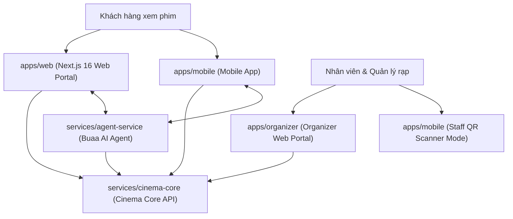

# Movie Booking Platform — Product Overview

## 1. Tầm nhìn sản phẩm (Product Vision)

**Movie Booking Platform** là hệ sinh thái đặt vé xem phim và quản lý rạp chiếu thế hệ mới, tích hợp **Trợ lý Trí tuệ Nhân tạo (Conversational AI Agent)** kết hợp cùng hệ thống giao dịch điện ảnh cốt lõi (**Cinema Core**).

Nền tảng phục vụ 2 nhóm người dùng chính:
1. **Khách hàng yêu điện ảnh (Moviegoers)**: Trải nghiệm đặt vé trực quan, hiện đại, nhanh chóng thông qua web và ứng dụng di động; hoặc tương tác tự nhiên với AI Agent để tìm phim, giữ chỗ và thanh toán ngay trong cuộc hội thoại.
2. **Nhà tổ chức & Cụm rạp (Cinema Operators & Organizers)**: Quản trị danh mục phim, trailer, cấu hình ma trận ghế phòng chiếu, sắp xếp lịch chiếu linh hoạt và theo dõi doanh thu thời gian thực.

---

## 2. Các phân hệ chính trong nền tảng (Platform Modules)

### 2.1. Ứng dụng Web Khách hàng (`apps/web`)
- Khám phá phim đang chiếu, sắp chiếu, trailer mosaic và điểm đánh giá CineScore.
- Bộ lọc phim thông minh theo thể loại, định dạng (2D, 3D, IMAX) và cụm rạp.
- Sơ đồ ghế động (64 ghế) hỗ trợ chọn ghế thường, VIP và ghế đôi Sweetbox.
- Không gian làm việc AI Agent (Agent Workspace) hỗ trợ đặt vé trọn vẹn từ tìm phim đến phát hành vé trong khung chat.
- Quản lý vé điện tử cá nhân kèm mã QR và lịch sử giao dịch.

### 2.2. Ứng dụng Di động (`apps/mobile`)
- Đặt vé tiện lợi, lưu vé xem phim offline không cần mạng khi đến rạp.
- Chế độ nhân viên rạp: Quét mã QR soát vé tại cửa phòng chiếu bằng camera điện thoại.

### 2.3. Cổng Quản trị Rạp chiếu (`apps/organizer`)
- Đăng tải phim, trailer, poster chất lượng cao.
- Thiết lập sơ đồ phòng chiếu và phân loại ghế.
- Lập lịch chiếu phim theo giao diện dòng thời gian (Timeline/Gantt view).
- Báo cáo doanh thu, tỷ lệ lấp đầy phòng chiếu (Occupancy rate) và đối soát tài chính.

### 2.4. Dịch vụ AI Agent (`services/agent-service`)
- Tiếp nhận ngôn ngữ tự nhiên, hiểu bối cảnh và điều phối lệnh gọi công cụ (Tool calling) tới Cinema Core.
- Luôn tuân thủ nguyên tắc an toàn: Phản hồi giao dịch dựa trên dữ liệu thật, không tự ý bịa đặt trạng thái xác nhận vé.

### 2.5. Dịch vụ Cinema Core (`services/cinema-core`)
- Nguồn thẩm quyền duy nhất (Single Source of Truth) về tồn kho, ghế, giá vé, khóa giữ chỗ (Hold TTL 5 phút) và thanh toán.
- Ký số mã QR vé điện tử chống làm giả vé.
