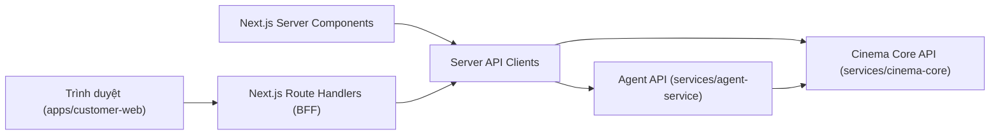

# Kiến trúc Frontend — Next.js App Router và Định hướng Microservices

**Trạng thái: Đã duyệt (Accepted), chuẩn hóa cho Movie Booking Platform Monorepo.**

**Phạm vi đọc:** định hướng kiến trúc đã duyệt, không phải bằng chứng toàn bộ luồng đã tích hợp
Core runtime. [CONTEXT](../../CONTEXT.md) ghi hiện trạng; [mô hình use case](../03-product/use-cases.md)
sở hữu mục tiêu/BR/OPEN. Sơ đồ kiến trúc dưới đây không cấp quyền mới cho actor.

Tài liệu này mô tả Customer Web; ba app còn lại có bối cảnh riêng theo
[ADR-0002](../06-decisions/0002-customer-organizer-app-boundaries.md), không kế thừa stack Next.js
chỉ từ việc dùng chung monorepo.

---

## 1. Quyết định kiến trúc (Architecture Decision)

Ứng dụng Web đặt vé (`apps/customer-web`) được xây dựng trên nền tảng **Next.js 16 App Router + React 19 + TypeScript**, tổ chức theo mô hình **Feature-Driven Architecture** (chia theo nghiệp vụ) với lớp **Backend for Frontend (BFF)** mỏng.

Khi hệ thống mở rộng và các dịch vụ backend (`services/cinema-core`, `services/agent-service`) phát triển thành các microservices độc lập, tầng Web Frontend tiếp tục sử dụng các hợp đồng dữ liệu (API Contracts) ổn định thông qua BFF.



> [!NOTE]
> **Hiện trạng mô phỏng tầng BFF:**
> Dịch vụ backend `services/cinema-core` là kiến trúc đích độc lập (theo [ADR-0001](../06-decisions/0001-monorepo-platform-and-microservices-boundaries.md)), hiện tại chưa triển khai runtime thực tế. Biến môi trường `CINEMA_CORE_URL` là ranh giới kiến trúc tương lai, chưa được đấu nối. Tầng BFF Route Handlers (`src/app/api/...`) hiện vận hành thông qua các in-memory adapters (`src/server/`) có độ trung thực cao, tuân thủ đúng hợp đồng `@platform/contracts`.


---

## 2. Cấu trúc thư mục ứng dụng Web (`apps/customer-web`)

```text
apps/customer-web/
├── public/                     # Tài nguyên tĩnh: fonts, icons, ảnh poster
├── src/
│   ├── app/                    # Next.js App Router
│   │   ├── (cinema)/           # Route group chính cho giao diện xem phim
│   │   │   ├── auth/           # Đăng nhập, đăng ký, quên mật khẩu
│   │   │   ├── booking/        # Chọn ghế, chọn combo
│   │   │   ├── chat/           # Không gian làm việc của AI Agent
│   │   │   ├── checkout/       # Thanh toán, kết quả đơn hàng
│   │   │   ├── cinemas/        # Danh mục rạp và cụm rạp
│   │   │   ├── movies/         # Chi tiết phim, trailer, lịch chiếu
│   │   │   ├── my-tickets/     # Danh sách vé và chi tiết vé điện tử QR
│   │   │   ├── profile/        # Hồ sơ cá nhân và sở thích CineMember
│   │   │   ├── search/         # Tìm kiếm và bộ lọc đa diện (Facets)
│   │   │   └── vouchers/       # Kho ưu đãi và mã giảm giá
│   │   ├── layout.tsx          # Root layout
│   │   └── page.tsx            # Trang chủ
│   ├── components/             # Layout components (Header, Footer, Navigation, Modal, Toast)
│   ├── features/               # Modules nghiệp vụ độc lập
│   │   ├── agent/              # Logic trò chuyện, streaming, thẻ tương tác
│   │   ├── auth/               # Validation định danh, độ mạnh mật khẩu, masking OTP
│   │   ├── booking/            # Sơ đồ theo phòng mục tiêu, Sweetbox coupling, hold timer
│   │   ├── payment/            # Tính giá, mã giảm giá, QR thanh toán
│   │   └── ...
│   └── styles/
│       ├── globals.css         # Reset CSS và layout toàn cục
│       └── tokens.css          # CSS Variables từ DESIGN.md
└── tests/                      # Bộ kiểm thử; bằng chứng chạy thuộc PR theo đúng bản code
```

---

## 3. Nguyên tắc phát triển và ranh giới phụ thuộc

Ma trận 64 ghế từng dùng trong mẫu/BFF không ràng buộc sản phẩm mục tiêu. Chênh lệch fixture hiện có
được ghi ở [mục 7 của mô hình](../03-product/use-cases.md#7-hiện-trạng-và-chênh-lệch-so-với-mục-tiêu);
cây thư mục minh họa trách nhiệm, không chứng minh màn hình/adapter đã phục vụ mọi use case.

1. **Server Components vs Client Components**:
   - Mặc định sử dụng Server Components để fetch dữ liệu từ Cinema Core.
   - Chỉ dùng Client Components (`"use client"`) cho các thành phần có tương tác: chọn ghế, chat streaming, bộ đếm ngược thời gian giữ vé, modal video trailer.
2. **Quản lý trạng thái (State Discipline)**:
   - Tách biệt rõ ràng giữa **UI State** (đang mở modal, tab đang chọn) và **Server/Transaction State** (ghế đang giữ, trạng thái thanh toán).
   - Trạng thái giao dịch tài chính luôn lấy trực tiếp từ Cinema Core API, không lưu tạm bợ tại Client State lâu dài.
3. **Tuân thủ quy chuẩn thiết kế**:
   - Sử dụng triệt để hệ thống CSS Variables từ `DESIGN.md` (Rosso Corsa, Carbone Nero, Notte Profonda, hairline borders, typography scale).
