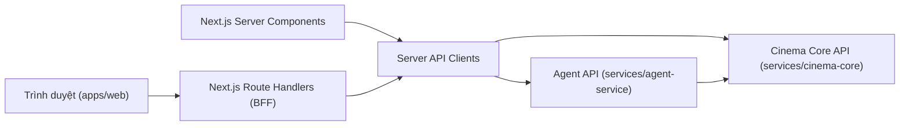

# Kiến trúc Frontend — Next.js App Router và Định hướng Microservices

**Trạng thái: Đã duyệt (Accepted), chuẩn hóa cho Movie Booking Platform Monorepo.**

**Phạm vi đọc:** định hướng kiến trúc đã duyệt, không phải bằng chứng toàn bộ luồng đã tích hợp
Core runtime. [CONTEXT](../../CONTEXT.md) ghi hiện trạng; [mô hình use case](../03-product/use-cases.md)
sở hữu mục tiêu/BR/OPEN. Sơ đồ kiến trúc dưới đây không cấp quyền mới cho actor.

---

## 1. Quyết định kiến trúc (Architecture Decision)

Ứng dụng Web đặt vé (`apps/web`) được xây dựng trên nền tảng **Next.js 16 App Router + React 19 + TypeScript**, tổ chức theo mô hình **Feature-Driven Architecture** (chia theo nghiệp vụ) với lớp **Backend for Frontend (BFF)** mỏng.

Organizer Portal (`apps/organizer`) chọn **React 19 + TypeScript + Vite + TanStack Router SPA** theo
[ADR-0015](../06-decisions/0015-react-vite-and-tanstack-router-for-organizer.md). Build assets tĩnh,
gọi API có xác thực; Core kiểm quyền theo actor/rạp. Các phần Next.js/RSC/BFF và sơ đồ bên dưới
áp dụng cho `apps/web`, không mặc định áp dụng cho Organizer. Chưa scaffold hoặc xác nhận runtime Organizer.

Mobile (`apps/mobile`) giữ React Native/Expo, chọn Expo Router, development builds, expo-camera
và expo-secure-store theo [ADR-0016](../06-decisions/0016-expo-router-and-mobile-native-foundation.md).
Theme native bám Ferrari Dark Cinema; kho vé offline chọn MMKV mã hóa/SecureStore theo
[ADR-0023](../06-decisions/0023-encrypted-mmkv-for-offline-mobile-tickets.md).
Client SSE dùng browser fetch trên Web, expo/fetch trên Mobile và eventsource-parser chung theo
[ADR-0024](../06-decisions/0024-fetch-and-eventsource-parser-for-sse-clients.md).
Chưa tích hợp hoặc xác nhận native/streaming runtime; lifecycle, auth delivery và phục hồi còn cần đặc tả.

Đồng bộ ghế từ Core chọn SSE báo thay đổi + TanStack Query lấy snapshot theo
[ADR-0029](../06-decisions/0029-core-sse-and-query-for-seat-map-synchronization.md), tách stream Agent.
Tái dùng fetch/parser trên các client, giữ polling fallback/resync định kỳ và refresh khi resume/hết hạn.
Không tự xác nhận giữ thành công từ event/cache; contract/revision, chu kỳ và runtime còn cần kiểm chứng.

Form nghiệp vụ trên các kênh chọn **React Hook Form + resolvers + Zod 4** theo
[ADR-0025](../06-decisions/0025-react-hook-form-and-zod-for-frontend-forms.md); form nhỏ có thể dùng React state.
Form engine giữ input/errors/dirty/reset; Query/Zustand giữ trách nhiệm riêng theo ADR-0017.
Tái dùng hợp đồng phù hợp, chuẩn hóa draft tại ranh giới gửi; Core vẫn kiểm quyền/dữ liệu/nghiệp vụ.
Chưa cài, migrate form hoặc kiểm SSR/native; giao diện tiếp tục theo DESIGN.md/tokens.

Nền hành vi component tương tác trên **Web/Organizer** chọn **React Aria Components** theo
[ADR-0026](../06-decisions/0026-react-aria-components-for-web-ui-primitives.md).
Chia sẻ component thực sự dùng chung ở `packages/ui`, style bằng CSS modules/tokens hiện có;
tái dùng control đơn giản, không yêu cầu rewrite UI. Mobile giữ component native riêng.
Chưa cài hoặc kiểm SSR, focus/bàn phím/screen reader, bundle và UI runtime.

Khi hệ thống mở rộng và các dịch vụ backend (`services/cinema-core`, `services/agent-service`) phát triển thành các microservices độc lập, tầng Web Frontend tiếp tục sử dụng các hợp đồng dữ liệu (API Contracts) ổn định thông qua BFF.



> [!NOTE]
> **Hiện trạng mô phỏng tầng BFF:**
> Dịch vụ backend `services/cinema-core` là kiến trúc đích độc lập (theo [ADR-0001](../06-decisions/0001-monorepo-platform-and-microservices-boundaries.md)), hiện tại chưa triển khai runtime thực tế. Biến môi trường `CINEMA_CORE_URL` là ranh giới kiến trúc tương lai, chưa được đấu nối. Tầng BFF Route Handlers (`src/app/api/...`) dùng các in-memory adapters (`src/server/`) và contracts hiện có; chưa xác nhận tương thích toàn bộ yêu cầu mục tiêu, pipeline hợp đồng ADR-0014 hoặc Core runtime. Nguồn đối chiếu và giới hạn theo [CONTEXT](../../CONTEXT.md).


---

## 2. Cấu trúc thư mục ứng dụng Web (`apps/web`)

```text
apps/web/
├── public/                     # Tài nguyên tĩnh: fonts, icons, ảnh poster
├── src/
│   ├── app/                    # Next.js App Router
│   │   ├── (cinema)/           # Route group chính cho giao diện xem phim
│   │   │   ├── auth/           # Đăng nhập, đăng ký, quên mật khẩu
│   │   │   ├── booking/        # Chọn ghế, chọn combo
│   │   │   ├── chat/           # Không gian làm việc của AI Agent
│   │   │   ├── checkout/       # Thanh toán, kết quả đơn hàng
│   │   │   ├── cinemas/        # Danh mục rạp và cụm rạp
│   │   │   ├── movies/         # Chi tiết phim, trailer, lịch chiếu
│   │   │   ├── my-tickets/     # Danh sách vé và chi tiết vé điện tử QR
│   │   │   ├── profile/        # Hồ sơ cá nhân và sở thích CineMember
│   │   │   ├── search/         # Tìm kiếm và bộ lọc đa diện (Facets)
│   │   │   └── vouchers/       # Kho ưu đãi và mã giảm giá
│   │   ├── layout.tsx          # Root layout
│   │   └── page.tsx            # Trang chủ
│   ├── components/             # Layout components (Header, Footer, Navigation, Modal, Toast)
│   ├── features/               # Modules nghiệp vụ độc lập
│   │   ├── agent/              # Logic trò chuyện, streaming, thẻ tương tác
│   │   ├── auth/               # Validation định danh, độ mạnh mật khẩu, masking OTP
│   │   ├── booking/            # Sơ đồ theo phòng mục tiêu, Sweetbox coupling, hold timer
│   │   ├── payment/            # Tính giá, mã giảm giá, QR thanh toán
│   │   └── ...
│   └── styles/
│       ├── globals.css         # Reset CSS và layout toàn cục
│       └── tokens.css          # CSS Variables từ DESIGN.md
└── tests/                      # Bộ kiểm thử; bằng chứng chạy thuộc PR theo đúng bản code
```

---

## 3. Nguyên tắc phát triển và ranh giới phụ thuộc

Ma trận 64 ghế từng dùng trong mẫu/BFF không ràng buộc sản phẩm mục tiêu. Chênh lệch fixture hiện có
được ghi ở [mục 7 của mô hình](../03-product/use-cases.md#7-hiện-trạng-và-chênh-lệch-so-với-mục-tiêu);
cây thư mục minh họa trách nhiệm, không chứng minh màn hình/adapter đã phục vụ mọi use case.

1. **Server Components vs Client Components**:
   - Mặc định sử dụng Server Components để fetch dữ liệu từ Cinema Core.
   - Chỉ dùng Client Components (`"use client"`) cho các thành phần có tương tác: chọn ghế, chat streaming, bộ đếm ngược thời gian giữ vé, modal video trailer.
2. **Quản lý trạng thái (State Discipline)**:
   - Tách biệt rõ ràng giữa **UI State** (đang mở modal, tab đang chọn) và **Server/Transaction State** (ghế đang giữ, trạng thái thanh toán).
   - Trạng thái giao dịch tài chính luôn lấy trực tiếp từ Cinema Core API, không lưu tạm bợ tại Client State lâu dài.
   - Chọn TanStack Query cho snapshot API phía client, Zustand có phạm vi cho UI draft chia sẻ,
     React local state mặc định và router/URL cho filters theo
     [ADR-0017](../06-decisions/0017-tanstack-query-and-zustand-for-frontend-state.md).
     Giữ RSC server fetch; QueryClient/store SSR theo request, không dùng chung dữ liệu người dùng.
     Cache/refetch không thay Core hoặc tự gia hạn hold; chưa cài thư viện/kiểm chứng runtime.
3. **Tuân thủ quy chuẩn thiết kế**:
   - Sử dụng triệt để hệ thống CSS Variables từ `DESIGN.md` (Rosso Corsa, Carbone Nero, Notte Profonda, hairline borders, typography scale).
