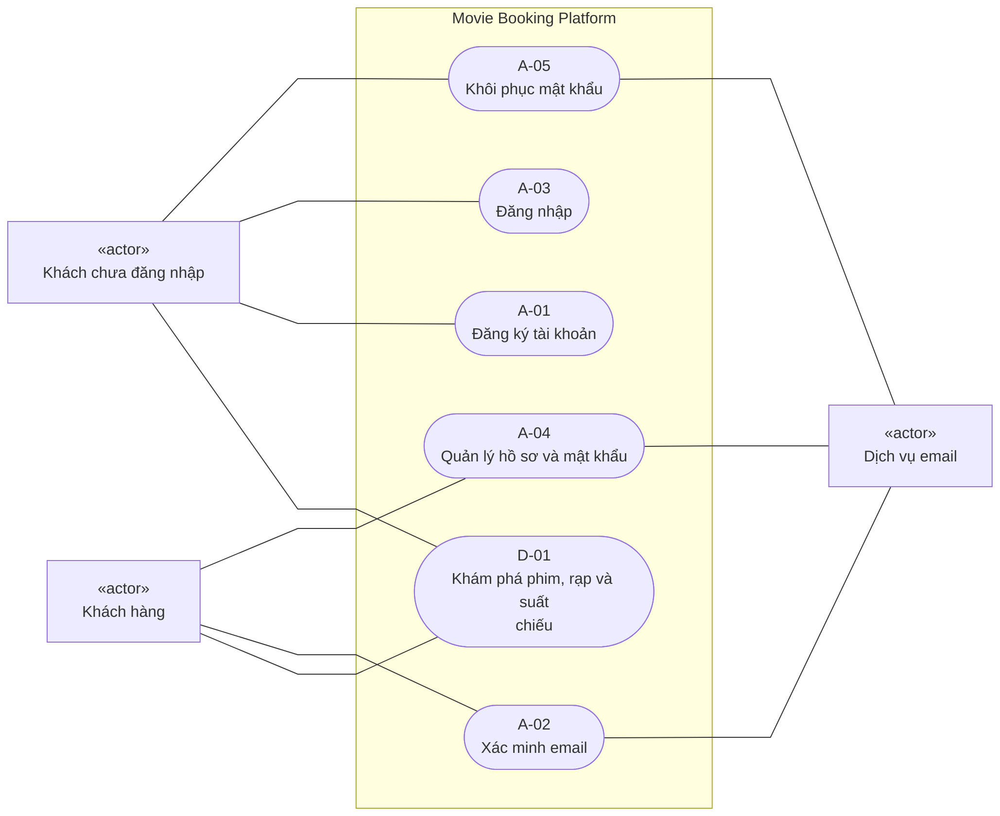
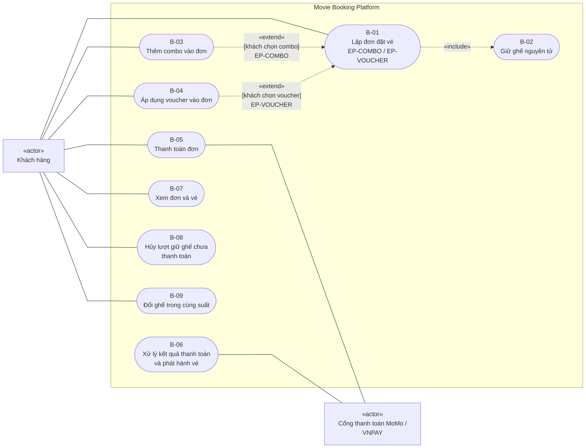
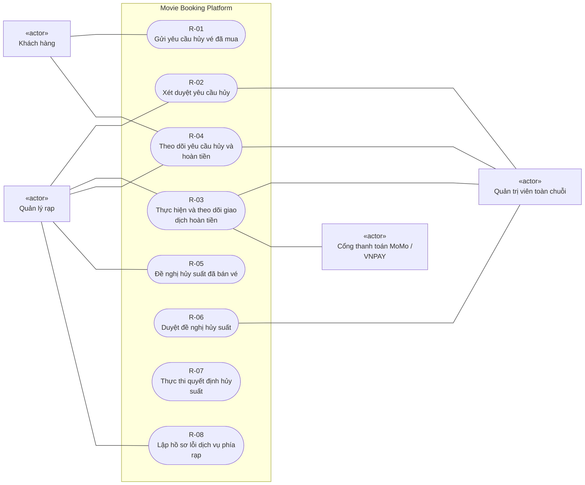
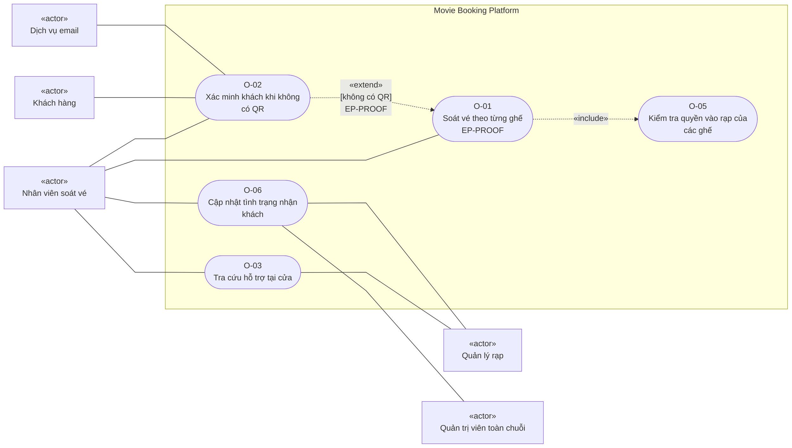
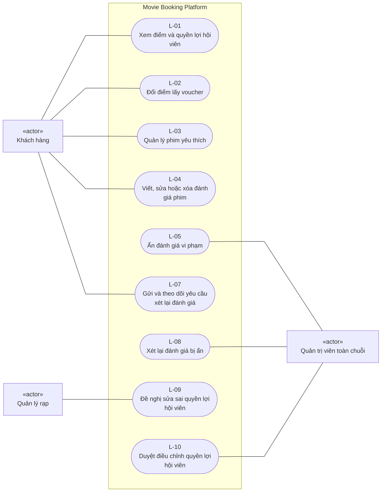
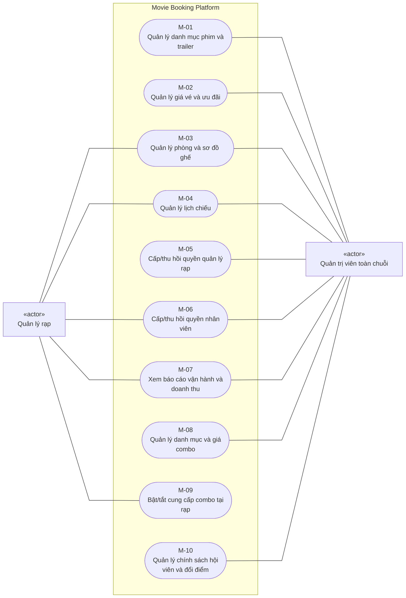
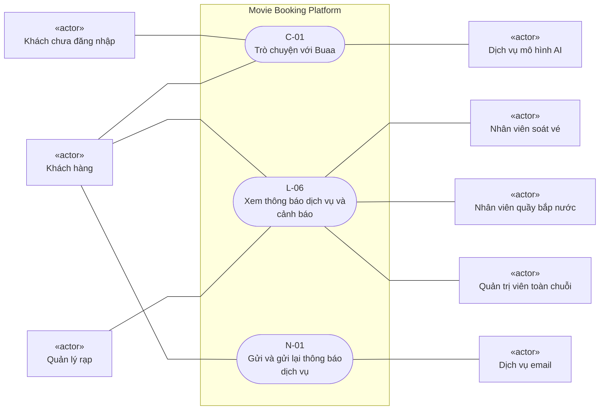
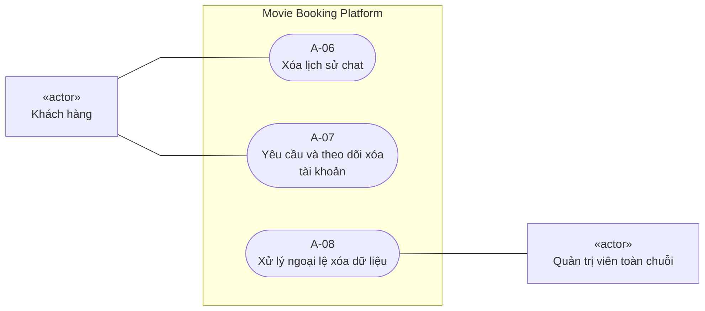
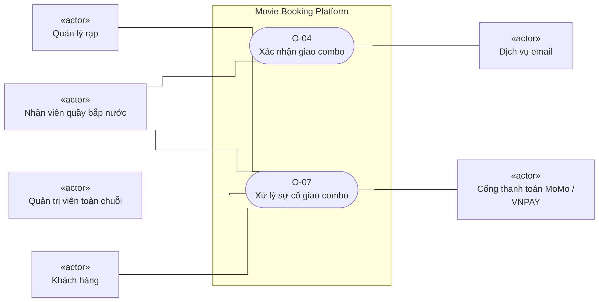

# UML use case — Movie Booking Platform

**Trạng thái:** mô hình sản phẩm mục tiêu, đồng bộ theo xác nhận tổng hợp Q173-A ngày 2026-11-17.
**Nguồn quyết định:** các vòng Q1–Q30 và xác nhận bản tổng hợp Q31 trong hội thoại thiết kế
use case. Phê duyệt này không phải bằng chứng triển khai, kiểm thử, hợp nhất hoặc triển khai vận hành.

**Đồng bộ bổ sung:** quyết định Q32–Q172 và xác nhận cách hiểu chung Q173 được lưu tại
[mục 6.1](#61-quyết-định-đã-xác-nhận). General, ánh xạ, chi tiết, danh mục, BR và mô tả
đã cập nhật theo các lựa chọn này. Đây là yêu cầu mục tiêu; khả năng tích hợp/pháp lý còn ở mục 6.2.

## Cách đọc

- Khi tạo hoặc cập nhật bộ sơ đồ, tuân theo [quy chuẩn phân tích và trình bày use case](../04-standards/use-case-modeling.md).
- Tài liệu này sở hữu mô hình actor, mục tiêu, quan hệ UML và quyết định sản phẩm của bộ use case.
- [Mô tả use case](use-case-descriptions.md) diễn giải các tình huống, điều kiện và kết quả.
- [Thuật ngữ](../../GLOSSARY.md) phân biệt đơn hàng, vé theo ghế, QR chung và lượt soát vé.
- Các sơ đồ nằm ngay trong mục 2 dưới dạng mã Mermaid, không cần file ảnh hoặc trang xem riêng.
- `OPEN-*` giữ nhóm truy vết và phần phụ thuộc còn lại; lựa chọn đã chốt ở mục 6.1 không bị mở lại vì mã OPEN vẫn tồn tại.
- Các sơ đồ là những góc nhìn của cùng một hệ thống, không phải các hệ thống con có actor nội bộ.

## 1. Ranh giới và phạm vi

Subject của mọi sơ đồ là **Movie Booking Platform**, phục vụ **một đơn vị/chuỗi rạp**.
Web khách hàng, Mobile, Organizer Portal, AI Agent và Cinema Core đều nằm bên trong ranh giới.
Các kênh được tổ chức thành bốn app theo
[ADR-0002](../06-decisions/0002-customer-organizer-app-boundaries.md); việc chuyển trải nghiệm
nhân viên sang Organizer Mobile không đổi actor, mục tiêu hoặc BR/OPEN của mô hình.
Web/Mobile là kênh tương tác, không phải actor. Buaa/Agent Service và Core không được vẽ thành actor của toàn nền tảng; ACT-LLM là dịch vụ ngoài khác với Buaa.

Phạm vi gồm khám phá phim/rạp/suất chiếu; tài khoản; đặt vé trực tiếp và trong chat;
combo và ưu đãi; thanh toán; vé điện tử; hỗ trợ hủy/hoàn tiền; soát vé; giao combo;
đánh giá/yêu thích; hội viên/điểm/đổi voucher; quản trị chuỗi, vận hành rạp và báo cáo.

Không bổ sung bán vé tiền mặt tại quầy, quản lý kho nguyên liệu vật lý, sàn nhiều đơn vị rạp độc lập,
soát vé ngoại tuyến hoặc thuật toán đề xuất phim phức tạp. Các mục này không được suy ra từ chữ
“sản phẩm thực tế”. Đổi vị trí ghế trong cùng suất thuộc B-09 theo Q34–Q44; đổi sang suất khác vẫn ngoài phạm vi.

### Actor

| Mã | Actor | Phạm vi tương tác |
|---|---|---|
| ACT-GUEST | Khách chưa đăng nhập | Khám phá/thảo luận thông tin công khai qua Buaa, đọc đánh giá, đăng ký, đăng nhập, khôi phục tài khoản. A-03/A-05 là điểm vào khi chưa đăng nhập, kể cả người có tài khoản vận hành. |
| ACT-CUSTOMER | Khách hàng | Hành động với tài khoản, đơn/vé, điểm và đánh giá thuộc quyền của mình. Giữ ghế/mua vé cần đăng nhập và email đã xác minh. |
| ACT-SCANNER | Nhân viên soát vé | Tra cứu/soát từng ghế, xác nhận phòng sẵn sàng và suất kết thúc thực tế tại rạp được giao; không duyệt hoàn tiền hay giao combo nếu chưa được cấp vai trò tương ứng. |
| ACT-CONCESSION | Nhân viên quầy bắp nước | Tra cứu và xác nhận giao combo tại rạp được giao; không mặc định có quyền soát vé hoặc duyệt hoàn tiền. |
| ACT-MANAGER | Quản lý rạp | Phòng/ghế, lịch chiếu, quyền nhân viên và báo cáo của rạp được giao; xét yêu cầu hủy theo chính sách; đề nghị hủy suất; bật/tắt combo, lập hồ sơ lỗi dịch vụ, đề nghị sửa sai hội viên, giám sát nhận khách và duyệt ngoại lệ combo đúng phạm vi. |
| ACT-ADMIN | Quản trị viên toàn chuỗi | Danh mục phim, giá/ưu đãi, quyền quản lý rạp, báo cáo toàn chuỗi, quản lý tổng thể; ngoại lệ hoàn tiền, duyệt hủy suất, kiểm duyệt/xét lại đánh giá, chính sách/sửa sai hội viên, danh mục combo, ngoại lệ xóa dữ liệu được giao. |
| ACT-PAY | Cổng thanh toán | Thu tiền, cung cấp kết quả/đối soát và xử lý hoàn tiền; phạm vi là MoMo, VNPAY. |
| ACT-MAIL | Dịch vụ email | Chuyển email xác minh, khôi phục, mã xác nhận và thông báo dịch vụ. Nhà cung cấp chưa chọn. |
| ACT-LLM | Dịch vụ mô hình AI | API mô hình bên ngoài hỗ trợ hiểu/trả lời Buaa qua Agent Service; chỉ nhận dữ liệu tối thiểu đã lọc theo quyền. Chưa chọn nhà cung cấp/mô hình. |

Actor là vai trò, không phải mỗi actor một con người hoặc một tài khoản bắt buộc.
Một người có thể được cấp cả hai vai trò nhân viên. Không dùng kế thừa actor để ngầm cấp quyền
soát vé/giao combo cho quản lý, hoặc quyền của khách hàng cho tài khoản vận hành.
Q151–Q154 phân biệt Agent Service nội bộ với ACT-LLM bên ngoài. Vai trò dịch vụ ngoài không cấp
quyền gọi Core trực tiếp, xem toàn hồ sơ hoặc xác nhận giao dịch. Nhà cung cấp còn là phụ thuộc đặc tả.

## 2. Sơ đồ use case: tổng quát đến chi tiết

Đọc **General → bảng ánh xạ → chi tiết**, rồi đối chiếu mô tả/quy tắc. Mermaid `flowchart`
biểu diễn UML use case: hộp `«actor»` ở ngoài khung, nút bo tròn là mục tiêu, `---` là association
không hướng; nét đứt có nhãn tuân theo mục 5. Đây không phải sơ đồ thứ tự xử lý.
Core, Agent Service và các app ở bên trong nền tảng; dịch vụ mô hình AI bên ngoài là ACT-LLM.

### 2.1. Sơ đồ use case tổng quát (General)

General gồm **9 actor, 50 use case chính**; năm hành vi hỗ trợ nằm ở chi tiết.
Mỗi actor có một nút duy nhất trong từng sơ đồ; G-01…G-10 chỉ là khung nhóm, không cấp quyền.
Giữ cỡ chữ tự nhiên: mở preview toàn màn hình, cuộn/thu phóng khi cần; dùng các góc nhìn chi tiết
để đọc từng nhóm. Điểm giao đường không phải phần tử UML mới. Không thêm quan hệ để ép bố cục.

```mermaid
%%{init: {"flowchart":{"nodeSpacing":60,"rankSpacing":120,"curve":"stepAfter","useMaxWidth":false,"padding":18}}}%%
flowchart LR
    %% Mỗi actor có một ID duy nhất; các khung G chỉ gom bố cục.
    guest["«actor»<br/>Khách chưa đăng nhập"]
    customer["«actor»<br/>Khách hàng"]
    scanner["«actor»<br/>Nhân viên soát vé"]
    concession["«actor»<br/>Nhân viên quầy bắp nước"]
    manager["«actor»<br/>Quản lý rạp"]
    admin["«actor»<br/>Quản trị viên toàn chuỗi"]
    pay["«actor»<br/>Cổng thanh toán MoMo /<br/>VNPAY"]
    mail["«actor»<br/>Dịch vụ email"]
    llm["«actor»<br/>Dịch vụ mô hình AI"]
    subgraph system["Movie Booking Platform"]
        subgraph group_G_02["G-02 · Khám phá"]
            D_01(["D-01<br/>Khám phá phim, rạp và suất<br/>chiếu"])
        end
        subgraph group_G_01["G-01 · Tài khoản"]
            A_01(["A-01<br/>Đăng ký tài khoản"])
            A_02(["A-02<br/>Xác minh email"])
            A_03(["A-03<br/>Đăng nhập"])
            A_04(["A-04<br/>Quản lý hồ sơ và mật khẩu"])
            A_05(["A-05<br/>Khôi phục mật khẩu"])
        end
        subgraph group_G_10["G-10 · Xóa chat, tài khoản và dữ liệu"]
            A_06(["A-06<br/>Xóa lịch sử chat"])
            A_07(["A-07<br/>Yêu cầu và theo dõi xóa<br/>tài khoản"])
            A_08(["A-08<br/>Xử lý ngoại lệ xóa dữ liệu"])
        end
        subgraph group_G_03["G-03 · Đặt vé, thanh toán và đổi ghế"]
            B_01(["B-01<br/>Lập đơn đặt vé"])
            B_03(["B-03<br/>Thêm combo vào đơn"])
            B_04(["B-04<br/>Áp dụng voucher vào đơn"])
            B_05(["B-05<br/>Thanh toán đơn"])
            B_07(["B-07<br/>Xem đơn và vé"])
            B_08(["B-08<br/>Hủy lượt giữ ghế chưa<br/>thanh toán"])
            B_09(["B-09<br/>Đổi ghế trong cùng suất"])
        end
        subgraph group_G_04["G-04 · Hủy, hoàn tiền và hủy suất"]
            R_01(["R-01<br/>Gửi yêu cầu hủy vé đã mua"])
            R_02(["R-02<br/>Xét duyệt yêu cầu hủy"])
            R_03(["R-03<br/>Thực hiện và theo dõi giao<br/>dịch hoàn tiền"])
            R_04(["R-04<br/>Theo dõi yêu cầu hủy và<br/>hoàn tiền"])
            R_05(["R-05<br/>Đề nghị hủy suất đã bán vé"])
            R_06(["R-06<br/>Duyệt đề nghị hủy suất"])
            R_08(["R-08<br/>Lập hồ sơ lỗi dịch vụ phía<br/>rạp"])
        end
        subgraph group_G_05["G-05 · Soát vé và nhận khách"]
            O_01(["O-01<br/>Soát vé theo từng ghế"])
            O_03(["O-03<br/>Tra cứu hỗ trợ tại cửa"])
            O_06(["O-06<br/>Cập nhật tình trạng nhận<br/>khách"])
        end
        subgraph group_G_06["G-06 · Giao combo và xử lý sự cố"]
            O_04(["O-04<br/>Xác nhận giao combo"])
            O_07(["O-07<br/>Xử lý sự cố giao combo"])
        end
        subgraph group_G_07["G-07 · Cộng đồng và hội viên"]
            L_01(["L-01<br/>Xem điểm và quyền lợi hội<br/>viên"])
            L_02(["L-02<br/>Đổi điểm lấy voucher"])
            L_03(["L-03<br/>Quản lý phim yêu thích"])
            L_04(["L-04<br/>Viết, sửa hoặc xóa đánh<br/>giá phim"])
            L_05(["L-05<br/>Ẩn đánh giá vi phạm"])
            L_07(["L-07<br/>Gửi và theo dõi yêu cầu<br/>xét lại đánh giá"])
            L_08(["L-08<br/>Xét lại đánh giá bị ẩn"])
            L_09(["L-09<br/>Đề nghị sửa sai quyền lợi<br/>hội viên"])
            L_10(["L-10<br/>Duyệt điều chỉnh quyền lợi<br/>hội viên"])
        end
        subgraph group_G_09["G-09 · Buaa và thông báo dịch vụ"]
            L_06(["L-06<br/>Xem thông báo dịch vụ và<br/>cảnh báo"])
            C_01(["C-01<br/>Trò chuyện với Buaa"])
            N_01(["N-01<br/>Gửi và gửi lại thông báo<br/>dịch vụ"])
        end
        subgraph group_G_08["G-08 · Vận hành và quản trị"]
            M_01(["M-01<br/>Quản lý danh mục phim và<br/>trailer"])
            M_02(["M-02<br/>Quản lý giá vé và ưu đãi"])
            M_03(["M-03<br/>Quản lý phòng và sơ đồ ghế"])
            M_04(["M-04<br/>Quản lý lịch chiếu"])
            M_05(["M-05<br/>Cấp/thu hồi quyền quản lý<br/>rạp"])
            M_06(["M-06<br/>Cấp/thu hồi quyền nhân<br/>viên"])
            M_07(["M-07<br/>Xem báo cáo vận hành và<br/>doanh thu"])
            M_08(["M-08<br/>Quản lý danh mục và giá<br/>combo"])
            M_09(["M-09<br/>Bật/tắt cung cấp combo tại<br/>rạp"])
            M_10(["M-10<br/>Quản lý chính sách hội<br/>viên và đổi điểm"])
        end
    end
    guest --- D_01
    customer --- D_01
    guest --- A_01
    customer --- A_02
    A_02 --- mail
    guest --- A_03
    customer --- A_04
    A_04 --- mail
    guest --- A_05
    A_05 --- mail
    customer --- A_06
    customer --- A_07
    A_08 --- admin
    customer --- B_01
    customer --- B_03
    customer --- B_04
    customer --- B_05
    B_05 --- pay
    customer --- B_07
    customer --- B_08
    customer --- B_09
    customer --- R_01
    manager --- R_02
    R_02 --- admin
    manager --- R_03
    R_03 --- admin
    R_03 --- pay
    customer --- R_04
    manager --- R_04
    R_04 --- admin
    manager --- R_05
    R_06 --- admin
    manager --- R_08
    O_01 --- scanner
    O_03 --- scanner
    manager --- O_03
    O_04 --- concession
    O_04 --- mail
    O_06 --- scanner
    manager --- O_06
    O_06 --- admin
    O_07 --- concession
    manager --- O_07
    O_07 --- admin
    customer --- O_07
    O_07 --- pay
    customer --- L_01
    customer --- L_02
    customer --- L_03
    customer --- L_04
    L_05 --- admin
    customer --- L_06
    L_06 --- scanner
    L_06 --- concession
    manager --- L_06
    L_06 --- admin
    customer --- L_07
    L_08 --- admin
    manager --- L_09
    L_10 --- admin
    M_01 --- admin
    M_02 --- admin
    manager --- M_03
    M_03 --- admin
    manager --- M_04
    M_04 --- admin
    M_05 --- admin
    manager --- M_06
    M_06 --- admin
    manager --- M_07
    M_07 --- admin
    M_08 --- admin
    manager --- M_09
    M_10 --- admin
    guest --- C_01
    customer --- C_01
    C_01 --- llm
    customer --- N_01
    N_01 --- mail
```

### 2.2. Bảng phân rã chức năng

| Nhóm | Mục tiêu chính trên General | Hỗ trợ ở chi tiết | Sơ đồ chi tiết |
|---|---|---|---|
| G-01 — Tài khoản | `A-01`, `A-02`, `A-03`, `A-04`, `A-05` | — | [2.3.1. Tài khoản và khám phá](#231-tài-khoản-và-khám-phá) |
| G-02 — Khám phá | `D-01` | — | [2.3.1. Tài khoản và khám phá](#231-tài-khoản-và-khám-phá) |
| G-03 — Đặt vé, thanh toán và đổi ghế | `B-01`, `B-03`, `B-04`, `B-05`, `B-07`, `B-08`, `B-09` | `B-02`, `B-06` | [2.3.2. Đặt vé và thanh toán](#232-đặt-vé-và-thanh-toán) |
| G-04 — Hủy, hoàn tiền và hủy suất | `R-01`, `R-02`, `R-03`, `R-04`, `R-05`, `R-06`, `R-08` | `R-07` | [2.3.3. Hủy, hoàn tiền và hủy suất](#233-hủy-hoàn-tiền-và-hủy-suất) |
| G-05 — Soát vé và nhận khách | `O-01`, `O-03`, `O-06` | `O-02`, `O-05` | [2.3.4. Soát vé và nhận khách](#234-soát-vé-và-nhận-khách) |
| G-06 — Giao combo và xử lý sự cố | `O-04`, `O-07` | — | [2.3.9. Giao combo và sự cố](#239-giao-combo-và-sự-cố) |
| G-07 — Cộng đồng và hội viên | `L-01`, `L-02`, `L-03`, `L-04`, `L-05`, `L-07`, `L-08`, `L-09`, `L-10` | — | [2.3.5. Cộng đồng và hội viên](#235-cộng-đồng-và-hội-viên) |
| G-08 — Vận hành và quản trị | `M-01`, `M-02`, `M-03`, `M-04`, `M-05`, `M-06`, `M-07`, `M-08`, `M-09`, `M-10` | — | [2.3.6. Vận hành và quản trị](#236-vận-hành-và-quản-trị) |
| G-09 — Buaa và thông báo dịch vụ | `L-06`, `C-01`, `N-01` | — | [2.3.7. Buaa và thông báo dịch vụ](#237-buaa-và-thông-báo-dịch-vụ) |
| G-10 — Xóa chat, tài khoản và dữ liệu | `A-06`, `A-07`, `A-08` | — | [2.3.8. Xóa chat, tài khoản và dữ liệu](#238-xóa-chat-tài-khoản-và-dữ-liệu) |

Danh mục có **55 use case**: 50 mục tiêu chính và 5 hành vi hỗ trợ.
B-02/O-05 dùng actor thông qua use case gọi; B-06 phối hợp cổng với nhánh 0đ không gọi cổng;
O-02 chỉ chạy khi thiếu QR; R-07 do quyết định đã duyệt kích hoạt, không thêm actor “System”.
Các sự kiện gửi email được quy về N-01; đọc thông báo L-06 không đồng nghĩa dịch vụ email tham gia
vào thao tác đọc. Những use case có email xác minh/mã chứng minh trực tiếp vẫn nối ACT-MAIL.

### 2.3. Sơ đồ use case chi tiết

#### 2.3.1. Tài khoản và khám phá

Phiên đăng nhập là điều kiện trước. A-03/A-05 là điểm vào chung khi chưa đăng nhập, kể cả người có vai trò vận hành; không cấp thêm quyền từ việc đăng nhập. A-04 xác minh email cũ/mới qua ACT-MAIL; A-06…A-08 tách ở 2.3.8.

#### 2.3.2. Đặt vé và thanh toán

B-01 có EP-COMBO/EP-VOUCHER. B-06 chỉ phát hành theo Core, kể cả nhánh 0đ được khách xác nhận; không suy thanh toán thành vé. B-09 là mục tiêu sau mua độc lập, không extend B-01. Thông báo phát hành/đổi ghế qua N-01.

#### 2.3.3. Hủy, hoàn tiền và hủy suất

R-08 lập hồ sơ lỗi dịch vụ; R-02 là quyết định hủy và R-03 là tiến trình tiền độc lập. Quản lý chỉ theo dõi/đề nghị trong R-03; quản trị viên xử lý ngoại lệ qua Core. R-07 chạy sau R-06, gửi thông báo qua N-01; không vẽ include/extend chỉ để nói chạy sau.

#### 2.3.4. Soát vé và nhận khách

O-05 bắt buộc trước ghi nhận sử dụng. O-06 phân quyền theo thao tác: nhân viên xác nhận sẵn sàng/kết thúc; quản lý giám sát/tạm dừng và quản lý hoặc quản trị sửa kết thúc nhầm. Giao combo và sự cố xem 2.3.9; không cấp quyền giao thường ngày cho người duyệt.

#### 2.3.5. Cộng đồng và hội viên

L-07 là yêu cầu của tác giả, L-08 là quyết định của quản trị viên khác người ẩn; không extend việc viết bài. L-09 chỉ đề nghị, L-10 mới duyệt điều chỉnh. Thông báo quyền lợi/kiểm duyệt qua N-01; cộng điểm sau soát là hệ quả giao dịch, không include “Xem điểm” vào soát.

#### 2.3.6. Vận hành và quản trị

M-08 quản trị danh mục/giá, M-09 bật/tắt tại rạp được giao; M-10 là chính sách hội viên, khác L-10 sửa sai từng giao dịch. M-07 chỉ số tổng hợp không mở quyền đọc hồ sơ khách.

#### 2.3.7. Buaa và thông báo dịch vụ

C-01 là mục tiêu hội thoại; các giao dịch thực hiện theo B-*/R-* được cho phép, không include mọi giao dịch vào mọi cuộc chat. N-01 sở hữu gửi email dịch vụ từ các sự kiện; khách yêu cầu gửi lại theo quyền. L-06 chỉ xem thông báo/cảnh báo theo trách nhiệm, không cấp quyền xử lý hồ sơ của vai trò khác.

#### 2.3.8. Xóa chat, tài khoản và dữ liệu

A-06 xử lý xóa chat chủ động; A-07 xử lý xóa tài khoản và theo dõi quyền cũ khi chờ đóng. A-08 chỉ xử lý phần ngoại lệ với quyền tối thiểu; không bắt duyệt mọi lần xóa. Các mục tiêu này dùng màn hình Customer, không tự cấp Buaa quyền xóa. Thông báo kết quả qua N-01.

#### 2.3.9. Giao combo và sự cố

O-04 là giao thường ngày của nhân viên quầy. O-07: nhân viên báo/thực hiện giao bù đã duyệt,
quản lý/quản trị xác minh và duyệt, khách đồng ý phương án thay/thu thêm, cổng xử lý tiền.
ACT-MAIL chỉ nhánh chứng minh quyền nhận thiếu QR. Người duyệt không tự có quyền giao thường ngày.

## 3. Danh mục use case

| Mã | Mục tiêu | Actor trực tiếp chính/phối hợp | Quyết định |
|---|---|---|---|
| D-01 | Khám phá phim, rạp và suất chiếu | Khách chưa đăng nhập; Khách hàng | Q1–Q4, Q22, Q139, Q144–Q145 |
| A-01 | Đăng ký tài khoản | Khách chưa đăng nhập | Q19, Q21, Q25 |
| A-02 | Xác minh email | Khách hàng; Dịch vụ email | Q19, Q149, Q154 |
| A-03 | Đăng nhập | Khách chưa đăng nhập | Q4, Q19, Q21, Q163 |
| A-04 | Quản lý hồ sơ và mật khẩu | Khách hàng; Dịch vụ email | Q22, Q162–Q163 |
| A-05 | Khôi phục mật khẩu | Khách chưa đăng nhập; Dịch vụ email | Q19, Q163 |
| A-06 | Xóa lịch sử chat | Khách hàng | Q164–Q165, Q169–Q170 |
| A-07 | Yêu cầu và theo dõi xóa tài khoản | Khách hàng | Q166–Q170 |
| A-08 | Xử lý ngoại lệ xóa dữ liệu | Quản trị viên toàn chuỗi | Q168–Q170 |
| B-01 | Lập đơn đặt vé | Khách hàng | Q8–Q9, Q49, Q128 |
| B-02 | Giữ ghế nguyên tử | Khách hàng qua B-01 | Q9, Q49 |
| B-03 | Thêm combo vào đơn | Khách hàng | Q22, Q53 |
| B-04 | Áp dụng voucher vào đơn | Khách hàng | Q74–Q87, Q110–Q113, Q171 |
| B-05 | Thanh toán đơn | Khách hàng; Cổng thanh toán MoMo / VNPAY | Q15, Q45, Q49, Q77, Q118 |
| B-06 | Xử lý kết quả thanh toán và phát hành vé | Cổng thanh toán MoMo / VNPAY | Q8, Q15, Q47, Q77, Q101 |
| B-07 | Xem đơn và vé | Khách hàng | Q16, Q22, Q30, Q133 |
| B-08 | Hủy lượt giữ ghế chưa thanh toán | Khách hàng | Q9–Q10 |
| B-09 | Đổi ghế trong cùng suất | Khách hàng | Q34–Q44, Q46 |
| R-01 | Gửi yêu cầu hủy vé đã mua | Khách hàng | Q10–Q14, Q30, Q61–Q67, Q121 |
| R-02 | Xét duyệt yêu cầu hủy | Quản lý rạp; Quản trị viên toàn chuỗi | Q11, Q13, Q51, Q61–Q73, Q120–Q121, Q132, Q134–Q135, Q172 |
| R-03 | Thực hiện và theo dõi giao dịch hoàn tiền | Quản lý rạp; Quản trị viên toàn chuỗi; Cổng thanh toán MoMo / VNPAY | Q15, Q62, Q65, Q114–Q119 |
| R-04 | Theo dõi yêu cầu hủy và hoàn tiền | Khách hàng; Quản lý rạp; Quản trị viên toàn chuỗi | Q22, Q30, Q117, Q120 |
| R-05 | Đề nghị hủy suất đã bán vé | Quản lý rạp | Q27, Q33, Q45–Q47, Q52 |
| R-06 | Duyệt đề nghị hủy suất | Quản trị viên toàn chuỗi | Q27, Q48, Q52, Q65 |
| R-07 | Thực thi quyết định hủy suất | Kích hoạt nội bộ từ quyết định R-06 | Q27, Q52, Q65, Q70–Q71, Q79–Q87, Q102–Q103 |
| R-08 | Lập hồ sơ lỗi dịch vụ phía rạp | Quản lý rạp | Q132, Q134–Q135, Q172 |
| O-01 | Soát vé theo từng ghế | Nhân viên soát vé | Q6, Q16, Q18, Q122–Q131 |
| O-02 | Xác minh khách khi không có QR | Nhân viên soát vé; Khách hàng; Dịch vụ email | Q17, Q19, Q133, Q163 |
| O-03 | Tra cứu hỗ trợ tại cửa | Nhân viên soát vé; Quản lý rạp | Q6, Q127, Q129–Q135 |
| O-04 | Xác nhận giao combo | Nhân viên quầy bắp nước; Dịch vụ email | Q28, Q54–Q56, Q68–Q72 |
| O-05 | Kiểm tra quyền vào rạp của các ghế | Nhân viên soát vé qua O-01 | Q13, Q16, Q18, Q122–Q131 |
| O-06 | Cập nhật tình trạng nhận khách | Nhân viên soát vé; Quản lý rạp; Quản trị viên toàn chuỗi | Q124–Q125, Q136 |
| O-07 | Xử lý sự cố giao combo | Nhân viên quầy bắp nước; Quản lý rạp; Quản trị viên toàn chuỗi; Khách hàng; Cổng thanh toán MoMo / VNPAY | Q57–Q60, Q73, Q88–Q89, Q118, Q172 |
| L-01 | Xem điểm và quyền lợi hội viên | Khách hàng | Q25, Q90–Q108 |
| L-02 | Đổi điểm lấy voucher | Khách hàng | Q24–Q25, Q98–Q99, Q109–Q113 |
| L-03 | Quản lý phim yêu thích | Khách hàng | Q22–Q23 |
| L-04 | Viết, sửa hoặc xóa đánh giá phim | Khách hàng | Q23, Q26, Q137, Q139, Q143–Q145 |
| L-05 | Ẩn đánh giá vi phạm | Quản trị viên toàn chuỗi | Q26, Q138–Q139, Q144 |
| L-06 | Xem thông báo dịch vụ và cảnh báo | Khách hàng; Nhân viên soát vé; Nhân viên quầy bắp nước; Quản lý rạp; Quản trị viên toàn chuỗi | Q147–Q150 |
| L-07 | Gửi và theo dõi yêu cầu xét lại đánh giá | Khách hàng | Q140, Q143, Q146 |
| L-08 | Xét lại đánh giá bị ẩn | Quản trị viên toàn chuỗi | Q141–Q146 |
| L-09 | Đề nghị sửa sai quyền lợi hội viên | Quản lý rạp | Q104 |
| L-10 | Duyệt điều chỉnh quyền lợi hội viên | Quản trị viên toàn chuỗi | Q87, Q104–Q108 |
| M-01 | Quản lý danh mục phim và trailer | Quản trị viên toàn chuỗi | Q7, Q32 |
| M-02 | Quản lý giá vé và ưu đãi | Quản trị viên toàn chuỗi | Q7, Q74–Q81, Q113, Q171 |
| M-03 | Quản lý phòng và sơ đồ ghế | Quản lý rạp; Quản trị viên toàn chuỗi | Q7, Q29, Q32 |
| M-04 | Quản lý lịch chiếu | Quản lý rạp; Quản trị viên toàn chuỗi | Q7, Q27, Q32, Q49–Q50 |
| M-05 | Cấp/thu hồi quyền quản lý rạp | Quản trị viên toàn chuỗi | Q21 |
| M-06 | Cấp/thu hồi quyền nhân viên | Quản lý rạp; Quản trị viên toàn chuỗi | Q21, Q28 |
| M-07 | Xem báo cáo vận hành và doanh thu | Quản lý rạp; Quản trị viên toàn chuỗi | Q155–Q161 |
| M-08 | Quản lý danh mục và giá combo | Quản trị viên toàn chuỗi | Q53 |
| M-09 | Bật/tắt cung cấp combo tại rạp | Quản lý rạp | Q53 |
| M-10 | Quản lý chính sách hội viên và đổi điểm | Quản trị viên toàn chuỗi | Q91–Q101, Q110–Q113 |
| C-01 | Trò chuyện với Buaa | Khách chưa đăng nhập; Khách hàng; Dịch vụ mô hình AI | Q8, Q30, Q42, Q151–Q154 |
| N-01 | Gửi và gửi lại thông báo dịch vụ | Khách hàng; Dịch vụ email | Q147–Q150, Q154 |

Actor liệt kê là người tham gia, không phải tất cả đều có quyền thực hiện mọi nhánh: mô tả quy định
rõ người đề nghị, người duyệt, người thực hiện và người phối hợp. Các email dịch vụ do N-01 sở hữu.
“Đặt vé thành công” cần xác nhận/phát hành B-06; B-01 chỉ kết thúc ở đơn chưa xác nhận mua.

### Phạm vi kênh AI

| Mục tiêu | Trong chat | Điều kiện |
|---|---|---|
| C-01, D-01 | Có | Đọc công khai không cần đăng nhập; cá nhân hóa dữ liệu phải kiểm tra quyền. |
| B-01…B-05, B-07…B-09 | Có | Đăng nhập/email xác minh khi mua; khách xác nhận ghế/đơn, hoặc ghế cũ → mới. Thanh toán có thể mở cổng rồi quay lại. |
| R-01, R-04 | Có | Khách xác nhận đúng vé/cặp, gửi yêu cầu chưa phải duyệt; trạng thái lấy từ Core. |
| Hội viên/đổi điểm, đánh giá/xét lại, tài khoản/xóa chat/xóa dữ liệu, gửi lại email | Màn hình chuyên biệt | Không suy quyền giao dịch chung thành quyền Buaa tự làm mọi chức năng khách. |
| R-02/R-06/R-08, O-*, L-05/L-08…L-10, M-*, A-08 | Không cấp cho AI | Thẩm quyền vận hành của người được phân quyền. |

Hai kênh dùng cùng đơn/hold và giờ từ Core; chuyển kênh không khởi động lại TTL. Agent Service gọi
ACT-LLM chỉ để hiểu/trả lời, không chuyển quyền xác nhận tiền/vé sang mô hình. Core trả kết quả được
xác minh trước khi UI/Buaa trình bày thành công. Nhánh 0đ không tạo giao dịch thu tiền giả.

## 4. Quy tắc đã thống nhất

| Mã | Quy tắc mục tiêu | Nguồn |
|---|---|---|
| BR-01 | Một chuỗi rạp; giới hạn dữ liệu/quyền theo rạp được giao. Khách tự đăng ký; vai trò vận hành được cấp nội bộ. | Q3, Q5–Q7, Q21, Q28 |
| BR-02 | Email + mật khẩu; số điện thoại tùy chọn. Phải đăng nhập và xác minh email trước lần giữ ghế/mua vé đầu tiên. | Q4, Q19 |
| BR-03 | Mỗi phòng có sơ đồ, số ghế riêng; giữ Standard/VIP/Sweetbox. 64 ghế là mẫu hiện có, không phải giới hạn sản phẩm mục tiêu. | Q29 |
| BR-04 | Xác nhận danh sách ghế mới bắt đầu giữ; nguyên tử cả danh sách, tối đa 6 ghế, Sweetbox cả cặp, một hold còn hiệu lực/tài khoản, TTL 300 giây. | Q9 |
| BR-05 | Không tự gia hạn TTL. Hết hạn không đồng nghĩa đã xác định thanh toán thất bại; tiếp tục đối soát khi kết quả chưa rõ. | Q9, Q15 |
| BR-06 | Core xác nhận đơn/phát hành vé khi có căn cứ thanh toán hợp lệ và quyền ghế; riêng đơn 0đ theo BR-21. Thu tiền sau mất quyền ghế thì hoàn khoản thu, không tự đặt ghế khác. | Q8, Q15, Q77 |
| BR-07 | Một QR cho lượt đặt; quyền sử dụng và trạng thái soát được quản lý theo ghế. Ghế chưa dùng còn được xuất trình; ghế đã dùng/hủy bị từ chối. | Q16 |
| BR-08 | Soát vé cần kết nối Core. Mỗi ghế được ghi nhận vào một lần, kể cả hai cửa xác nhận đồng thời. QR khách lưu ngoại tuyến không cho phép thiết bị nhân viên soát ngoại tuyến. | Q16, Q18 |
| BR-09 | Thiếu QR: tra cứu + mã xác nhận qua email đã xác minh. Có phiên tài khoản người mua thì lấy lại QR qua Core. Tên/điện thoại/mã đơn không đủ; chưa SMS dự phòng hoặc bỏ xác minh khi mất email. | Q17, Q19, Q55, Q133, Q163 |
| BR-10 | Hủy toàn bộ/một phần vé chưa soát; Sweetbox cả cặp; yêu cầu tự nguyện được Core tiếp nhận ít nhất 12 tiếng trước giờ chiếu. Gửi chưa vô hiệu vé. Không loại vé ưu đãi/voucher/0đ; không ngoại lệ hủy trễ vì việc cá nhân. | Q10, Q12–Q13, Q61–Q67, Q121 |
| BR-11 | Quản lý rạp xét theo chính sách, ngoại lệ lên quản trị viên; kiểm tra lại quyền chưa dùng. Duyệt vô hiệu đúng phần và hoàn thực trả không phí, giữ ưu đãi phần còn lại. Quyết định duyệt khác tiền đã hoàn. Hồ sơ gửi đúng hạn bị xét trễ theo BR-25. | Q11, Q13–Q14, Q62–Q67, Q75 |
| BR-12 | Quản lý đề nghị hủy suất, kể cả sự cố đang chiếu; quản trị viên duyệt. Gửi đề nghị thành công dừng hold mới/khởi tạo thanh toán mới/đổi ghế. Giao dịch đã bắt đầu hợp lệ xử lý Q47. Duyệt thì ngừng bán/vô hiệu quyền và hoàn đủ thực trả vé bị ảnh hưởng, giữ lịch sử soát. | Q27, Q33, Q45–Q48, Q52, Q65 |
| BR-13 | Quyền giao combo tách với soát vé. Nhận toàn bộ combo một đơn một lần, chống giao lặp; thiếu QR xác minh email. Quyền sửa sai/duyệt giao bù không tự cấp quyền giao thường ngày; không quản lý kho vật lý. | Q28, Q53–Q58 |
| BR-14 | Tự thành hội viên khi đăng ký; điểm thuộc tài khoản đặt, tính tiền vé thực trả sau ưu đãi đã soát, không tính combo. Hạng/tỷ lệ chốt lúc xác nhận đơn, chỉ cộng khi soát thật, không cộng lặp; vé 0đ không sinh điểm chi tiêu. | Q25, Q90, Q100–Q103 |
| BR-15 | Đổi đủ điểm còn hạn lấy voucher đúng một lần; dùng phần hết hạn sớm nhất trước. Trừ điểm/cấp voucher nhất quán; không dùng điểm như tiền thanh toán, không tự đổi ngược voucher hợp lệ vì đổi ý. | Q24–Q25, Q109, Q112 |
| BR-16 | Tài khoản đặt có vé phim đã soát được một đánh giá/phim, sửa/xóa đúng bài; đăng ngay, hậu kiểm. Điểm 1–5 sao nguyên bắt buộc, chữ tùy chọn. Không khẳng định chủ tài khoản đã trực tiếp xem hoặc cấp quyền riêng cho người cầm QR. | Q23, Q26, Q137, Q145 |
| BR-17 | AI chỉ gửi lệnh giao dịch sau xác nhận cần thiết của khách, không phê duyệt hủy, không cam kết tiền hoàn hoặc bịa vé thành công. | Q8, Q30 |
| BR-18 | Không sửa phim/giờ/phòng/sơ đồ khi có hold còn hạn; đã có vé thì không sửa các thông tin đó, dùng hủy suất nếu không thể tổ chức. Ngừng hold mới từ T−5 phút; chỉ bắt đầu thanh toán trước T khi hold còn hạn. Khoảng đệm cùng phòng tối thiểu 20 phút, không mặc định quảng cáo. Ghế hủy chỉ bán lại sau vô hiệu quyền/giải phóng, còn mở bán và trước hạn. | Q32–Q33, Q45–Q51 |
| BR-19 | B-09: cùng suất, giữ số lượng/loại, Sweetbox cả cặp; miễn phí, hạn T−30 phút, một lần thành công/vé gốc xuyên vé thay. Cho đổi một phần; chặn vé đang chờ hủy và suất chờ hủy. Core kiểm tra lúc xác nhận và đổi nguyên tử; lỗi giữ toàn vé cũ/không mất lượt, chưa rõ phải tra cứu. Giữ tiền/ưu đãi/combo/điểm, không tính lại đơn. | Q34–Q44, Q46 |
| BR-20 | Tối đa một mã/đơn kể cả voucher đổi điểm, tối đa một ưu đãi tự động/phần. Core chọn phương án hợp lệ có lợi nhất có xét mã đã chọn; chỉ kết hợp nếu cho phép rõ: tự động trước, mã sau. Phân bổ giảm chung theo tỷ lệ giá trị ngay trước mỗi khoản giảm; làm xuống đến đồng, chia dư theo số lẻ lớn nhất/thứ tự cố định, giữ đúng tổng/trần và lưu lúc mua. Hủy một phần dùng phân bổ cũ. | Q74–Q76, Q78, Q81, Q171 |
| BR-21 | Cho đơn 0đ: khách xác nhận, Core kiểm tra ưu đãi/hold/quyền ghế rồi xác nhận đơn/phát hành. Không gọi cổng thu 0đ hoặc tạo giao dịch tiền giả; vé vẫn được xét hủy theo chính sách, phần thực trả 0đ không có tiền hoàn. | Q77, Q121 |
| BR-22 | Còn phần giữ ưu đãi thì không trả lượt. Hủy hết phần hưởng chưa sử dụng, vô hiệu quyền, mã còn hạn thì khôi phục đúng lượt ngay sau hủy, không chờ tiền về. Hết hạn: tự hủy xử lý đúng hạn không gia hạn; rạp hủy hoặc xử lý trễ làm mất hạn thì cấp bù 14 ngày từ cấp thành công, giữ loại/mức/trần gốc. Sự cố đang chiếu áp ngoại lệ Q83/Q86 khi không còn phần hưởng giữ lại. Điều kiện cũ không khả dụng do quản trị viên duyệt chỉnh cụ thể, có lý do; không tự hoàn cả điểm lẫn voucher. | Q79–Q87, Q109 |
| BR-23 | Quản trị quản lý danh mục/thành phần/giá combo; quản lý bật/tắt tại rạp, nhân viên quầy giao. Nhận một lần trong ca gắn ngày chiếu, có thể qua 0 giờ. Hủy toàn bộ vé hoặc rạp hủy suất: hủy/hoàn combo chưa giao; hủy một phần giữ combo. Đã giao đúng không hoàn; quầy phục vụ đúng mà khách không đến/quá ca thì hết quyền nhận, không hoàn/chuyển lần xem. | Q53–Q56, Q68–Q72 |
| BR-24 | Ghi nhầm giao: quản lý/quản trị xác minh sửa có lịch sử. Giao nhầm người: duyệt giao bù liên kết sự cố, nhân viên thực hiện chống lặp. Không cung cấp được: duyệt thay có khách đồng ý; giá mới = giá niêm yết hiện tại trừ số giảm cũ, thấp nhất 0đ, không ưu đãi mới; so với thực trả cũ để thu/hoàn chênh lệch. Thu thêm phải được Core xác minh trước giao; giảm giá được giao khi ghi nghĩa vụ hoàn, không chờ tiền về. Không đồng ý thay thì hoàn đủ thực trả phần không cung cấp được, giữ phần còn lại. | Q57–Q60, Q73, Q88–Q89 |
| BR-25 | Quản lý quyết định/chuyển ngoại lệ trong 4 tiếng liên tục từ tiếp nhận; quá hạn cảnh báo/chuyển quản trị, không tự duyệt/từ chối. Quản trị xét trong 4 tiếng liên tục từ chuyển hồ sơ nếu đủ căn cứ; thiếu thì ghi vướng mắc/thông báo trong mốc, cập nhật ít nhất 24 tiếng/lần. Hồ sơ gửi đủ điều kiện đúng hạn bị rạp xử lý sau giờ chiếu, vé chưa từng soát: quản trị xác minh rồi duyệt đủ thực trả không phí. | Q63–Q64, Q67, Q120 |
| BR-26 | Lỗi rạp/hệ thống không cung cấp đúng phần chưa sử dụng cho khách đủ điều kiện lúc mua: quản lý lập hồ sơ, quản trị xác minh/duyệt hoàn đủ thực trả phần bị ảnh hưởng, không phí/không hạn tự hủy 12 tiếng; phần phục vụ đúng giữ nguyên. Q132 lỗi thông tin trước mua xét riêng: không loại quyền hoàn chỉ vì khách thực tế chưa đủ tuổi/bị từ chối đúng quy định; giữ Q134 chậm mở phòng từ T+15 khi còn chậm, Q135 lỗi kỹ thuật chặn soát 15 phút từ ghi nhận hoặc phim kết thúc sớm hơn. Vé đã soát/sự cố đang chiếu theo BR-12. Lỗi nhỏ khắc phục và phục vụ đúng không tự tạo quyền hoàn. | Q132, Q134–Q135, Q172 |
| BR-27 | Đủ căn cứ/khoản thu/số tiền: tự bắt đầu hoàn ngay, tối đa 15 phút liên tục; chưa gửi được ghi lý do/cảnh báo. Quản trị xử lý ngoại lệ, bắt đầu kiểm tra trong 4 tiếng từ cảnh báo; cập nhật ngay thay đổi quan trọng và ít nhất mỗi 24 tiếng khi chờ. Chỉ thu đúng số tiền qua kênh đã xác minh; khoản hoàn nhỏ giữ đủ nghĩa vụ, quản trị xác minh với đối tác. Không tự làm tròn tăng, thay voucher/ngoài cổng, thử lại mù hoặc ghi đã hoàn tay. Đây không phải hạn tiền về. | Q114–Q119 |
| BR-28 | Hai hạng Cơ bản/Thân thiết: chi tiêu xét hạng là thực trả vé đã soát toàn chuỗi trong 12 tháng gần nhất, tách số dư điểm. Từ 3.000.000đ nâng ngay khi soát, giữ 12 tháng rồi xét gia hạn/hạ. Cơ bản 1 điểm/10.000đ, Thân thiết 2; từng vé giữ hai số lẻ, bỏ phần dư, điểm hết hạn 12 tháng từ mỗi lần cộng. 100 điểm đổi voucher 10.000đ hạn 90 ngày; không tối thiểu mua, một lần không giữ dư, gắn tài khoản, giữ điều kiện lúc cấp đúng. | Q90–Q101, Q110–Q113 |
| BR-29 | Sự cố rạp hủy đang chiếu giữ điểm/chi tiêu của vé soát thật, đúng một lần/mốc cũ. Sửa sai/gian lận: quản lý đề nghị, quản trị duyệt có chứng cứ/lịch sử; thu hồi hạng cấp nhầm ngay, đơn mới dùng hạng sửa. Voucher từ điểm sai chưa dùng/không giao dịch treo: thu hồi, trả điểm đúng và xử lý sai một lần. Điểm đúng còn hạn giữ hạn; hết hạn do lỗi rạp/hệ thống không gian lận được 30 ngày. Voucher đã dùng không thu hồi được thì điểm có thể âm, không đòi tiền/trừ hoàn. | Q102–Q108 |
| BR-30 | Soát từ giờ chiếu niêm yết khi phòng sẵn sàng đến kết thúc thực tế, không từ chối riêng vì đến muộn. Nhân viên được phân công xác nhận sẵn sàng/kết thúc; giờ dự kiến chỉ nhắc. Quản lý giám sát/tạm dừng, quản lý/quản trị sửa kết thúc nhầm có lịch sử, không mở suất thực sự hết/hủy. Quay lại kiểm thẻ/dấu tạm gắn suất/ghế và đối chiếu trực tiếp, chưa rõ chuyển quản lý; giữ lần soát đầu, không cộng lại điểm hoặc theo dõi từng lượt Core. | Q122–Q127, Q136 |
| BR-31 | Hiển thị rõ phân loại/giới hạn giờ trẻ em/giấy tờ trước mua cả hai kênh; người đặt xác nhận cả nhóm, không khai tuổi từng người. Kiểm tra từng người ở cửa khi cần; ảnh chụp rời chưa đủ, xuất trình giấy tờ hợp lệ, chưa rõ nhờ quản lý; chưa thu/lưu ảnh/số giấy tờ. Sai tuổi hoặc thiếu giấy tờ phía khách sau thông báo đúng: không vào khi chưa đủ căn cứ, không thêm ngoại lệ hoàn tự nguyện sau hạn; xác minh kịp còn phim vẫn được vào. Giữ quyền bắt buộc theo luật và BR-26 lỗi thông tin phía rạp. | Q128–Q132 |
| BR-32 | Chỉ ẩn vi phạm cộng đồng Q138, không ẩn vì chê/điểm thấp, không sửa lời. Cốt truyện che có cảnh báo, người đọc chủ động mở, quản trị thêm nhãn được. Tác giả lưu sửa rồi gửi xét lại; một hồ sơ đang mở/quyết định/phiên bản, mới sau xử lý cần sửa khắc phục/căn cứ mới. Quản trị khác người ẩn xét trong 48 tiếng liên tục; thiếu căn cứ ghi vướng mắc/thông báo và cập nhật mỗi 24 tiếng, quá hạn cảnh báo không tự khôi phục/bác. Thêm chứng cứ cùng phiên bản không reset hạn. Điểm trung bình cộng bài công khai/chưa xóa, kể cả che cốt truyện; hiển thị một số lẻ và số lượt, không có bài thì chưa có đánh giá. | Q138–Q146 |
| BR-33 | Customer/Organizer có hộp thông báo và email, chưa SMS/push. Email các sự kiện quan trọng Q148, cộng điểm thường chỉ trong tài khoản. Tự thử lại giới hạn, khách gửi lại kiểm quyền/chống spam, đúng trạng thái hiện hành; lỗi không đảo giao dịch/phát vé mới, cảnh báo đúng người. Gửi email chưa là tiếp nhận/xử lý xong, các hạn tính từ phát cảnh báo. Không gửi lại mã bảo mật hết hạn. | Q147–Q150 |
| BR-34 | Agent Service gọi API mô hình ngoài; chỉ gửi phim/rạp/suất/giá cần, chat đã lọc và kết quả tối thiểu đúng quyền. Không đính kèm tên/email/điện thoại/toàn hồ sơ/đơn, mật khẩu/OTP/token/khóa/QR/thẻ. Mô hình lỗi/hết hạn mức: báo gián đoạn và hướng màn hình trực tiếp, chưa tự đổi mô hình/vendor; tra cứu Core trước thử giao dịch, không gia hạn hold. | Q151–Q153 |
| BR-35 | Báo cáo tổng hợp đúng phạm vi, không danh sách đơn/PII. Tách thực thu/đã hoàn/còn phải hoàn/bán ròng; ngày lịch giờ Việt Nam, theo sự kiện xác nhận, duyệt hủy giảm bán ròng, hoàn không giảm lại. Phải hoàn là số cuối kỳ, không cộng số dư ngày; thu thừa không thành bán. Tỷ lệ bán/soát riêng, hold không bán, Sweetbox hai ghế; suất hủy loại tử/mẫu nhưng báo riêng hủy/lịch sử soát, giữ số tiền. Tỷ lệ chính gồm suất kết thúc bình thường thuộc kỳ theo ngày bắt đầu niêm yết: cộng ghế rồi chia, không mẫu số thì chưa có dữ liệu; đang/chưa chiếu tạm tính riêng. | Q155–Q161 |
| BR-36 | Đổi email: mật khẩu + xác minh cả email cũ/mới, email mới chưa thuộc tài khoản khác, giữ tài khoản/quyền cũ. Mất email: hướng khôi phục hộp thư, chưa bỏ xác minh hoặc thêm đường dự phòng; còn mật khẩu vẫn đăng nhập bằng địa chỉ cũ theo quyền. Mất cả mật khẩu/hộp thư không khôi phục được thì chưa có đường dự phòng. Quyền dữ liệu xét riêng, nhân viên không đổi email bằng QR/mã đơn/bằng chứng thanh toán. | Q162–Q163 |
| BR-37 | Không tự xóa chat theo hạn thông thường. Khách xác minh chủ sở hữu, chọn/xác nhận xóa một cuộc hoặc toàn bộ trên Customer Web/Mobile; xóa phần đủ điều kiện, nêu đúng phần giữ/chờ và căn cứ. Không xóa đơn/vé/hoàn theo chat, không tự cấp quyền Buaa xóa hoặc hiểu thành giữ mọi dữ liệu vĩnh viễn. | Q164–Q165 |
| BR-38 | Yêu cầu xóa tài khoản xác minh/xác nhận ý định và quyền còn lại; còn dịch vụ/hủy–hoàn thì chờ đóng, dừng mua/đổi điểm mới, giữ dùng/theo dõi đơn cũ, được rút khi chờ. Vẫn xóa dữ liệu đủ điều kiện; phần giữ có căn cứ/lý do/hạn, không giữ toàn hồ sơ vì một khoản hoàn. Hiển thị và xác nhận từ bỏ điểm/voucher gắn riêng chưa dùng, không quy tiền/chuyển hoặc xóa nghĩa vụ đơn cũ. Hoàn tất xóa đủ điều kiện/thu hồi phiên/báo kết quả. Ngoại lệ quản trị được giao xử lý tối thiểu; phản hồi có nội dung trong 24 tiếng liên tục, khác nhận tự động/xóa xong mọi bản sao. | Q166–Q169 |
| BR-39 | Q154/Q170 để lựa chọn vendor/cấu hình và bảng lưu/xóa chi tiết, pháp lý/tích hợp thành phụ thuộc bắt buộc chưa đạt trước vận hành/xử lý dữ liệu thật. Q173 chỉ duyệt hiểu chung và đồng bộ docs; không bằng chứng triển khai, pháp lý, cài đặt hoặc công bố Git. | Q154, Q170, Q173 |

Các BR là bản chiếu của quyết định ở mục 6.1, không thay hợp đồng code/API. Phụ thuộc còn lại tại mục 6.2; hiện trạng có mốc riêng tại mục 7.

## 5. Kiểm tra quan hệ UML

Theo [OMG UML 2.5.1, chương 18, tr. 640–642](https://www.omg.org/spec/UML/2.5.1/PDF):
`include` trỏ từ use case gọi sang hành vi được chèn bắt buộc tại vị trí tương ứng;
`extend` trỏ từ phần bổ sung về use case gốc, có điều kiện và điểm mở rộng của use case gốc.
Use case gốc của `extend` vẫn có nghĩa khi không chạy phần bổ sung.

### Toàn bộ quan hệ include/extend trong bộ sơ đồ

| Quan hệ và chiều mũi tên | Vị trí/điều kiện | Kiểm tra ý nghĩa |
|---|---|---|
| B-01 `include` → B-02 | Bước giữ ghế sau xác nhận danh sách | Không có giữ ghế hợp lệ thì không lập được đơn chờ thanh toán hợp lệ. |
| B-03 `extend` → B-01 | `EP-COMBO`, trước chốt giá: khách chọn combo | Đơn chỉ có vé vẫn là một đơn hợp lệ. |
| B-04 `extend` → B-01 | `EP-VOUCHER`, trước xác nhận tổng tiền: khách chọn mã | Đặt không có voucher vẫn có nghĩa. Mã không hợp lệ không được tự tạo giảm giá. |
| O-01 `include` → O-05 | Sau có bằng chứng tra cứu, trước ghi nhận vào rạp | Luôn kiểm tra quyền từng ghế trước khi chấp nhận, kể cả sau xác minh email. |
| O-02 `extend` → O-01 | `EP-PROOF`, trước O-05: khách không có QR | Soát bằng QR là luồng gốc đầy đủ; xác minh email bổ sung bằng chứng thay QR. |

Chỉ có **2 include và 3 extend**. Mọi đường actor–use case là association không có mũi tên thứ tự.
Không dùng actor generalization trong phiên bản này.

### Các quan hệ cố ý không vẽ

- Không `include Đăng nhập` vào mọi use case: phiên đăng nhập là điều kiện trước, không phải lần nào cũng nhập lại mật khẩu.
- Không `include Xác minh email` vào đăng ký: có thể tồn tại tài khoản chưa xác minh, nhưng chưa được giữ ghế/mua vé.
- Không nối `include/extend` giữa lập đơn, thanh toán, callback và xem vé chỉ để biểu diễn trình tự.
- Không `include Hoàn tiền` vào xét duyệt hủy: có thể từ chối; phần hoàn diễn ra sau quyết định và có kết quả riêng.
- Không `extend Hủy vé` vào Đặt vé, hoặc `extend Ẩn đánh giá` vào Viết đánh giá: đó là các tương tác khác thời điểm/actor.
- Không vẽ “đặt qua AI” như `extend` của “đặt trực tiếp”: đây là hai kênh thực hiện cùng mục tiêu.
- Không `include Cộng điểm` vào soát vé: cộng điểm là hệ quả giao dịch được ghi nhận sau khi soát thành công, không phải thao tác bắt buộc của nhân viên.
- Không `include Phát hành vé` vào thanh toán theo ý khách: kết quả từ cổng/Core mới có thẩm quyền quyết định.

Một bước điều kiện trong mô tả không bắt buộc phải được tách thành `extend`.
Trình tự và xử lý bất đồng bộ nằm trong mô tả; cần bổ sung activity/sequence khi đặc tả triển khai,
không gán nghĩa thời gian cho đường UML use case.

## 6. Các quyết định còn mở

OPEN-01…OPEN-10 giữ mã truy vết nhóm ban đầu. **Các lựa chọn sản phẩm Q32–Q172 đã được xác nhận;
Q173-A duyệt cách hiểu chung và đồng bộ tài liệu.** Phần còn mở là đặc tả/kiểm chứng có nêu dưới đây,
không phải yêu cầu hỏi lại các chính sách đã chọn. Chi tiết lịch sử lựa chọn giữ tại mục 6.1.

| Mã | Đã chốt và nơi phản ánh | Phụ thuộc còn lại |
|---|---|---|
| OPEN-01 | Hủy tự nguyện/ngoại lệ, người xét, tiền thực trả, thời hạn: R-01/R-02/R-08, BR-10…BR-12/BR-25…BR-26 | Đặc tả/kiểm chứng chuyển trạng thái, cạnh tranh soát–hủy và vận hành đủ người; không tự duyệt/từ chối vì hết hạn. |
| OPEN-02 | Ưu đãi/phân bổ/đơn 0đ/khôi phục voucher và combo: B-04/B-06, R-02/R-07, BR-20…BR-24 | Kiểm chứng thuật toán bảo toàn tổng, quyền/lượt mã và hợp đồng tích hợp; khoản nhỏ theo OPEN-03. |
| OPEN-03 | Mốc bắt đầu hoàn/phản hồi/cập nhật, quyền ngoại lệ, thu đúng số và giữ nghĩa vụ hoàn nhỏ: R-03/R-04, BR-27 | Merchant/cổng hỗ trợ khoản nhỏ/nhiều lần hoàn/thu thêm/thu muộn/đối soát và thời gian tiền về, chưa được chứng minh. |
| OPEN-04 | Chính sách hạng/điểm/đổi voucher/sửa sai: L-01/L-02/L-09/L-10/M-10, BR-28…BR-29 | Đặc tả/kiểm chứng lô điểm, điểm âm, hạng, sự kiện lặp/cạnh tranh và bảo toàn điều kiện đã cấp. |
| OPEN-05 | Lịch, hạn bán, đổi ghế cùng suất: B-09/M-03/M-04, BR-18…BR-19 | Giữ ghế đích/chuyển quyền/QR/API; không tự chọn TTL mới, sửa suất đã có vé hoặc chuyển khách. |
| OPEN-06 | Mở/đóng thực tế, đến muộn, quay lại, tuổi/giấy tờ, lỗi cửa: O-01…O-06/R-08, BR-30…BR-31 | Rà soát danh mục giấy tờ/hiệu lực pháp lý, đặc tả và kiểm chứng online/quyền. Hai mốc 15 phút giữ cách tính khác nhau. |
| OPEN-07 | Danh mục/cung cấp/giao/sự cố combo: M-08/M-09/O-04/O-07, BR-23…BR-24 | Hợp đồng thu thêm/hoàn chênh, kết quả chưa rõ, kênh/màn hình nhân viên quầy và kiểm chứng thực tế; không thêm kho/tiền mặt/giao nhiều lần tự nguyện. |
| OPEN-08 | Đánh giá/hậu kiểm/cốt truyện/xét lại/điểm tổng hợp: L-04/L-05/L-07/L-08, BR-16/BR-32 | Phân quyền ít nhất hai quản trị viên khác nhau, phiên bản và kiểm chứng thời hạn/cảnh báo; không đổi thành tiền kiểm. |
| OPEN-09 | Kênh Customer/Organizer, email/gửi lại, mô hình AI ngoài/dữ liệu tối thiểu/lỗi: C-01/L-06/N-01, ACT-LLM, BR-33…BR-34 | Nhà cung cấp/mô hình/ngân sách/cấu hình và điều kiện dữ liệu theo Q154; kiểm chứng lọc dữ liệu, chưa SMS/push. |
| OPEN-10 | Báo cáo/email/xóa chat/tài khoản, ngoại lệ/phản hồi: M-07/A-04…A-08, BR-35…BR-39 | Bảng lưu/xóa chi tiết, pháp lý, bản sao/log/nhà cung cấp theo Q170 và đặc tả/kiểm chứng; không tự áp hạn lưu chung. |

Không coi xác nhận sản phẩm hoặc đồng bộ UML là kiểm chứng runtime/pháp lý/tích hợp.
Các phụ thuộc bắt buộc được tổng hợp ở mục 6.2.

### 6.1. Quyết định đã xác nhận

Nguồn: câu trả lời trực tiếp của chủ sản phẩm trong hội thoại làm rõ OPEN, Q32–Q172;
ngày lưu bản ghi: **2026-11-17**. Đây là bản ghi nội dung được chọn, không phải khuyến nghị của agent, bằng chứng
code hoặc một phê duyệt triển khai. Không có URL phê duyệt riêng; mã Q dùng đối chiếu hội thoại.
Q32–Q172 gồm **141 câu đã có quyết định**; Q173 xác nhận tổng hợp và phạm vi đồng bộ tài liệu; Q156/Q163 được chọn A sau khi giải thích lại, Q164 là lựa chọn riêng.
Các quy tắc cũ không bị thay thế vẫn giữ hiệu lực.
Cụm “còn chốt tiếp/chưa cấp mã/chờ đồng bộ” trong từng câu ghi trạng thái tại thời điểm trả lời;
chính sách/quy chiếu hiện hành xem mục 2–4 và 8, không coi đó là việc còn thiếu sau Q173.

#### Lịch chiếu, dừng bán và đổi ghế cùng suất

| Câu / lựa chọn cuối | Nội dung đã xác nhận | Liên quan |
|---|---|---|
| Q32 — A | Khi có hold còn hiệu lực, không đổi phim, giờ chiếu, phòng hoặc sơ đồ ghế: chờ hold hết hạn hoặc khách bỏ giữ. Suất đã phát sinh vé thì không sửa các thông tin này; nếu không thể tổ chức, dùng quy trình hủy suất và tạo suất mới, không tự chuyển khách. | OPEN-05; M-03/M-04 |
| Q33 — A | Dừng nhận hold mới ngay khi quản lý gửi thành công đề nghị hủy cả suất để quản trị viên toàn chuỗi xét duyệt. Đây là hủy suất, khác khách xin hủy một vé. | OPEN-05; R-05 |
| Q34 — A | Bổ sung quyền khách đổi ghế trong **cùng suất chiếu**; đổi sang suất khác vẫn ngoài phạm vi. Đây là mở rộng so với bản Q1–Q31. | Phạm vi; mục tiêu đổi ghế mới |
| Q35 — A | Khách chọn ghế mới, xem và xác nhận ghế cũ → ghế mới; Core tự kiểm tra và thực hiện khi đủ điều kiện, không cần người duyệt thủ công. | Đổi ghế |
| Q36 — A | Giữ nguyên số lượng và loại ghế đã mua, chỉ đổi vị trí; Sweetbox phải đổi cả cặp. | Đổi ghế |
| Q37 — chốt lại 30 phút | Được đổi chậm nhất **30 phút trước giờ chiếu**. Lựa chọn 3 tiếng từng có trong hội thoại đã được người dùng thay thế, không còn hiệu lực. | Đổi ghế |
| Q38 — A | Không thu phí đổi ghế. | Đổi ghế |
| Q39 — A | Tối đa một lần đổi thành công cho mỗi vé theo ghế gốc; theo dõi xuyên suốt các vé thay thế, không đặt lại số lượt. Sweetbox tính chung cả cặp; thất bại không mất lượt. | Đổi ghế |
| Q40 — A | Được đổi riêng những ghế được chọn trong đơn, các ghế khác giữ nguyên; Sweetbox phải chọn cả cặp. | Đổi ghế |
| Q41 — A | Chặn đổi ghế đang có yêu cầu hủy chờ xét. Hủy bị từ chối thì có thể đổi nếu còn đủ điều kiện; hủy được duyệt thì không còn quyền đổi. Chưa bổ sung chức năng rút yêu cầu hủy. | Đổi ghế; R-01/R-02 |
| Q42 — A | Hỗ trợ qua màn hình chuyên biệt Customer Web/Mobile và chat Buaa; dùng cùng chính sách/trạng thái Core và phải có xác nhận rõ ghế cũ → ghế mới. | Kênh trực tiếp và AI |
| Q43 — A | Giữ nguyên tiền vé đã trả, phân bổ ưu đãi, combo và quyền lợi điểm hiện có; đổi ghế không tự tính lại đơn, cộng/trừ điểm, thu thêm hoặc hoàn tiền. | Đổi ghế; OPEN-02/OPEN-04 |
| Q44 — A | Chỉ đổi vé còn hiệu lực, chưa soát. Core kiểm tra ghế mới còn chỗ và hạn 30 phút tại lúc xác nhận. Một lần đổi nhiều ghế phải thành công toàn bộ; lỗi/tranh chấp thì giữ nguyên toàn bộ vé cũ, không mất lượt. Kết quả chưa rõ phải tra cứu giao dịch cũ trước khi thử lại. | Đổi ghế; tính nguyên tử |
| Q45 — A | Khi suất chờ duyệt hủy, hold đã có nhưng chưa bắt đầu thanh toán bị chặn khởi tạo thanh toán mới; vẫn hết hạn theo TTL 300 giây gốc, không tự gia hạn. | OPEN-05; B-05/R-05 |
| Q46 — A | Chặn đổi ghế khi cả suất chờ duyệt hủy. Nếu mở lại, dùng điều kiện bình thường; không kéo dài hạn đổi 30 phút. | OPEN-05; đổi ghế |
| Q47 — A | Giao dịch đã bắt đầu hợp lệ trước khi tạm dừng được tiếp tục xác nhận/phát hành vé nếu Core xác minh tiền hợp lệ và đơn còn quyền với ghế. Sau đó suất bị duyệt hủy thì xử lý theo hủy suất. Thu tiền muộn sau khi mất quyền ghế vẫn theo quy tắc đối soát/hoàn khoản thu đã chốt. | OPEN-05; B-06/R-07 |
| Q48 — A | Nếu đề nghị hủy bị từ chối, Core tự mở lại thao tác còn đủ điều kiện khi không có lý do dừng khác và chưa đóng bán. Không khôi phục hold hết hạn hoặc thay mốc thời gian. | OPEN-05; R-06 |
| Q49 — A | Customer Web/Mobile/chat dừng tạo hold mới từ **5 phút trước giờ chiếu**. Hold cũ giữ TTL 300 giây gốc; chỉ bắt đầu thanh toán khi hold còn hiệu lực và chưa tới giờ chiếu. Không khởi tạo giao dịch mới từ giờ chiếu; kết quả thanh toán đến muộn vẫn phải đối soát, không tự coi thất bại. | OPEN-05; B-01/B-05/B-06 |
| Q50 — A | Khoảng đệm tối thiểu **20 phút** giữa lúc suất trước kết thúc và suất sau bắt đầu trong cùng phòng, ngoài thời lượng chiếu. Không suy thêm độ dài quảng cáo/trailer cố định. | OPEN-05; M-04 |
| Q51 — A | Sau khi hủy vé được duyệt, chỉ bán lại ghế khi Core đã vô hiệu quyền vé cũ và giải phóng ghế; không cần đợi hoàn tiền thành công. Suất phải còn mở bán và trước hạn nhận hold mới; Sweetbox trả lại cả cặp. | OPEN-05; R-02/R-03 |
| Q52 — A | Hỗ trợ hủy suất đã bắt đầu khi sự cố phía rạp khiến không thể chiếu tiếp: quản lý ghi nhận/đề nghị, quản trị viên toàn chuỗi duyệt; giữ lịch sử đã soát. Mức hoàn tiền vé được chốt tiếp ở Q65, quyền lợi khác chưa tự suy ra. | OPEN-05; R-05…R-07 |

#### Danh mục, giao và xử lý ngoại lệ combo

| Câu / lựa chọn cuối | Nội dung đã xác nhận | Liên quan |
|---|---|---|
| Q53 — A | Quản trị viên toàn chuỗi quản lý danh mục, thành phần và giá combo. Quản lý rạp bật/tắt cung cấp tại rạp được giao. Nhân viên quầy thực hiện giao theo quyền đã cấp. | OPEN-07; B-03/O-04 |
| Q54 — B | Khách nhận **toàn bộ combo của một đơn trong một lần**; không hỗ trợ tự nguyện nhận thành nhiều lần theo luồng thông thường. Khuyến nghị A ban đầu đã được thay bằng B sau khi làm rõ nhu cầu. | OPEN-07; O-04 |
| Q55 — A | Thiếu QR: tra cứu đơn và dùng mã xác nhận gửi tới email đã xác minh của người mua; nhân viên quầy kiểm tra quyền/số lượng còn được nhận qua Core. Tên, số điện thoại hoặc mã đơn đơn thuần chưa đủ. | OPEN-07; O-04; dịch vụ email |
| Q56 — A | Được nhận một lần trước hoặc sau phim trong ca quầy phục vụ gắn với ngày chiếu; ca kéo qua 0 giờ không tự làm mất quyền nhận. Quá hạn/không đến nhận được chốt tiếp ở Q72. | OPEN-07/OPEN-02 |
| Q57 — A | Khi bấm nhầm đã giao nhưng chưa giao thực tế, quản lý rạp được giao hoặc quản trị viên toàn chuỗi xác minh/điều chỉnh qua Core, có lý do và giữ lịch sử. Nhân viên quầy không tự đặt lại; quyền sửa không tự cấp quyền giao thường ngày cho quản lý. | OPEN-07; ngoại lệ O-04 |
| Q58 — A | Nếu đã giao nhầm cho người khác, quản lý/quản trị duyệt giao bù cho khách đúng; nhân viên quầy thực hiện. Core liên kết sự cố, lần giao nhầm và lần giao bù, ngăn giao bù lặp; không xóa lịch sử hay đặt lại để giao tiếp. | OPEN-07; ngoại lệ O-04 |
| Q59 — A mở rộng | Combo đã mua không còn cung cấp được: quản lý/quản trị xác minh và duyệt thay, khách phải đồng ý. Hỗ trợ cùng giá và khác giá, gồm thu thêm/hoàn chênh lệch. Nếu không đồng ý thì xử lý phần chưa giao theo Q73, không tự hủy vé phim. Giá thay theo Q88, giao sau thu thêm theo Q89; không mở thành quyền tùy ý đổi combo. | OPEN-07/OPEN-02/OPEN-03 |
| Q60 — A | Với combo thay thế rẻ hơn, giao sau khi Core xác nhận phương án thay và ghi khoản phải hoàn; không cần chờ hoàn thành công. Theo dõi hoàn riêng, chỉ báo đã hoàn khi có xác nhận. | OPEN-07/OPEN-02/OPEN-03 |

#### Hạn hủy, xét duyệt và nguyên tắc tiền hoàn

| Câu / lựa chọn cuối | Nội dung đã xác nhận | Liên quan |
|---|---|---|
| Q61 — B | Core phải tiếp nhận yêu cầu hủy tự nguyện **ít nhất 12 tiếng trước giờ chiếu**, tính chính xác theo giờ, không theo ngày lịch. Ví dụ suất 19:30 thì hạn gửi 07:30 cùng ngày. Khách mua sau hạn không có quyền hủy thông thường; đổi ghế vẫn theo hạn 30 phút. Ý kiến một ngày/đề xuất 24 tiếng trước đó không phải lựa chọn cuối. | OPEN-01; R-01 |
| Q62 — A | Khi yêu cầu hủy được duyệt, hoàn toàn bộ giá trị thực trả của phần vé đủ điều kiện bị hủy, không thu phí hủy vé. Xét vé chưa soát, suất chưa bắt đầu; combo và cách phân bổ ưu đãi được chốt riêng. | OPEN-01/OPEN-02; R-02/R-03 |
| Q63 — A | Bảo toàn thời điểm gửi đúng hạn 12 tiếng: quản lý xét khi còn ít hơn 12 tiếng vẫn xét bình thường, kiểm tra lại vé chưa soát và các điều kiện còn lại. Nếu rạp xét muộn sau giờ chiếu, chuyển quản trị viên xử lý ngoại lệ; không tự từ chối vì rạp chậm và không tự hứa hoàn tiền. | OPEN-01; R-02 |
| Q64 — A | Trong tối đa **4 tiếng liên tục** từ lúc Core tiếp nhận, phải ra quyết định hoặc chuyển xử lý ngoại lệ, kể cả ngoài giờ hành chính; cần bố trí người xử lý. Quá hạn thì cảnh báo và chuyển quản trị viên toàn chuỗi, không tự duyệt/từ chối. Đây không phải thời hạn tiền hoàn về khách. | OPEN-01; R-02; vận hành |
| Q65 — A | Khi quản trị viên duyệt hủy suất vì rạp không thể tổ chức hoặc không thể tiếp tục chiếu do sự cố, hoàn toàn bộ tiền vé thực trả bị ảnh hưởng, kể cả vé đã soát trước sự cố; giữ lịch sử soát. Không áp hạn hủy tự nguyện 12 tiếng; combo được chốt tiếp ở Q70/Q71, điểm và bồi thường thêm còn chốt riêng. | OPEN-01/OPEN-02/OPEN-04; R-07 |
| Q66 — A | Không hỗ trợ quản trị viên duyệt ngoại lệ hủy dưới hạn 12 tiếng vì việc cá nhân. Khách vẫn được đổi ghế nếu đủ điều kiện đã chốt. Lỗi phía rạp/hệ thống, khoản thu sai và hồ sơ gửi đúng hạn nhưng rạp xét muộn là các trường hợp xử lý riêng, không phải quyền hủy trễ vì việc cá nhân. | OPEN-01; R-01/R-02 |
| Q67 — A | Khách đã gửi đúng hạn và yêu cầu đủ điều kiện lúc gửi, nhưng vì rạp xử lý chậm nên tới sau giờ chiếu vẫn chưa có quyết định, vé chưa từng soát: quản trị viên xác minh đầy đủ các điều kiện này rồi duyệt hoàn toàn bộ tiền vé thực trả, không phí như Q62. Đây là ngoại lệ đã được chọn để bảo vệ khách gửi đúng hạn; không tự động duyệt. | OPEN-01; R-02/R-03; bổ sung Q63 |
| Q120 — A | Hồ sơ yêu cầu hủy vé chuyển lên quản trị viên theo Q63/Q64/Q67 phải được quyết định khi đủ căn cứ trong tối đa **4 tiếng liên tục từ lúc Core chuyển hồ sơ**. Nếu còn thiếu dữ liệu cần xác minh, trong mốc đó phải ghi rõ vướng mắc và thông báo; tiếp tục cập nhật ít nhất mỗi **24 tiếng** khi còn chờ. Không tự duyệt/từ chối vì hết giờ. Đây là hạn xét quyền hủy vé R-02, khác hạn phản hồi sự cố hoàn tiền R-03/Q116 và thời gian tiền về. | OPEN-01/OPEN-09; R-02; bổ sung Q63/Q64/Q67 |
| Q121 — A | Không loại vé ưu đãi, vé dùng voucher hoặc vé 0đ khỏi quyền hủy tự nguyện. Đủ điều kiện của chính sách đã công bố khi mua thì người xét phải duyệt, không từ chối chỉ vì doanh thu hoặc khách đổi ý; vẫn giữ bước người xét duyệt, không tự động duyệt. Hoàn theo tiền thực trả: vé 0đ không có tiền để hoàn; quyền vé/voucher xử lý theo chính sách tương ứng, không tạo giao dịch hoàn tiền giả. | OPEN-01/OPEN-02; R-01/R-02/R-03; bổ sung Q61/Q62/Q77/Q80–Q87 |
| Q172 — A | Quy tắc chung cho lỗi khác phía rạp/hệ thống khiến không thể cung cấp đúng phần dịch vụ đã mua: khách đáp ứng điều kiện lúc mua, phần dịch vụ chưa được sử dụng và xác minh được nguyên nhân từ phía rạp/hệ thống thì quản lý lập hồ sơ, quản trị viên toàn chuỗi xác minh/duyệt hủy và hoàn toàn bộ tiền thực trả của phần bị ảnh hưởng, không phí, không áp hạn khách tự hủy 12 tiếng. Các phần đã cung cấp đúng giữ nguyên; vé đã soát/sự cố đang chiếu theo chính sách tương ứng đã chốt. Lỗi nhỏ đã khắc phục và khách vẫn được phục vụ đúng không tự tạo quyền hoàn. Giữ nguyên quyền, mốc thời gian và điều kiện cụ thể Q132/Q134/Q135; trường hợp do khách theo chính sách hiện có. Không tự coi phản ánh là quyết định hoàn hoặc đã hoàn tiền. | OPEN-01/OPEN-02/OPEN-06; R-02/R-03/O-03 và ngoại lệ dịch vụ; ACT-MANAGER/ACT-ADMIN |

#### Combo khi hủy vé

| Câu / lựa chọn cuối | Nội dung đã xác nhận | Liên quan |
|---|---|---|
| Q68 — A | Khi khách được duyệt hủy toàn bộ vé trong đơn, hủy kèm toàn bộ combo mà Core xác minh chưa giao và hoàn tiền thực trả của phần đó. Combo đã giao được chốt tiếp ở Q71; nguyên tắc phân bổ tiền sau ưu đãi được chốt ở Q74/Q75, không tự lấy giá niêm yết để hoàn. | OPEN-02/OPEN-07; R-02/R-03/O-04 |
| Q69 — A | Khi khách chỉ hủy một phần vé và còn vé có hiệu lực trong cùng đơn, giữ nguyên combo chưa giao; luồng hủy một phần vé không tự giảm hoặc cho hủy bớt combo. Ví dụ 3 vé + 2 combo, hủy 1 vé thì vẫn giữ 2 combo. Không mặc định chia combo đều theo ghế; nguyên tắc phân bổ ưu đãi được chốt tiếp ở Q74/Q75. | OPEN-02/OPEN-07; R-02/O-04 |
| Q70 — A | Khi có quyết định hủy suất hợp lệ từ phía rạp, trước giờ chiếu hoặc do sự cố khi đang chiếu, hủy combo chưa giao của các đơn bị ảnh hưởng và hoàn toàn bộ tiền thực trả của phần đó. Quyết định hủy chưa có nghĩa giao dịch hoàn đã thành công. | OPEN-02/OPEN-07; R-07/R-03/O-04 |
| Q71 — A | Combo đã giao đầy đủ, đúng cho khách và không có lỗi riêng về combo thì không hoàn tiền khi khách tự hủy vé được duyệt hoặc khi rạp hủy suất. Giao nhầm, thiếu hàng hoặc hàng có vấn đề được xử lý riêng, không dùng quy tắc này để từ chối xử lý các sự cố đó. | OPEN-02/OPEN-07; R-02/R-07/O-04 |
| Q72 — A | Nếu rạp vẫn cung cấp được combo và quầy phục vụ đúng ca đã công bố, khách không đến nhận hoặc đến sau khi ca kết thúc thì hết quyền nhận, không hoàn tiền hay chuyển sang lần xem khác. Ca qua 0 giờ tính đến hết ca theo Q56. Sự cố phía rạp xử lý riêng, không áp quy tắc này để từ chối hoàn phần không cung cấp được. | OPEN-02/OPEN-07; O-04 |
| Q73 — A | Khi quản lý xác minh rạp không cung cấp được combo đã mua và khách không đồng ý phương án thay theo Q59, hoàn toàn bộ tiền thực trả của phần không cung cấp được, không phí; giữ vé xem phim và các phần còn lại. Không bắt khách nhận voucher thay tiền. | OPEN-02/OPEN-07; R-03/O-04; bổ sung Q59 |

#### Ưu đãi và giá trị thực trả

| Câu / lựa chọn cuối | Nội dung đã xác nhận | Liên quan |
|---|---|---|
| Q74 — A | Khoản giảm giá dùng chung được phân bổ vào từng vé/combo đủ điều kiện theo tỷ lệ giá trị ngay trước khi áp khoản giảm đó, lưu cùng giao dịch mua. Phần ngoài phạm vi ưu đãi không được chia khoản giảm. Ví dụ vé 100.000đ + combo 50.000đ đều đủ điều kiện, giảm chung 30.000đ thì chia giảm 20.000đ/10.000đ; tiền thực trả là 80.000đ/40.000đ. Kết hợp ưu đãi tự động với mã theo Q78, nhiều ưu đãi tự động theo Q81; chi tiết làm tròn còn cần đặc tả. | OPEN-02; B-04/R-03 |
| Q75 — A | Khi hủy một phần, giữ nguyên phân bổ ưu đãi lúc mua; hoàn đúng tiền thực trả của phần đủ điều kiện bị hủy, không tính lại hoặc thu hồi ưu đãi của phần còn lại dù đơn còn lại không đạt ngưỡng khuyến mãi ban đầu. Chủ sản phẩm chấp nhận đánh đổi phần còn lại vẫn giữ ưu đãi; khôi phục voucher/điểm là chính sách riêng chưa được suy ra. | OPEN-02; R-02/R-03 |
| Q171 — A | Phân bổ ưu đãi tiền VND đến đơn vị đồng: làm xuống từng phần theo tỷ lệ, rồi chia từng 1đ còn dư cho phần có số lẻ lớn nhất; nếu bằng nhau dùng thứ tự cố định và lưu kết quả lúc mua. Ví dụ ba vé đồng giá giảm chung 10.000đ được phân bổ 3.334đ, 3.333đ, 3.333đ, đủ đúng 10.000đ. Khoản giảm không vượt giá trị phần đủ điều kiện; hủy một phần dùng đúng phân bổ đã lưu, không tính lại đơn. Đây là nguyên tắc sản phẩm, chưa kiểm chứng thuật toán hoặc khả năng thu/hoàn mọi khoản nhỏ qua cổng. | OPEN-02; B-04/R-02/R-03; bổ sung Q74/Q75 và giữ điều kiện cổng Q118/Q119 |
| Q76 — A | Mỗi đơn được dùng tối đa một mã giảm giá, tính cả voucher đổi bằng điểm hội viên. Giá ưu đãi tự động theo phim/ngày/loại ghế không tính là một mã; việc kết hợp với ưu đãi tự động và thứ tự tính được chốt tiếp ở Q78. | OPEN-02; B-04/L-02 |
| Q77 — A | Cho phép hoàn tất đơn có tổng tiền phải trả 0đ do ưu đãi hợp lệ. Core kiểm tra ưu đãi, hold còn hiệu lực và quyền ghế; khách xác nhận rõ rồi Core xác nhận đơn/phát hành vé theo quy trình riêng, không gọi MoMo/VNPAY để thu 0đ hay tạo giao dịch thu tiền giả. Giao diện/Buaa phải xác minh kết quả từ Core. | OPEN-02; B-04/B-06; bổ sung trường hợp 0đ cho BR-06 |
| Q78 — A | Mã chỉ được kết hợp với ưu đãi tự động trên cùng phần vé/combo khi cấu hình chương trình cho phép rõ ràng. Tính ưu đãi tự động trước, rồi tính mã trên giá sau giảm. Không được kết hợp thì báo xung đột để khách chọn; không âm thầm đổi giá đã xác nhận. | OPEN-02; B-04; bổ sung Q74/Q76 |
| Q79 — A | Với mã/voucher có giới hạn lượt dùng, khi khách hủy một phần đơn nhưng phần còn lại vẫn hưởng ưu đãi của mã/voucher đó, không khôi phục lượt dùng để dùng cho đơn khác. Hủy hết phần hưởng ưu đãi chưa sử dụng khi mã còn hạn theo Q80; mã hết hạn được chốt tiếp ở Q82 trong phạm vi câu đó. | OPEN-02/OPEN-04; B-04/R-02/L-02 |
| Q80 — A | Khi toàn bộ phần vé/combo hưởng mã đã được duyệt hủy và Core đã vô hiệu quyền sử dụng, chưa có phần nào được soát/giao, mã/voucher vẫn còn hạn: khôi phục đúng lượt đã dùng cho cả khách tự hủy hợp lệ và rạp hủy. Thực hiện sau khi Core xác nhận hủy, không cần đợi tiền hoàn về; không cấp thêm giá trị hoặc gia hạn. Dùng lại vẫn phải đáp ứng điều kiện chương trình. Không tự áp cho mã hết hạn hoặc quyền đã sử dụng. | OPEN-02/OPEN-04; R-02/R-07/B-04/L-02 |
| Q81 — A | Mỗi phần vé/combo nhận tối đa một ưu đãi tự động, không cộng nhiều ưu đãi tự động trên cùng phần. Core chọn phương án hợp lệ có lợi nhất cho khách, có xét mã khách chọn và điều kiện kết hợp Q78. Các vé/combo khác nhau trong cùng đơn có thể hưởng chương trình tự động khác nhau. | OPEN-02; B-04; bổ sung Q78 |
| Q82 — A | Đủ điều kiện hủy/chưa sử dụng của Q80 nhưng mã/voucher đã hết hạn lúc khôi phục: khách tự hủy được xử lý đúng hạn thì giữ hạn gốc, không gia hạn. Nếu rạp hủy suất, hoặc khách gửi khi voucher còn hạn nhưng rạp xử lý trễ làm hết hạn, cấp voucher thay thế tương đương. Hạn dùng và mức ưu đãi thay thế được chốt tiếp ở Q84/Q85. | OPEN-02/OPEN-04; R-02/R-07/L-02 |
| Q83 — A | Rạp hủy suất do sự cố khi đang chiếu, vé đã soát: nếu toàn bộ phần hưởng mã đều được xử lý hủy/hoàn, không còn phần hưởng giảm giá nào được giữ lại và mã/voucher còn hạn, khôi phục đúng lượt dùng, giữ lịch sử soát. Nếu combo hưởng cùng mã đã giao đúng và được giữ lại thì theo Q79, không trả lượt. Mã hết hạn trong cùng tình huống được chốt tiếp ở Q86. | OPEN-02/OPEN-04; R-07/L-02; ngoại lệ so với Q80 |
| Q84 — A | Voucher thay thế được cấp bù theo Q82 có hạn dùng 14 ngày kể từ lúc Core cấp thành công. Đây là hạn của voucher thay thế, không sửa hạn gốc của mã được khôi phục theo Q80. | OPEN-02/OPEN-04; L-02 |
| Q85 — A | Voucher thay thế giữ loại và mức ưu đãi gốc, gồm trần giảm nếu có. Ví dụ mã gốc giảm 20%, tối đa 50.000đ, dù đơn cũ chỉ giảm 20.000đ thì voucher cấp bù vẫn giảm 20%, tối đa 50.000đ; mã giảm tiền cố định thì giữ mệnh giá. Không chuyển thành khoản giảm cố định bằng số tiền từng hưởng ở đơn cũ. Câu này chỉ chốt mức ưu đãi; điều kiện sử dụng cũ không còn phù hợp được chốt tiếp ở Q87. | OPEN-02/OPEN-04; L-02/B-04 |
| Q86 — A | Sự cố rạp hủy suất đang chiếu theo Q83 nhưng mã/voucher đã hết hạn: nếu toàn bộ phần hưởng mã được xử lý hủy/hoàn và không còn phần hưởng ưu đãi nào được giữ lại, cấp voucher thay thế 14 ngày, giữ loại/mức/trần ưu đãi gốc theo Q82–Q85; giữ lịch sử soát vé. | OPEN-02/OPEN-04; R-07/L-02; bổ sung Q83 |
| Q87 — A | Voucher cấp bù giữ điều kiện cũ còn phù hợp. Nếu có điều kiện không còn khả dụng, ví dụ chỉ áp dụng phim đã ngừng chiếu, quản trị viên toàn chuỗi duyệt điều chỉnh cụ thể phần đó, có lý do và hiển thị rõ điều kiện mới cho khách. Giữ mức ưu đãi và hạn 14 ngày đã chốt; không tự mở mọi voucher ra toàn chuỗi/mọi phim/suất/loại ghế hoặc bỏ mức mua tối thiểu. | OPEN-02/OPEN-04; L-02/B-04; ACT-ADMIN |

#### Giá và thu thêm khi thay combo

| Câu / lựa chọn cuối | Nội dung đã xác nhận | Liên quan |
|---|---|---|
| Q88 — A | Riêng ngoại lệ rạp thay combo không còn hàng đã được duyệt: bảo lưu số tiền giảm đã ghi cho combo cũ, trừ vào giá niêm yết hiện tại của combo mới, thấp nhất 0đ; không áp thêm ưu đãi mới. So với tiền combo cũ thực trả để thu/hoàn chênh lệch. Ví dụ cũ 100.000đ, giảm 20.000đ, trả 80.000đ; mới 120.000đ thì phải trả 100.000đ, bù 20.000đ. Khách xem và đồng ý trước; vé và các phần khác không tính lại. Đây là chính sách riêng của thay combo, không thay cách tối ưu ưu đãi lúc mua mới Q81. | OPEN-02/OPEN-07; O-04/R-03; bổ sung Q59 |
| Q89 — A | Khi khách đồng ý khoản thu thêm do Core tính, chỉ giao combo mới sau khi Core xác minh thu thành công. Nếu thanh toán thất bại, bảo toàn quyền xử lý phần combo rạp chưa cung cấp được; kết quả chưa rõ thì tra cứu, không tự thu lần nữa. Chưa xác nhận tích hợp thu thêm thực tế hoặc khả năng API của cổng. | OPEN-07/OPEN-03; O-04; bổ sung Q59/Q60 |

#### Điểm và chính sách hội viên

| Câu / lựa chọn cuối | Nội dung đã xác nhận | Liên quan |
|---|---|---|
| Q90 — A | Cơ sở tính điểm là tiền thực trả sau ưu đãi của phần vé đã soát, không dùng giá niêm yết. Điểm thuộc tài khoản đặt, thời điểm cộng theo Q25/BR-14; vé 0đ không sinh điểm từ chi tiêu. Tỷ lệ cộng và giá đổi voucher được chốt tiếp ở Q98. | OPEN-04; L-01; bổ sung BR-14 |
| Q91 — A | Quản trị viên toàn chuỗi quản lý chính sách hội viên và danh mục voucher đổi điểm, gồm tỷ lệ cộng, giá điểm cần đổi, hạn và quyền lợi. Quản lý rạp không tự sửa chính sách hoặc danh mục đổi điểm. Quyền sửa sai từng khách được chốt riêng ở Q104, không suy từ quyền quản lý chính sách. | OPEN-04; L-01/L-02; ACT-ADMIN |
| Q92 — A | Hội viên có hai hạng Cơ bản và Thân thiết. Chỉ số/ngưỡng/cách xét được chốt tiếp ở Q94–Q97; tỷ lệ điểm và quyền lợi không tự suy ra từ việc chọn số hạng. | OPEN-04; L-01 |
| Q93 — A | Điểm tích từ vé có hạn 12 tháng, tính riêng từ lúc Core cộng từng phần điểm; lần mua mới không tự gia hạn toàn bộ điểm cũ. Áp dụng chung cho hai hạng. Hạn voucher đổi điểm được chốt tiếp ở Q99, không dùng 14 ngày của voucher cấp bù. | OPEN-04; L-01/L-02 |
| Q94 — A | Xét hạng theo tổng tiền vé thực trả sau ưu đãi của các vé đã soát, cộng trên toàn chuỗi cho tài khoản đặt. Chỉ số xét hạng tách số dư điểm, đổi điểm lấy voucher không tự làm tụt hạng. Sự cố rạp hủy suất được chốt tiếp ở Q103; điều chỉnh sai dữ liệu/gian lận còn mở. | OPEN-04; L-01 |
| Q95 — A | Khoảng dữ liệu dùng xét hạng là 12 tháng gần nhất tại lúc xét, không reset vào ngày 1/1. Câu này không tự chốt ngưỡng, mốc ghi nhận chi tiêu, thời điểm nâng/hạ hoặc thời gian giữ hạng. | OPEN-04; L-01 |
| Q96 — A | Ngưỡng lên Thân thiết là từ 3.000.000đ tiền vé thực trả đã soát trong 12 tháng gần nhất, cộng cho tài khoản đặt theo Q94. Ví dụ vé thực trả 100.000đ thì cần 30 vé, gồm vé đặt cho nhóm. Đây là ngưỡng sản phẩm đã chọn, chưa phải kết quả tối ưu bằng dữ liệu kinh doanh thực tế. | OPEN-04; L-01 |
| Q97 — A | Ghi nhận chi tiêu xét hạng tại lúc Core xác nhận soát từng vé; đủ ngưỡng thì nâng ngay. Giữ hạng Thân thiết 12 tháng; hết kỳ xét chi tiêu 12 tháng gần nhất để gia hạn thêm 12 tháng nếu đủ, hoặc về Cơ bản nếu không đủ. Giữ chi tiêu khi rạp hủy suất do sự cố theo Q103; ngoại lệ sai dữ liệu/gian lận còn mở. | OPEN-04; L-01; bổ sung Q95/Q96 |
| Q98 — A | Cơ bản tích 1 điểm cho mỗi 10.000đ tiền vé hợp lệ; Thân thiết tích 2 điểm cho cùng mức chi tiêu. 100 điểm đổi voucher giảm 10.000đ dùng cho vé/combo. Với 1.000.000đ chi tiêu hợp lệ, giá trị voucher tương ứng là 10.000đ/20.000đ theo hạng. Quyền lợi tăng của Thân thiết được chọn ở đây là tích điểm gấp đôi; phần lẻ và thời điểm xác định hạng/tỷ lệ được chốt tiếp ở Q100/Q101. | OPEN-04; L-01/L-02; bổ sung Q90/Q92 |
| Q99 — A | Voucher đổi bằng điểm có hạn 90 ngày kể từ lúc Core trừ điểm và cấp voucher thành công. Đây là voucher đổi điểm, khác voucher cấp bù 14 ngày theo Q84. | OPEN-04; L-02 |
| Q100 — A | Tính điểm riêng từng vé đã soát, giữ tối đa hai chữ số thập phân; phần sau hai chữ số bị bỏ, không làm tròn lên. Ví dụ vé 95.000đ ở hạng Cơ bản được 9,50 điểm. Đổi voucher 100 điểm thì trừ đúng 100, giữ phần điểm lẻ còn lại. | OPEN-04; L-01/L-02; bổ sung Q98 |
| Q101 — A | Chốt hạng và tỷ lệ tích điểm khi Core xác nhận đơn và phát hành vé; chỉ cộng khi vé được soát, theo tỷ lệ đã chốt. Lên hạng sau đó áp dụng cho các đơn xác nhận mới, không tính lại vé cũ; thay đổi chính sách trước ngày xem cũng không sửa tỷ lệ đã chốt của vé. Không coi mức điểm sẽ nhận là số dư được dùng trước khi soát. | OPEN-04; L-01; bổ sung Q97/Q98/BR-14 |
| Q102 — A | Khi rạp hủy suất đang chiếu do sự cố và hoàn tiền theo Q65, giữ quyền tích điểm của vé đã được Core xác nhận soát thật trước sự cố, dù tiền vé được hoàn. Chỉ cộng đúng một lần theo tỷ lệ đã chốt; vé chưa soát không được cộng. Đây là quyền lợi giữ lại do sự cố phía rạp, không áp cho ghi nhầm hoặc gian lận. | OPEN-02/OPEN-04; L-01/R-07; bổ sung Q90 |
| Q103 — A | Trong cùng sự cố rạp hủy suất đang chiếu, giữ khoản chi tiêu xét hạng của vé đã soát thật trước sự cố dù tiền vé được hoàn. Giữ mốc ghi nhận lúc soát ban đầu, không kéo dài thêm cửa sổ 12 tháng; vé chưa soát không được tính. | OPEN-02/OPEN-04; L-01/R-07; bổ sung Q94/Q97 |
| Q104 — A | Quản trị viên toàn chuỗi duyệt sửa điểm hoặc chi tiêu xét hạng ghi sai sau xác minh soát nhầm, cộng nhầm hoặc gian lận. Quản lý rạp gửi đề nghị cho giao dịch thuộc rạp mình; nhân viên không tự sửa. Mọi điều chỉnh qua Core gắn giao dịch, bằng chứng/lý do, giữ lịch sử và thông báo rõ; không xóa ghi nhận cũ. | OPEN-04; L-01; ACT-ADMIN/ACT-MANAGER; bổ sung Q91 |
| Q105 — A | Có quyết định hợp lệ thu hồi điểm ghi sai, nhưng điểm đã đổi voucher, voucher đã dùng và không thể thu hồi: cho số dư điểm âm để bù bằng điểm tích sau, không đổi voucher khi thiếu điểm. Ví dụ cần trừ 30 điểm, còn 10 thì thành −20 điểm. Giữ lịch sử/lý do; không đòi tiền mặt hoặc trừ khoản hoàn tiền. Không áp cho quyền giữ điểm do sự cố Q102. | OPEN-04; L-01/L-02; bổ sung Q104 |
| Q106 — A | Quản trị viên xác minh hạng Thân thiết đã được cấp nhầm do chi tiêu ghi sai/gian lận và lần cấp đó không đủ điều kiện hợp lệ thì duyệt sửa về đúng hạng ngay, lưu căn cứ/lịch sử và thông báo; đơn xác nhận mới dùng hạng đã sửa. Không áp cho chỉ số giảm do thời gian trôi hoặc quyền lợi giữ lại theo Q103. Không tự tính lại đơn hợp lệ đã xác nhận theo Q101; thời gian giữ 12 tháng bảo vệ hạng được cấp hợp lệ. | OPEN-04; L-01; ACT-ADMIN; ngoại lệ Q97 |
| Q107 — A | Có quyết định sửa sai theo Q104, voucher từ điểm sai chưa dùng và Core xác minh không nằm trong giao dịch đang xử lý/chưa rõ kết quả: thu hồi voucher, trả phần điểm đúng đã đóng vào lần đổi nếu có, xử lý điểm sai đúng một lần. Không vừa thu hồi voucher vừa trừ trùng phần đã xử lý. Hạn của phần điểm đúng được trả lại theo Q108. | OPEN-04; L-01/L-02; bổ sung Q104/Q105 |
| Q108 — A | Phần điểm đúng được hoàn theo Q107 còn hạn thì giữ hạn gốc. Nếu đã hết hạn, việc đổi sai do lỗi rạp/hệ thống và khách không gian lận, phần điểm đúng đó có hạn 30 ngày từ lúc Core hoàn điểm thành công. Nếu đã xác minh gian lận thì không gia hạn. Không khởi động lại hạn 12 tháng cho toàn bộ số dư; không hoàn phần điểm sai như điểm hợp lệ. | OPEN-04; L-01/L-02; bổ sung Q107 |
| Q109 — A | Không hỗ trợ khách tự hủy voucher đổi điểm hợp lệ, chưa dùng và còn hạn để lấy lại điểm chỉ vì đổi ý. Đây là trường hợp khác sửa giao dịch sai theo Q107. Khi hủy đơn dùng voucher, áp dụng khôi phục/cấp bù voucher theo chính sách đã chốt; không tự trả đồng thời cả voucher lẫn điểm. | OPEN-02/OPEN-04; L-02/B-04; bổ sung Q80–Q87 |
| Q110 — A | Voucher chuẩn 100 điểm đổi 10.000đ không yêu cầu mức mua tối thiểu. Dùng toàn chuỗi cho phim/suất/loại ghế và combo đang mở bán hợp lệ, theo điều kiện kết hợp Q78; giảm tối đa 10.000đ, không vượt giá trị phần đủ điều kiện. Dùng một lần, không đổi thành tiền hoặc giữ phần giảm chưa dùng hết. Ví dụ phần đủ điều kiện 8.000đ thì chỉ giảm 8.000đ, không giữ 2.000đ còn lại; khách phải thấy rõ trước khi xác nhận. | OPEN-04/OPEN-02; L-02/B-04 |
| Q111 — A | Chỉ tài khoản đã đổi điểm được dùng voucher đổi điểm; Core kiểm tra đúng chủ quyền lợi, người khác biết mã không tự dùng được. Không hỗ trợ tặng/chuyển voucher đổi điểm. Khách vẫn có thể dùng tài khoản mình đặt vé cho nhóm/người đi cùng; không áp hạn chế này để phủ nhận phạm vi đặt hộ đã chốt. | OPEN-04; L-02/B-04; ACT-CUSTOMER |
| Q112 — A | Khi đổi điểm, dùng phần điểm có ngày hết hạn sớm nhất trước, không ưu tiên theo ngày được cộng nếu hạn khác nhau. Chỉ dùng điểm còn hạn và phải kiểm tra đủ số dư hợp lệ tại Core; áp dụng cả điểm tích và điểm được hoàn có hạn khác nhau. | OPEN-04; L-02; bổ sung Q93/Q108 |
| Q113 — A | Voucher đổi điểm được cấp đúng giữ mức giảm, hạn, phạm vi và điều kiện kết hợp đã công bố lúc Core cấp thành công. Thay đổi chính sách/danh mục thông thường áp dụng cho lượt đổi sau, không hồi tố sửa voucher được cấp đúng. Thu hồi voucher phát hành sai/gian lận vẫn theo Q104/Q107, không thuộc việc giữ điều kiện này. | OPEN-04; L-02/B-04; bổ sung Q91 |

#### Hoàn tiền và xử lý sự cố

| Câu / lựa chọn cuối | Nội dung đã xác nhận | Liên quan |
|---|---|---|
| Q114 — A | Với khoản hoàn có tiền và Core đã xác nhận đủ căn cứ, khoản thu và số tiền hợp lệ, tự bắt đầu xử lý ngay, tối đa 15 phút liên tục: lập hồ sơ và gửi yêu cầu đầu tiên khi đủ điều kiện cổng. Chưa gửi được thì ghi lý do/cảnh báo, không báo đã hoàn. Đây là hạn nội bộ từ lúc Core xác nhận đủ căn cứ, không cam kết tiền về khách trong 15 phút; thời gian thực từng cổng cần kiểm chứng riêng. | OPEN-03; R-03; không đổi điều kiện hủy OPEN-01 |
| Q115 — A | Quản trị viên toàn chuỗi xử lý ngoại lệ hoàn tiền lỗi, quá hạn hoặc chưa rõ kết quả qua Core. Quản lý rạp theo dõi/gửi đề nghị cho giao dịch rạp mình, không tự thực hiện lại. Core đối soát/ngăn hoàn trùng; thử lại dựa trên kết quả xác minh và khả năng cổng đã kiểm chứng, không tự tạo khoản hoàn mới hoặc ghi đã hoàn bằng tay. | OPEN-03; R-03/R-04; ACT-ADMIN/ACT-MANAGER |
| Q116 — A | Từ lúc Core phát cảnh báo hoàn tiền lỗi, quá hạn hoặc chưa rõ kết quả, quản trị viên tiếp nhận và bắt đầu kiểm tra trong tối đa 4 tiếng liên tục: xem hồ sơ, bắt đầu xác minh/đối soát và cập nhật bước tiếp theo cho khách. Đây là hạn phản hồi sự cố, không cam kết giải quyết xong hoặc tiền về trong 4 tiếng. | OPEN-03; R-03/R-04; bổ sung Q115 |
| Q117 — A | Hồ sơ hoàn tiền ngoại lệ còn mở được cập nhật tiến độ cho khách ít nhất mỗi 24 tiếng, kể cả chưa có kết quả mới. Có thay đổi quan trọng thì báo ngay, không đợi kỳ cập nhật; nêu đúng bước/phần đang chờ theo dữ liệu Core. Kênh thông báo cụ thể còn ở OPEN-09. | OPEN-03/OPEN-09; R-04/L-06 |
| Q118 — A | Khoản thu lớn hơn 0đ, gồm tiền trả thêm khi thay combo, chỉ mở cổng/nguồn tiền đã xác minh hỗ trợ đúng số tiền. Không có kênh hợp lệ thì dừng khởi tạo thu, giải thích để khách chọn phương án khác; không tự làm tròn tăng tiền, đổi thành 0đ hoặc gia hạn hold. Đơn thật sự 0đ theo Q77; thay combo bị chặn thu không làm mất quyền xử lý phần rạp chưa giao. Không bổ sung thu thủ công ngoài MoMo/VNPAY từ câu này. | OPEN-03/OPEN-07; B-05/O-04; bổ sung Q77/Q89 |
| Q119 — A | Khoản khách được hoàn thấp hơn mức API cho phép vẫn được ghi nhận đủ nghĩa vụ hoàn, chuyển quản trị viên xác minh phương án hoàn với đối tác. Không bỏ khoản nhỏ, tự đổi voucher hoặc báo đã hoàn. Giữ phạm vi qua đối tác, không mở chuyển khoản ngân hàng ngoài cổng. Phương án thực thi khoản nhỏ là điều kiện bắt buộc phải xác minh trước khi vận hành chức năng liên quan; chưa có bằng chứng mọi khoản nhỏ đều xử lý được. | OPEN-03; R-03/R-04; bổ sung Q115 |

#### Vào phòng chiếu và khách đến muộn

| Câu / lựa chọn cuối | Nội dung đã xác nhận | Liên quan |
|---|---|---|
| Q122 — A | Chỉ bắt đầu soát vé cho vào phòng từ giờ chiếu niêm yết, khi phòng đã sẵn sàng; ví dụ suất 19:30 thì không cho vào trước 19:30. Không mặc định cộng thêm 10 phút quảng cáo. Phòng chưa chuẩn bị xong khiến mở cửa chậm là chậm từ phía rạp, cần xử lý riêng; không tự suy mức hoàn hoặc bồi thường. Đề xuất mở sớm 10 phút/5 phút không được chọn. | OPEN-06; O-01/O-03; giữ khoảng đệm lịch Q50 |
| Q123 — Lựa chọn riêng | Khách đã mua vé và đến muộn vẫn được vào khi phim chưa kết thúc, nếu vé còn hợp lệ và đáp ứng các điều kiện soát đã chốt; không từ chối chỉ vì đã quá 15 hoặc 30 phút từ giờ chiếu. Đây là lựa chọn sản phẩm của người dùng, thay cho hai phương án agent đề xuất. Không thay hạn bán online Q49 hoặc bỏ kiểm tra Core/chống dùng lặp/độ tuổi. Cách xác định phim đã kết thúc, ra/vào lại và quyền lợi phần phim khách bỏ lỡ chưa được chốt từ câu này. | OPEN-06; O-01/O-03; không mặc định có 10 phút quảng cáo |
| Q124 — A | Nhân viên soát vé được phân công kiểm tra và xác nhận phòng đã sẵn sàng, không cần quản lý duyệt từng suất. Quản lý rạp giám sát và có quyền tạm dừng nhận khách khi có sự cố. Mở cửa vẫn phải trong khung giờ đã chốt; xác nhận vận hành không cấp quyền sửa lịch chiếu hoặc bỏ kiểm tra vé. Không tự suy quyền soát vé thường ngày cho quản lý. | OPEN-06; O-01/O-03; ACT-SCANNER/ACT-MANAGER; bổ sung Q122 |
| Q125 — A | Nhân viên soát vé được phân công xác nhận suất đã kết thúc thực tế qua Core. Giờ kết thúc dự kiến dùng để nhắc kiểm tra, không tự coi phim đã kết thúc; không từ chối khách chỉ vì đã qua giờ dự kiến khi phim vẫn đang chiếu. Không tự suy cơ chế sửa xác nhận nhầm hoặc cho phép soát ngoại tuyến. | OPEN-06; O-01/O-03; ACT-SCANNER; bổ sung Q123 |
| Q126 — A | Khách đã soát được ra ngoài và quay lại sau khi nhân viên xác minh tại cửa. Hệ thống giữ nguyên lần soát đầu, chưa quản lý riêng từng lượt ra/vào; không đặt vé về chưa soát hoặc cộng điểm lần nữa. QR chung của đơn không đủ chứng minh đúng người quay lại. Cách xác minh cụ thể còn cần làm rõ; không mở quyền vào cho người khác chỉ vì biết QR/mã đơn. | OPEN-06; O-01/O-03; ACT-SCANNER; không tự bổ sung chức năng theo dõi lượt ra/vào qua Core |
| Q127 — A | Khi khách ra ngoài, nhân viên cấp thẻ/dấu ra vào tạm gắn với suất và vé theo ghế. Khi quay lại, kiểm tra dấu hoặc thu lại thẻ, kết hợp đối chiếu trực tiếp khách. Thẻ/dấu chỉ phục vụ quay lại đúng suất, không phải vé mới và không tạo lượt soát mới trong Core. Nếu chưa xác minh được thì chuyển quản lý hỗ trợ; QR chung hoặc mã đơn đơn thuần chưa đủ để cho vào. Không bổ sung theo dõi riêng từng lượt ra/vào trong hệ thống từ quyết định này. | OPEN-06; O-01/O-03; ACT-SCANNER/ACT-MANAGER; bổ sung Q126 |
| Q128 — A | Không yêu cầu khai tuổi từng người khi đặt vé; người đặt xác nhận đã đọc và cả nhóm đáp ứng điều kiện. Trước khi xác nhận mua phải hiển thị rõ phân loại phim, giới hạn giờ dành cho trẻ em và yêu cầu giấy tờ, áp dụng nhất quán cho kênh đặt trực tiếp/chat. Nhân viên tại cửa kiểm tra từng người khi cần xác minh, không dùng tuổi chủ tài khoản đại diện cả nhóm; tự xác nhận khi mua không thay kiểm tra thực tế. Chỉ lưu kết quả kiểm tra cần thiết, chưa thu/lưu ảnh hoặc số giấy tờ cho luồng này. Danh sách giấy tờ và xử lý không đủ/chưa xác minh được điều kiện còn cần chốt. | OPEN-06/OPEN-10; B-01/O-01/O-03; ACT-CUSTOMER/ACT-SCANNER; không tự bổ sung khai nhóm tuổi từng vé hoặc tải giấy tờ lên |
| Q129 — A | Ảnh chụp giấy tờ rời trong điện thoại không đủ để cho vào. Yêu cầu xuất trình giấy tờ hợp lệ và đủ thông tin đối chiếu người xem/ngày sinh; có thể là giấy tờ giấy hoặc giấy tờ điện tử có giá trị pháp lý được xuất trình trực tiếp. Giấy khai sinh của trẻ được đối chiếu cùng người đi kèm. Chưa rõ thì quản lý hỗ trợ xác minh; danh mục cụ thể phải rà soát trước vận hành. Đây là kiểm tra tại cửa, không tự cấp phạm vi tích hợp VNeID hoặc thu/lưu giấy tờ. | OPEN-06/OPEN-10; O-01/O-03; ACT-SCANNER/ACT-MANAGER; bổ sung Q128 |
| Q130 — A | Không thêm ngoại lệ hoàn tự nguyện sau hạn hủy thông thường 12 tiếng khi khách thực sự chưa đủ tuổi xem phim và hệ thống đã hiển thị đúng điều kiện trước mua. Không cho vào sai tuổi; chỉ xét vé chưa soát bị ảnh hưởng. Không áp kết luận này cho trường hợp mới thiếu giấy tờ/chưa xác minh được tuổi, rạp/hệ thống thông báo sai hoặc quyền hoàn bắt buộc theo pháp luật; các trường hợp đó xử lý riêng. Không tự hủy các vé khác hoặc combo từ quyết định này. | OPEN-06/OPEN-01/OPEN-02; O-01/O-03/R-01/R-02; bổ sung Q61/Q128 |
| Q131 — A | Khách chưa xuất trình được giấy tờ nên chưa xác minh được tuổi, dù rạp đã thông báo rõ yêu cầu trước mua: nhân viên hỗ trợ tìm cách xuất trình giấy tờ hợp lệ; xác minh kịp khi phim còn chiếu thì vẫn được vào theo Q123. Chưa đủ căn cứ thì chưa cho vào, không ghi đã soát hoặc kết luận khách chưa đủ tuổi. Nếu hết cơ hội xác minh để vào xem, không thêm ngoại lệ hoàn tự nguyện sau hạn hủy chỉ vì thiếu giấy tờ. Chỉ áp cho vướng mắc phía khách, không áp khi rạp từ chối giấy tờ hợp lệ hoặc quyền hoàn bắt buộc theo luật. | OPEN-06/OPEN-01; O-01/O-03/R-01/R-02; bổ sung Q129/Q130 |
| Q132 — A | Hệ thống/rạp thông báo sai hoặc thiếu điều kiện tuổi/giờ/giấy tờ trước mua khiến khách mua vé rồi bị từ chối vào đúng quy định: quản lý rạp lập hồ sơ, quản trị viên toàn chuỗi xác minh lỗi thông tin và duyệt hủy, hoàn toàn bộ tiền vé thực trả, không phí, không áp hạn hủy tự nguyện 12 tiếng. Chỉ xét vé chưa soát bị ảnh hưởng, không cho vào trái quy định; combo và các phần khác theo chính sách liên quan đã chốt. Đây là xét duyệt có căn cứ, không tự coi lời phản ánh là quyết định hoàn hoặc đã hoàn tiền. | OPEN-06/OPEN-01/OPEN-02; O-01/O-03/R-02/R-03; ACT-MANAGER/ACT-ADMIN; bổ sung Q128–Q131 |
| Q133 — A | Giữ xác minh qua tài khoản/email, chưa bổ sung SMS dự phòng khi không có QR và không nhận được mã email. Nếu còn đăng nhập tài khoản người mua trên Customer Web/Mobile, khách lấy lại QR qua Core; nếu không thì chuyển hỗ trợ khôi phục quyền truy cập. Không cho vào chỉ bằng mã đơn, tên hoặc số điện thoại. Đây là lựa chọn kênh, chưa chọn nhà cung cấp hay chốt toàn bộ quy trình khôi phục tài khoản; không mở quyền bỏ xác minh cho nhân viên/quản lý. | OPEN-06/OPEN-09; A-05/O-02/O-03; ACT-CUSTOMER/ACT-SCANNER |
| Q134 — A | Từ **15 phút sau giờ chiếu niêm yết**, nếu rạp vẫn chưa chuẩn bị xong phòng nên khách đã đến chưa thể vào, khách có quyền yêu cầu hủy vé chưa soát và hoàn toàn bộ tiền thực trả, không phí, không áp hạn 12 tiếng. Yêu cầu được gửi khi việc chậm mở phòng còn diễn ra; quản lý lập hồ sơ, quản trị viên xác minh/duyệt theo xử lý lỗi phía rạp. Khách muốn tiếp tục chờ vẫn giữ vé; hủy vé này không tự đồng nghĩa hủy cả suất. Không tự suy áp mốc này cho mọi lỗi kỹ thuật khác hoặc cam kết tiền về ngay. | OPEN-06/OPEN-01/OPEN-02; O-01/O-03/R-02/R-03; ACT-CUSTOMER/ACT-MANAGER/ACT-ADMIN; bổ sung Q122 |
| Q135 — A | Khách có vé hợp lệ, đủ điều kiện và đã đến rạp nhưng lỗi kỹ thuật phía rạp/hệ thống khiến không thể xác minh để soát: được yêu cầu hủy sau **15 phút liên tục từ lúc rạp ghi nhận khách bị chặn soát** mà lỗi chưa khắc phục, hoặc khi phim kết thúc trước mốc đó. Quản lý lập hồ sơ, quản trị viên xác minh và duyệt hoàn toàn bộ tiền thực trả của vé chưa soát bị ảnh hưởng, không phí, không áp hạn 12 tiếng. Thiết bị soát vẫn phải online, không tự bỏ kiểm tra Core; lỗi mạng chỉ ở điện thoại khách không tự thuộc trường hợp này. Mốc này khác T+15 của chậm mở phòng Q134, không cam kết tiền về ngay hoặc tự coi vé đã được hủy khi khách phản ánh. | OPEN-06/OPEN-01/OPEN-02; O-01/O-03/R-02/R-03; ACT-CUSTOMER/ACT-MANAGER/ACT-ADMIN |
| Q136 — A | Khi nhân viên xác nhận suất kết thúc nhầm trong lúc phim thực tế vẫn đang chiếu, quản lý rạp được giao hoặc quản trị viên toàn chuỗi kiểm tra thực tế và sửa qua Core, có lý do và giữ lịch sử. Nhân viên soát vé gửi đề nghị, không tự sửa. Chỉ khôi phục nhận khách khi suất còn đủ điều kiện; không mở lại suất thực sự đã kết thúc/đã bị hủy và không đặt vé đã soát về chưa soát. Không coi quyền sửa ghi nhận kết thúc là quyền thay lịch hoặc bỏ kiểm tra vé. | OPEN-06; O-01/O-03; ACT-SCANNER/ACT-MANAGER/ACT-ADMIN; bổ sung Q125 |

#### Đánh giá phim và kiểm duyệt nội dung

| Câu / lựa chọn cuối | Nội dung đã xác nhận | Liên quan |
|---|---|---|
| Q137 — A | Giữ quyền đánh giá ở tài khoản đặt có vé phim đã soát, một đánh giá/tài khoản/phim như đã chốt. Chưa cấp quyền đánh giá riêng cho người đi cùng chỉ vì có QR hoặc đã ngồi một ghế trong đơn. Việc một đơn có ghế đã soát không chứng minh chính chủ tài khoản đã xem; nhãn đánh giá phải nói đúng căn cứ này, không tự khẳng định người viết đã trực tiếp xem. | OPEN-08; L-04; ACT-CUSTOMER; giữ BR-16/Q23/Q26 |
| Q138 — A | Được ẩn nội dung thuộc nhóm: spam/quảng cáo, không liên quan, công kích hoặc đe dọa, kích động thù ghét, khiêu dâm, tiết lộ thông tin cá nhân trái phép hoặc vi phạm pháp luật. Chê phim, chê trải nghiệm rạp hoặc chấm điểm thấp tự thân không phải lý do ẩn. Quản trị viên ghi lý do, không sửa lời khách; giữ cơ chế đăng ngay/hậu kiểm đã chốt. Nội dung tiết lộ cốt truyện được làm rõ riêng, chưa tự coi thuộc nhóm phải ẩn. | OPEN-08; L-04/L-05; ACT-ADMIN; bổ sung BR-16 |
| Q139 — A | Người viết đánh dấu nội dung tiết lộ cốt truyện; nội dung mặc định được che, người đọc chủ động mở. Quản trị viên được bổ sung nhãn nếu tác giả bỏ sót, không ẩn bài chỉ vì có tiết lộ. Nhãn chỉ thay cách hiển thị, không cho sửa lời khách; nếu có vi phạm khác thì xử lý theo Q138. Che để tránh tiết lộ ngoài ý muốn khác với ẩn công khai do vi phạm, không tự chốt tác động tới điểm đánh giá từ câu này. | OPEN-08; L-04/L-05; ACT-CUSTOMER/ACT-GUEST/ACT-ADMIN |
| Q140 — A | Tác giả bài bị ẩn được xem lý do và quy tắc liên quan, gửi và theo dõi yêu cầu xem xét lại ngay trong tài khoản khách hàng. Quản trị viên toàn chuỗi xét yêu cầu, ghi kết quả/lý do. Khi chờ, bài vẫn bị ẩn; không tự khôi phục chỉ vì có khiếu nại. Thời hạn và người xét lại cụ thể còn cần chốt; kênh gửi thông báo thuộc OPEN-09. Đây là bổ sung mục tiêu khách hàng yêu cầu xem xét lại, chưa cấp mã use case mới. | OPEN-08/OPEN-09; L-04/L-05 và mục tiêu yêu cầu xem xét lại chưa cấp mã; ACT-CUSTOMER/ACT-ADMIN |
| Q141 — A | Yêu cầu xem xét lại bài bị ẩn do một quản trị viên toàn chuỗi khác người đã ẩn bài ban đầu xử lý; cần bố trí ít nhất hai người có quyền này. Phải đối chiếu nội dung/quy tắc, ghi kết quả và căn cứ; không chuyển quyền kiểm duyệt cho quản lý rạp hoặc cho người đã ẩn tự xét lại chỉ vì thiếu nhân sự. Đây là yêu cầu vận hành sản phẩm, chưa xác nhận nhân sự/phân quyền thực tế đã đáp ứng. | OPEN-08; L-05 và mục tiêu yêu cầu xem xét lại; ACT-ADMIN; bổ sung Q140 |
| Q142 — A | Trong tối đa **48 tiếng liên tục từ lúc hệ thống tiếp nhận** yêu cầu xem xét lại, đủ căn cứ thì phải ra quyết định. Nếu còn cần xác minh, trong mốc đó ghi rõ vướng mắc và thông báo; sau đó cập nhật ít nhất mỗi **24 tiếng** khi còn chờ. Quá hạn phải cảnh báo, không tự khôi phục bài hoặc tự bác yêu cầu. Đây là thời hạn xét nội dung, khác các mốc hủy/hoàn tiền; kênh thông báo còn OPEN-09. | OPEN-08/OPEN-09; L-05 và mục tiêu yêu cầu xem xét lại; bổ sung Q140/Q141 |
| Q143 — A | Tác giả lưu bản sửa của bài đang bị ẩn trước, sau đó chủ động bấm gửi xem xét lại; không tự gửi chỉ vì lưu sửa. Áp dụng người xét và thời hạn Q141–Q142. Bài vẫn ẩn đến khi được duyệt; việc xét phải gắn đúng phiên bản được gửi, không dùng kết quả xét bản cũ để tự công khai nội dung mới chưa xét. Không suy việc sửa thành bài mới hoặc bỏ giới hạn một đánh giá/tài khoản/phim. | OPEN-08; L-04/L-05 và mục tiêu yêu cầu xem xét lại; ACT-CUSTOMER/ACT-ADMIN |
| Q144 — A | Chỉ tính điểm của bài đang công khai và chưa xóa vào điểm trung bình công khai của phim; loại điểm bài bị ẩn do vi phạm và bài đã xóa. Bài chỉ che nội dung tiết lộ cốt truyện theo Q139 vẫn công khai nên vẫn tính. Khi bài được khôi phục hợp lệ, cập nhật lại điểm theo trạng thái mới. Chưa chốt thang điểm, công thức/trọng số và cách hiển thị làm tròn từ câu này. | OPEN-08; D-01/L-04/L-05; bổ sung Q139/Q143 |
| Q145 — A | Chấm từ **1 đến 5 sao, chọn số nguyên**; điểm bắt buộc, nhận xét bằng chữ có thể bỏ trống. Mỗi tài khoản/phim có trọng số bằng nhau, không tăng theo số vé đã mua. Điểm công khai là trung bình cộng các bài hợp lệ theo Q144, hiển thị một chữ số thập phân và số lượt đánh giá. Chưa có bài thì ghi chưa có đánh giá, không ghi 0 điểm. Không suy điểm phim từ nguồn ngoài thành điểm đánh giá của khách trên hệ thống. | OPEN-08; D-01/L-04; ACT-CUSTOMER; bổ sung Q137/Q144 |
| Q146 — A | Mỗi quyết định/phiên bản chỉ có một hồ sơ xem xét lại đang mở; khi chờ, tác giả bổ sung vào hồ sơ hiện có, không tạo hồ sơ trùng. Xử lý xong chỉ nhận yêu cầu mới khi có bản sửa khắc phục vi phạm hoặc căn cứ mới, liên kết lịch sử cũ. Không tự khôi phục bài hoặc tự kéo dài hạn 48 tiếng chỉ vì bổ sung bằng chứng cho cùng phiên bản. Giữ yêu cầu xét đúng phiên bản và người xét Q141–Q143. | OPEN-08; L-04/L-05 và mục tiêu yêu cầu xem xét lại; ACT-CUSTOMER/ACT-ADMIN |

#### Thông báo dịch vụ và dịch vụ ngoài

| Câu / lựa chọn cuối | Nội dung đã xác nhận | Liên quan |
|---|---|---|
| Q147 — A | Khách hàng nhận thông báo dịch vụ qua hộp thông báo trong tài khoản và email, dùng chung cho Customer Web/Mobile; chưa thêm SMS hoặc thông báo đẩy trên điện thoại. Ví dụ sự kiện vé phát hành, đổi ghế, kết quả hủy/hoàn, sự cố suất và kết quả xét lại đánh giá. Thông báo dẫn tới chi tiết trong tài khoản; email cũ không thay trạng thái hiện hành từ Core. Danh mục sự kiện phải gửi email, cách gửi lại và nhà cung cấp còn cần chốt; chưa thêm quảng cáo hoặc nhắc lịch xem phim và không tự chọn kênh cảnh báo Organizer. | OPEN-09; L-06/B-06/R-04/L-05 và đổi ghế/yêu cầu xem xét lại; ACT-CUSTOMER/ACT-MAIL |
| Q148 — A | Gửi email cho cấp/cập nhật vé và đổi ghế; tiếp nhận, quyết định, thay đổi quan trọng của hủy/hoàn và sự cố suất; cập nhật hồ sơ còn chờ theo mốc 24 tiếng đã chốt; kiểm duyệt/xét lại đánh giá; cấp/thu hồi voucher, thay đổi hạng hoặc sửa sai quyền lợi. Cộng điểm thông thường chỉ báo trong tài khoản để giảm email. Email xác minh, khôi phục và mã xác nhận vẫn theo luồng bảo mật riêng. Đây là danh mục thông báo dịch vụ, không tự bổ sung quảng cáo, nhắc lịch hoặc xác nhận tích hợp email. | OPEN-09; L-06/B-06/R-04/L-01/L-02/L-05 và mục tiêu bổ sung; ACT-CUSTOMER/ACT-MAIL; bổ sung Q117/Q120/Q142/Q147 |
| Q149 — A | Email giao dịch thất bại được tự thử lại có giới hạn; khách cũng được yêu cầu gửi lại có kiểm tra quyền/chống spam. Không gửi được thì cảnh báo vận hành và chỉ dẫn khách tra cứu trong tài khoản. Email lỗi không hủy giao dịch hoặc phát hành thêm vé; khách vẫn xem trạng thái/vé trong tài khoản. Gửi lại kiểm tra quyền và trạng thái hiện hành, không trình bày vé đã hủy như còn hiệu lực. Giới hạn số lần/khoảng chờ sẽ đặc tả theo khả năng nhà cung cấp; quyết định này không cho gửi lại mã bảo mật hết hạn hoặc tự gia hạn hiệu lực mã. | OPEN-09; L-06/B-06/B-07; ACT-CUSTOMER/ACT-MAIL; không suy gửi email thành xác nhận giao dịch Core |
| Q150 — A | Cảnh báo cần nhân sự xử lý được đưa vào hộp thông báo/cảnh báo trên Organizer Web/Mobile và gửi email người có trách nhiệm, chưa SMS hoặc thông báo đẩy. Người nhận phải đúng quyền/phạm vi rạp hoặc toàn chuỗi. Gửi email không tự được tính đã tiếp nhận hoặc xử lý xong hồ sơ; các mốc phản hồi đã chốt vẫn tính từ thời điểm phát cảnh báo, không đợi người mở email. Ví dụ hoàn tiền lỗi/quá hạn hoặc email không gửi được; không tự coi email là kênh dự phòng đủ dùng khi chính dịch vụ email gặp sự cố. | OPEN-09; R-03/R-04/L-05 và vận hành thông báo; ACT-MANAGER/ACT-ADMIN/ACT-MAIL theo quyền/phạm vi |
| Q151 — A | Agent Service gọi API mô hình AI do nhà cung cấp bên ngoài vận hành để Buaa hiểu và trả lời hội thoại. Agent Service vẫn là dịch vụ của dự án điều phối công cụ, Cinema Core giữ thẩm quyền giao dịch. Đây chỉ là lựa chọn hướng sử dụng, chưa chọn nhà cung cấp/mô hình, ngân sách hoặc dữ liệu được gửi; phải nghiên cứu/chốt riêng trước tích hợp. Cần bổ sung actor dịch vụ mô hình AI bên ngoài khi đồng bộ mô hình mục tiêu, chưa cấp mã actor mới và không khẳng định tích hợp đã vận hành. | OPEN-09; luồng AI/Buaa; danh mục actor, General/chi tiết/mô tả chờ đồng bộ; không cấp thẩm quyền giao dịch cho mô hình |
| Q152 — A | Tối thiểu hóa dữ liệu gửi tới mô hình AI ngoài: chỉ thông tin phim/rạp/suất/giá cần thiết, hội thoại đã lọc và kết quả nghiệp vụ tối thiểu đã được phân quyền; thông tin nhận diện được thay thế hoặc giữ ở dịch vụ của dự án. Không đính kèm tên, email, số điện thoại hoặc toàn bộ hồ sơ tài khoản/đơn cho mô hình. Không gửi mật khẩu, OTP, token đăng nhập, khóa ký/API, QR vé hoặc dữ liệu thẻ thanh toán. Đây là yêu cầu thiết kế; khả năng lọc dữ liệu và điều kiện xử lý/lưu trữ của nhà cung cấp phải kiểm chứng trước vận hành, chưa xác nhận đã bảo đảm hoặc đã chọn điều kiện nhà cung cấp. | OPEN-09/OPEN-10; luồng AI/Buaa; không suy quyền gọi công cụ thành quyền gửi toàn bộ dữ liệu ra ngoài |
| Q153 — A | Khi mô hình AI không phản hồi hoặc hết hạn mức, báo Buaa tạm gián đoạn và hướng khách sang màn hình trực tiếp; chưa tự chuyển mô hình/nhà cung cấp khác. Không tự kết luận đặt vé/thanh toán thất bại; giao dịch đang dở được tra cứu qua Core trước khi thử lại, hold không tự gia hạn. Màn hình đặt vé trực tiếp là kênh tiếp tục khi Core còn hoạt động; không suy mô hình lỗi thành Core đã lỗi hoặc được bỏ xác minh kết quả. | OPEN-09; luồng AI/Buaa và B-01/B-05/B-06/B-07; bổ sung Q44 và thẩm quyền Core |
| Q154 — A | Trong đợt làm rõ UML này, chốt ở mức yêu cầu sản phẩm: vai trò dịch vụ ngoài và các ràng buộc đã chọn. So sánh/chọn nhà cung cấp email/AI, mô hình, ngân sách, điều kiện xử lý dữ liệu và giới hạn gửi lại được thực hiện khi đặc tả tích hợp. Giữ các mục này là phụ thuộc chưa hoàn tất, phải xác minh trước vận hành, không tự đánh dấu đã đạt. Không tự chọn nhà cung cấp, cài đặt hoặc tích hợp từ quyết định này. | OPEN-09; phạm vi đợt phân tích; không miễn yêu cầu tích hợp/bảo vệ dữ liệu hoặc coi toàn bộ OPEN-09 đã sẵn sàng vận hành |

#### Báo cáo vận hành và dữ liệu tài khoản

| Câu / lựa chọn cuối | Nội dung đã xác nhận | Liên quan |
|---|---|---|
| Q155 — A | Báo cáo số liệu tổng hợp vé bán/hủy/đã soát, combo đã giao, tiền thu/hoàn và tình hình sử dụng ghế; lọc theo rạp, phim, suất và kỳ thời gian. Chưa đưa danh sách đơn hoặc thông tin cá nhân khách vào báo cáo. Quản lý rạp chỉ xem rạp được giao, quản trị viên xem toàn chuỗi; quyền tra cứu nghiệp vụ riêng không tự mở rộng vì có báo cáo. Công thức, mốc ghi nhận và xử lý hoàn tiền còn chốt tiếp; không tự bổ sung xuất file, dự báo hoặc kế toán. | OPEN-10; M-07; ACT-MANAGER/ACT-ADMIN |
| Q156 — A | Tách bốn chỉ số vận hành: tiền thực thu đã xác minh; tiền đã hoàn thành công; tiền còn phải hoàn nhưng chưa hoàn tất; giá trị bán ròng. Giá trị bán ròng dựa trên phần bán vé/combo đã xác nhận sau ưu đãi và các điều chỉnh hủy/giảm được duyệt, không chờ tiền hoàn về. Ví dụ thu 200.000đ, duyệt hủy 100.000đ nhưng chưa hoàn: đã thu 200.000đ, đã hoàn 0đ, còn phải hoàn 100.000đ, bán ròng 100.000đ. Khoản thu thừa/thu không tạo được vé không tự trở thành giá trị bán. Chỉ số này chưa trừ chi phí vận hành và chưa xác định doanh thu kế toán. Người dùng chọn A sau khi yêu cầu giải thích; không coi các câu hỏi giải thích trước đó là lựa chọn. | OPEN-10; M-07; phân biệt quyết định hủy, nghĩa vụ hoàn và kết quả hoàn; còn mốc gắn giao dịch vào kỳ |
| Q157 — A | Ngày báo cáo là ngày lịch, từ 00:00 đến trước 00:00 ngày kế tiếp theo giờ Việt Nam. Chưa chốt việc gắn khoản thu/hoàn theo thời điểm xác nhận hay theo ngày chiếu; ca nhận combo kéo qua 0 giờ vẫn giữ Q56, không tự đổi bởi định nghĩa ngày báo cáo. Không chọn ngày vận hành 06:00–06:00. | OPEN-10; M-07; không chốt các chỉ số Q156 từ lựa chọn này |
| Q158 — A | Ghi nhận theo ngày từng sự kiện được xác nhận, dùng ngày lịch giờ Việt Nam. Ví dụ thu ngày 1, duyệt hủy ngày 3, hoàn thành công ngày 5: tiền thu ghi ngày 1, giá trị bán giảm ngày 3, tiền đã hoàn ghi ngày 5; không giảm giá trị bán thêm lần nữa khi chuyển tiền hoàn thành công. Tiền còn phải hoàn là số chưa trả xong tại cuối kỳ, không cộng lặp số dư từng ngày. Không quy các khoản thu/hoàn về ngày chiếu để thay lịch sự kiện đã chốt. | OPEN-10; M-07; bổ sung Q156/Q157; giữ xác minh Core/cổng |
| Q159 — A | Hiển thị riêng tỷ lệ ghế bán được và tỷ lệ ghế đã soát. Ví dụ suất có 100 ghế có thể bán, 80 ghế có vé chưa hủy, 60 ghế đã soát thì tỷ lệ lần lượt 80% và 60%. Hold chưa thành vé không tính đã bán; Sweetbox tính hai ghế. Chỉ số tính theo ghế, không chứng minh mỗi tài khoản là một người xem. Cách xử lý suất bị hủy trong tỷ lệ tổng hợp còn chốt riêng, không tự xóa lịch sử đã soát do hủy/hoàn. | OPEN-10; M-07; bổ sung Q155/Q52/Q65; ACT-MANAGER/ACT-ADMIN |
| Q160 — A | Loại suất bị hủy trước giờ chiếu hoặc do sự cố đang chiếu khỏi cả số ghế tính tỷ lệ và tổng ghế làm mẫu số của tỷ lệ sử dụng ghế tổng hợp. Báo riêng số suất hủy, số vé bị ảnh hưởng và ghế đã soát thật trước sự cố; giữ lịch sử, không xóa lượt đã soát. Các chỉ số tiền thu/hoàn/bán ròng vẫn theo Q156–Q158, không bị loại theo tỷ lệ ghế. Chưa tự chốt phạm vi suất đang/chưa chiếu hoặc cách tổng hợp tỷ lệ từ câu này. | OPEN-10; M-07; bổ sung Q159/Q52/Q65; không ẩn sự cố hủy suất khỏi báo cáo |
| Q161 — A | Tỷ lệ sử dụng ghế chính của kỳ chỉ gồm suất đã kết thúc bình thường; suất đang/chưa chiếu theo dõi riêng và ghi rõ tạm tính. Suất thuộc kỳ theo ngày bắt đầu niêm yết, dùng giờ Việt Nam; loại suất hủy theo Q160. Tổng hợp bằng cách cộng số ghế tương ứng rồi chia cho tổng ghế có thể bán của các suất đủ điều kiện. Không có ghế đủ điều kiện thì ghi chưa có dữ liệu, không ghi 0%. Không dùng kỳ theo ngày chiếu này để thay ngày ghi nhận các chỉ số tiền Q158. | OPEN-10; M-07; bổ sung Q157/Q159/Q160 |
| Q162 — A | Khi khách còn truy cập được email cũ và muốn đổi email tài khoản, phải xác thực lại bằng mật khẩu, xác minh cả email cũ lẫn email mới rồi mới đổi; email mới chưa thuộc tài khoản khác. Thành công vẫn giữ cùng tài khoản, đơn/vé/điểm, thông báo mới chuyển sang email mới đã xác minh. Mất quyền truy cập email cũ là trường hợp làm rõ riêng; không tự bỏ bước xác minh hoặc cho nhân viên thay email dựa vào mã đơn/QR. | OPEN-10/OPEN-06/OPEN-09; A-04/A-05; ACT-CUSTOMER/ACT-MAIL |
| Q163 — A | Khi mất quyền truy cập email cũ, hỗ trợ hướng dẫn khôi phục hộp thư qua nhà cung cấp email, chưa mở ngoại lệ bỏ xác minh email cũ để đổi email theo Q162 hoặc cấp mã khôi phục tài khoản dự phòng. Nếu vẫn nhớ mật khẩu Movie Booking và đáp ứng điều kiện đăng nhập thì vẫn đăng nhập bằng địa chỉ email cũ, nhưng chưa đổi email khi không xác minh được hộp thư cũ. Nếu đồng thời quên mật khẩu Movie Booking thì cần khôi phục hộp thư trước để nhận hướng dẫn đặt lại; không khôi phục được hộp thư thì chưa có đường khôi phục dự phòng. Nhân viên không tự thay email dựa vào mã đơn/QR hoặc bằng chứng thanh toán; phiên đăng nhập/QR hợp lệ vẫn dùng theo đúng quyền. Đây là lựa chọn sau giải thích bằng wait-what, chỉ áp dụng khôi phục đăng nhập/đổi email, không thay quy trình thực hiện quyền dữ liệu cá nhân. | OPEN-10/OPEN-06/OPEN-09; A-04/A-05/O-02/O-03; ACT-CUSTOMER; khôi phục hộp thư ngoài phạm vi hệ thống |
| Q164 — Lựa chọn riêng | Không tự xóa lịch sử chat theo thời hạn lưu thông thường; không chọn đề xuất tự xóa sau 90 hoặc 30 ngày. Đây là lựa chọn của người dùng sau khi xem Q164, không phải xác nhận một trong hai phương án của agent. Việc khách chủ động xóa, đóng tài khoản, mục đích/thời hạn lưu theo từng loại dữ liệu, căn cứ giữ bằng chứng và xử lý bản sao/log/nhà cung cấp còn cần chốt/đối chiếu. Không tự suy thành giữ mọi dữ liệu vĩnh viễn hoặc đã đáp ứng nghĩa vụ bảo vệ dữ liệu. | OPEN-10/OPEN-09; lịch sử Buaa, A-04 và mục tiêu xóa dữ liệu chưa cấp mã; không áp TTL chat 30/90 ngày từ đề xuất cũ |
| Q165 — A | Khách được chọn và xác nhận xóa một cuộc trò chuyện hoặc toàn bộ lịch sử chat trực tiếp trên Customer Web/Mobile sau xác minh đúng chủ tài khoản. Hệ thống xử lý phần đủ điều kiện, hiển thị đúng kết quả/phần còn chờ; không báo đã xóa tất cả khi chưa đủ căn cứ. Xóa chat không xóa đơn/vé/hoàn tiền ở Core. Nếu có phần cần giữ với căn cứ cụ thể thì nêu phần đó và lý do; bản sao/log/nhà cung cấp còn phải đặc tả/kiểm chứng. Đây là xóa do khách chủ động, giữ nguyên Q164 không tự xóa theo hạn thông thường; chưa cấp mã use case xóa chat mới hoặc mở quyền cho Buaa tự xóa thay khách. | OPEN-10/OPEN-09; A-04 và mục tiêu xóa lịch sử chat chưa cấp mã; ACT-CUSTOMER |
| Q166 — A, làm rõ sau giải thích | Có quy trình yêu cầu xóa tài khoản: khách xác minh quyền sở hữu, xem vé/combo/khoản hoàn/quyền lợi còn lại và xác nhận ý định. Nếu còn vé/combo hoặc hủy–hoàn đang xử lý, chuyển sang chờ đóng: dừng mua/đổi điểm mới, vẫn sử dụng/theo dõi đơn cũ, được rút yêu cầu khi còn chờ. Trong lúc chờ vẫn xử lý xóa dữ liệu không còn cần thiết; chỉ giữ phần có căn cứ cụ thể, thông báo lý do và thời hạn, không giữ toàn bộ hồ sơ chỉ vì còn một khoản hoàn. Khi đủ điều kiện, hoàn tất xóa tài khoản/dữ liệu đủ điều kiện, thu hồi phiên đăng nhập và báo kết quả; hồ sơ bị vướng phải có người xử lý và thời hạn rõ ràng. Không chỉ vô hiệu hóa rồi coi đã xóa, không tự coi đã xóa mọi bản sao. Điểm/voucher chưa dùng và các mốc xử lý cụ thể còn chốt riêng; đây là yêu cầu sản phẩm, chưa xác nhận đã đáp ứng pháp luật/kho ứng dụng hoặc triển khai. | OPEN-10/OPEN-09; A-04 và mục tiêu yêu cầu xóa tài khoản chưa cấp mã; ACT-CUSTOMER; không tự hủy quyền đã mua hoặc chặn toàn bộ quyền xóa do còn giao dịch |
| Q167 — A | Trước khi hoàn tất xóa tài khoản, hiển thị rõ điểm và voucher gắn riêng với tài khoản nhưng chưa dùng, yêu cầu khách xác nhận từ bỏ. Sau khi hoàn tất, chấm dứt quyền sử dụng các quyền lợi này; không quy đổi thành tiền hoặc chuyển sang tài khoản khác. Nếu muốn dùng quyền lợi, khách được rút yêu cầu xóa khi còn chờ. Chỉ áp dụng quyền lợi hội viên/khuyến mãi chưa dùng, không xóa nghĩa vụ hoàn tiền hoặc quyền với đơn đã mua theo Q166; không vô hiệu mã khuyến mãi dùng chung toàn chương trình chỉ vì một tài khoản bị xóa. | OPEN-10/OPEN-04/OPEN-02; L-01/L-02 và mục tiêu xóa tài khoản; ACT-CUSTOMER; bổ sung Q166 |
| Q168 — A | Quản trị viên toàn chuỗi được giao xử lý ngoại lệ yêu cầu xóa dữ liệu, như phần cần giữ, dữ liệu tại đối tác chưa xóa được hoặc tranh chấp. Quản lý rạp/nhân viên không tự xóa hoặc quyết định giữ dữ liệu tài khoản. Phần đủ điều kiện hệ thống vẫn tự xử lý theo Q165–Q166, không bắt duyệt mọi lần xóa chat. Người xử lý chỉ truy cập dữ liệu cần thiết cho hồ sơ, có lý do/lịch sử, không được tự xem toàn bộ chat. Đây là quyền trong sản phẩm, không xác nhận đã bố trí nhân sự chuyên trách theo pháp luật. | OPEN-10; mục tiêu xóa chat/tài khoản và xử lý ngoại lệ; ACT-ADMIN; không thêm actor chuyên trách riêng từ phương án B |
| Q169 — A | Phản hồi ban đầu yêu cầu xóa dữ liệu trong tối đa **24 tiếng liên tục từ lúc hệ thống tiếp nhận**, kể cả ngoài giờ hành chính. Phản hồi phải nêu bước xác minh hoặc phạm vi xử lý, phần còn vướng và kế hoạch/thời hạn dự kiến; thông báo tự động đã nhận chưa được coi hoàn thành bước phản hồi này. Đây là hạn phản hồi, không phải cam kết xóa xong mọi bản sao. Việc thực hiện/gia hạn vẫn phải đáp ứng quy định áp dụng; không tự dùng mốc 24 tiếng thay toàn bộ thời hạn pháp lý hoặc coi đã xác minh xong mọi dữ liệu. | OPEN-10/OPEN-09; mục tiêu xóa dữ liệu và xử lý ngoại lệ; ACT-CUSTOMER/ACT-ADMIN; bổ sung Q165/Q166/Q168 |
| Q170 — A | Đợt UML chốt các nguyên tắc sản phẩm đã thống nhất; bảng chi tiết lưu/xóa dữ liệu và rà soát pháp lý/tích hợp là điều kiện bắt buộc chưa hoàn tất trước khi xử lý dữ liệu thật. Bảng phải nêu từng nhóm dữ liệu, mục đích/căn cứ, phần giữ/xóa, thời hạn thực hiện/lưu/gia hạn, quyền truy cập, bản sao/log/nhà cung cấp. Giữ Q164 không tự xóa chat định kỳ; không tự áp một hạn 5/10 năm cho mọi dữ liệu hoặc đánh dấu rà soát đã đạt. Đây là giới hạn phạm vi đợt tài liệu, không miễn nghĩa vụ dữ liệu hoặc cho phép xử lý dữ liệu thật trước kiểm chứng. | OPEN-10/OPEN-09; mục tiêu quyền dữ liệu và phụ thuộc đặc tả; bổ sung Q154/Q164–Q169 |

#### Xác nhận cách hiểu chung và phạm vi đồng bộ

| Câu / lựa chọn cuối | Nội dung đã xác nhận | Liên quan |
|---|---|---|
| Q173 — A | Chủ sản phẩm xác nhận bản tổng hợp mười nhóm tại mục 6.3 phản ánh đúng cách hiểu chung, giữ nguyên chi tiết Q32–Q172 và cho đồng bộ General → ánh xạ → chi tiết, danh mục, mô tả, BR, actor, thuật ngữ và tài liệu liên quan. Giữ Mermaid trong Markdown; kiểm tra tài liệu. Nhà cung cấp, hợp đồng tích hợp, khả năng cổng, bảng lưu/xóa và rà soát pháp lý vẫn chưa hoàn tất. Không sửa code, cài công cụ, commit/push hoặc tạo PR từ xác nhận này. | Toàn mô hình; phạm vi tài liệu, không xác nhận runtime hoặc sẵn sàng vận hành |

### 6.2. Giới hạn và phần tiếp tục làm rõ

Q173-A xác nhận cách hiểu chung và cho đồng bộ tài liệu. Các lựa chọn Q32–Q172 đã có câu trả lời;
không hỏi lại các phương án cũ đã bị thay thế. OPEN giữ mã truy vết cho phần phụ thuộc còn lại,
không đồng nghĩa mọi chính sách trong nhóm vẫn chưa chốt.

| Phụ thuộc chưa hoàn tất | Phạm vi bắt buộc trước vận hành |
|---|---|
| Thanh toán/hoàn (OPEN-03) | Hợp đồng merchant MoMo/VNPAY, số tiền thu đúng, khoản hoàn nhỏ, nhiều lần hoàn một giao dịch, thu thêm combo, thu muộn/chưa rõ, thử lại/đối soát và thời gian tiền về. Q114 là hạn bắt đầu nội bộ, Q116 là phản hồi lỗi, không phải cam kết tiền về. |
| Đổi ghế (OPEN-05) | Đặc tả giữ ghế đích, chuyển quyền nguyên tử, bảo toàn vé cũ, QR chung và hợp đồng API; chưa chọn TTL mới. Không sửa thông tin suất đã có vé hoặc tự chuyển khách. |
| Email/AI (OPEN-09, Q154) | Chọn nhà cung cấp/mô hình/ngân sách, cấu hình gửi lại có giới hạn, điều kiện xử lý/lưu trữ, kiểm chứng lọc dữ liệu; không gửi bí mật/QR/hồ sơ đầy đủ ra mô hình. |
| Dữ liệu (OPEN-10, Q170) | Bảng theo từng nhóm: mục đích/căn cứ, giữ/xóa, hạn thực hiện/lưu/gia hạn, quyền, bản sao/log/nhà cung cấp và rà soát pháp lý. Không gán hạn 5/10 năm cho mọi dữ liệu, không coi Q164 là giữ mọi thứ vĩnh viễn. |
| Nhận khách (OPEN-06) | Rà soát danh mục giấy tờ và hiệu lực quy định tuổi/giờ; đặc tả bằng chứng và quy trình online. Q134 tính T+15 phút; Q135 tính từ lúc rạp ghi nhận bị chặn hoặc phim kết thúc sớm hơn. |
| Phân quyền/nhân sự | Ánh xạ role hiện có sang quyền mục tiêu; trực đáp ứng các mốc liên tục, ít nhất hai quản trị viên xét lại nội dung; truy cập hồ sơ xóa dữ liệu tối thiểu. Chưa có bằng chứng nhân sự hoặc runtime đáp ứng. |

Nguồn tham khảo, không thay quyết định sản phẩm hoặc kiểm chứng tích hợp:
[thu/hoàn qua cổng](../99-notes/payment-refund-provider-research.md),
[giới hạn bán online](../99-notes/cinema-online-sales-cutoff-research.md),
[tuổi/giấy tờ](../99-notes/cinema-admission-age-verification-research.md),
[lưu/xóa dữ liệu](../99-notes/account-data-retention-research.md).
Các ghi chú nêu giới hạn xác minh; không lấy chính sách rạp tham khảo thay luật hoặc phê duyệt của chủ sản phẩm.

### 6.3. Bản tổng hợp trước khi đồng bộ UML

**Trạng thái:** chủ sản phẩm đã xác nhận Q173-A ngày 2026-11-17. Bản này tổng hợp Q32–Q172;
chi tiết từng lựa chọn tại mục 6.1 vẫn có hiệu lực. Phạm vi đồng bộ là tài liệu, không phải triển khai.

| Nhóm | Nội dung sản phẩm đã chọn |
|---|---|
| OPEN-01 — Hủy và ngoại lệ | Khách gửi hủy trước giờ chiếu ít nhất 12 tiếng; đủ chính sách thì người xét duyệt, hoàn thực trả không phí. Có thời hạn chuyển/xét ngoại lệ. Lỗi phía rạp khiến không thể cung cấp phần chưa sử dụng được xét hủy/hoàn theo Q172; sự cố đang chiếu giữ chính sách riêng. |
| OPEN-02 — Phân bổ và hoàn quyền lợi | Hoàn theo thực trả sau ưu đãi; giữ phân bổ khi hủy một phần, làm tròn đến đồng bảo toàn tổng. Đơn 0đ không tạo giao dịch tiền giả. Khôi phục/cấp bù voucher và combo theo đúng trường hợp đã chọn. |
| OPEN-03 — Tiền và đối tác | Bắt đầu xử lý hoàn trong 15 phút khi đủ căn cứ; sự cố có người xử lý/phản hồi và cập nhật định kỳ. Giữ đủ nghĩa vụ hoàn khoản nhỏ, không tự đổi thành voucher/tiền ngoài cổng hoặc thu tăng cho đủ mức API. |
| OPEN-04 — Hội viên | Hai hạng Cơ bản/Thân thiết; ngưỡng 3 triệu đồng chi tiêu vé đã soát trong 12 tháng gần nhất, giữ hạng 12 tháng. Tích theo hạng/tỷ lệ đã chốt lúc xác nhận đơn; 100 điểm đổi voucher 10.000đ, hạn 90 ngày. Giữ các quy tắc sự cố/sửa sai/điểm âm đã chọn. |
| OPEN-05 — Suất và đổi ghế | Đổi ghế cùng suất, cùng số lượng/loại, miễn phí, trước giờ chiếu ít nhất 30 phút, tối đa một lần thành công/vé gốc; Sweetbox cả cặp. Hạn bán, tạm dừng và hủy suất giữ Q32–Q52. |
| OPEN-06 — Nhận khách | Mở từ giờ niêm yết khi phòng sẵn sàng; khách muộn vẫn được vào khi phim chưa kết thúc và đủ điều kiện. Soát vẫn online, theo từng ghế. Nhận diện khi quay lại bằng thẻ/dấu tạm và đối chiếu; xác minh tuổi/giấy tờ và lỗi tại cửa giữ các điều kiện đã chốt. |
| OPEN-07 — Combo | Quản trị quản lý danh mục/giá, quản lý rạp bật/tắt cung cấp, nhân viên quầy giao. Nhận toàn bộ một lần trong ca phục vụ; sửa ghi nhầm/giao bù/thay combo có phê duyệt, khách đồng ý, thu/hoàn chênh lệch theo Q88–Q89. |
| OPEN-08 — Đánh giá | Tài khoản đặt có vé đã soát được đánh giá 1–5 sao; một bài/phim, đăng ngay/hậu kiểm. Không ẩn chỉ vì chê/điểm thấp; che cốt truyện khác ẩn vi phạm. Xét lại do quản trị viên khác người ẩn, hạn 48 tiếng; điểm chỉ tính bài công khai/chưa xóa. |
| OPEN-09 — Thông báo và Buaa | Hộp thông báo/email cho Customer và Organizer theo quyền, chưa SMS/push. Buaa gọi mô hình AI ngoài, tối thiểu hóa dữ liệu, giữ thẩm quyền Core; mô hình lỗi thì hướng sang màn hình trực tiếp, chưa tự đổi mô hình/nhà cung cấp. |
| OPEN-10 — Báo cáo và tài khoản | Báo cáo tổng hợp, tách bốn chỉ số tiền và hai tỷ lệ ghế. Đổi email cần xác minh cũ/mới; chưa khôi phục dự phòng khi mất hộp thư. Chat không tự xóa theo kỳ; khách được chủ động xóa. Xóa tài khoản có chờ đóng để giữ quyền đơn cũ, vẫn xử lý phần dữ liệu đủ điều kiện; từ bỏ điểm/voucher chưa dùng phải xác nhận, ngoại lệ do quản trị viên được giao xử lý, phản hồi trong 24 tiếng. |

**Các điều kiện chưa hoàn tất phải tiếp tục giữ rõ khi đồng bộ:**

- Lựa chọn nhà cung cấp email/AI, mô hình, ngân sách, cấu hình gửi lại và điều kiện xử lý dữ liệu theo Q154.
- Bảng lưu/xóa chi tiết, phân loại chứng từ/căn cứ/thời hạn, bản sao/log/nhà cung cấp và rà soát pháp lý theo Q170;
  danh mục giấy tờ/hiệu lực quy định tuổi cũng cần rà soát trước vận hành, không tự chọn chính sách trái quy định.
- Hợp đồng Core, giữ ghế đích/QR khi đổi, giao dịch thu thêm combo, đối soát thu muộn/chưa rõ kết quả,
  khả năng cổng/merchant với khoản nhỏ/nhiều lần hoàn và thời gian tiền về thực tế phải đặc tả/kiểm chứng trước vận hành.
- Phân quyền/nhân sự vận hành phải đáp ứng các mốc đã chọn; lựa chọn chính sách chưa chứng minh code, dịch vụ hoặc nhân sự đã đáp ứng.

**Phạm vi được Q173-A xác nhận:** đồng bộ General → ánh xạ → chi tiết, danh mục, mô tả, BR,
actor và thuật ngữ/tài liệu liên quan; giữ nguồn Mermaid trực tiếp trong Markdown, mỗi actor một nút mỗi sơ đồ,
kiểm tra include/extend và các khối Mermaid thực tế. Không sửa code, cài công cụ, commit/push hoặc tạo PR từ bước này.

## 7. Hiện trạng và chênh lệch so với mục tiêu

Đường dẫn trong bảng đối chiếu dưới đây thuộc mốc code đã nêu. Tra vị trí sau khi chuyển app theo
[ánh xạ ADR-0002](../06-decisions/0002-customer-organizer-app-boundaries.md#consequences);
không thay đường dẫn hoặc kết quả lịch sử bằng một lần kiểm chứng mới.

Đối chiếu đọc mã tại **549d7b2f76e63aefe34e0c3799c3d28495cdf868**; không chạy ứng dụng,
không dùng kết quả test cũ làm bằng chứng của bộ tài liệu này. Các ghi nhận code dưới đây giữ nguyên
phạm vi commit đối chiếu; tài liệu nền tảng/đặc tả đã được hòa giải với mục tiêu trong đợt đồng bộ docs.

| Nguồn hiện có | Điều đã thấy / giới hạn | Yêu cầu mục tiêu mới hoặc khác |
|---|---|---|
| `apps/organizer/README.md`, `apps/mobile/README.md`, `services/cinema-core/README.md`, `services/agent-service/README.md` | Có mô tả trách nhiệm/scaffold; chưa chứng minh dịch vụ thực. | Toàn bộ các actor vận hành và giao dịch phải có triển khai có phân quyền. |
| `apps/web/src/features/auth/components/LoginView.tsx:19`, `apps/web/src/lib/api-client.ts:63` | Đăng nhập còn mô phỏng; chỉ thấy khai báo `apiClient`, chưa thấy nơi gọi trong UI ở commit đối chiếu. | Xác thực tài khoản, liên kết UI–Core và quyền dữ liệu phải được triển khai/kiểm chứng. |
| `apps/web/src/server/hold-adapter.ts:28`, `apps/web/src/server/order-adapter.ts:23`, `:316`, `:354` | Adapter dùng `Map`; không còn phát vé ngay khi tạo payment intent, nhưng webhook mới kiểm tra chiều dài chữ ký, chưa xác minh mật mã. Chưa thấy cơ chế đổi sang Core runtime hoặc từ chối mặc định khi thiếu Core. | Không xem BFF mô phỏng là giao dịch thật; B-06 cần xác thực nguồn, số tiền, chữ ký và quyền ghế. |
| `packages/contracts/src/tickets/types.ts` | Một `ETicketDto` có nhiều `seats`, một `status`/`checkedInAt`; yêu cầu soát chưa có tập ghế cần ghi nhận. | QR chung nhưng trạng thái/quyền sử dụng theo ghế, hủy/soát từng phần. |
| `packages/contracts/src/common/enums.ts` | Ba role `CUSTOMER`, `CINEMA_STAFF`, `ORGANIZER_ADMIN`. | Thêm phân biệt quản lý rạp, soát vé và giao combo; mô hình quyền cụ thể cần đặc tả tiếp. |
| `PROJECT-OVERVIEW.md`, `.specify/memory/constitution.md`, `docs/05-specs/domain-context.md` | Ràng buộc 64 ghế trước đây đã được thay bằng sơ đồ theo phòng trong tài liệu mục tiêu ngày 2026-11-16; code/fixture chưa đổi trong đợt này. | Q29-B: triển khai Core cung cấp sơ đồ từng phòng; không coi đồng bộ docs là đã đáp ứng. |
| `apps/web/src/server/hold-adapter.ts:34`, `apps/web/src/features/booking/model/booking-fixtures.ts:38` | BFF phát 64 ghế (8×8), fixture UI có 132 ghế (11×12); hiện trạng chưa nhất quán. | Không chọn một fixture làm yêu cầu mục tiêu; Core cung cấp sơ đồ hợp lệ theo từng phòng. |
| `docs/05-specs/domain-context.md` | Tài liệu đã diễn giải mục tiêu về quyền theo ghế, hủy/hoàn riêng; enum/DTO tại commit đối chiếu vẫn tổng thể. | Đặc tả chuyển trạng thái/API cho từng tính năng trước triển khai; không tự gán enum từ câu chữ nghiệp vụ. |
| `docs/05-specs/conversational-booking.md` | Tài liệu đã ánh xạ hành trình mua và hỗ trợ sau mua theo mục tiêu; không xác nhận tool runtime mới. | Q30-B: triển khai/kiểm chứng truy vấn đơn/vé, gửi hủy và theo dõi hoàn; không mở toàn bộ chức năng khách cho AI. |
| UI đánh giá/hội viên/voucher/hồ sơ/thông báo | Sự hiện diện của màn hình/fixture không chứng minh lưu trữ, giao dịch hay chính sách thật. | Các quy tắc Q22–Q26 là yêu cầu mục tiêu; phải kiểm chứng riêng khi triển khai. |

Tài liệu này không sửa ngược lịch sử của ADR hoặc tiêu chí/bằng chứng trong các đặc tả feature trước đó.
Actor/mục tiêu/BR/OPEN vẫn do tài liệu này sở hữu; mô tả use case diễn giải tình huống,
[GLOSSARY](../../GLOSSARY.md) sở hữu thuật ngữ. Các nguồn nền tảng/hiến pháp/đặc tả tham chiếu mô hình,
còn contracts sở hữu hợp đồng code hiện có. Đợt đặc tả/triển khai tiếp theo phải xử lý các chênh lệch
code được ghi ở trên, không dùng mô hình hoặc việc đồng bộ docs để khẳng định đã đáp ứng chúng.

### Nguồn kỹ thuật mới hơn mốc đối chiếu ban đầu
[Đặc tả BFF](../05-specs/002-web-bff-routes/spec.md) và
[plan BFF](../05-specs/002-web-bff-routes/plan.md) trên nhánh chính đã được đồng bộ tại
`2ce4893d66fa002f88a2208492f9aff19b4252f2`. Nguồn này mô tả HMAC webhook/ký vé trong BFF mô phỏng,
kiểm tra sở hữu, bảo toàn đơn đã xác nhận và đối soát attempt thanh toán khác/muộn.
Bảng mục 7 vẫn là bằng chứng đọc mã tại `549d7b2`, không phải đánh giá các sửa sau đó.
Xem CONTEXT và nguồn BFF khi chuẩn bị triển khai tiếp; không dùng nhận xét webhook tại mốc cũ
để kết luận implementation hiện tại chỉ kiểm tra chiều dài chữ ký.

## 8. Truy vết quyết định

| Nhóm quyết định | Mục tiêu và quy tắc phản ánh |
|---|---|
| Q1–Q31 | Nền tảng, actor gốc, D-01/A-01…A-05/B-01…B-08/R-01…R-07/O-01…O-05/L-01…L-06/M-01…M-07; BR-01…BR-17 |
| Q32–Q52 | B-01/B-05/B-06/B-09, M-03/M-04, R-02/R-05…R-07; BR-18…BR-19 |
| Q53–Q60, Q68–Q73, Q88–Q89 | B-03, O-04/O-07, M-08/M-09, R-02/R-03/R-07; BR-23…BR-24 |
| Q61–Q67, Q120–Q121 | R-01/R-02/R-03, BR-10…BR-11/BR-25 |
| Q74–Q87, Q171 | B-04/B-06, R-02/R-07, L-10; BR-20…BR-22 |
| Q90–Q113 | L-01/L-02/L-09/L-10/M-10, BR-14…BR-15/BR-28…BR-29 |
| Q114–Q119 | R-03/R-04, B-05/O-07; BR-27 |
| Q122–Q136 | B-01, O-01…O-06, R-08/R-02/R-03; BR-09/BR-26/BR-30…BR-31 |
| Q137–Q146 | D-01/L-04/L-05/L-07/L-08; BR-16/BR-32 |
| Q147–Q154 | C-01/L-06/N-01, ACT-LLM/ACT-MAIL; BR-33…BR-34/BR-39 |
| Q155–Q163 | M-07/A-04/A-05; BR-35…BR-36 |
| Q164–Q170 | A-06…A-08, L-01/L-02; BR-37…BR-39 |
| Q172 | R-08/R-02/R-03/O-03/O-07; BR-26, giữ phần đã cung cấp đúng và Q132/Q134/Q135 |
| Q173 | Xác nhận tổng hợp mười nhóm, cho đồng bộ tài liệu; giữ phụ thuộc trước vận hành, không cấp quyền sửa code/cài đặt/công bố Git |

## 9. Nguồn và kiểm tra mô hình

- Phương pháp/ngữ nghĩa theo [chuẩn use case](../04-standards/use-case-modeling.md), dẫn nguồn OMG UML và Mermaid.
- Kiểm tra danh mục thực tế giữa General, ánh xạ, chi tiết, mô tả và BR; không dùng số 39 use case/8 actor của bản cũ làm hạn ngạch.
- Có 2 include và 3 extend theo mục 5; không nối trình tự hoặc sự kiện bất đồng bộ bằng quan hệ UML.
- Mermaid trực tiếp trong Markdown là nguồn sơ đồ duy nhất. Kiểm tra parse khác với quan sát bản render; xem toàn màn hình khi General lớn.
- Đồng bộ tài liệu không xác nhận code, tích hợp, pháp lý, nhân sự hoặc runtime. Phần cần đặc tả/kiểm chứng giữ tại mục 6.2 và mục 7.
