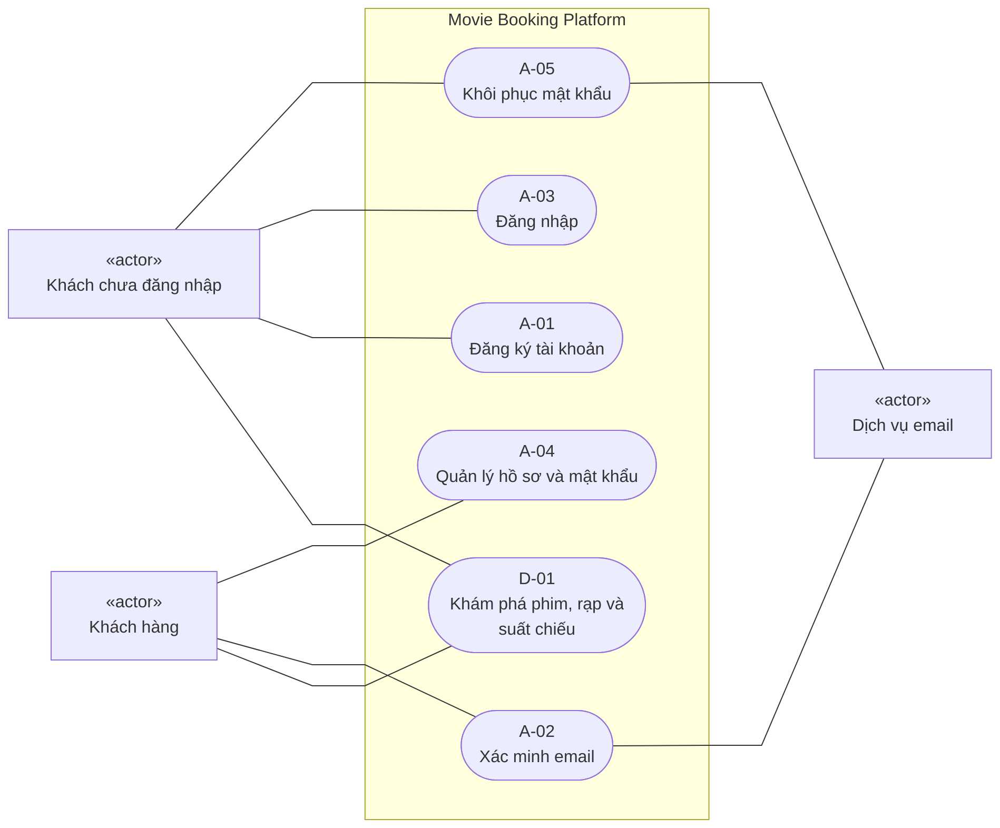
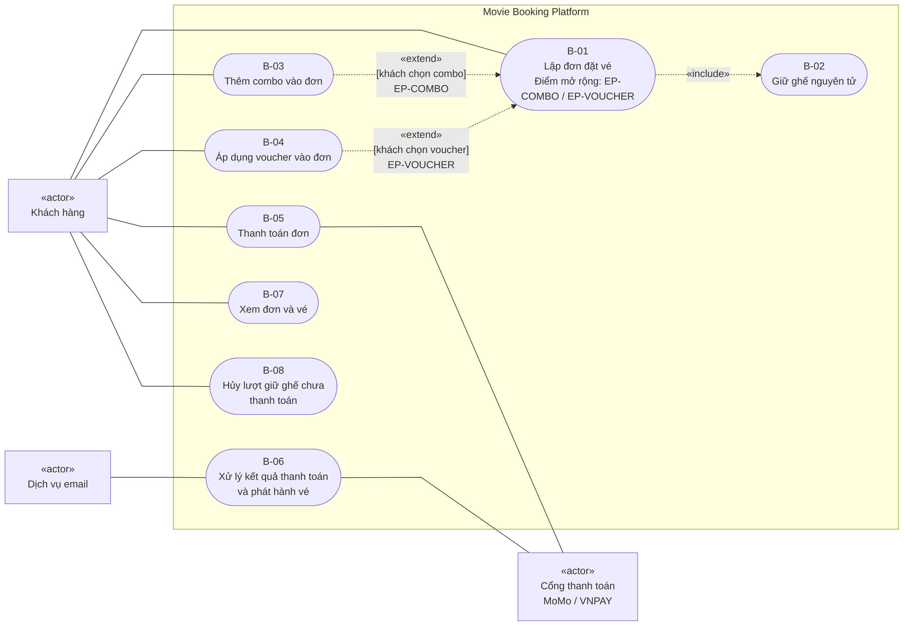
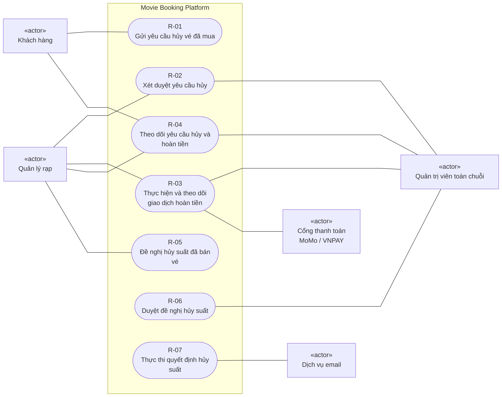
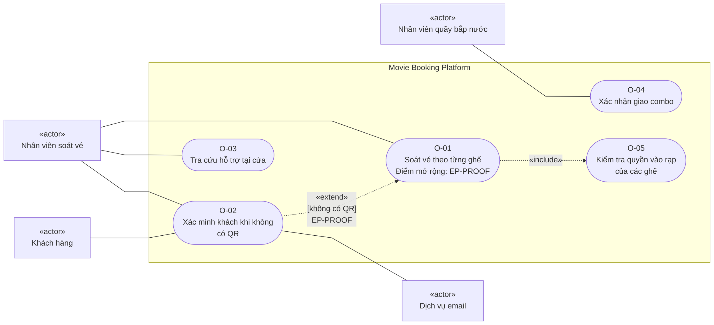
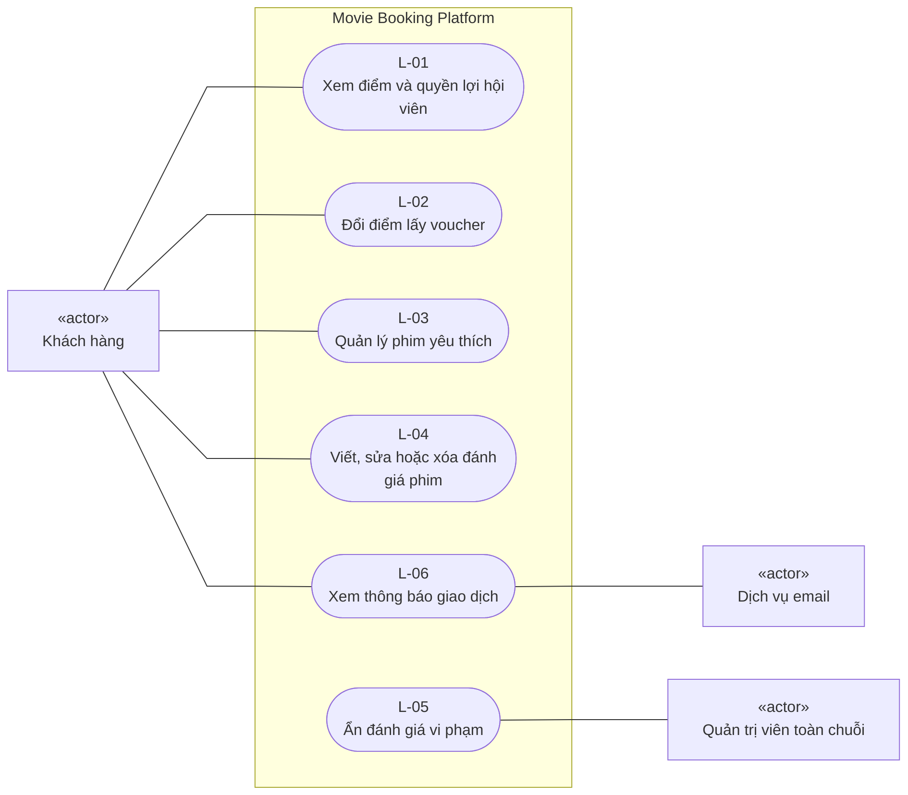
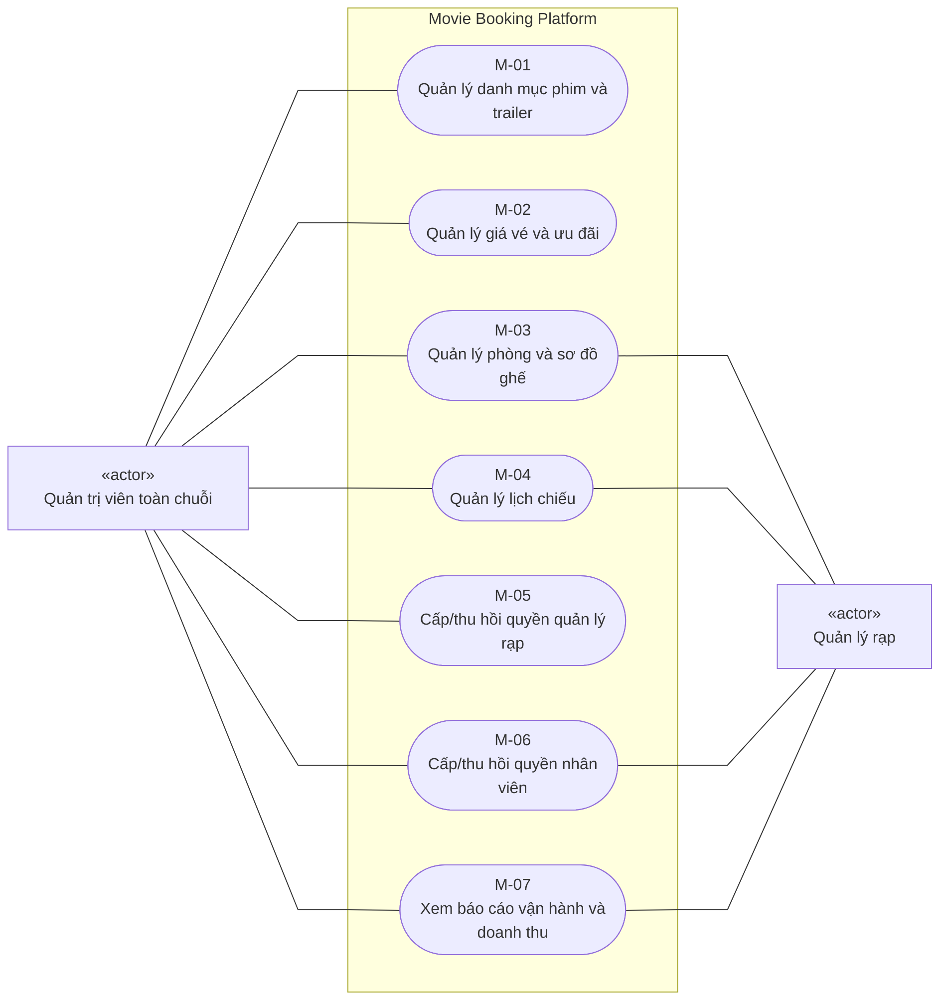

# UML use case — Movie Booking Platform

**Trạng thái:** mô hình sản phẩm mục tiêu được chủ sản phẩm xác nhận ngày 2026-11-16.
**Nguồn quyết định:** các vòng Q1–Q30 và xác nhận bản tổng hợp Q31 trong hội thoại thiết kế
use case. Phê duyệt này không phải bằng chứng triển khai, kiểm thử, hợp nhất hoặc triển khai vận hành.

Bổ sung ngày 2026-11-17 trong hội thoại Tech Stack (`01a1e2f4-4de8-75d2-a43e-efd7365dbd58`):
chủ sản phẩm đồng ý phương án A cho quyền kiểm soát cá nhân hóa tại BR-18.
Sau đó đồng ý phương án A cho chuyển từ phiên khách sang tài khoản tại BR-19.
Tiếp đó đồng ý phương án A ưu tiên truy vấn trong thứ hạng tìm kiếm tại BR-20.
Nguồn tín hiệu, phạm vi nhận diện và khám phá ngay không có bảng hỏi ban đầu được ghi tại BR-21.
Đây là các quyết định mục tiêu của nâng cấp D-01; luồng chi tiết, API và các chính sách còn mở cần đặc tả.

## Cách đọc

- Khi tạo hoặc cập nhật bộ sơ đồ, tuân theo [quy chuẩn phân tích và trình bày use case](../04-standards/use-case-modeling.md).
- Tài liệu này sở hữu mô hình actor, mục tiêu, quan hệ UML và quyết định sản phẩm của bộ use case.
- [Mô tả use case](use-case-descriptions.md) diễn giải các tình huống, điều kiện và kết quả.
- [Thuật ngữ](../../GLOSSARY.md) phân biệt đơn hàng, vé theo ghế, QR chung và lượt soát vé.
- Các sơ đồ nằm ngay trong mục 2 dưới dạng mã Mermaid, không cần file ảnh hoặc trang xem riêng.
- Các chính sách chưa quyết định có mã `OPEN-*`; không được coi các chỗ đó là giá trị mặc định.
- Các sơ đồ là những góc nhìn của cùng một hệ thống, không phải các hệ thống con có actor nội bộ.

## 1. Ranh giới và phạm vi

Subject của mọi sơ đồ là **Movie Booking Platform**, phục vụ **một đơn vị/chuỗi rạp**.
Web khách hàng, Mobile, Organizer Portal, AI Agent và Cinema Core đều nằm bên trong ranh giới.
Các kênh được tổ chức thành bốn app theo
[ADR-0002](../06-decisions/0002-customer-organizer-app-boundaries.md); việc chuyển trải nghiệm
nhân viên sang Organizer Mobile không đổi actor, mục tiêu hoặc BR/OPEN của mô hình.
Web/Mobile là kênh tương tác, không phải actor. AI và Core không được vẽ thành actor của toàn nền tảng.

[Thiết kế microservices](../05-specs/004-service-decomposition/spec.md) phân chia backend thành bảy
service nội bộ; các nhóm use case dưới đây không phải ranh giới service. Thiết kế đó sở hữu giao tiếp,
dữ liệu và cách ly lỗi, không thay danh mục actor hoặc quyền nghiệp vụ của mô hình này.

Phạm vi gồm khám phá phim/rạp/suất chiếu; tài khoản; đặt vé trực tiếp và trong chat;
combo và ưu đãi; thanh toán; vé điện tử; hỗ trợ hủy/hoàn tiền; soát vé; giao combo;
đánh giá/yêu thích; hội viên/điểm/đổi voucher; quản trị chuỗi, vận hành rạp và báo cáo.

D-01 bao gồm tìm theo tên/alias, không dấu/lỗi gõ và ý nghĩa nội dung; tìm kiếm kết hợp từ khóa/ngữ nghĩa
và khám phá cá nhân hóa theo nội dung + hồ sơ phiên/tài khoản đã chọn tại
[ADR-0030](../06-decisions/0030-typesense-for-movie-search-and-discovery.md) và
[ADR-0031](../06-decisions/0031-content-based-and-profile-scoring-for-personalization.md).
BR-18–21 quy định kiểm soát dữ liệu và thứ hạng; OPEN-11 giữ các chính sách dữ liệu còn thiếu.

Không bổ sung bán vé tiền mặt tại quầy, quản lý kho nguyên liệu vật lý, sàn nhiều đơn vị rạp độc lập,
soát vé ngoại tuyến hoặc collaborative filtering/mô hình đề xuất huấn luyện phức tạp ở bản đầu.
Phạm vi loại trừ đó không loại cá nhân hóa theo nội dung/hồ sơ đã chọn. Các mục này không được suy ra từ chữ
“sản phẩm thực tế”. Hỗ trợ hủy/hoàn tiền không đồng nghĩa hỗ trợ đổi suất/đổi ghế sau khi mua.

### Actor

| Mã | Actor | Phạm vi tương tác |
|---|---|---|
| ACT-GUEST | Khách chưa đăng nhập | Khám phá thông tin công khai, đọc đánh giá, đăng ký, đăng nhập, khôi phục tài khoản. |
| ACT-CUSTOMER | Khách hàng | Hành động với tài khoản, đơn/vé, điểm và đánh giá thuộc quyền của mình. Giữ ghế/mua vé cần đăng nhập và email đã xác minh. |
| ACT-SCANNER | Nhân viên soát vé | Tra cứu hỗ trợ và soát từng ghế tại rạp được giao; không duyệt hoàn tiền hay giao combo nếu chưa được cấp vai trò tương ứng. |
| ACT-CONCESSION | Nhân viên quầy bắp nước | Tra cứu và xác nhận giao combo tại rạp được giao; không mặc định có quyền soát vé hoặc duyệt hoàn tiền. |
| ACT-MANAGER | Quản lý rạp | Phòng/ghế, lịch chiếu, quyền nhân viên và báo cáo của rạp được giao; xét yêu cầu hủy theo chính sách; đề nghị hủy suất đã bán vé. |
| ACT-ADMIN | Quản trị viên toàn chuỗi | Danh mục phim, giá/ưu đãi, quyền quản lý rạp, báo cáo toàn chuỗi, quản lý tổng thể; ngoại lệ hoàn tiền, duyệt hủy suất và ẩn đánh giá vi phạm. |
| ACT-PAY | Cổng thanh toán | Thu tiền, cung cấp kết quả/đối soát và xử lý hoàn tiền; phạm vi là MoMo, VNPAY. |
| ACT-MAIL | Dịch vụ email | Chuyển email xác minh, khôi phục, mã xác nhận và thông báo giao dịch. Đã chọn Resend theo [ADR-0018](../06-decisions/0018-resend-for-transactional-email.md), chưa xác nhận tích hợp runtime. |

Actor là vai trò, không phải mỗi actor một con người hoặc một tài khoản bắt buộc.
Một người có thể được cấp cả hai vai trò nhân viên. Không dùng kế thừa actor để ngầm cấp quyền
soát vé/giao combo cho quản lý, hoặc quyền của khách hàng cho tài khoản vận hành.
Đã chọn LLM bên ngoài: Cloudflare Workers AI + GPT-OSS 120B theo
[ADR-0012](../06-decisions/0012-cloudflare-workers-ai-and-gpt-oss-120b.md), dự phòng Groq Free GPT-OSS 120B tại
[ADR-0028](../06-decisions/0028-groq-free-for-agent-provider-fallback.md). Khi cả hai gián đoạn, thông báo
Agent không dùng được và giữ đường đặt vé trực tiếp; không tự trả phí hoặc hứa AI luôn sẵn sàng.
Việc chọn provider không tự chứng minh dịch vụ ngoài đã vận hành hoặc thay đổi bộ actor trong sơ đồ.

## 2. Sơ đồ use case: tổng quát đến chi tiết

Đọc theo thứ tự: **2.1 — General toàn hệ thống → 2.2 — bảng ánh xạ → 2.3 — sơ đồ chi tiết từng nhóm chức năng**.
General thể hiện các use case chính mà từng actor tham gia. Các sơ đồ chi tiết giữ cùng mã/tên,
bổ sung hành vi hỗ trợ và quan hệ `include`/`extend`; mô tả use case ghi điều kiện và ngoại lệ.

Các sơ đồ nằm trong khối mã `mermaid`, dùng trình xem Markdown hỗ trợ Mermaid.
Dùng `flowchart` để biểu diễn mô hình use case: actor là hộp `«actor»` bên ngoài hệ thống;
use case là nút bo tròn; `---` là association; đường nét đứt có nhãn là quan hệ theo mục 5.
Đây không phải sơ đồ luồng xử lý. Hình dạng nút/mũi tên tùy trình render; ngữ nghĩa theo bảng kiểm tra UML.

### 2.1. Sơ đồ use case tổng quát (General)

Sơ đồ General hiển thị **8 actor và 34 use case chính**, nối actor trực tiếp với từng chức năng
như đăng ký, đăng nhập, thanh toán, xem vé, đánh giá, đổi voucher hoặc quản lý lịch chiếu.
Các khung chữ nhật `G-01`…`G-08` chỉ gom chức năng để bố trí dễ đọc, **không thay thế use case**.
Chỉ khung ngoài Movie Booking Platform là ranh giới hệ thống; các nhóm bên trong không phải dịch vụ
hay hệ thống con. AI Agent và Cinema Core vẫn là thành phần nội bộ.

**Quy ước bố trí:** mỗi vai trò có **một nút actor duy nhất** trong General; các nhóm cùng tham gia
đều nối về nút đó. Khách chưa đăng nhập, khách hàng và quản lý rạp đặt bên trái; các actor còn lại
đặt bên phải. Đường nối không hướng đi theo đoạn thẳng/gấp đoạn, có khoảng cách giữa các nút.
General giữ đủ 8 actor, 34 use case và 48 association; không nhân actor hoặc bỏ chức năng để làm gọn.
Sơ đồ giữ cỡ tự nhiên để chữ dễ đọc; cần cuộn dọc và có thể cần kéo ngang/thu phóng trong preview.
Một số đường vẫn giao nhau vì actor tham gia nhiều nhóm; điểm giao không phải nút nối hay use case mới.
Khuyến nghị mở preview **toàn màn hình** khi xem General. Trên khung hẹp, tra cứu từng chức năng qua
các sơ đồ chi tiết **2.3.1–2.3.6** ở [mục 2.3](#23-sơ-đồ-use-case-chi-tiết) và bảng ánh xạ ở mục 2.2;
giữ General làm bản tham chiếu đầy đủ, không thu nhỏ chữ để ép vừa chiều rộng panel.

```mermaid
%%{init: {"flowchart":{"nodeSpacing":55,"rankSpacing":110,"curve":"linear","useMaxWidth":false,"padding":18}}}%%
flowchart LR
    %% Mỗi vai trò có một nút actor duy nhất trong sơ đồ.
    guest["«actor»<br/>Khách chưa đăng nhập"]
    customer["«actor»<br/>Khách hàng"]
    mail["«actor»<br/>Dịch vụ email"]
    pay["«actor»<br/>Cổng thanh toán<br/>MoMo / VNPAY"]
    manager["«actor»<br/>Quản lý rạp"]
    admin["«actor»<br/>Quản trị viên toàn chuỗi"]
    scanner["«actor»<br/>Nhân viên soát vé"]
    concession["«actor»<br/>Nhân viên quầy bắp nước"]

    subgraph system["Movie Booking Platform"]
        subgraph group_G_01["G-01 · Quản lý tài khoản"]
            A_01(["A-01<br/>Đăng ký tài khoản"])
            A_02(["A-02<br/>Xác minh email"])
            A_03(["A-03<br/>Đăng nhập"])
            A_04(["A-04<br/>Quản lý hồ sơ và mật khẩu"])
            A_05(["A-05<br/>Khôi phục mật khẩu"])
        end
        subgraph group_G_02["G-02 · Khám phá phim, rạp và suất chiếu"]
            D_01(["D-01<br/>Khám phá phim, rạp và suất<br/>chiếu"])
        end
        subgraph group_G_03["G-03 · Đặt vé và thanh toán"]
            B_01(["B-01<br/>Lập đơn đặt vé"])
            B_03(["B-03<br/>Thêm combo vào đơn"])
            B_04(["B-04<br/>Áp dụng voucher vào đơn"])
            B_05(["B-05<br/>Thanh toán đơn"])
            B_07(["B-07<br/>Xem đơn và vé"])
            B_08(["B-08<br/>Hủy lượt giữ ghế chưa<br/>thanh toán"])
        end
        subgraph group_G_04["G-04 · Hủy vé, hoàn tiền và hủy suất"]
            R_01(["R-01<br/>Gửi yêu cầu hủy vé đã mua"])
            R_02(["R-02<br/>Xét duyệt yêu cầu hủy"])
            R_03(["R-03<br/>Thực hiện và theo dõi giao<br/>dịch hoàn tiền"])
            R_04(["R-04<br/>Theo dõi yêu cầu hủy và<br/>hoàn tiền"])
            R_05(["R-05<br/>Đề nghị hủy suất đã bán vé"])
            R_06(["R-06<br/>Duyệt đề nghị hủy suất"])
        end
        subgraph group_G_05["G-05 · Soát vé"]
            O_01(["O-01<br/>Soát vé theo từng ghế"])
            O_03(["O-03<br/>Tra cứu hỗ trợ tại cửa"])
        end
        subgraph group_G_06["G-06 · Giao combo"]
            O_04(["O-04<br/>Xác nhận giao combo"])
        end
        subgraph group_G_07["G-07 · Cộng đồng và hội viên"]
            L_01(["L-01<br/>Xem điểm và quyền lợi hội<br/>viên"])
            L_02(["L-02<br/>Đổi điểm lấy voucher"])
            L_03(["L-03<br/>Quản lý phim yêu thích"])
            L_04(["L-04<br/>Viết, sửa hoặc xóa đánh<br/>giá phim"])
            L_05(["L-05<br/>Ẩn đánh giá vi phạm"])
            L_06(["L-06<br/>Xem thông báo giao dịch"])
        end
        subgraph group_G_08["G-08 · Vận hành rạp và quản trị chuỗi"]
            M_01(["M-01<br/>Quản lý danh mục phim và<br/>trailer"])
            M_02(["M-02<br/>Quản lý giá vé và ưu đãi"])
            M_03(["M-03<br/>Quản lý phòng và sơ đồ ghế"])
            M_04(["M-04<br/>Quản lý lịch chiếu"])
            M_05(["M-05<br/>Cấp/thu hồi quyền quản lý<br/>rạp"])
            M_06(["M-06<br/>Cấp/thu hồi quyền nhân<br/>viên"])
            M_07(["M-07<br/>Xem báo cáo vận hành và<br/>doanh thu"])
        end
    end

    guest --- D_01
    guest --- A_01
    guest --- A_03
    guest --- A_05
    customer --- D_01
    customer --- A_02
    customer --- A_04
    A_02 --- mail
    A_05 --- mail
    customer --- B_01
    customer --- B_03
    customer --- B_04
    customer --- B_05
    customer --- B_07
    customer --- B_08
    B_05 --- pay
    customer --- R_01
    customer --- R_04
    manager --- R_02
    manager --- R_03
    manager --- R_04
    manager --- R_05
    R_02 --- admin
    R_03 --- admin
    R_04 --- admin
    R_06 --- admin
    R_03 --- pay
    O_01 --- scanner
    O_03 --- scanner
    O_04 --- concession
    customer --- L_01
    customer --- L_02
    customer --- L_03
    customer --- L_04
    customer --- L_06
    L_05 --- admin
    L_06 --- mail
    M_01 --- admin
    M_02 --- admin
    M_03 --- admin
    M_04 --- admin
    M_05 --- admin
    M_06 --- admin
    M_07 --- admin
    manager --- M_03
    manager --- M_04
    manager --- M_06
    manager --- M_07
```

General giữ ở mức mục tiêu chính nên chưa vẽ các bước giữ ghế, xử lý kết quả cổng/phát hành vé,
thực thi quyết định hủy suất, xác minh khi thiếu QR hoặc kiểm tra quyền từng ghế. Các hành vi đó
vẫn thuộc phạm vi và xuất hiện đầy đủ ở sơ đồ chi tiết. Việc lược bước hỗ trợ không cho phép bỏ qua
điều kiện xác thực, quyền hạn hoặc quy tắc giao dịch trong mô tả.

### 2.2. Bảng phân rã chức năng

Bảng dưới chỉ rõ use case nào hiện trên General và hành vi nào bổ sung trong sơ đồ chi tiết.
Mã `G-*` là nhãn nhóm, không phải use case mới. Việc chuyển từ góc nhìn tổng quát sang chi tiết
không tự tạo quan hệ `include`, `extend`, kế thừa hoặc thứ tự thời gian.

| Nhóm | Chức năng | Use case hiện trên General | Bổ sung ở mức chi tiết | Sơ đồ chi tiết |
|---|---|---|---|---|
| G-01 | Quản lý tài khoản | `A-01`, `A-02`, `A-03`, `A-04`, `A-05` | — | [2.3.1. Tài khoản và khám phá](#231-tài-khoản-và-khám-phá) |
| G-02 | Khám phá phim, rạp và suất chiếu | `D-01` | — | [2.3.1. Tài khoản và khám phá](#231-tài-khoản-và-khám-phá) |
| G-03 | Đặt vé và thanh toán | `B-01`, `B-03`, `B-04`, `B-05`, `B-07`, `B-08` | `B-02`, `B-06` | [2.3.2. Đặt vé và thanh toán](#232-đặt-vé-và-thanh-toán) |
| G-04 | Hủy vé, hoàn tiền và hủy suất | `R-01`, `R-02`, `R-03`, `R-04`, `R-05`, `R-06` | `R-07` | [2.3.3. Hủy, hoàn tiền và hủy suất](#233-hủy-hoàn-tiền-và-hủy-suất) |
| G-05 | Soát vé | `O-01`, `O-03` | `O-02`, `O-05` | [2.3.4. Soát vé và giao combo](#234-soát-vé-và-giao-combo) |
| G-06 | Giao combo | `O-04` | — | [2.3.4. Soát vé và giao combo](#234-soát-vé-và-giao-combo) |
| G-07 | Cộng đồng và hội viên | `L-01`, `L-02`, `L-03`, `L-04`, `L-05`, `L-06` | — | [2.3.5. Cộng đồng và hội viên](#235-cộng-đồng-và-hội-viên) |
| G-08 | Vận hành rạp và quản trị chuỗi | `M-01`, `M-02`, `M-03`, `M-04`, `M-05`, `M-06`, `M-07` | — | [2.3.6. Vận hành và quản trị](#236-vận-hành-và-quản-trị) |

34 use case chính và 5 hành vi hỗ trợ bao phủ đủ **39 mã use case** đã thống nhất.
`B-02` hỗ trợ lập đơn; `B-06` xử lý kết quả thanh toán/phát hành vé; `R-07` thực thi hủy suất
được duyệt; `O-02`/`O-05` diễn giải xác minh và kiểm tra trong soát vé. Không tạo hoặc đổi nghĩa
use case để làm sơ đồ General trông nhiều chức năng hơn.

### 2.3. Sơ đồ use case chi tiết

Các sơ đồ dưới đây giữ cùng ranh giới Movie Booking Platform, mã use case, actor và quyền đã thống nhất.

#### 2.3.1. Tài khoản và khám phá

**Nhóm chức năng trong General:** G-01, G-02.

Đăng nhập là điều kiện trước; xác minh email có thể hoàn tất sau đăng ký.

#### 2.3.2. Đặt vé và thanh toán

**Nhóm chức năng trong General:** G-03.

Các mục tiêu có thể diễn ra khác thời điểm. Callback không phải include của lập đơn.
Association `B-06`–dịch vụ email thể hiện phối hợp gửi email vé sau khi Core xác nhận phát hành;
không quy định gửi đồng bộ hay qua xử lý nền. `L-06` là góc nhìn khách xem thông báo giao dịch,
không phải bước include/extend của `B-06`; gửi email lỗi không làm mất hiệu lực vé đã phát hành.

#### 2.3.3. Hủy, hoàn tiền và hủy suất

**Nhóm chức năng trong General:** G-04.

Gửi yêu cầu, xét duyệt và giao dịch hoàn tiền có kết quả riêng; không nối bằng include/extend.
Ở `R-03`, cổng thanh toán phối hợp thực hiện/đối soát giao dịch; quản lý rạp và quản trị viên toàn chuỗi
theo dõi giao dịch theo phạm vi được cấp. `R-04` trình bày tiến độ yêu cầu/quyết định hủy và hoàn tiền
cho khách hàng hoặc hai vai trò vận hành đó theo quyền truy cập. Thẩm quyền xử lý sự cố hoàn tiền
cụ thể vẫn thuộc `OPEN-03`.

#### 2.3.4. Soát vé và giao combo

**Nhóm chức năng trong General:** G-05, G-06.

Một QR cho lượt đặt; Core kiểm tra/ghi nhận riêng từng ghế. Thiết bị nhân viên phải online.

#### 2.3.5. Cộng đồng và hội viên

**Nhóm chức năng trong General:** G-07.

Điểm cộng theo phần vé đã soát; đổi điểm tạo voucher, chưa phải áp voucher vào đơn.

#### 2.3.6. Vận hành và quản trị

**Nhóm chức năng trong General:** G-08.

Quản lý chỉ trong rạp được giao; quyền cấp/thu hồi phải được kiểm tra tại từng thao tác.

## 3. Danh mục use case

| Mã | Mục tiêu | Actor chính/phối hợp | Quyết định |
|---|---|---|---|
| D-01 | Khám phá phim, rạp và suất chiếu | Khách chưa đăng nhập, khách hàng | Q1–Q4, Q22; Tech Stack 2026-11-17, BR-18–21 |
| A-01 | Đăng ký tài khoản | Khách chưa đăng nhập | Q19, Q21, Q25 |
| A-02 | Xác minh email | Khách hàng; dịch vụ email | Q19 |
| A-03 | Đăng nhập | Khách chưa đăng nhập, người được cấp vai trò vận hành | Q4, Q19, Q21 |
| A-04 | Quản lý hồ sơ và mật khẩu | Khách hàng | Q19, Q22 |
| A-05 | Khôi phục mật khẩu | Người dùng mất quyền đăng nhập; dịch vụ email | Q19, Q22 |
| B-01 | Lập đơn đặt vé | Khách hàng | Q8–Q9, Q19, Q29 |
| B-02 | Giữ ghế nguyên tử | Khách hàng qua B-01 | Q9 |
| B-03 | Thêm combo vào đơn | Khách hàng | Q22 |
| B-04 | Áp dụng voucher vào đơn | Khách hàng | Q22, Q24 |
| B-05 | Thanh toán đơn | Khách hàng; cổng thanh toán | Q8, Q15, Q20 |
| B-06 | Xử lý kết quả thanh toán và phát hành vé | Cổng thanh toán; dịch vụ email | Q8, Q15–Q16 |
| B-07 | Xem đơn và vé | Khách hàng | Q16, Q22, Q30 |
| B-08 | Hủy lượt giữ ghế chưa thanh toán | Khách hàng | Q9–Q10 |
| R-01 | Gửi yêu cầu hủy vé đã mua | Khách hàng | Q10, Q12–Q14, Q30 |
| R-02 | Xét duyệt yêu cầu hủy | Quản lý rạp; quản trị viên xử lý ngoại lệ | Q11, Q13 |
| R-03 | Thực hiện và theo dõi giao dịch hoàn tiền | Cổng thanh toán; quản lý rạp và quản trị viên toàn chuỗi theo dõi theo phạm vi | Q10–Q15, Q27 |
| R-04 | Theo dõi yêu cầu hủy và hoàn tiền | Khách hàng; quản lý rạp; quản trị viên toàn chuỗi (theo quyền/phạm vi) | Q10, Q22, Q30 |
| R-05 | Đề nghị hủy suất đã bán vé | Quản lý rạp | Q27 |
| R-06 | Duyệt đề nghị hủy suất | Quản trị viên toàn chuỗi | Q27 |
| R-07 | Thực thi quyết định hủy suất | Được kích hoạt bởi quyết định R-06; dịch vụ email | Q27 |
| O-01 | Soát vé theo từng ghế | Nhân viên soát vé | Q6, Q16, Q18 |
| O-02 | Xác minh khách khi không có QR | Nhân viên soát vé, khách hàng; dịch vụ email | Q17, Q19 |
| O-03 | Tra cứu hỗ trợ tại cửa | Nhân viên soát vé | Q6 |
| O-04 | Xác nhận giao combo | Nhân viên quầy bắp nước | Q28 |
| O-05 | Kiểm tra quyền vào rạp của các ghế | Hành vi bắt buộc trong O-01 | Q13, Q16, Q18 |
| L-01 | Xem điểm và quyền lợi hội viên | Khách hàng | Q22, Q25 |
| L-02 | Đổi điểm lấy voucher | Khách hàng | Q24–Q25 |
| L-03 | Quản lý phim yêu thích | Khách hàng | Q22–Q23 |
| L-04 | Viết, sửa hoặc xóa đánh giá phim | Khách hàng đủ điều kiện | Q23, Q26 |
| L-05 | Ẩn đánh giá vi phạm | Quản trị viên toàn chuỗi | Q26 |
| L-06 | Xem thông báo giao dịch | Khách hàng; dịch vụ email | Q19, Q22 |
| M-01 | Quản lý danh mục phim và trailer | Quản trị viên toàn chuỗi | Q7 |
| M-02 | Quản lý giá vé và ưu đãi | Quản trị viên toàn chuỗi | Q7 |
| M-03 | Quản lý phòng và sơ đồ ghế | Quản lý rạp; quản trị viên | Q7, Q29 |
| M-04 | Quản lý lịch chiếu | Quản lý rạp; quản trị viên | Q7, Q27 |
| M-05 | Cấp/thu hồi quyền quản lý rạp | Quản trị viên toàn chuỗi | Q21 |
| M-06 | Cấp/thu hồi quyền nhân viên | Quản lý rạp; quản trị viên | Q21, Q28 |
| M-07 | Xem báo cáo vận hành và doanh thu | Quản lý rạp; quản trị viên | Q7 |

“Đặt vé thành công” là hành trình B-01 → B-05 → B-06 → B-07, không phải chỉ hoàn thành B-01.
B-01 kết thúc ở đơn chờ thanh toán; chỉ B-06 có thể dẫn tới vé đã phát hành khi đủ căn cứ từ Core.

### Phạm vi kênh AI

| Mục tiêu | Trong chat | Điều kiện |
|---|---|---|
| D-01, B-01…B-05, B-07…B-08 | Có | Khách xác nhận ghế/đơn; trả tiền có thể cần mở ứng dụng cổng rồi quay lại. |
| R-01, R-04 | Có | Hiển thị rõ vé/cặp Sweetbox cần hủy, khách xác nhận trước khi gửi; không hứa được duyệt. |
| Hội viên/đổi điểm, đánh giá, quản trị tài khoản | Màn hình chuyên biệt | Không suy Q30-B thành quyền AI thao tác mọi chức năng. |
| R-02, R-06, O-01, O-04, M-01…M-07 | Không cấp cho AI | Đây là thẩm quyền vận hành của người được phân quyền. |

AI và giao diện trực tiếp dùng cùng đơn, lượt giữ ghế và thời hạn từ Core; đổi kênh không tự tạo
thêm đơn, thêm hold hoặc khởi động lại 5 phút. Vé chỉ được trình bày là hợp lệ sau xác minh phản hồi/
chữ ký của Core theo [ranh giới giao dịch](../02-architecture/system-boundaries.md).

## 4. Quy tắc đã thống nhất

| Mã | Quy tắc mục tiêu | Nguồn |
|---|---|---|
| BR-01 | Một chuỗi rạp; giới hạn dữ liệu/quyền theo rạp được giao. Khách tự đăng ký; vai trò vận hành được cấp nội bộ. | Q3, Q5–Q7, Q21, Q28 |
| BR-02 | Email + mật khẩu; số điện thoại tùy chọn. Phải đăng nhập và xác minh email trước lần giữ ghế/mua vé đầu tiên. | Q4, Q19 |
| BR-03 | Mỗi phòng có sơ đồ, số ghế riêng; giữ Standard/VIP/Sweetbox. 64 ghế là mẫu hiện có, không phải giới hạn sản phẩm mục tiêu. | Q29 |
| BR-04 | Xác nhận danh sách ghế mới bắt đầu giữ; nguyên tử cả danh sách, tối đa 6 ghế, Sweetbox cả cặp, một hold còn hiệu lực/tài khoản, TTL 300 giây. | Q9 |
| BR-05 | Không tự gia hạn TTL. Hết hạn không đồng nghĩa đã xác định thanh toán thất bại; tiếp tục đối soát khi kết quả chưa rõ. | Q9, Q15 |
| BR-06 | Chỉ xác nhận đơn/phát hành vé khi Core có căn cứ thanh toán hợp lệ và quyền sở hữu ghế. Đã thu tiền sau khi ghế giải phóng: không tự đặt ghế khác, xử lý hoàn khoản thu. | Q8, Q15 |
| BR-07 | Một QR cho lượt đặt; quyền sử dụng và trạng thái soát được quản lý theo ghế. Ghế chưa dùng còn được xuất trình; ghế đã dùng/hủy bị từ chối. | Q16 |
| BR-08 | Soát vé cần kết nối Core. Mỗi ghế được ghi nhận vào một lần, kể cả hai cửa xác nhận đồng thời. QR khách lưu ngoại tuyến không cho phép thiết bị nhân viên soát ngoại tuyến. | Q16, Q18 |
| BR-09 | Không QR: tra cứu + mã xác nhận qua email đã xác minh; tên/số điện thoại/mã đơn đơn thuần không đủ. Sau xác minh vẫn kiểm tra quyền từng ghế. | Q17, Q19 |
| BR-10 | Khách được gửi yêu cầu hủy toàn bộ hoặc một phần. Chỉ vé chưa soát, suất chưa bắt đầu; Sweetbox hủy cả cặp. Gửi yêu cầu chưa vô hiệu hóa vé. | Q10, Q12–Q13 |
| BR-11 | Quản lý rạp xét theo chính sách toàn chuỗi; ngoại lệ chuyển quản trị viên. Khi duyệt phải kiểm tra lại vé chưa bị sử dụng. Chỉ có quyết định duyệt chưa phải tiền đã hoàn. | Q11, Q13–Q14 |
| BR-12 | Quản lý rạp đề nghị hủy suất đã bán vé; quản trị viên toàn chuỗi duyệt. Thực thi: ngừng bán, vô hiệu hóa quyền vào suất, thông báo và khởi tạo xử lý hoàn tiền. | Q27 |
| BR-13 | Quyền giao combo tách với quyền soát vé; nhận hàng phải được ghi nhận để không giao lặp. Không mở rộng sang quản lý kho vật lý. | Q28 |
| BR-14 | Tự thành hội viên khi tạo tài khoản; điểm thuộc tài khoản đặt, cộng theo phần vé đã soát, không cộng ngay khi thanh toán. | Q25 |
| BR-15 | Đổi đủ điểm lấy voucher vé/combo; trừ điểm và cấp đúng một lần; không dùng điểm như phương thức thanh toán trực tiếp. | Q24–Q25 |
| BR-16 | Chỉ tài khoản có vé phim đã soát được đánh giá; một đánh giá/tài khoản/phim, được sửa/xóa; đăng ngay. Quản trị viên được ẩn nội dung vi phạm, ghi lý do, không sửa lời khách. | Q23, Q26 |
| BR-17 | AI lập đề xuất; app/BFF thực thi lệnh dưới danh tính khách sau xác nhận đúng nội dung/phiên bản Core đã kiểm tra. AI không trực tiếp gửi lệnh ghi, không phê duyệt hủy, không cam kết tiền hoàn hoặc bịa vé thành công. | Q8, Q30; quyết định service 2026-11-17 |
| BR-18 | Bản đầu cho người dùng bật/tắt cá nhân hóa và đặt lại dữ liệu đã học. Khi tắt, ngừng học và sử dụng hồ sơ sở thích; vẫn tìm theo truy vấn/bộ lọc. Đặt lại không xóa đơn hàng/vé. Chưa thêm xem lịch sử học và xóa từng tương tác. | Tech Stack 2026-11-17, phương án A |
| BR-19 | Khi đăng nhập, không nhập hành vi đã thu thập ở phiên khách vào hồ sơ tài khoản. Giữ hồ sơ tài khoản hiện có, học tiếp từ tương tác sau đăng nhập khi cá nhân hóa được bật; không thêm bước hỏi gộp phiên ở bản đầu. Quyết định không tự quy định thời hạn lưu/xóa dữ liệu phiên khách. | Tech Stack 2026-11-17, phương án A về phiên khách |
| BR-20 | Tìm kiếm ưu tiên độ khớp truy vấn: tên phim/alias khớp chính xác đứng trước; sở thích chỉ điều chỉnh giữa các kết quả có độ phù hợp tương đương. Trang khám phá có thể cá nhân hóa mạnh hơn. Cả hai phải giữ đúng bộ lọc đã chọn; công thức, ngưỡng tương đương và trọng số chưa chốt. | Tech Stack 2026-11-17, phương án A về thứ hạng |
| BR-21 | Cá nhân hóa dùng sở thích khai báo, yêu thích, đánh giá, mua vé đã xác nhận, lượt xem chi tiết, click kết quả và lịch sử tìm kiếm; không tự nhập toàn bộ chat Agent. Khách chưa đăng nhập chỉ có hồ sơ theo phiên; hồ sơ lâu dài/xuyên thiết bị gắn tài khoản. Tìm/khám phá không bắt đăng nhập hoặc hỏi sở thích lúc bắt đầu; người mới khám phá danh mục/ngữ cảnh rồi học dần. | Tech Stack 2026-11-17: tín hiệu B, nhận diện A, người mới B |

Các quy tắc trên là yêu cầu đã chốt của mô hình sản phẩm. Nền tảng dự án, hiến pháp và các đặc tả
nghiệp vụ đã được đồng bộ về phạm vi mục tiêu ngày 2026-11-16. DTO, cơ chế xác thực, máy trạng thái
và các đặc tả feature trước đây chưa tự thay đổi theo lần cập nhật tài liệu này; xem mục 7.

## 5. Kiểm tra quan hệ UML

Theo [OMG UML 2.5.1, chương 18, tr. 640–642](https://www.omg.org/spec/UML/2.5.1/PDF):
`include` trỏ từ use case gọi sang hành vi được chèn bắt buộc tại vị trí tương ứng;
`extend` trỏ từ phần bổ sung về use case gốc, có điều kiện và điểm mở rộng của use case gốc.
Use case gốc của `extend` vẫn có nghĩa khi không chạy phần bổ sung.

### Toàn bộ quan hệ include/extend trong bộ sơ đồ

| Quan hệ và chiều mũi tên | Vị trí/điều kiện | Kiểm tra ý nghĩa |
|---|---|---|
| B-01 `include` → B-02 | Bước giữ ghế sau xác nhận danh sách | Không có giữ ghế hợp lệ thì không lập được đơn chờ thanh toán hợp lệ. |
| B-03 `extend` → B-01 | `EP-COMBO`, trước chốt giá: khách chọn combo | Đơn chỉ có vé vẫn là một đơn hợp lệ. |
| B-04 `extend` → B-01 | `EP-VOUCHER`, trước xác nhận tổng tiền: khách chọn mã | Đặt không có voucher vẫn có nghĩa. Mã không hợp lệ không được tự tạo giảm giá. |
| O-01 `include` → O-05 | Sau có bằng chứng tra cứu, trước ghi nhận vào rạp | Luôn kiểm tra quyền từng ghế trước khi chấp nhận, kể cả sau xác minh email. |
| O-02 `extend` → O-01 | `EP-PROOF`, trước O-05: khách không có QR | Soát bằng QR là luồng gốc đầy đủ; xác minh email bổ sung bằng chứng thay QR. |

Chỉ có **2 include và 3 extend**. Mọi đường actor–use case là association không có mũi tên thứ tự.
Không dùng actor generalization trong phiên bản này.

### Các quan hệ cố ý không vẽ

- Không `include Đăng nhập` vào mọi use case: phiên đăng nhập là điều kiện trước, không phải lần nào cũng nhập lại mật khẩu.
- Không `include Xác minh email` vào đăng ký: có thể tồn tại tài khoản chưa xác minh, nhưng chưa được giữ ghế/mua vé.
- Không nối `include/extend` giữa lập đơn, thanh toán, callback và xem vé chỉ để biểu diễn trình tự.
- Không `include Hoàn tiền` vào xét duyệt hủy: có thể từ chối; phần hoàn diễn ra sau quyết định và có kết quả riêng.
- Không `extend Hủy vé` vào Đặt vé, hoặc `extend Ẩn đánh giá` vào Viết đánh giá: đó là các tương tác khác thời điểm/actor.
- Không vẽ “đặt qua AI” như `extend` của “đặt trực tiếp”: đây là hai kênh thực hiện cùng mục tiêu.
- Không `include Cộng điểm` vào soát vé: cộng điểm là hệ quả giao dịch được ghi nhận sau khi soát thành công, không phải thao tác bắt buộc của nhân viên.
- Không `include Phát hành vé` vào thanh toán theo ý khách: kết quả từ cổng/Core mới có thẩm quyền quyết định.

Một bước điều kiện trong mô tả không bắt buộc phải được tách thành `extend`.
Trình tự và xử lý bất đồng bộ nằm trong mô tả; cần bổ sung activity/sequence khi đặc tả triển khai,
không gán nghĩa thời gian cho đường UML use case.

## 6. Các quyết định còn mở

OPEN-01–10 được giữ lại khi chủ sản phẩm xác nhận Q31. OPEN-11 tập hợp phần chính sách dữ liệu
còn mở sau các lựa chọn Tech Stack ngày 2026-11-17; không thuộc lần xác nhận Q31 trước đó.
Không giả định các phần này đã được giải quyết.

| Mã | Cần quyết định | Ảnh hưởng / ai cần chốt |
|---|---|---|
| OPEN-01 | Mốc nhận yêu cầu hủy, mức/phí hoàn, thẩm quyền ngoại lệ cụ thể. | R-01…R-04; chủ sản phẩm/quản trị chuỗi. Chưa đủ chính sách để vận hành chức năng hủy. |
| OPEN-02 | Phân bổ/cộng dồn ưu đãi, đơn còn 0 đồng, giá thực trả từng vé, combo đã/chưa nhận, voucher/điểm đã sử dụng khi hoàn một phần hoặc hủy suất. | B-04, R-02…R-03, R-07, L-02; không tự hoàn “100%” hoặc tự thu hồi điểm. |
| OPEN-03 | Hạn xử lý hoàn tiền, lỗi hoàn, đối soát khoản thu muộn, khả năng API/cam kết của từng cổng và người xử lý sự cố. | B-06, R-03…R-04; phải phân biệt đang xử lý/đã hoàn/chưa rõ. |
| OPEN-04 | Tỷ lệ/cơ sở tính điểm, giá đổi voucher, hạn điểm/voucher, hạng và quyền lợi hội viên, người được quản lý chính sách/danh mục đổi điểm, xử lý điều chỉnh điểm khi phát sinh ngoại lệ. | L-01…L-02; không lấy “10%” hay số điểm fixture làm chính sách. |
| OPEN-05 | Quyền sửa giờ/phòng/sơ đồ khi đã có ghế giữ hoặc vé bán; ngưỡng ngừng bán, khoảng đệm lịch, dừng bán khi chờ duyệt hủy suất, thời điểm ghế hủy trở lại bán, sự cố sau khi suất bắt đầu. | M-03…M-04, R-02/R-05…R-07; chưa cấp quyền tự chuyển khách sang suất/ghế khác. |
| OPEN-06 | Xác minh ngoại lệ khi không nhận được email/mất quyền truy cập; mất mạng; thời gian cho vào rạp và yêu cầu kiểm tra độ tuổi. | O-01…O-03; không tự cho phép bỏ qua Core/mã xác nhận hoặc tự gán quy định pháp lý. |
| OPEN-07 | Ai quản lý danh mục/giá combo, phạm vi cung cấp, bằng chứng nhận combo không có QR, giao từng phần và xử lý nhận nhầm. | B-03, O-04; vai trò giao combo đã chốt, quyền sửa danh mục chưa chốt. |
| OPEN-08 | Nội dung/quy tắc kiểm duyệt chi tiết, khiếu nại nội dung bị ẩn; quyền lợi của người đi cùng nhưng không đứng tên đơn. | L-04…L-05; quyền viết hiện gắn với tài khoản có vé đã soát, không chứng minh từng người đã xem. |
| OPEN-09 | Còn mở: tham số/quy trình mã, gửi lại/lỗi giao email và các kênh bổ sung ngoài email, hộp thông báo trong app. Email chọn Resend tại [ADR-0018](../06-decisions/0018-resend-for-transactional-email.md); LLM Workers AI + GPT-OSS 120B tại ADR-0012 và Groq Free dự phòng tại [ADR-0028](../06-decisions/0028-groq-free-for-agent-provider-fallback.md). | A-02/A-05/O-02/L-06 và AI; Notification sở hữu chuyển phát/hộp thông báo theo thiết kế service. Không mặc định SMS, push hoặc Google login. Chọn provider chưa xác nhận tích hợp runtime. |
| OPEN-10 | Phạm vi chỉ số báo cáo, cách thể hiện doanh thu/hoàn tiền và dữ liệu cá nhân; quy trình sửa thông tin liên hệ, lưu trữ/xóa dữ liệu tài khoản. | M-07, A-04; không suy dữ liệu báo cáo mẫu thành định nghĩa đối soát. |
| OPEN-11 | Cách nhận diện/hết hạn phiên khách; thời hạn lưu tín hiệu thô và hồ sơ dẫn xuất; xử lý tín hiệu cũ khi đặt lại/bật lại cá nhân hóa; phạm vi dữ liệu gửi/log/trace ra ngoài. | D-01, BR-18–21; không tự lưu khách ẩn danh dài hạn, nhập chat, xóa chứng từ giao dịch hoặc quyết định cách dùng/replay tín hiệu cũ sau đặt lại. Chi tiết hợp đồng/công thức và hành vi khi index hỏng cần đặc tả/kiểm chứng riêng. |

Các yêu cầu an toàn đã chốt (xác thực chữ ký, phân quyền, chống dùng lặp, bảo toàn đơn khi chưa rõ
thanh toán) vẫn bắt buộc; “còn mở” không cho phép bỏ qua chúng. Không tuyên bố sẵn sàng vận hành
khi chính sách liên quan chưa được chốt và kiểm chứng.

OPEN-05/06/09 vẫn giữ các chính sách còn thiếu; không mở lại ranh giới kiến trúc đã duyệt:
hủy suất đã duyệt có hiệu lực tại Core trước xử lý nền từng đơn; soát cần Core online nhưng không
gọi Identity đồng bộ mỗi lượt; Notification nhận sự kiện sau commit và email có mã bảo mật dùng
Claim Check. Điều kiện và phần còn mở theo [thiết kế service](../05-specs/004-service-decomposition/spec.md).

## 7. Hiện trạng và chênh lệch so với mục tiêu

Đường dẫn trong bảng đối chiếu dưới đây thuộc mốc code đã nêu. Tra vị trí sau khi chuyển app theo
[ánh xạ ADR-0002](../06-decisions/0002-customer-organizer-app-boundaries.md#consequences);
không thay đường dẫn hoặc kết quả lịch sử bằng một lần kiểm chứng mới.

Đối chiếu đọc mã tại **549d7b2f76e63aefe34e0c3799c3d28495cdf868**; không chạy ứng dụng,
không dùng kết quả test cũ làm bằng chứng của bộ tài liệu này. Các ghi nhận code dưới đây giữ nguyên
phạm vi commit đối chiếu; tài liệu nền tảng/đặc tả đã được hòa giải với mục tiêu trong đợt đồng bộ docs.

| Nguồn hiện có | Điều đã thấy / giới hạn | Yêu cầu mục tiêu mới hoặc khác |
|---|---|---|
| `apps/organizer/README.md`, `apps/mobile/README.md`, `services/cinema-core/README.md`, `services/agent-service/README.md` | Có mô tả trách nhiệm/scaffold; chưa chứng minh dịch vụ thực. | Toàn bộ các actor vận hành và giao dịch phải có triển khai có phân quyền. |
| `apps/web/src/features/auth/components/LoginView.tsx:19`, `apps/web/src/lib/api-client.ts:63` | Đăng nhập còn mô phỏng; chỉ thấy khai báo `apiClient`, chưa thấy nơi gọi trong UI ở commit đối chiếu. | Xác thực tài khoản, liên kết UI–Core và quyền dữ liệu phải được triển khai/kiểm chứng. |
| `apps/web/src/server/hold-adapter.ts:28`, `apps/web/src/server/order-adapter.ts:23`, `:316`, `:354` | Adapter dùng `Map`; không còn phát vé ngay khi tạo payment intent, nhưng webhook mới kiểm tra chiều dài chữ ký, chưa xác minh mật mã. Chưa thấy cơ chế đổi sang Core runtime hoặc từ chối mặc định khi thiếu Core. | Không xem BFF mô phỏng là giao dịch thật; B-06 cần xác thực nguồn, số tiền, chữ ký và quyền ghế. |
| `packages/contracts/src/tickets/types.ts` | Một `ETicketDto` có nhiều `seats`, một `status`/`checkedInAt`; yêu cầu soát chưa có tập ghế cần ghi nhận. | QR chung nhưng trạng thái/quyền sử dụng theo ghế, hủy/soát từng phần. |
| `packages/contracts/src/common/enums.ts` | Ba role `CUSTOMER`, `CINEMA_STAFF`, `ORGANIZER_ADMIN`. | Thêm phân biệt quản lý rạp, soát vé và giao combo; mô hình quyền cụ thể cần đặc tả tiếp. |
| `PROJECT-OVERVIEW.md`, `.specify/memory/constitution.md`, `docs/05-specs/domain-context.md` | Ràng buộc 64 ghế trước đây đã được thay bằng sơ đồ theo phòng trong tài liệu mục tiêu ngày 2026-11-16; code/fixture chưa đổi trong đợt này. | Q29-B: triển khai Core cung cấp sơ đồ từng phòng; không coi đồng bộ docs là đã đáp ứng. |
| `apps/web/src/server/hold-adapter.ts:34`, `apps/web/src/features/booking/model/booking-fixtures.ts:38` | BFF phát 64 ghế (8×8), fixture UI có 132 ghế (11×12); hiện trạng chưa nhất quán. | Không chọn một fixture làm yêu cầu mục tiêu; Core cung cấp sơ đồ hợp lệ theo từng phòng. |
| `docs/05-specs/domain-context.md` | Tài liệu đã diễn giải mục tiêu về quyền theo ghế, hủy/hoàn riêng; enum/DTO tại commit đối chiếu vẫn tổng thể. | Đặc tả chuyển trạng thái/API cho từng tính năng trước triển khai; không tự gán enum từ câu chữ nghiệp vụ. |
| `docs/05-specs/conversational-booking.md` | Tài liệu đã ánh xạ hành trình mua và hỗ trợ sau mua theo mục tiêu; không xác nhận tool runtime mới. | Q30-B: triển khai/kiểm chứng truy vấn đơn/vé, gửi hủy và theo dõi hoàn; không mở toàn bộ chức năng khách cho AI. |
| UI đánh giá/hội viên/voucher/hồ sơ/thông báo | Sự hiện diện của màn hình/fixture không chứng minh lưu trữ, giao dịch hay chính sách thật. | Các quy tắc Q22–Q26 là yêu cầu mục tiêu; phải kiểm chứng riêng khi triển khai. |

Tài liệu này không sửa ngược lịch sử của ADR hoặc tiêu chí/bằng chứng trong các đặc tả feature trước đó.
Actor/mục tiêu/BR/OPEN vẫn do tài liệu này sở hữu; mô tả use case diễn giải tình huống,
[GLOSSARY](../../GLOSSARY.md) sở hữu thuật ngữ. Các nguồn nền tảng/hiến pháp/đặc tả tham chiếu mô hình,
còn contracts sở hữu hợp đồng code hiện có. Đợt đặc tả/triển khai tiếp theo phải xử lý các chênh lệch
code được ghi ở trên, không dùng mô hình hoặc việc đồng bộ docs để khẳng định đã đáp ứng chúng.

### Nguồn kỹ thuật mới hơn mốc đối chiếu ban đầu
[Đặc tả BFF](../05-specs/002-web-bff-routes/spec.md) và
[plan BFF](../05-specs/002-web-bff-routes/plan.md) trên nhánh chính đã được đồng bộ tại
`2ce4893d66fa002f88a2208492f9aff19b4252f2`. Nguồn này mô tả HMAC webhook/ký vé trong BFF mô phỏng,
kiểm tra sở hữu, bảo toàn đơn đã xác nhận và đối soát attempt thanh toán khác/muộn.
Bảng mục 7 vẫn là bằng chứng đọc mã tại `549d7b2`, không phải đánh giá các sửa sau đó.
Xem CONTEXT và nguồn BFF khi chuẩn bị triển khai tiếp; không dùng nhận xét webhook tại mốc cũ
để kết luận implementation hiện tại chỉ kiểm tra chiều dài chữ ký.

## 8. Truy vết quyết định

| Vòng đã xác nhận | Nội dung được chốt | Nơi thể hiện |
|---|---|---|
| Q1–Q4 | Toàn nền tảng mục tiêu, một chuỗi, mua vé cần tài khoản | Ranh giới; ACT-*; BR-01…BR-02 |
| Q5–Q7 | Phân cấp chuỗi/rạp, nhân viên tra cứu + soát, phân công quản lý | M-01…M-07, O-01/O-03 |
| Q8–Q9 | Đặt trọn vẹn trong chat, quy tắc giữ ghế | B-01…B-06, BR-04 |
| Q10–Q14 | Yêu cầu hủy được xét, hủy một phần/cả cặp, thông số hoàn còn mở | R-01…R-04, OPEN-01…OPEN-02 |
| Q15 | Thanh toán muộn/không rõ, không tự đổi ghế | B-06, R-03, BR-05…BR-06 |
| Q16–Q18 | QR chung, soát từng ghế, xác minh khi thiếu QR, thiết bị phải online | O-01…O-05, BR-07…BR-09 |
| Q19–Q21 | Email/mật khẩu, xác minh email, MoMo/VNPAY, cấp quyền nội bộ | A-01…A-05, M-05…M-06 |
| Q22 | Bao gồm cả combo, voucher, hồ sơ, thông báo, đánh giá/yêu thích, hội viên | B-03…B-04, A-04, L-01…L-06 |
| Q23–Q26 | Đánh giá có vé đã soát, một đánh giá/phim, hậu kiểm; điểm sau soát, đổi voucher | L-01…L-05, BR-14…BR-16 |
| Q27–Q28 | Duyệt hủy suất ở cấp chuỗi; tách nhân viên quầy | R-05…R-07, O-04, ACT-CONCESSION |
| Q29–Q30 | Sơ đồ ghế theo phòng; AI có hỗ trợ sau mua | M-03, phạm vi kênh AI, mục 7 |
| Q31 | Chủ sản phẩm xác nhận bản tổng hợp và giữ các quyết định còn mở | Trạng thái tài liệu; OPEN-01…OPEN-10 |
| Tech Stack 2026-11-17 — khám phá | Nâng cấp tìm kiếm từ khóa/ngữ nghĩa/kết hợp; cá nhân hóa theo nội dung + hồ sơ. Tín hiệu B, nhận diện A và người mới B được chấp thuận; các chính sách chưa chốt giữ tại OPEN-11. | D-01, BR-21; ADR-0030/0031. Nguồn: hội thoại `01a1e2f4-4de8-75d2-a43e-efd7365dbd58`. |
| Tech Stack 2026-11-17 | Đồng ý đề xuất A: bật/tắt cá nhân hóa và đặt lại dữ liệu đã học; giữ đơn hàng/vé. | BR-18; mô tả D-01. Nguồn: hội thoại `01a1e2f4-4de8-75d2-a43e-efd7365dbd58`. |
| Tech Stack 2026-11-17 — phiên khách | Đồng ý đề xuất A: không nhập hành vi phiên khách khi đăng nhập, giữ hồ sơ tài khoản và học tiếp sau đăng nhập. Tránh trộn sở thích của người dùng chung thiết bị; chấp nhận không mang tín hiệu phiên khách sang hồ sơ lâu dài. | BR-19; mô tả D-01. Nguồn: cùng hội thoại Tech Stack nêu trên. |
| Tech Stack 2026-11-17 — thứ hạng | Đồng ý đề xuất A: ưu tiên truy vấn, cá nhân hóa giữa các kết quả phù hợp tương đương; trang khám phá có thể cá nhân hóa mạnh hơn. Giữ khả năng tìm đúng phim, chấp nhận kết quả tìm kiếm ít khác biệt giữa người dùng hơn phương án trộn điểm truy vấn/sở thích. | BR-20; mô tả D-01. Nguồn: cùng hội thoại Tech Stack nêu trên. |

## 9. Nguồn và kiểm tra mô hình

- Chuẩn ngữ nghĩa/ký hiệu: [OMG UML 2.5.1](https://www.omg.org/spec/UML/2.5.1/PDF), chương 18.
- Cú pháp hiển thị: [Mermaid flowchart](https://mermaid.js.org/syntax/flowchart.html).
- Kiểm tra phải bao gồm: đủ 39 use case, khớp mã trong các khối Mermaid và mô tả; actor ngoài subject;
  chỉ đúng 5 quan hệ đã liệt kê; điểm mở rộng tồn tại trong use case gốc; không biến điều kiện
  đăng nhập hay các sự kiện bất đồng bộ thành include/extend.
- Khối mã Mermaid trong tài liệu này là nguồn sơ đồ duy nhất. Chỉnh sửa trực tiếp tại mục 2;
  xem bằng chế độ preview có hỗ trợ Mermaid. Không cần xuất ảnh hoặc duy trì một bản nguồn khác.
