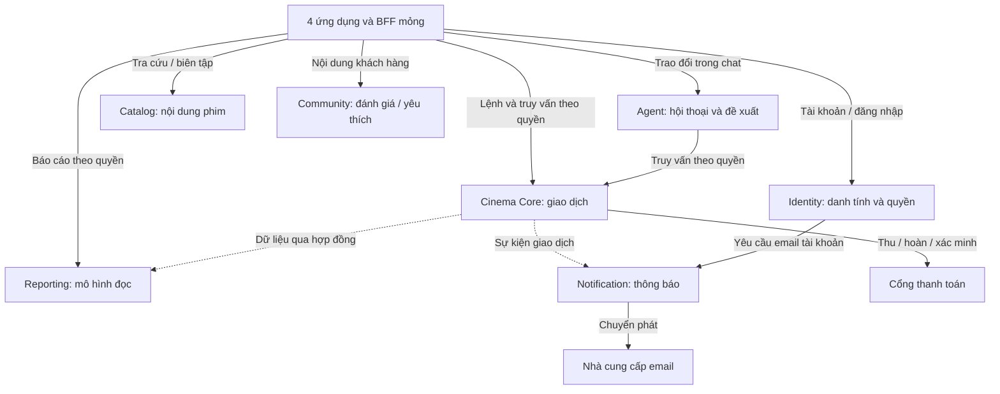
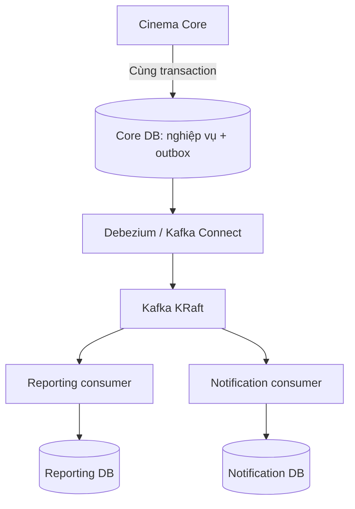
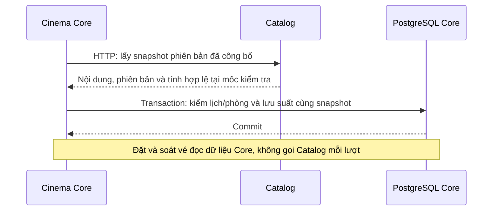
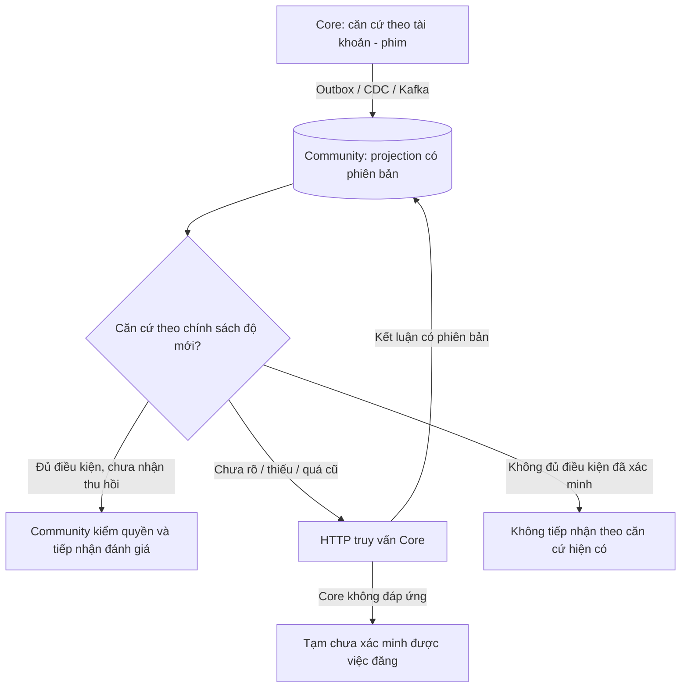
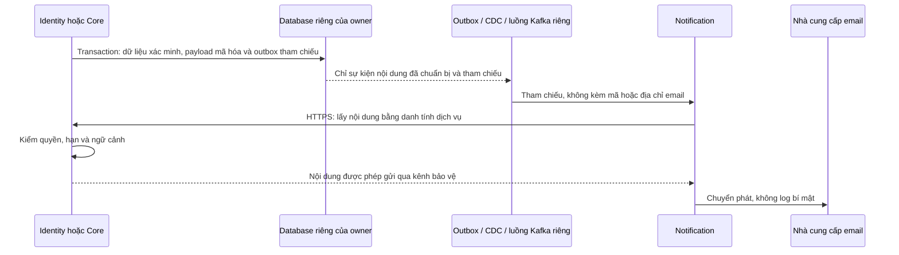
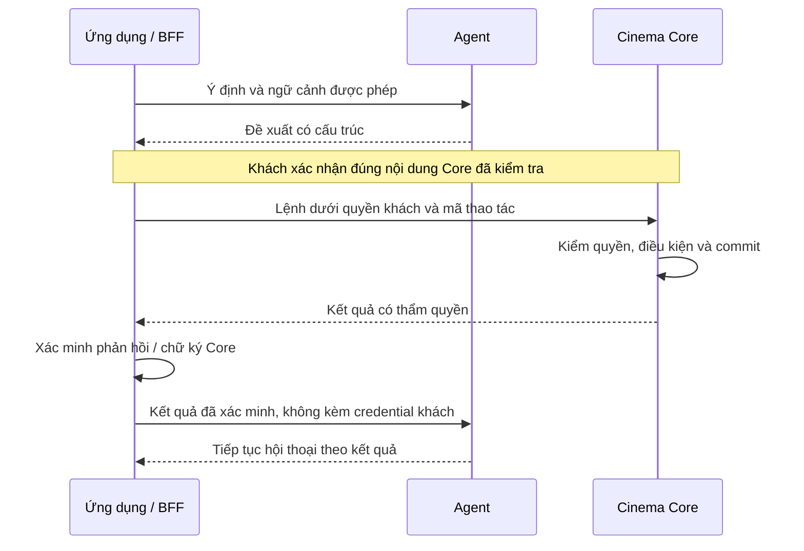
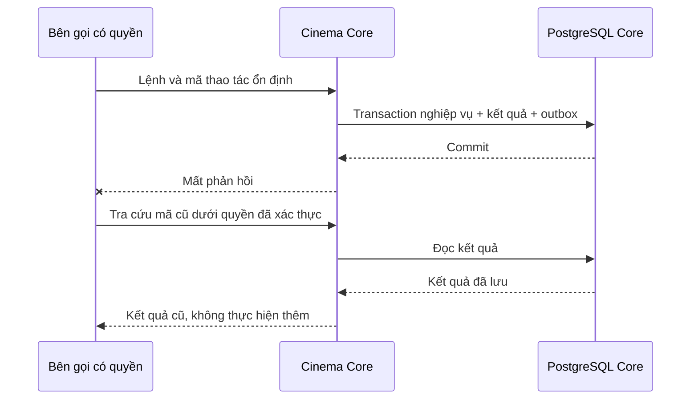
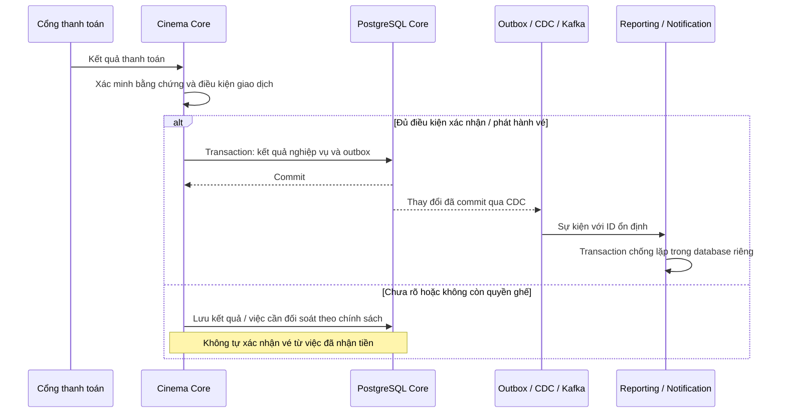

# Kiến trúc microservices Movie Booking Platform

## 1. Phạm vi và trạng thái

Bản tổng hợp kiến trúc đích: **7 service trong monorepo, với Cinema Core giữ hạt nhân giao dịch**.
Các ranh giới bên dưới đã được chủ sản phẩm chốt qua hội thoại ngày 2026-11-17. Bản tổng hợp này
vẫn là `draft` để chủ sản phẩm đọc lại; không chứng minh service đã được viết, kiểm thử hoặc triển khai.

Tài liệu trả lời service nào làm gì, sở hữu dữ liệu gì, giao tiếp và chịu lỗi ra sao. Không thiết kế
thêm tính năng, màn hình, endpoint, schema, thuật toán khóa hoặc kế hoạch triển khai.

- [Quyết định và lý do](decisions.md) giữ nguyên 19 mục ban đầu và bổ sung 3 quyết định tích hợp
  đã được xác nhận. Không hủy hoặc mở lại những chấp thuận đó.
- [Nghiên cứu nguồn sơ cấp](../../99-notes/service-boundary-research.md) cung cấp căn cứ, không thay quyết định.
- [So sánh ba ranh giới tích hợp](../../99-notes/service-integration-gaps-research.md) giữ các phương án
  và đánh đổi; lựa chọn đã duyệt được ghi tại bản quyết định.
- [ADR-0001](../../06-decisions/0001-monorepo-platform-and-microservices-boundaries.md) và
  [ADR-0002](../../06-decisions/0002-customer-organizer-app-boundaries.md) giữ nền monorepo và bốn app.
- [Mô hình sản phẩm](../../03-product/use-cases.md) và [GLOSSARY](../../../GLOSSARY.md) sở hữu nghiệp vụ/thuật ngữ.

Nguồn code nền đã đối chiếu là `2cd10657861db1b64e0b9f33e56769d59e9916f0`. Các ADR công nghệ có
nguồn phê duyệt riêng trong [danh mục ADR](../../06-decisions/README.md), được đối chiếu khi hòa giải
PR #5; tài liệu tích hợp không là bằng chứng code/runtime mới. ADR-0002 giữ ranh giới app,
NestJS/Fastify đổi từ mã 0002 ở nhánh tech stack sang ADR-0036 để tránh trùng mã.

## 2. Bản đồ service và dữ liệu sở hữu

Tên service trong bảng dẫn tới README tại thư mục tương ứng trong `services/`. Các thư mục hiện chỉ
định vị trách nhiệm bằng tài liệu, chưa có code, manifest hoặc cấu hình chạy service.

| Service | Trách nhiệm và dữ liệu sở hữu | Lý do giữ/tách |
| --- | --- | --- |
| **[Cinema Core](../../../services/cinema-core/README.md)** | Rạp, phòng, sơ đồ ghế, lịch chiếu, phiên bản phim gắn với suất, giá/điều kiện bán; hold, đơn, thanh toán/hoàn, quyền vé/soát; Hội viên, Ưu đãi/Voucher, Combo. | Các điều kiện giao dịch liên quan cần được bảo vệ trong một chủ dữ liệu. Không tách theo mỗi bảng hoặc mỗi bước đặt vé. |
| **[Agent](../../../services/agent-service/README.md)** | Ngữ cảnh hội thoại, checkpoint, truy vấn và đề xuất hành động. | Vòng đời mô hình/hội thoại khác giao dịch; không sở hữu trạng thái ghế, tiền hoặc vé. |
| **[Catalog](../../../services/catalog-service/README.md)** | Nội dung phim: tên, mô tả, thể loại, trailer, thời lượng, phân loại độ tuổi. | Biên tập nội dung độc lập; Core giữ phiên bản cần cho giao dịch của suất. |
| **[Identity & Access](../../../services/identity-service/README.md)** | Tài khoản, xác thực, xác minh email, phiên/khóa tài khoản; cấp/thu hồi vai trò và phạm vi rạp. | Một nguồn danh tính cho bốn app; service sở hữu tài nguyên vẫn tự kiểm quyền nghiệp vụ. |
| **[Notification](../../../services/notification-service/README.md)** | Mẫu/hộp thông báo, yêu cầu gửi email, lịch sử/trạng thái gửi và gửi lại. | Tách lỗi chuyển phát khỏi giao dịch và xác thực; không tự phát hành/xác minh mã nghiệp vụ. |
| **[Community](../../../services/community-service/README.md)** | Đánh giá, trạng thái hiển thị/lịch sử kiểm duyệt, phim yêu thích. | Nội dung khách hàng có vòng đời riêng; căn cứ đủ điều kiện đánh giá lấy từ Core. |
| **[Reporting](../../../services/reporting-service/README.md)** | Bản sao/mô hình đọc và tổng hợp vận hành/doanh thu, mốc cập nhật. | Tách truy vấn tổng hợp; chấp nhận dữ liệu trễ có thông báo, không là nguồn xác nhận thu/hoàn tiền. |

Core có các module trách nhiệm: Lịch/phòng, Ghế/hold, Đơn, Thanh toán/hoàn, Quyền vé/soát,
Hội viên, Ưu đãi/Voucher và Combo. Chúng phối hợp qua interface, không tự ghi dữ liệu của nhau;
không biến từng module thành một service hoặc một database riêng. Một interface gồm cả điều kiện,
lỗi và các bảo đảm cần biết, không chỉ danh sách hàm.

Bốn ứng dụng là Customer Web/Mobile và Organizer Web/Mobile. Ứng dụng và BFF mỏng là kênh giao tiếp,
không là chủ giao dịch mới. Worker là tiến trình thực thi trong trách nhiệm service sở hữu;
PostgreSQL, Redis, Kafka và Debezium là hạ tầng, không tính thêm vào bảy service nghiệp vụ.

### Kết hợp các lựa chọn công nghệ đã duyệt

Stack không thay ranh giới dữ liệu ở bảng trên. NestJS/Fastify + Drizzle thuộc Core
([ADR-0036](../../06-decisions/0036-nestjs-fastify-for-cinema-core.md), ADR-0005);
Python/FastAPI/LangGraph/uv và checkpoint trong database Agent theo ADR-0009/0013.
Better Auth thuộc Identity (ADR-0008), Resend do Notification tích hợp cùng Claim Check đã duyệt
(ADR-0018), media R2/Images thuộc Catalog (ADR-0019). Không tự chọn framework/ORM cho các service
bổ trợ chỉ vì đã chọn công nghệ của Core hoặc provider email.

[ADR-0035](../../06-decisions/0035-search-module-in-cinema-core.md) bổ sung **module Search trong Core**,
Typesense dẫn xuất và Cloudflare/Qwen3 external vectors theo ADR-0030–0034, BullMQ indexing nền.
Nội dung nguồn vẫn thuộc Catalog, đánh giá/yêu thích thuộc Community, danh tính thuộc Identity;
Search nhận dữ liệu qua hợp đồng/API/sự kiện, không SQL chéo database hoặc biến index thành chủ dữ liệu.
Luồng search không thay HTTP snapshot phim khi lập suất hoặc cho Agent tự gửi lệnh giao dịch.
Các DTO/projection/version/reconcile và quyền sở hữu profile/tín hiệu còn cần đặc tả; không thêm service thứ tám.

### Sơ đồ trách nhiệm tổng quát

Các đường biểu diễn vai trò logic, không phải đầy đủ đường mạng hoặc số container. Truy cập theo
quyền của từng app; ví dụ báo cáo không tự được cấp cho Customer chỉ vì dùng chung hộp ứng dụng.
Sơ đồ tổng quát cần mở rộng/thu phóng khi xem trong khung hẹp; bảng service là cách đọc tương đương.

Quan hệ bổ sung: Apps đọc hộp thông báo; Agent tra cứu Catalog; Identity là nguồn bằng chứng quyền
cho các service. Ba ranh giới Catalog–Core, Core–Community và email bảo mật được tách thành sơ đồ
riêng ở mục 4. Sơ đồ tổng quát không quy định mọi lời gọi hoặc yêu cầu gọi Identity đồng bộ.

## 3. Quyền sở hữu dữ liệu và ranh giới giao dịch

- **Mỗi service một database PostgreSQL logic**, credential/quyền migration riêng. Không đọc/ghi,
  JOIN hoặc khóa ngoại xuyên service, kể cả qua FDW/dblink; dùng ID và hợp đồng. Reporting lưu bản sao.
- Các module Core cùng dùng database Core và có thể tham gia transaction cục bộ qua interface.
  Không import ORM/schema nội bộ của service khác làm hợp đồng chung.
- Dùng cùng cụm PostgreSQL không đồng nghĩa cùng chủ dữ liệu; database riêng cũng không tự tạo cách
  ly CPU/RAM, WAL, sự cố hoặc khôi phục. Số cụm và backup vận hành còn mở.
  Phạm vi diễn tập mất Core DB đã được duyệt tại [NFR phục hồi](../nfr/recovery-and-correctness.md).
- CDC có quyền hạ tầng giới hạn để đọc nguồn outbox/WAL; không trao quyền đó cho business service
  hoặc mặc định phát mọi bảng nghiệp vụ. `packages/contracts` giữ hợp đồng, không giữ quyền dữ liệu.

| Ranh giới | Bảo đảm đã chốt |
| --- | --- |
| **Trong Core** | Transaction ngắn bảo vệ các thay đổi quyền liên quan, kết quả thao tác và outbox. Nhóm nguyên tử đã duyệt được lưu ở bản ghi quyết định. |
| **Core → cổng thanh toán** | Lưu ý định, gọi ngoài, xác minh rồi ghi kết quả bằng transaction tiếp theo. Không giữ khóa/transaction suốt thời gian chờ mạng hoặc khách trả tiền. |
| **Service phát → Kafka** | Thay đổi nghiệp vụ và outbox cùng transaction; Debezium phân phối sau commit. Không có transaction PostgreSQL–Kafka xuyên suốt. |
| **Kafka → consumer** | Dấu đã xử lý và cập nhật database consumer cùng transaction; giữ thứ tự nghiệp vụ cần thiết, chịu được giao lại. |
| **Agent → giao dịch khách** | Agent đề xuất; khách xác nhận, ứng dụng/BFF gửi lệnh dưới quyền khách. Chỉ Core có quyền quyết định kết quả giao dịch. |

### Sơ đồ dữ liệu và sự kiện

Ví dụ đường Core → Reporting/Notification; các database còn lại có chủ riêng theo bảng service.
Sơ đồ không quyết định số connector, broker, worker hay cụm PostgreSQL.

## 4. Giao tiếp và hợp đồng

| Quan hệ | Cách đã chọn / giới hạn |
| --- | --- |
| App/BFF → service sở hữu | HTTP/JSON cho truy vấn/lệnh; trả kết quả hoặc đang xử lý đúng thực tế. Nhận lệnh thanh toán không đồng nghĩa vé đã phát hành. |
| Agent ↔ app/BFF → Core | Agent điều phối; app/BFF thực thi bằng quyền khách, không để Agent giữ credential giao dịch rộng. Token/bí mật không vào mô hình hoặc checkpoint. |
| Core → Reporting / thông báo giao dịch | Sự kiện đã commit qua Outbox–Debezium–Kafka; xử lý nền không đảo ngược giao dịch hợp lệ. |
| Identity → service kiểm quyền | Bằng chứng có thể xác minh cục bộ, cập nhật/thu hồi quyền theo hợp đồng; không gọi Identity ở từng lượt soát/giao combo. |
| Catalog → Core | HTTP lấy snapshot của phiên bản đã công bố khi lập/công bố suất, ngoài transaction Core; lưu snapshot/version trong database Core. Đặt/soát vé dùng dữ liệu Core, không gọi Catalog mỗi lượt. |
| Core → Community | Core phát căn cứ đủ điều kiện theo tài khoản–phim qua Outbox/Kafka; Community dùng projection có phiên bản, HTTP fallback khi chưa rõ. Chấp nhận độ trễ đính chính có giới hạn; chưa chọn giá trị cửa sổ. |
| Identity/Core → email có mã bảo mật | Claim Check: nội dung mã hóa có thời hạn tại owner, outbox/luồng riêng chỉ mang tham chiếu; Notification lấy qua HTTPS xác thực. Owner phát hành/xác minh mã; không plaintext trong broker/log/trace/DLQ. |

Ba lựa chọn trên được chủ sản phẩm duyệt cùng nhau ngày 2026-11-17. Chấp thuận gồm các đánh đổi
về phụ thuộc và tính nhất quán, không tự chọn schema, endpoint hoặc thời hạn cụ thể.

### Snapshot phim qua HTTP

Core lấy nội dung phiên bản đã công bố và kiểm tra tính hợp lệ tại mốc Catalog trả lời, sau đó
lưu snapshot cùng suất bằng transaction ngắn. Không giữ transaction database trong lúc gọi Catalog.
Nội dung phiên bản bất biến không đồng nghĩa phiên bản luôn được phép dùng; Catalog có thể ngừng
phiên bản giữa HTTP check và Core commit. Không có bảo đảm nguyên tử xuyên hai service.
Giao thức xử lý ngừng phiên bản/đính chính suất đã công bố cần đặc tả riêng, không âm thầm ghi đè snapshot.

### Căn cứ đánh giá: projection và truy vấn bù

Core sở hữu kết luận có phiên bản theo tài khoản đặt–phim, gồm cả đính chính/thu hồi; Community
không tự suy quyền từ mọi sự kiện quét vé hoặc hoàn tiền. Kết quả HTTP và sự kiện dùng cùng quy tắc
phiên bản; dữ liệu cũ không được ghi đè kết quả mới. Đính chính một vé không tự xóa căn cứ của vé khác.

Phân biệt đủ điều kiện, không đủ điều kiện tại mốc xác minh và chưa rõ. Miss, thiếu thứ tự, backfill
chưa xong hoặc dữ liệu quá cũ là chưa rõ: truy vấn Core; Core lỗi thì tạm chưa cho đăng, không tự
báo khách chưa xem hoặc bỏ kiểm tra. Căn cứ dương tính cục bộ hợp lệ cho phép đăng khi Core gián đoạn,
trong cửa sổ độ mới được phép và khi chưa nhận thu hồi. Không tự kéo dài cửa sổ khi mất liên lạc.

Độ mới phải dựa trên quan sát tại nguồn và mốc bao phủ dữ liệu, không chỉ Kafka lag hoặc giờ đọc
cache. Cần backfill/rebuild có mốc và bàn giao sự kiện không hở. Chấp thuận projection bao gồm
đánh đổi có khoảng trễ đính chính; chưa chọn độ dài. Không tự thu hồi/xóa đánh giá đã đăng từ quyết định này.

### Mã bảo mật: Claim Check qua luồng riêng

Owner lưu dữ liệu xác minh, payload gửi được mã hóa ngắn hạn và ý định/outbox tham chiếu một cách
nguyên tử theo thiết kế tích hợp. Callback Better Auth không tự chứng minh bảo đảm này; phải kiểm
chứng adapter/vòng đời khi triển khai, không thay bằng gửi fire-and-forget sau commit.

Luồng riêng chỉ mang tham chiếu mờ, nguồn và mục đích, không chứa OTP, email người nhận, reset URL
hoặc token. Notification dùng danh tính dịch vụ gọi HTTPS tới nguồn tin cậy; tham chiếu không là quyền
truy cập. Owner kiểm hạn/thu hồi/thay thế và ràng buộc người nhận/ngữ cảnh. Không đọc SQL chéo database.

Payload được bảo vệ bằng mã hóa và quyền giải mã riêng; khóa tách khỏi dữ liệu. Notification/provider
phải thấy plaintext trong lúc gửi, nhưng không lưu plaintext trong database, queue, log, trace hoặc DLQ.
Lấy payload không tiêu thụ mã xác minh. Retry có giới hạn, cùng mã/thời hạn, không phát hành/gia hạn
mã mới để phục hồi lỗi chuyển phát. Provider nhận nhưng mất phản hồi có thể dẫn đến email trùng;
không hứa đúng một lần hoặc thu hồi được thư đã bàn giao. Dọn payload/bản sao mã hóa theo vòng đời.

Lệnh thay đổi dùng mã thao tác ổn định, lưu bền kết quả; timeout phải tra cứu trước khi thử lại.
Cùng mã khác nội dung bị từ chối, mã không thay xác thực/quyền. Sự kiện dùng ID ổn định; không
nhầm bản cập nhật trạng thái với khoản cộng/trừ tài chính hoặc hứa “đúng một lần” cho provider ngoài.
Kafka giữ sự kiện; BullMQ giữ vai trò job đã chọn. Không mặc định mọi event đều qua cả hai.

Monorepo không tự chứng minh triển khai độc lập: mỗi service cần giữ interface tương thích,
kiểm chứng hợp đồng và migration trong quyền sở hữu khi triển khai sau này. Chưa thiết kế pipeline
hoặc thêm cơ chế runtime để tuyên bố điều đó đã đạt.

## 5. Luồng kiến trúc quan trọng

### Đặt qua chat và xác nhận kết quả

Sơ đồ chỉ mô tả trách nhiệm, không đặc tả màn hình hoặc endpoint. Nội dung xác nhận và ví dụ nghiệp vụ
đã duyệt nằm tại bản ghi quyết định; giá, ghế và điều kiện vẫn được Core kiểm tra khi thực thi.

### Core commit rồi mất phản hồi

### Thanh toán bên ngoài và hệ quả bất đồng bộ

Không mô tả toàn bộ máy trạng thái đặt vé. Core chỉ phát hành vé khi xác minh đủ căn cứ thanh toán
và quyền ghế; webhook lặp/đến muộn theo chính sách nghiệp vụ, không tự cấp vé hoặc đổi ghế.

## 6. Phạm vi lỗi và phục hồi

| Sự cố | Ranh giới và hành vi kiến trúc |
| --- | --- |
| **Agent lỗi** | Giao dịch đã commit thuộc Core, checkpoint không thay kết quả. Tách Agent khỏi chủ giao dịch; khả năng từng kênh trực tiếp vẫn cần kiểm chứng. |
| **Core/PostgreSQL Core lỗi hoặc kết quả chưa rõ** | Không tự xác nhận hold/vé/soát thành công; tra cứu kết quả có thẩm quyền khi phục hồi. |
| **Identity lỗi** | Soát/giao thường xuyên kiểm cục bộ theo phạm vi đã cấp; tác vụ rủi ro cao cần quyền hiện hành. Webhook/tra cứu công khai không phụ thuộc phiên khách. |
| **Kafka/CDC/consumer lỗi** | Core không chờ consumer để hoàn tất giao dịch đã commit; outbox và tiến độ phục hồi cần bảo vệ. Trễ phân phối không là lý do bỏ qua thu hồi đã biết hoặc đồng bộ trễ vô hạn. |
| **Notification/email lỗi** | Theo dõi/gửi lại có kiểm soát, không hủy vé hợp lệ; email đã gửi chưa chứng minh mã đã xác minh. Claim Check không lấy được payload khi owner lỗi; retry không gia hạn mã. |
| **Reporting lỗi/trễ** | Không chặn đặt/soát vé; hiển thị mốc cập nhật, không dùng bản sao thay xác nhận thu/hoàn tiền. |
| **Community không xác minh được căn cứ Core** | Dùng căn cứ dương tính cục bộ trong chính sách độ mới; chưa rõ thì HTTP fallback, Core lỗi vẫn chưa rõ và tạm không cho đăng. Thu hồi đã nhận phải được áp dụng. Lỗi Community không chặn đặt/soát vé. |
| **Catalog lỗi** | Không lấy được snapshot thì chưa lập/công bố suất mới cần snapshot đó. Các suất đã lưu snapshot hợp lệ đặt/soát bằng dữ liệu Core; không bỏ qua trạng thái dừng/hủy của Core hoặc tự sửa phiên bản phim. |
| **Cổng thanh toán timeout** | Lưu ý định/kết quả chưa rõ, tra cứu/đối soát; không thu/hoàn lần nữa bằng một mã mới mù quáng. |

Consumer thử lại có giới hạn, cách ly lỗi bền và replay có kiểm soát. Xây lại Reporting không tự gửi
lại email/hoàn tiền. Inbox bảo vệ database của consumer, không tự bảo vệ tác dụng phụ provider ngoài.
Hủy suất có hiệu lực tại Core trước xử lý nền từng đơn; đây là ranh giới nhất quán/khôi phục, không
thiết kế thêm chính sách hủy trong tài liệu này.

Điều kiện vận hành đã duyệt được giữ nguyên: mục tiêu soát thêm **60 phút** khi Identity gián đoạn,
bằng chứng quyền vận hành **90 phút**, làm mới chậm nhất mỗi **15 phút** khi khỏe; chỉ với phiên sẵn
sàng/Core còn hoạt động. Thu hồi đã nhận phải từ chối; quyền cũ tối đa đến hạn 90 phút khi đường cập
nhật bị mất. Chi tiết/điều kiện và giới hạn của phép tính 75 phút nằm trong [bản ghi](decisions.md).
Đây là yêu cầu thiết kế, chưa phải bảo đảm runtime hoặc thu hồi tức thì lúc mất liên lạc.

## 7. Đánh đổi và phần để mở

Chọn hướng B thay vì chỉ Core+Agent hoặc tách ngay ghế/đơn/thanh toán/vé: tập trung nhất quán ở Core,
đồng thời tách các vòng đời nội dung, danh tính, hội thoại, thông báo và tổng hợp. Đổi lại có bảy đơn vị
phát hành, nhiều database logic, hợp đồng, luồng sự kiện và phục hồi cần vận hành/kiểm chứng.
Không dùng thiếu nhân lực hoặc chi phí làm lý do tự hạ mục tiêu kiến trúc đã được chọn.

**Phần kiến trúc còn mở, không tự mặc định đã duyệt:**

- Ba phương thức tích hợp đã chốt ở mục 4. Cửa sổ trễ đính chính của Community chưa có giá trị;
  nguyên tắc version/coverage, ngừng phiên bản Catalog và tích hợp nguyên tử mã–ý định gửi cần
  đặc tả trước khi triển khai, không tự coi đã đạt chỉ nhờ HTTP/Kafka/callback.
- Quyền đọc riêng tư Agent và chi tiết hợp đồng ủy quyền/xác thực giữa các lớp ngoài phần đã chốt.
- Tương thích phiên bản hợp đồng, độ trễ sự kiện, retention/rebuild và phục hồi dữ liệu liên service.
- Topology/HA/số cụm, backup vận hành và ngân sách kết nối còn mở. Mục tiêu tải, cảnh báo và phục hồi
  của demo theo [bộ NFR](../nfr/README.md).

**Để lại cho đặc tả tính năng/kỹ thuật khi được giao:** endpoint/DTO/schema/enum, TTL đề xuất và mã
thao tác, thuật toán khóa/isolation, số lần retry, UI xác nhận, chi tiết worker/hủy từng đơn và quy trình
đính chính dữ liệu phim. Chúng không là điều kiện để đọc/duyệt bản tổng hợp kiến trúc này.
