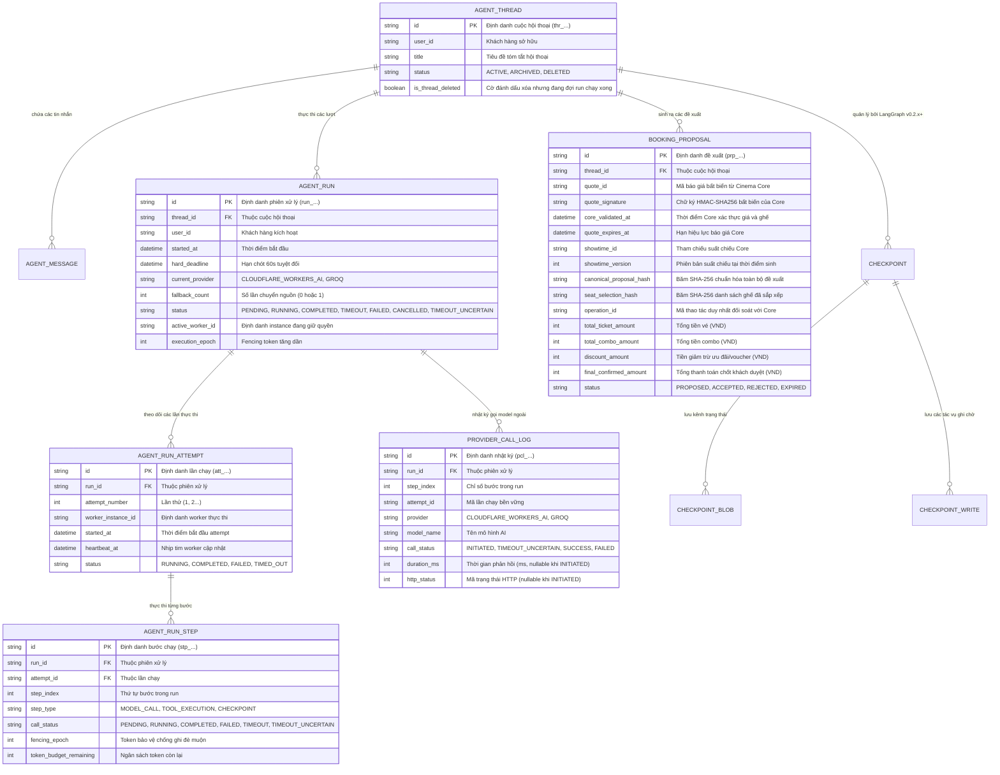
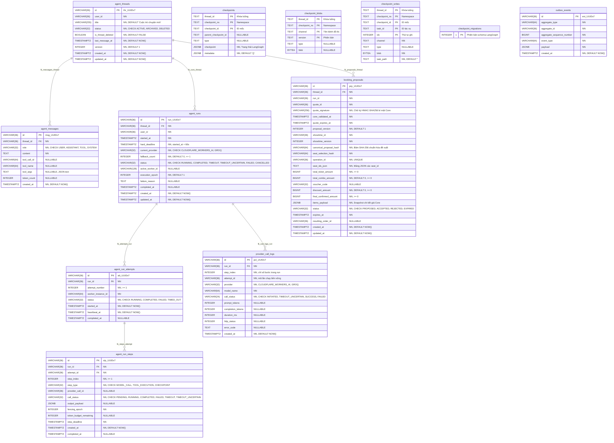
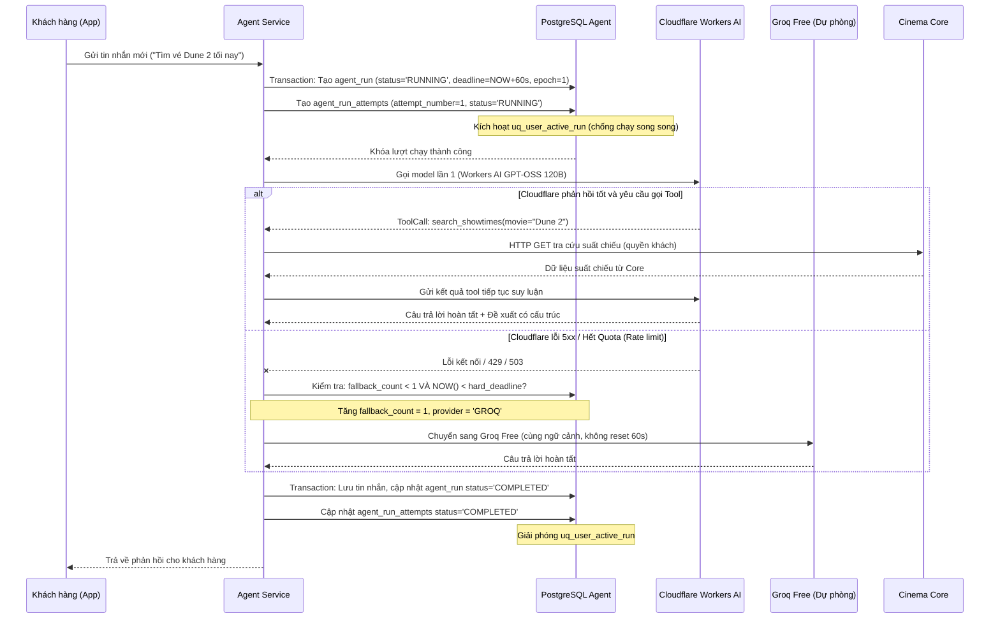

# Thiết kế dữ liệu Database Agent

## 1. Trách nhiệm và nguồn

### Trách nhiệm của Service và Database
- Agent Service sở hữu toàn bộ ngữ cảnh hội thoại (Conversational Context), lịch sử tin nhắn giữa người dùng và trợ lý ảo Buaa, các đề xuất giao dịch có cấu trúc (Booking Proposals), và trạng thái thực thi từng bước (Graph Execution State & Checkpoints) của luồng LangGraph Python (`langgraph-checkpoint-postgres` v0.2.x+ theo ADR-0010, ADR-0013).
- Agent Service sử dụng thư viện LangGraph PostgresSaver để duy trì tính bền bỉ của đồ thị trạng thái Agent qua các bảng chuẩn do thư viện quản lý: `checkpoints`, `checkpoint_blobs`, `checkpoint_writes`, `checkpoint_migrations`.
- Agent Service **tuyệt đối không phải là chủ giao dịch nghiệp vụ**. Agent chỉ diễn giải ý định của khách hàng, tra cứu thông tin suất chiếu từ Cinema Core, xây dựng đề xuất đặt vé/đổi ghế có cấu trúc và gửi về cho khách hàng xác nhận trên giao diện ứng dụng. Lệnh ghi giao dịch thực tế luôn do App/BFF gửi trực tiếp sang Cinema Core dưới quyền của khách hàng (BR-17).
- Database Agent không lưu trữ thông tin thẻ, credential, mật khẩu, OTP hay mã QR vé của khách hàng. Khi khách hàng yêu cầu xóa một cuộc hội thoại hoặc toàn bộ lịch sử chat (use case A-06, BR-37), Agent Service bảo vệ các run đang chạy dở và xóa các bản ghi hội thoại/checkpoint tương ứng mà không làm ảnh hưởng đến dữ liệu đơn hàng hay quyền vé tại Cinema Core.

### Nguồn nghiệp vụ và quyết định kỹ thuật
- [Use case C-01, A-06](../../../03-product/use-cases.md) và [Mô tả use case](../../../03-product/use-case-descriptions.md).
- [Quy tắc nghiệp vụ BR-17, BR-34, BR-37](../../../03-product/use-cases.md#4-quy-tắc-đã-thống-nhất).
- [Kiến trúc microservices](../../004-service-decomposition/spec.md) và [Quyết định kiến trúc](../../004-service-decomposition/decisions.md).
- [ADR-0009](../../../06-decisions/0009-python-fastapi-langgraph-and-uv-for-agent-service.md) (Python/FastAPI cho Agent Service).
- [ADR-0012](../../../06-decisions/0012-cloudflare-workers-ai-and-gpt-oss-120b.md) và [ADR-0028](../../../06-decisions/0028-groq-free-for-agent-provider-fallback.md) (Cloudflare Workers AI GPT-OSS 120B làm chính, Groq Free làm dự phòng).
- [ADR-0013](../../../06-decisions/0013-modular-agent-postgres-checkpoints-and-httpx.md) (PostgresSaver cho checkpoint LangGraph v0.2.x+).
- [NFR cho AI Agent](https://github.com/NhiBuaa/movie-booking-agent/blob/ad002e99936231fac0f8493830b9ec36dc3aedb2/docs/05-specs/nfr/ai-agent.md) (§9.5 và §9.11):
  - Giới hạn tối đa một lượt xử lý AI đang chạy trên mỗi tài khoản (`max 1 active run / account`).
  - Hard deadline 60 giây không được cấp mới hay reset khi reconnect, resume, đổi replica hoặc chuyển đổi provider.
  - Tối đa một lần chuyển nguồn AI (Cloudflare → Groq Free) trong một lượt xử lý; không bao giờ tự động kích hoạt gói trả phí.

---

## 2. ERD logic

Mô hình logic thể hiện sự phân định rạch ròi giữa các thực thể ứng dụng (Thread, Message, Run, Attempt, Step, Proposal) và các bảng Checkpoint do thư viện LangGraph quản lý.



---

## 3. ERD chi tiết

> [!TIP]
> **Hướng dẫn xem sơ đồ:** Để đọc rõ các nhãn cột và quan hệ phức tạp trong sơ đồ chi tiết, khuyến nghị xem tài liệu ở chế độ xem rộng hoặc 100% zoom, cuộn ngang, hoặc xem riêng từng phân vùng quan hệ.

Mô hình chi tiết toàn bộ các bảng trong database `agent` kèm kiểu dữ liệu PostgreSQL, thuộc tính ràng buộc và quan hệ khóa ngoại nội bộ.



---

## 4. Từ điển dữ liệu toàn diện (100% các bảng)

### 4.1. Bảng `agent_threads` (Cuộc trò chuyện của người dùng)

| Tên cột | Kiểu dữ liệu | Nullable | Default | Ý nghĩa / Đơn vị | Nguồn quy tắc |
|---|---|---|---|---|---|
| `id` | `VARCHAR(36)` | NOT NULL | Không có | Khóa chính, tiền tố `thr_` theo UUIDv7 | Mục 4.1 `spec.md` |
| `user_id` | `VARCHAR(36)` | NOT NULL | Không có | Khách hàng sở hữu cuộc trò chuyện (`usr_...`) | BR-17, BR-37 |
| `title` | `VARCHAR(255)` | NOT NULL | `'Cuộc trò chuyện mới'` | Tiêu đề tóm tắt cuộc trò chuyện hiển thị trên sidebar | Trải nghiệm UI |
| `status` | `VARCHAR(32)` | NOT NULL | `'ACTIVE'` | Trạng thái: `ACTIVE`, `ARCHIVED`, `DELETED` | BR-37 |
| `is_thread_deleted` | `BOOLEAN` | NOT NULL | `FALSE` | Cờ đánh dấu người dùng đã xóa chat nhưng đang chờ run hoàn tất | Finding 12, BR-37 |
| `last_message_at` | `TIMESTAMPTZ` | NOT NULL | `NOW()` | Thời điểm nhận tin nhắn mới nhất | Trải nghiệm UI |
| `version` | `INTEGER` | NOT NULL | `1` | Số hiệu phiên bản dùng cho Optimistic Locking | Mục 4.4 `spec.md` |
| `created_at` | `TIMESTAMPTZ` | NOT NULL | `NOW()` | Thời điểm bắt đầu tạo cuộc hội thoại (UTC) | Mục 4.3 `spec.md` |
| `updated_at` | `TIMESTAMPTZ` | NOT NULL | `NOW()` | Thời điểm cập nhật cuộc trò chuyện gần nhất (UTC) | Mục 4.3 `spec.md` |

### 4.2. Bảng `agent_messages` (Nội dung tin nhắn trong cuộc trò chuyện)

| Tên cột | Kiểu dữ liệu | Nullable | Default | Ý nghĩa / Đơn vị | Nguồn quy tắc |
|---|---|---|---|---|---|
| `id` | `VARCHAR(36)` | NOT NULL | Không có | Khóa chính, tiền tố `msg_` theo UUIDv7 | Mục 4.1 `spec.md` |
| `thread_id` | `VARCHAR(36)` | NOT NULL | Không có | Khóa ngoại tham chiếu `agent_threads(id)` | Quyền sở hữu thread |
| `role` | `VARCHAR(32)` | NOT NULL | Không có | Vai trò: `USER`, `ASSISTANT`, `TOOL`, `SYSTEM` | Chuẩn hội thoại AI |
| `content` | `TEXT` | NOT NULL | Không có | Nội dung văn bản tiếng Việt của tin nhắn | BR-17, NFR-AI-01 |
| `tool_call_id` | `VARCHAR(64)` | NULL | NULL | ID lệnh gọi công cụ nếu là tin nhắn function call | Kiến trúc đồ thị AI |
| `tool_name` | `VARCHAR(64)` | NULL | NULL | Tên công cụ Core được gọi (ví dụ: `search_showtimes`) | BR-17 |
| `tool_args` | `TEXT` | NULL | NULL | Đối số gửi sang công cụ dạng chuỗi JSON | BR-17 |
| `token_count` | `INTEGER` | NULL | NULL | Ước tính số lượng token để theo dõi chi phí/quota | NFR-RES-01 |
| `created_at` | `TIMESTAMPTZ` | NOT NULL | `NOW()` | Thời điểm gửi tin nhắn (UTC) | Mục 4.3 `spec.md` |

### 4.3. Bảng `agent_runs` (Phiên điều phối thực thi và quản lý tài nguyên)

| Tên cột | Kiểu dữ liệu | Nullable | Default | Ý nghĩa / Đơn vị | Nguồn quy tắc |
|---|---|---|---|---|---|
| `id` | `VARCHAR(36)` | NOT NULL | Không có | Khóa chính, tiền tố `run_` theo UUIDv7 | Mục 4.1 `spec.md` |
| `thread_id` | `VARCHAR(36)` | NOT NULL | Không có | Khóa ngoại tham chiếu `agent_threads(id)` | Quyền sở hữu thread |
| `user_id` | `VARCHAR(36)` | NOT NULL | Không có | Định danh tài khoản khách hàng kích hoạt lượt chạy | NFR-RES-01 |
| `started_at` | `TIMESTAMPTZ` | NOT NULL | Không có | Mốc thời gian bắt đầu lượt xử lý (UTC) | NFR-RES-01 |
| `hard_deadline` | `TIMESTAMPTZ` | NOT NULL | Không có | Mốc thời gian hết hạn tuyệt đối = `started_at + 60 seconds` | NFR-RES-01 mục 9.11 |
| `current_provider`| `VARCHAR(32)` | NOT NULL | Không có | Nhà cung cấp AI đang phục vụ: `CLOUDFLARE_WORKERS_AI`, `GROQ` | ADR-0012, ADR-0028 |
| `fallback_count` | `INTEGER` | NOT NULL | `0` | Số lần đã chuyển nguồn AI (tối đa 1 lần theo NFR-RES-01) | NFR-RES-01 mục 9.11.2 |
| `status` | `VARCHAR(32)` | NOT NULL | `'RUNNING'` | Trạng thái: `CHECK (status IN ('RUNNING', 'COMPLETED', 'TIMEOUT', 'TIMEOUT_UNCERTAIN', 'FAILED', 'CANCELLED'))` | NFR-RES-01, F23 |
| `active_worker_id`| `VARCHAR(128)`| NULL | NULL | Định danh instance/process đang nắm quyền xử lý | NFR-RES-01, NFR-DUR-01 |
| `execution_epoch` | `INTEGER` | NOT NULL | `1` | Fencing token tăng dần; loại bỏ worker cũ khi resume/retry | Finding 12, NFR-RES-01 |
| `failure_reason` | `TEXT` | NULL | NULL | Mã lỗi hoặc thông điệp giải thích ngắn gọn khi thất bại | NFR-REL-01 |
| `completed_at` | `TIMESTAMPTZ` | NULL | NULL | Thời điểm lượt xử lý kết thúc hoàn toàn (UTC) | NFR-AI-01 |
| `created_at` | `TIMESTAMPTZ` | NOT NULL | `NOW()` | Thời điểm tạo bản ghi lượt chạy (UTC) | Mục 4.3 `spec.md` |
| `updated_at` | `TIMESTAMPTZ` | NOT NULL | `NOW()` | Thời điểm cập nhật trạng thái gần nhất (UTC) | Mục 4.3 `spec.md` |

### 4.4. Bảng `agent_run_attempts` (Lịch sử các lần thực thi/retry của phiên chạy)

| Tên cột | Kiểu dữ liệu | Nullable | Default | Ý nghĩa / Đơn vị | Nguồn quy tắc |
|---|---|---|---|---|---|
| `id` | `VARCHAR(36)` | NOT NULL | Không có | Khóa chính, tiền tố `att_` theo UUIDv7 | Finding 12 |
| `run_id` | `VARCHAR(36)` | NOT NULL | Không có | Khóa ngoại tham chiếu `agent_runs(id)` | Finding 12 |
| `attempt_number` | `INTEGER` | NOT NULL | `1` | Thứ tự lần thực thi (1, 2...) | Finding 12 |
| `worker_instance_id`| `VARCHAR(64)`| NOT NULL | Không có | Định danh node/process đang chạy attempt | Finding 12 |
| `status` | `VARCHAR(32)` | NOT NULL | `'RUNNING'` | `CHECK (status IN ('RUNNING', 'COMPLETED', 'FAILED', 'TIMED_OUT'))` | Finding 12 |
| `started_at` | `TIMESTAMPTZ` | NOT NULL | `NOW()` | Mốc bắt đầu attempt | Finding 12 |
| `heartbeat_at` | `TIMESTAMPTZ` | NOT NULL | `NOW()` | Nhịp tim cập nhật định kỳ (mỗi 5 giây) để phát hiện worker chết | Finding 12 |
| `completed_at` | `TIMESTAMPTZ` | NULL | NULL | Mốc kết thúc attempt | Finding 12 |

### 4.5. Bảng `agent_run_steps` (Chi tiết từng bước thực thi trong lượt chạy AI)

| Tên cột | Kiểu dữ liệu | Nullable | Default | Ý nghĩa / Đơn vị | Nguồn quy tắc |
|---|---|---|---|---|---|
| `id` | `VARCHAR(36)` | NOT NULL | Không có | Khóa chính, tiền tố `stp_` theo UUIDv7 | Finding 12 |
| `run_id` | `VARCHAR(36)` | NOT NULL | Không có | Khóa ngoại tham chiếu `agent_runs(id)` | Finding 12 |
| `attempt_id` | `VARCHAR(36)` | NOT NULL | Không có | Khóa ngoại tham chiếu `agent_run_attempts(id)` | Finding 12 |
| `step_index` | `INTEGER` | NOT NULL | Không có | Số thứ tự tăng dần của bước trong run (1, 2, 3...) | Finding 12 |
| `step_type` | `VARCHAR(32)` | NOT NULL | Không có | `CHECK (step_type IN ('MODEL_CALL', 'TOOL_EXECUTION', 'CHECKPOINT'))` | Finding 12 |
| `provider_call_id` | `VARCHAR(36)` | NULL | NULL | Tham chiếu tới `provider_call_logs(id)` nếu bước này gọi model ngoài | Finding 12 |
| `call_status` | `VARCHAR(32)` | NOT NULL | `'PENDING'` | `CHECK (call_status IN ('PENDING', 'RUNNING', 'COMPLETED', 'FAILED', 'TIMEOUT', 'TIMEOUT_UNCERTAIN'))` | Finding 12 |
| `output_payload` | `JSONB` | NULL | NULL | Dữ liệu đầu ra của bước (kết quả tool call, payload phản hồi mô hình) | Finding 12, F23 |
| `fencing_epoch` | `INTEGER` | NOT NULL | Không có | Fencing epoch của attempt tại thời điểm bước được kích hoạt | Finding 12 |
| `token_budget_remaining` | `INTEGER` | NULL | NULL | Số token còn lại trong ngân sách phân bổ cho run | Finding 12 |
| `step_deadline` | `TIMESTAMPTZ` | NOT NULL | Không có | Hạn chót của bước (không vượt quá `agent_runs.hard_deadline`) | NFR-RES-01 |
| `created_at` | `TIMESTAMPTZ` | NOT NULL | `NOW()` | Thời điểm bắt đầu bước (UTC) | Finding 12 |
| `completed_at` | `TIMESTAMPTZ` | NULL | NULL | Thời điểm bước hoàn tất (UTC) | Finding 12 |

### 4.6. Bảng `booking_proposals` (Đề xuất giao dịch có cấu trúc cho người dùng)

| Tên cột | Kiểu dữ liệu | Nullable | Default | Ý nghĩa / Đơn vị | Nguồn quy tắc |
|---|---|---|---|---|---|
| `id` | `VARCHAR(36)` | NOT NULL | Không có | Khóa chính, tiền tố `prp_` theo UUIDv7 | Mục 4.1 `spec.md` |
| `thread_id` | `VARCHAR(36)` | NOT NULL | Không có | Khóa ngoại tham chiếu `agent_threads(id)` | BR-17 |
| `run_id` | `VARCHAR(36)` | NOT NULL | Không có | Lượt chạy Agent đã sinh ra đề xuất này | BR-17 |
| `quote_id` | `VARCHAR(36)` | NOT NULL | Không có | Mã định danh báo giá bất biến do Cinema Core phát hành | Finding 11 |
| `quote_signature` | `VARCHAR(256)` | NOT NULL | Không có | Chữ ký số HMAC-SHA256 bí mật do Core phát hành trên báo giá | Finding 11 |
| `core_validated_at` | `TIMESTAMPTZ` | NOT NULL | Không có | Thời điểm Cinema Core xác nhận tính hợp lệ của báo giá | Finding 11 |
| `quote_expires_at` | `TIMESTAMPTZ` | NOT NULL | Không có | Hạn hiệu lực của báo giá do Cinema Core quy định | Finding 11 |
| `proposal_version` | `INTEGER` | NOT NULL | `1` | Phiên bản của đề xuất giao dịch | Finding 11 |
| `showtime_id` | `VARCHAR(36)` | NOT NULL | Không có | Suất chiếu tại Cinema Core được đề xuất (`shw_...`) | BR-17 |
| `showtime_version` | `INTEGER` | NOT NULL | Không có | Phiên bản suất chiếu tại thời điểm sinh đề xuất (từ `showtimes.version`) | Finding 11 |
| `canonical_proposal_hash`| `VARCHAR(64)`| NOT NULL | Không có | Băm SHA-256 chuẩn hóa toàn bộ payload: user_id, showtime_id, seat_ids sorted, combo_items sorted, voucher, điểm, tổng tiền (Finding 11) | Finding 11, BR-17 |
| `seat_selection_hash`| `VARCHAR(64)`| NOT NULL | Không có | Băm SHA-256 danh sách `seat_ids` đã sắp xếp để bảo toàn vị trí ghế | Finding 11 |
| `operation_id` | `VARCHAR(36)` | NOT NULL | Không có | Định danh thao tác duy nhất (UNIQUE) để Core đối soát chống lặp | Finding 11 |
| `seat_ids_json` | `TEXT` | NOT NULL | Không có | Danh sách ID ghế vật lý được gợi ý dạng mảng JSON | BR-17, BR-04 |
| `total_ticket_amount` | `BIGINT` | NOT NULL | Không có | Tổng giá vé chuẩn xác từ báo giá Cinema Core (VND) | Finding 11, BR-17 |
| `total_combo_amount` | `BIGINT` | NOT NULL | `0` | Tổng giá combo bắp nước chuẩn xác từ Core (VND) | Finding 11, BR-17 |
| `voucher_code` | `VARCHAR(32)` | NULL | NULL | Mã voucher áp dụng trong báo giá (nếu có) | Finding 11, BR-17 |
| `discount_amount` | `BIGINT` | NOT NULL | `0` | Số tiền giảm trừ chuẩn xác do Core phê duyệt (VND) | Finding 11, BR-17 |
| `final_confirmed_amount` | `BIGINT` | NOT NULL | Không có | Tổng tiền thanh toán bất biến khách hàng cần duyệt (VND) | Finding 11 |
| `items_payload` | `JSONB` | NOT NULL | Không có | Snapshot chi tiết danh sách vé, combo, đơn giá từ báo giá Core | Finding 11 |
| `status` | `VARCHAR(32)` | NOT NULL | `'PROPOSED'` | Trạng thái: `PROPOSED`, `ACCEPTED`, `REJECTED`, `EXPIRED` | BR-17 |
| `expires_at` | `TIMESTAMPTZ` | NOT NULL | Không có | Hạn hiệu lực của đề xuất hiển thị trên UI (tối đa bằng `quote_expires_at`) | BR-17, Finding 11 |
| `resulting_order_id` | `VARCHAR(36)` | NULL | NULL | `ord_...` tương ứng nếu khách hàng đồng ý và tạo đơn | BR-17 |
| `created_at` | `TIMESTAMPTZ` | NOT NULL | `NOW()` | Thời điểm tạo đề xuất (UTC) | Mục 4.3 `spec.md` |
| `updated_at` | `TIMESTAMPTZ` | NOT NULL | `NOW()` | Thời điểm khách hàng phản hồi đề xuất (UTC) | Mục 4.3 `spec.md` |

### 4.7. Bảng `provider_call_logs` (Nhật ký gọi mô hình AI ngoài)

| Tên cột | Kiểu dữ liệu | Nullable | Default | Ý nghĩa / Đơn vị | Nguồn quy tắc |
|---|---|---|---|---|---|
| `id` | `VARCHAR(36)` | NOT NULL | Không có | Khóa chính, tiền tố `pcl_` theo UUIDv7 | ADR-0012, ADR-0028 |
| `run_id` | `VARCHAR(36)` | NOT NULL | Không có | Khóa ngoại tham chiếu `agent_runs(id)` | ADR-0012 |
| `step_index` | `INTEGER` | NOT NULL | Không có | Thứ tự bước thực thi trong run | Finding 12, F23 |
| `attempt_id` | `VARCHAR(36)` | NOT NULL | Không có | Mã lần chạy bền vững (`att_...`) | Finding 12, F23 |
| `provider` | `VARCHAR(32)` | NOT NULL | Không có | `CLOUDFLARE_WORKERS_AI`, `GROQ` | ADR-0012, ADR-0028 |
| `model_name` | `VARCHAR(64)` | NOT NULL | Không có | Tên mô hình (ví dụ: `@cf/meta/llama-3-70b-instruct`) | ADR-0012 |
| `call_status` | `VARCHAR(24)` | NOT NULL | Không có | `CHECK (call_status IN ('INITIATED', 'TIMEOUT_UNCERTAIN', 'SUCCESS', 'FAILED'))` | Finding 12, F23 |
| `prompt_tokens` | `INTEGER` | NULL | NULL | Số token đầu vào | NFR-RES-01 |
| `completion_tokens` | `INTEGER` | NULL | NULL | Số token sinh ra | NFR-RES-01 |
| `duration_ms` | `INTEGER` | NULL | NULL | Thời gian phản hồi tính bằng mili-giây (NULL khi `call_status = 'INITIATED'`) | NFR-AI-01, F23 |
| `http_status` | `INTEGER` | NULL | NULL | Mã trạng thái HTTP trả về từ API provider (NULL khi `call_status = 'INITIATED'` hoặc lỗi mạng) | NFR-REL-01, F23 |
| `error_code` | `TEXT` | NULL | NULL | Mã lỗi nếu cuộc gọi thất bại | NFR-REL-01 |
| `created_at` | `TIMESTAMPTZ` | NOT NULL | `NOW()` | Thời điểm gọi API (UTC) | Mục 4.3 `spec.md` |

### 4.8. Các bảng do Thư viện LangGraph Checkpoint quản lý

Các bảng dưới đây mô tả cấu trúc tham chiếu theo triển khai tiêu chuẩn của thư viện `langgraph-checkpoint-postgres` (khảo sát theo mẫu LangGraph Python v0.2.x, package `langgraph-checkpoint-postgres`). Toàn bộ schema runtime, index và migration nội bộ của các bảng này do thư viện tự động khởi tạo và nâng cấp tại runtime (`internal runtime-managed schema`). Ứng dụng Agent không can thiệp thủ công vào migration hay thêm/xóa cột nội bộ của thư viện, và không kiểm chứng qua script ứng dụng theo kế hoạch (plan dòng 119/247):

1. **Bảng `checkpoint_migrations`:**
   - `v` (`INTEGER PRIMARY KEY`): Lưu số hiệu phiên bản migration hiện tại của LangGraph.
2. **Bảng `checkpoints`:**
   - `thread_id` (`TEXT NOT NULL`): Khóa định danh luồng hội thoại.
   - `checkpoint_ns` (`TEXT NOT NULL DEFAULT ''`): Không gian tên đồ thị con.
   - `checkpoint_id` (`TEXT NOT NULL`): Định danh mốc trạng thái (UUID hoặc số tuần tự).
   - `parent_checkpoint_id` (`TEXT NULL`): Mốc trạng thái cha trước đó.
   - `type` (`TEXT NULL`): Kiểu tuần tự hóa trạng thái.
   - `checkpoint` (`JSONB NOT NULL`): Dữ liệu trạng thái đồ thị đầy đủ của các node.
   - `metadata` (`JSONB NOT NULL DEFAULT '{}'`): Thông tin bước thực thi, tên node.
   - `PRIMARY KEY (thread_id, checkpoint_ns, checkpoint_id)`.
3. **Bảng `checkpoint_blobs`:**
   - `thread_id` (`TEXT NOT NULL`), `checkpoint_ns` (`TEXT NOT NULL DEFAULT ''`), `channel` (`TEXT NOT NULL`), `version` (`TEXT NOT NULL`), `type` (`TEXT NULL`), `blob` (`BYTEA NULL`).
   - `PRIMARY KEY (thread_id, checkpoint_ns, channel, version)`.
4. **Bảng `checkpoint_writes`:**
   - `thread_id` (`TEXT NOT NULL`), `checkpoint_ns` (`TEXT NOT NULL DEFAULT ''`), `checkpoint_id` (`TEXT NOT NULL`), `task_id` (`TEXT NOT NULL`), `idx` (`INTEGER NOT NULL`), `channel` (`TEXT NOT NULL`), `type` (`TEXT NULL`), `blob` (`BYTEA NOT NULL`), `task_path` (`TEXT NOT NULL DEFAULT ''`).
   - `PRIMARY KEY (thread_id, checkpoint_ns, checkpoint_id, task_id, idx)`.

### 4.9. Bảng `outbox_events` (Transactional Outbox Pattern xuất sự kiện)

| Tên cột | Kiểu dữ liệu | Nullable | Default | Ý nghĩa / Đơn vị | Nguồn quy tắc |
|---|---|---|---|---|---|
| `id` | `VARCHAR(36)` | NOT NULL | Không có | Khóa chính sự kiện, tiền tố `evt_` theo UUIDv7 | Finding 23, 25 |
| `aggregate_type` | `VARCHAR(64)` | NOT NULL | Không có | Thực thể nguồn (`AGENT_THREAD`, `AGENT_PROPOSAL`) | Finding 25 |
| `aggregate_id` | `VARCHAR(36)` | NOT NULL | Không có | Định danh thực thể nguồn | Finding 25 |
| `aggregate_sequence_number` | `BIGINT` | NOT NULL | Không có | Số thứ tự tăng dần đơn điệu theo thực thể | Finding 25 |
| `event_type` | `VARCHAR(64)` | NOT NULL | Không có | Loại sự kiện (`PROPOSAL_CREATED`, `THREAD_CLOSED`) | Finding 25 |
| `payload` | `JSONB` | NOT NULL | Không có | Dữ liệu sự kiện (không chứa PII) | Finding 13, 25 |
| `created_at` | `TIMESTAMPTZ` | NOT NULL | `NOW()` | Thời điểm commit cùng transaction nghiệp vụ | Finding 25 |

---

## 5. Khóa, chỉ mục và ràng buộc

### 5.1. Khóa chính và Khóa ngoại nội bộ

- `agent_threads.id`: Primary Key (`pk_agent_threads`).
- `agent_messages.id`: Primary Key (`pk_agent_messages`). Khóa ngoại `fk_messages_thread` trỏ tới `agent_threads(id)` với `ON DELETE CASCADE`.
- `agent_runs.id`: Primary Key (`pk_agent_runs`). Khóa ngoại `fk_runs_thread` trỏ tới `agent_threads(id)` với `ON DELETE RESTRICT` (Finding 12: không xóa run đang chạy).
- `agent_run_attempts.id`: Primary Key (`pk_agent_run_attempts`). Khóa ngoại `fk_attempts_run` trỏ tới `agent_runs(id)` với `ON DELETE CASCADE`.
- `agent_run_steps.id`: Primary Key (`pk_agent_run_steps`). Khóa ngoại `fk_steps_attempt` trỏ tới `agent_run_attempts(id)` với `ON DELETE CASCADE`.
- `booking_proposals.id`: Primary Key (`pk_booking_proposals`). Khóa ngoại `fk_proposals_thread` trỏ tới `agent_threads(id)` với `ON DELETE CASCADE`.
- `provider_call_logs.id`: Primary Key (`pk_provider_call_logs`). Khóa ngoại `fk_call_logs_run` trỏ tới `agent_runs(id)` với `ON DELETE CASCADE`.

### 5.2. Ràng buộc toàn vẹn dữ liệu (CHECK & UNIQUE)

1. **Bảo vệ giới hạn 1 lượt AI đang chạy trên mỗi tài khoản (NFR-RES-01 Mục 9.11):**
   - Partial Unique Index trên `agent_runs`:
     `CREATE UNIQUE INDEX uq_user_active_run ON agent_runs (user_id) WHERE status = 'RUNNING';`
2. **Khống chế số lần chuyển nguồn AI (Fallback Constraint — NFR-RES-01 Mục 9.11.2):**
   - Trên bảng `agent_runs`:
     `CHECK (fallback_count <= 1)`: Tuyệt đối không chuyển nguồn quá 1 lần trong cùng một lượt chạy (chỉ từ Cloudflare sang Groq Free).
3. **Bảo đảm định danh đề xuất bất biến (Finding 11):**
   - Trên `booking_proposals`: `UNIQUE (operation_id)`.
4. **Giới hạn trạng thái và vai trò hợp lệ:**
   - `agent_runs`: `CHECK (status IN ('RUNNING', 'COMPLETED', 'TIMEOUT', 'TIMEOUT_UNCERTAIN', 'FAILED', 'CANCELLED'))` (Finding 12, F23).
   - `agent_runs`: `CHECK (current_provider IN ('CLOUDFLARE_WORKERS_AI', 'GROQ'))`.
   - `agent_messages`: `CHECK (role IN ('USER', 'ASSISTANT', 'TOOL', 'SYSTEM'))`.
   - `agent_run_steps`: `CHECK (call_status IN ('PENDING', 'RUNNING', 'COMPLETED', 'FAILED', 'TIMEOUT', 'TIMEOUT_UNCERTAIN'))` (Finding 12).
   - `provider_call_logs`: `CHECK (call_status IN ('INITIATED', 'TIMEOUT_UNCERTAIN', 'SUCCESS', 'FAILED'))` (Finding 12, Finding 23).
   - `booking_proposals`: `CHECK (status IN ('PROPOSED', 'ACCEPTED', 'REJECTED', 'EXPIRED'))`.

### 5.3. Chỉ mục tối ưu hóa truy vấn (Indexes)

1. `idx_agent_messages_thread_created`: B-Tree trên `agent_messages(thread_id, created_at ASC)` — Tải nhanh toàn bộ lịch sử tin nhắn của thread.
2. `idx_agent_threads_user_last_msg`: B-Tree trên `agent_threads(user_id, last_message_at DESC) WHERE status = 'ACTIVE'` — Hiển thị danh sách chat gần nhất.
3. `idx_agent_runs_deadline_scan`: B-Tree trên `agent_runs(hard_deadline) WHERE status = 'RUNNING'` — Worker quét timeout các lượt chạy quá 60 giây.
4. `idx_agent_run_attempts_heartbeat`: B-Tree trên `agent_run_attempts(heartbeat_at) WHERE status = 'RUNNING'` — Quét phát hiện worker chết để kích hoạt replica mới.
5. Chỉ mục chuẩn của LangGraph v0.2.x+: `checkpoints_thread_id_idx`, `checkpoint_blobs_thread_id_idx`, `checkpoint_writes_thread_id_idx`.

---

## 6. Giao dịch và interface

### 6.1. Giao thức Điều phối và Thực thi Vòng lặp AI (NFR-RES-01, NFR-REL-01)



### 6.2. Kiểm soát Thời hạn Cứng (Hard Deadline 60s), Run Steps và Call-Fencing (Finding 11, Finding 12)
- **Hard Deadline tuyệt đối (Quyết định đã duyệt — NFR-RES-01 Mục 9.11 snapshot vòng 5):**
  - Mốc thời gian `hard_deadline = started_at + INTERVAL '60 seconds'` là **quyết định đã được Chủ sản phẩm phê duyệt chính thức**, được ghi nhận cố định vào bảng `agent_runs` ngay khi bắt đầu lượt chạy.
  - Mọi thao tác kết nối lại (reconnect), chuyển đổi replica xử lý hoặc chuyển đổi provider (fallback sang Groq Free) **tuyệt đối không được phép cộng thêm thời gian hoặc khởi tạo lại đồng hồ đếm ngược 60 giây**.
  - **Bảo toàn ngân sách qua Restart:** Khi một tiến trình worker bị crash và khởi động lại hoặc khi replica mới tiếp quản, worker bắt buộc đọc trực tiếp `hard_deadline` từ database. Nếu `NOW() >= hard_deadline`, worker lập tức chuyển `agent_runs.status = 'TIMEOUT'`, đánh dấu các bước dở dang là `TIMEOUT_UNCERTAIN`, giải phóng khóa `uq_user_active_run` và dừng xử lý, bảo đảm không bao giờ chạy vượt quá 60 giây.
- **Xác thực báo giá Quote nguyên tử và chống gian lận Client (Finding 11):**
  - Khi người dùng đồng ý với phương án đặt vé do AI gợi ý, Agent gọi API Cinema Core `POST /internal/quotes` để xin cấp báo giá bất biến.
  - Cinema Core kiểm tra tính khả dụng, tính toán toàn bộ giá vé, áp dụng chiến dịch/voucher, sinh bản ghi `booking_quotes` và ký số bằng khóa bí mật HMAC-SHA256 của Core, trả về `quote_id`, `quote_signature`, snapshot giá và `canonical_proposal_hash`.
  - Agent lưu snapshot này vào bảng `booking_proposals` cùng với `quote_signature` và hiển thị UI cho người dùng xác nhận.
  - Khi khách hàng nhấn "Thanh toán", ứng dụng Client bắt buộc phải gửi `quote_id`, `quote_signature` và `canonical_proposal_hash` sang Cinema Core. Core thực hiện xác minh độc lập chữ ký nội bộ của chính Core và so khớp hash trước khi nhận thanh toán và phát vé. Khách hàng hoặc client tuyệt đối không thể tự đổi ghế/suất chiếu rồi tự tính lại hash hợp lệ!
- **Vòng lặp thực thi từng bước (Run Steps) và Call-fencing (Finding 12):**
  - Mỗi bước gọi model, gọi công cụ Core hoặc ghi checkpoint đều tạo một bản ghi `agent_run_steps` với `step_index` tăng dần và gắn với `fencing_epoch` hiện hành.
  - **Ghi nhận attempt bền vững trước khi phát cuộc gọi:** Trước khi phát request HTTP sang mô hình ngoài (Workers AI / Groq), worker tạo bản ghi trong `provider_call_logs` ở trạng thái `INITIATED` gắn với `(run_id, step_index, provider, attempt_id)`.
  - Trước khi thực hiện lệnh gọi bên ngoài, worker kiểm tra 3 điều kiện:
    1. `NOW() < hard_deadline` (nếu chạm deadline -> chuyển run sang `TIMEOUT`).
    2. `agent_runs.execution_epoch == agent_run_steps.fencing_epoch` (nếu epoch đã tăng do replica khác tiếp quản -> hủy bước ngay lập tức, không ghi đè kết quả).
    3. `agent_threads.is_thread_deleted == FALSE` (nếu người dùng đã xóa chat trong lúc đang chạy -> worker chủ động abort step, đánh dấu run `CANCELLED`).
  - **Xử lý cuộc gọi chưa rõ kết quả và Giao thức Tiếp quản an toàn (Finding 12, P2):**
    - Khi một bước gọi mô hình ngoài bị mất mạng hoặc timeout, hoặc khi replica mới tiếp quản do heartbeat cũ quá 15 giây không cập nhật:
      1. Replica mới thực thi giao dịch tăng đơn điệu thế hệ chạy: `UPDATE agent_runs SET execution_epoch = execution_epoch + 1 WHERE id = :run_id;`.
      2. Quét các bước trong `agent_run_steps` và `provider_call_logs` đang ở `RUNNING` hoặc `INITIATED`, chuyển trạng thái thành `TIMEOUT_UNCERTAIN`.
      3. **Chống gọi mù lặp:** Worker mới **TUYỆT ĐỐI KHÔNG phát lại cùng provider cũ**, mà thực hiện fallback sang Groq Free (tối đa 1 lần chuyển theo NFR-REL-01) với trạng thái được khôi phục từ LangGraph Checkpoint gần nhất.
      4. **Chặn worker cũ bằng CAS liên kết Run Epoch (Epoch-Linked Fencing):** Nếu worker cũ tỉnh lại sau khi mạng chậm và cố gắng ghi kết quả về database, câu lệnh cập nhật bắt buộc phải đối soát trực tiếp với `agent_runs.execution_epoch` hiện hành dưới khóa transaction:
         ```sql
         UPDATE agent_run_steps
         SET call_status = :final_status,
             output_payload = :output,
             completed_at = NOW()
         FROM agent_runs
         WHERE agent_run_steps.id = :step_id
           AND agent_run_steps.run_id = agent_runs.id
           AND agent_runs.execution_epoch = :my_epoch
           AND agent_runs.status = 'RUNNING';
         ```
         Do replica mới đã tăng `agent_runs.execution_epoch` lên giá trị mới, điều kiện `agent_runs.execution_epoch = :my_epoch` bị vi phạm, câu lệnh trả về chuẩn xác **`rows_affected == 0`**. Worker cũ bị tước quyền ngay lập tức, hủy bỏ toàn bộ kết quả muộn và dừng xử lý, loại trừ 100% rủi ro ghi đè dữ liệu sau khi đã bị takeover!
  - **Đo lường Thời gian Đơn điệu (Monotonic Time Measurement — NFR-RES-01 Mục 9.11):**
    - Ngân sách 60 giây được đo lường bằng đồng hồ đơn điệu của hệ thống (`process.hrtime.bigint()` trong Node.js hoặc `CLOCK_MONOTONIC_RAW` trong POSIX), hoàn toàn độc lập với đồng hồ tường (wall clock), ngăn ngừa rủi ro thời gian bị kéo lùi do đồng bộ NTP (NTP time drift) hoặc giây nhuận (leap second).
    - Khi pod khởi động lại hoặc khi replica tiếp quản: hệ thống đối soát cả mốc đơn điệu và mốc `deadline_at_utc = started_at + INTERVAL '60 seconds'`. Nếu sau sự cố mất kết nối/restart mà worker không thể chứng minh thời gian chạy thực tế còn nằm trong giới hạn an toàn dưới 60s, Agent Service lập tức kết thúc an toàn ở trạng thái `TIMEOUT_UNCERTAIN`, giải phóng tài nguyên và trả về thông báo để người dùng thử lại, bảo đảm tuyệt đối không vi phạm cam kết phản hồi.
  - Sau khi hoàn thành một bước thành công, worker cập nhật `call_status = 'COMPLETED'`, ghi nhận `completed_at` và trừ `token_budget_remaining`.

---

## 7. Vòng đời và bảo vệ dữ liệu

### 7.1. Loại bỏ dữ liệu nhạy cảm khỏi Ngữ cảnh Prompt và Checkpoint
- Tuân thủ quy định tại [Mô tả use case](../../../03-product/use-case-descriptions.md) và [BR-34](../../../03-product/use-cases.md):
  - Agent Service chỉ gửi sang API mô hình bên ngoài (Cloudflare Workers AI, Groq) các thông tin tối thiểu cần thiết để trả lời: nội dung tin nhắn đã được lọc bỏ PII, danh sách phim/suất/giá cần tìm.
  - Tuyệt đối không bao giờ đưa mật khẩu, token phiên đăng nhập, OTP, mã QR vé, thông tin thẻ ngân hàng hoặc toàn bộ hồ sơ khách hàng vào prompt hoặc dữ liệu gửi đi của mô hình ngoài.
  - Toàn bộ dữ liệu trong bảng `checkpoints` của LangGraph chỉ chứa trạng thái luồng hội thoại logic, không lưu trữ khóa bí mật của hệ thống.

### 7.2. Xóa cuộc trò chuyện an toàn khi đang có Run chạy (BR-37 & Finding 12)
- Khách hàng có toàn quyền chủ động xóa một cuộc trò chuyện cụ thể hoặc xóa toàn bộ lịch sử trò chuyện trên ứng dụng Customer Web/Mobile (`A-06`):
  1. Khi nhận lệnh xóa thread:
     - Nếu thread **không có** run nào đang `RUNNING`: Thực hiện xóa hoàn toàn dữ liệu theo thứ tự cascade an toàn để không vi phạm FK RESTRICT:
       1. Xóa `agent_run_steps`
       2. Xóa `agent_run_attempts`
       3. Xóa `provider_call_logs`
       4. Xóa `agent_runs`
       5. Xóa `booking_proposals`
       6. Xóa `agent_messages`
       7. Xóa các bảng LangGraph: `checkpoints`, `checkpoint_writes`, `checkpoint_blobs`
       8. Xóa `agent_threads`.
     - Nếu thread **đang có** run ở trạng thái `RUNNING`: Cập nhật `agent_threads.is_thread_deleted = TRUE` và `status = 'DELETED'`. Tuyệt đối không xóa bản ghi `agent_runs` đang chạy. Worker đang chạy khi kết thúc bước hiện tại kiểm tra thấy cờ `is_thread_deleted = TRUE` sẽ chủ động hủy sớm (abort), chuyển run sang `CANCELLED`. Sau đó, tiến trình dọn dẹp nền tự động thực thi tuần tự các bước xóa từ (1) đến (8) ở trên mà không gây lỗi khóa ngoại.
  2. **Tính độc lập:** Thao tác xóa chat chỉ xóa dữ liệu trong database `agent`. Các đơn hàng, quyền vé và lịch sử thanh toán tại Cinema Core hoàn toàn được bảo toàn nguyên vẹn, không bị xóa theo chat (BR-37).

---

## 8. Kịch bản đối chiếu và phụ thuộc

### 8.1. Các kịch bản đối chiếu bất biến trọng yếu

1. **Kịch bản 1: Khách hàng mở hai tab trình duyệt và bấm gửi hai câu hỏi cùng một lúc**
   - *Hành vi:* Người dùng mở Tab 1 hỏi "Suất chiếu phim Dune", mở Tab 2 hỏi "Giá vé phim Conan" và bấm gửi đồng thời.
   - *Kết quả mong đợi:* Nhờ Partial Unique Index `uq_user_active_run`, lượt gửi nào đến trước được ghi nhận với trạng thái `RUNNING`. Lượt gửi thứ hai ngay lập tức bị lỗi xung đột ràng buộc Unique tại database, Agent trả về thông báo lỗi thân thiện cho Tab 2 yêu cầu chờ lượt chat trước xử lý xong. Không có tình trạng tạo hai tiến trình chạy song song cho cùng một tài khoản (đáp ứng 100% NFR-RES-01).
2. **Kịch bản 2: Model Cloudflare Workers AI gặp sự cố giữa chừng khi thời gian đã trôi qua 45 giây**
   - *Hành vi:* Lượt chạy bắt đầu lúc 10:00:00 (`hard_deadline = 10:00:60`). Ở giây thứ 45, Cloudflare trả về lỗi 503 Service Unavailable.
   - *Kết quả mong đợi:* Hệ thống kiểm tra thấy `fallback_count = 0` (chưa từng fallback) và thời gian hiện tại 10:00:45 < `hard_deadline`. Hệ thống chuyển sang gọi Groq Free với quỹ thời gian còn lại đúng **15 giây**. Nếu Groq trả về kết quả trong vòng 15 giây đó, lượt chạy hoàn tất thành công. Nếu Groq xử lý quá 15 giây (chạm mốc 10:00:60), hệ thống tự động ngắt kết nối, đánh dấu `TIMEOUT`, giải phóng khóa lượt chạy và phản hồi thông báo gián đoạn cho khách hàng, hướng dẫn khách đặt vé trực tiếp trên màn hình ứng dụng (đáp ứng NFR-REL-01 và NFR-RES-01).
3. **Kịch bản 3: Khách hàng chấp nhận đề xuất mua vé từ Buaa và Core kiểm tra ràng buộc nội dung (Finding 11)**
   - *Hành vi:* Buaa đưa ra đề xuất với `quote_id = 'quo_01...'`, `core_validated_at = '2026-11-20T10:00:00Z'`, `final_confirmed_amount = 220000`, `proposal_version = 1`, `showtime_version = 3`, `canonical_proposal_hash = 'sha256...'`, `operation_id = 'op_01...'`. Khách hàng bấm nút "Xác nhận đặt vé" trên giao diện chat.
   - *Kết quả mong đợi:* Agent Service không trực tiếp tạo vé hay gọi thanh toán. Ứng dụng client nhận cấu trúc đề xuất kèm `operation_id`, `quote_id`, `canonical_proposal_hash`, phát lệnh tạo đơn trực tiếp sang Cinema Core. Core đối chiếu toàn bộ các trường:
     1. Khách hàng gửi lệnh phải trùng khớp `user_id` trong đề xuất.
     2. Toàn bộ danh sách ghế (`seat_ids`), combo (`combo_items`), mã voucher và giá trị phải trùng khớp 100% với `canonical_proposal_hash`. Nếu client cố tình thay đổi ghế (ví dụ đổi A1 thành B1 dù cùng giá vé), Core phát hiện sai lệch băm và từ chối với lỗi `PROPOSAL_TAMPERED`.
     3. Nếu báo giá đã hết hạn (`NOW() > quote_expires_at`) hoặc suất chiếu đã đổi phiên bản (`showtimes.version != showtime_version`), Core từ chối với lỗi `QUOTE_EXPIRED_OR_MISMATCH`.
     4. Ngược lại, Core tiến hành giữ chỗ và tạo đơn với số tiền đã được chốt (đáp ứng BR-17, Finding 11).

### 8.2. Quyết định còn thiếu và phụ thuộc
- *OPEN-11 (Vị trí lưu trữ dữ liệu cá nhân hóa):* Dữ liệu hội thoại Agent chỉ phục vụ ngữ cảnh phiên chat hiện tại; chưa tự động trích xuất toàn bộ nội dung chat đưa vào hồ sơ sở thích lâu dài của người dùng theo BR-43.
- *Số vòng lặp tối đa của Agent:* Giữ nguyên nguyên tắc hard deadline 60s tuyệt đối để bảo vệ tài nguyên; giới hạn tối đa 10 bước trong một lượt chạy cho mốc demo đã được phê duyệt ngày 2026-11-28 theo `TECH-PROP-08` tại [spec.md Mục 7](../spec.md). Khi nghiệm thu theo NFR §9.11.3, vẫn cần định nghĩa cách đếm bước, đối chiếu các kịch bản và kiểm riêng ngân sách gọi model.
