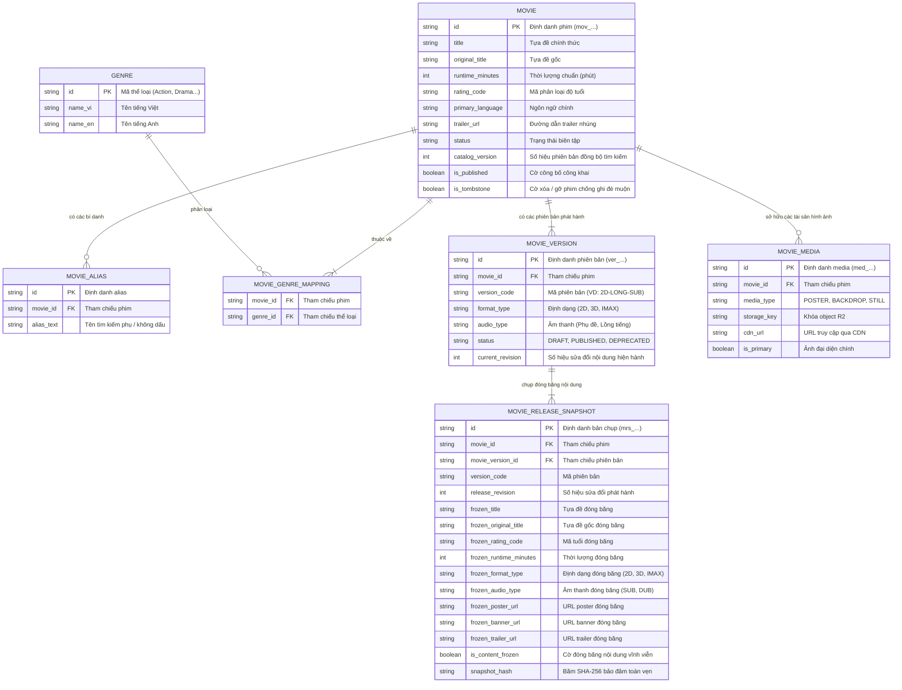
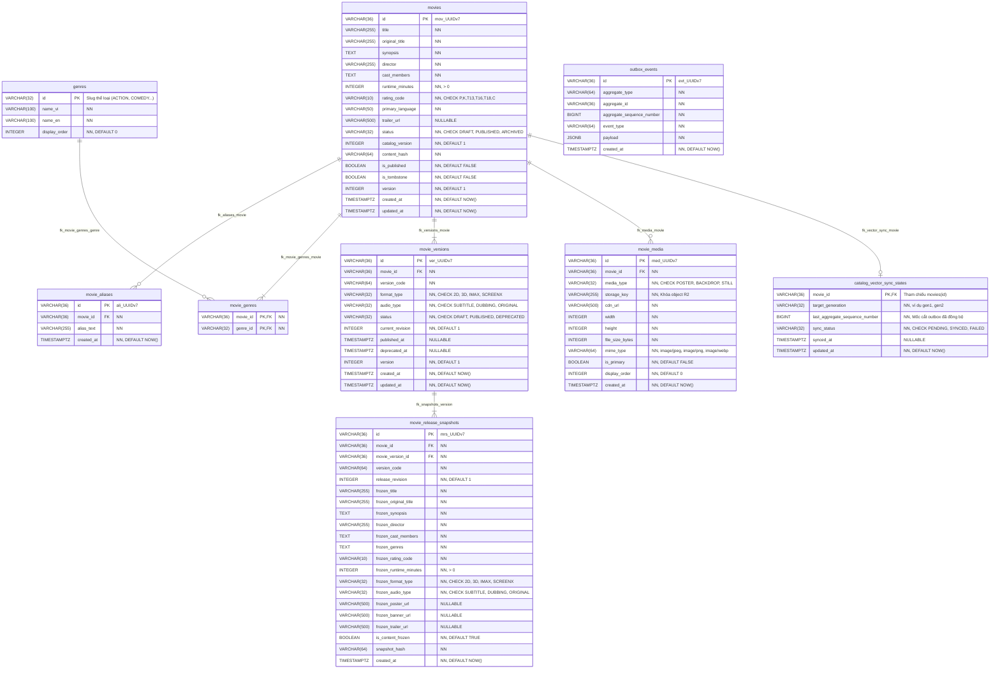

# Thiết kế dữ liệu Database Catalog

## 1. Trách nhiệm và nguồn

### Trách nhiệm của Service và Database
- Catalog Service sở hữu độc quyền toàn bộ thông tin nội dung biên tập về phim chiếu rạp: tựa đề tiếng Việt, tựa đề gốc, tên gọi phụ / bí danh tìm kiếm (alias), tóm tắt cốt truyện (synopsis), đạo diễn, dàn diễn viên chính, thể loại phim (genres), thời lượng chiếu chuẩn (runtime minutes), phân loại độ tuổi theo quy định quốc gia (age rating), định dạng trình chiếu gốc (2D, 3D, IMAX, ScreenX), các phiên bản phát hành nội dung (movie versions), metadata hình ảnh áp phích/banner (Cloudflare R2 / Cloudflare Images) và đường dẫn nhúng trailer video (YouTube / Vimeo embed URL).
- Catalog Service là chủ dữ liệu duy nhất cho công tác biên tập phim của Quản trị viên toàn chuỗi (ACT-ADMIN qua use case M-01).
- Catalog Service cung cấp snapshot bất biến của một phiên bản phim đã được công bố (`PUBLISHED`) cho Cinema Core thông qua giao thức nội bộ HTTP GET khi Core tạo hoặc mở bán một suất chiếu mới. Nội dung phiên bản phim đã phát hành được đóng băng bất biến (`is_content_frozen = TRUE` theo Finding 22). Sau khi Core đã ghi nhận snapshot vào database của mình, toàn bộ hoạt động bán vé, hiển thị thông tin suất chiếu và soát vé đều diễn ra độc lập trên dữ liệu của Core; Core không truy vấn lại Catalog Service trong các giao dịch đặt vé thường nhật.

### Nguồn nghiệp vụ và quyết định kỹ thuật
- [Use case M-01, D-01](../../../03-product/use-cases.md) và [Mô tả use case](../../../03-product/use-case-descriptions.md).
- [Kiến trúc microservices](../../004-service-decomposition/spec.md) và [Quyết định kiến trúc](../../004-service-decomposition/decisions.md) (mục 3, 4: HTTP Snapshot Catalog–Core).
- [ADR-0003](../../../06-decisions/0003-postgresql-and-redis-for-platform-data.md) (PostgreSQL làm kho lưu trữ bản ghi có thẩm quyền).
- [ADR-0019](../../../06-decisions/0019-r2-and-cloudflare-images-for-catalog-media.md) (Cloudflare R2 và Cloudflare Images lưu trữ hình ảnh phim, metadata lưu trong PostgreSQL Catalog).

---

## 2. ERD logic

Sơ đồ thể hiện mối quan hệ giữa các thực thể nội dung trong Catalog Service. Mọi thực thể đều thuộc quyền quản lý trực tiếp của Catalog Service.



---

## 3. ERD chi tiết

> [!TIP]
> **Hướng dẫn xem sơ đồ:** Để đọc rõ các nhãn cột và quan hệ phức tạp trong sơ đồ chi tiết, khuyến nghị xem tài liệu ở chế độ xem rộng hoặc 100% zoom, cuộn ngang, hoặc xem riêng từng phân vùng quan hệ.

Sơ đồ chi tiết các bảng vật lý trong database `catalog` kèm khóa chính, khóa ngoại nội bộ và kiểu dữ liệu PostgreSQL.



---

## 4. Từ điển dữ liệu toàn diện (100% các bảng)

### 4.1. Bảng `movies` (Danh mục phim biên tập)

| Tên cột | Kiểu dữ liệu | Nullable | Default | Ý nghĩa / Đơn vị | Nguồn quy tắc |
|---|---|---|---|---|---|
| `id` | `VARCHAR(36)` | NOT NULL | Không có | Khóa chính, tiền tố `mov_` theo chuẩn UUIDv7 | Mục 4.1 `spec.md` |
| `title` | `VARCHAR(255)` | NOT NULL | Không có | Tên phim chính thức hiển thị tại Việt Nam | Use case M-01, D-01 |
| `original_title` | `VARCHAR(255)` | NOT NULL | Không có | Tên gốc của phim (tiếng Anh hoặc ngôn ngữ sản xuất) | Use case M-01 |
| `synopsis` | `TEXT` | NOT NULL | Không có | Bản tóm tắt nội dung phim phục vụ giới thiệu | Use case M-01 |
| `director` | `VARCHAR(255)` | NOT NULL | Không có | Tên đạo diễn chính | Use case M-01 |
| `cast_members` | `TEXT` | NOT NULL | Không có | Danh sách diễn viên chính, ngăn cách bằng dấu phẩy | Use case M-01 |
| `runtime_minutes` | `INTEGER` | NOT NULL | Không có | Thời lượng chiếu chuẩn của phim, đơn vị phút (> 0) | Use case M-01 |
| `rating_code` | `VARCHAR(10)` | NOT NULL | Không có | Mã độ tuổi: `P`, `K`, `T13`, `T16`, `T18`, `C` | BR-31, Luật Điện ảnh VN |
| `primary_language`| `VARCHAR(50)` | NOT NULL | Không có | Ngôn ngữ thoại chính của phim | Use case M-01 |
| `trailer_url` | `VARCHAR(500)` | NULL | NULL | URL nhúng trailer (YouTube/Vimeo); NULL nếu chưa có | Use case M-01, ADR-0019 |
| `status` | `VARCHAR(32)` | NOT NULL | `'DRAFT'` | Trạng thái biên tập: `DRAFT`, `PUBLISHED`, `ARCHIVED` | Quy chuẩn vòng đời nội dung |
| `catalog_version` | `INTEGER` | NOT NULL | `1` | Số hiệu phiên bản đồng bộ tìm kiếm Typesense (tăng đơn điệu) | R2-N04, ADR-0030 |
| `content_hash` | `VARCHAR(64)` | NOT NULL | Không có | Băm SHA-256 toàn bộ metadata nội dung phục vụ phát hiện thay đổi | R2-N04 |
| `is_published` | `BOOLEAN` | NOT NULL | `FALSE` | Cờ công bố phim công khai phục vụ tìm kiếm | R2-N04 |
| `is_tombstone` | `BOOLEAN` | NOT NULL | `FALSE` | Cờ tombstone khi phim bị gỡ/xóa để ngăn CDC job cũ phục hồi | R2-N04 |
| `version` | `INTEGER` | NOT NULL | `1` | Số hiệu phiên bản dùng cho Optimistic Locking | Mục 4.4 `spec.md` |
| `created_at` | `TIMESTAMPTZ` | NOT NULL | `NOW()` | Thời điểm tạo bản ghi (UTC) | Mục 4.3 `spec.md` |
| `updated_at` | `TIMESTAMPTZ` | NOT NULL | `NOW()` | Thời điểm cập nhật bản ghi gần nhất (UTC) | Mục 4.3 `spec.md` |

### 4.2. Bảng `movie_aliases` (Bí danh tìm kiếm phim)

| Tên cột | Kiểu dữ liệu | Nullable | Default | Ý nghĩa / Đơn vị | Nguồn quy tắc |
|---|---|---|---|---|---|
| `id` | `VARCHAR(36)` | NOT NULL | Không có | Khóa chính, tiền tố `ali_` theo chuẩn UUIDv7 | Mục 4.1 `spec.md` |
| `movie_id` | `VARCHAR(36)` | NOT NULL | Không có | Khóa ngoại tham chiếu `movies(id)` | Quyền sở hữu Catalog |
| `alias_text` | `VARCHAR(255)` | NOT NULL | Không có | Tên gọi phụ, tên viết tắt, hoặc tên không dấu | BR-42, D-01, ADR-0030 |
| `created_at` | `TIMESTAMPTZ` | NOT NULL | `NOW()` | Thời điểm tạo bí danh (UTC) | Mục 4.3 `spec.md` |

### 4.3. Bảng `genres` (Danh mục thể loại phim)

| Tên cột | Kiểu dữ liệu | Nullable | Default | Ý nghĩa / Đơn vị | Nguồn quy tắc |
|---|---|---|---|---|---|
| `id` | `VARCHAR(32)` | NOT NULL | Không có | Khóa chính dạng slug viết hoa (ví dụ: `ACTION`, `HORROR`) | Chuẩn hóa thể loại |
| `name_vi` | `VARCHAR(100)` | NOT NULL | Không có | Tên thể loại bằng tiếng Việt (Hành động, Kinh dị...) | Use case M-01 |
| `name_en` | `VARCHAR(100)` | NOT NULL | Không có | Tên thể loại bằng tiếng Anh (Action, Horror...) | Use case M-01 |
| `display_order` | `INTEGER` | NOT NULL | `0` | Thứ tự ưu tiên sắp xếp trên giao diện | Trải nghiệm UI |

### 4.4. Bảng `movie_genres` (Liên kết phim - thể loại)

| Tên cột | Kiểu dữ liệu | Nullable | Default | Ý nghĩa / Đơn vị | Nguồn quy tắc |
|---|---|---|---|---|---|
| `movie_id` | `VARCHAR(36)` | NOT NULL | Không có | Khóa chính kết hợp, khóa ngoại `movies(id)` | Bảng nối N-N |
| `genre_id` | `VARCHAR(32)` | NOT NULL | Không có | Khóa chính kết hợp, khóa ngoại `genres(id)` | Bảng nối N-N |

### 4.5. Bảng `movie_versions` (Phiên bản phát hành nội dung)

| Tên cột | Kiểu dữ liệu | Nullable | Default | Ý nghĩa / Đơn vị | Nguồn quy tắc |
|---|---|---|---|---|---|
| `id` | `VARCHAR(36)` | NOT NULL | Không có | Khóa chính, tiền tố `ver_` theo chuẩn UUIDv7 | Mục 4.1 `spec.md` |
| `movie_id` | `VARCHAR(36)` | NOT NULL | Không có | Khóa ngoại tham chiếu `movies(id)` | Quan hệ thực thể phiên bản |
| `version_code` | `VARCHAR(64)` | NOT NULL | Không có | Mã phiên bản kỹ thuật (ví dụ: `2D-SUB-VN`, `IMAX-3D-DUB`) | Kiến trúc mục 4 |
| `format_type` | `VARCHAR(32)` | NOT NULL | Không có | Định dạng hình ảnh: `2D`, `3D`, `IMAX`, `SCREENX` | Use case M-01, M-04 |
| `audio_type` | `VARCHAR(32)` | NOT NULL | Không có | Hình thức âm thanh: `SUBTITLE`, `DUBBING`, `ORIGINAL` | Use case M-01, M-04 |
| `status` | `VARCHAR(32)` | NOT NULL | `'DRAFT'` | Trạng thái: `DRAFT`, `PUBLISHED`, `DEPRECATED` | Kiến trúc mục 4 |
| `current_revision`| `INTEGER`| NOT NULL | `1` | Số hiệu sửa đổi nội dung hiện hành của phiên bản | Kiến trúc mục 4 |
| `published_at` | `TIMESTAMPTZ` | NULL | NULL | Thời điểm công bố phiên bản cho phép lập suất chiếu | Kiến trúc mục 4 |
| `deprecated_at` | `TIMESTAMPTZ` | NULL | NULL | Thời điểm ngừng cho phép tạo suất mới từ phiên bản này | OPEN-05 |
| `version` | `INTEGER` | NOT NULL | `1` | Số hiệu phiên bản bản ghi (Optimistic Locking) | Mục 4.4 `spec.md` |
| `created_at` | `TIMESTAMPTZ` | NOT NULL | `NOW()` | Thời điểm tạo bản ghi (UTC) | Mục 4.3 `spec.md` |
| `updated_at` | `TIMESTAMPTZ` | NOT NULL | `NOW()` | Thời điểm cập nhật bản ghi gần nhất (UTC) | Mục 4.3 `spec.md` |

### 4.6. Bảng `movie_release_snapshots` (Bản chụp đóng băng toàn bộ nội dung phát hành cho suất chiếu)

| Tên cột | Kiểu dữ liệu | Nullable | Default | Ý nghĩa / Đơn vị | Nguồn quy tắc |
|---|---|---|---|---|---|
| `id` | `VARCHAR(36)` | NOT NULL | Không có | Khóa chính, tiền tố `mrs_` theo chuẩn UUIDv7 | Finding 22 |
| `movie_id` | `VARCHAR(36)` | NOT NULL | Không có | Khóa ngoại tham chiếu `movies(id)` | Finding 22 |
| `movie_version_id`| `VARCHAR(36)`| NOT NULL | Không có | Khóa ngoại tham chiếu `movie_versions(id)` | Finding 22 |
| `version_code` | `VARCHAR(64)` | NOT NULL | Không có | Mã phiên bản kỹ thuật snapshot được tạo | Finding 22 |
| `release_revision`| `INTEGER` | NOT NULL | `1` | Số hiệu sửa đổi phát hành tại thời điểm đóng băng | Finding 22 |
| `frozen_title` | `VARCHAR(255)`| NOT NULL | Không có | Tựa đề tiếng Việt đóng băng bất biến | Finding 22 |
| `frozen_original_title`| `VARCHAR(255)`| NOT NULL | Không có | Tựa đề gốc đóng băng bất biến | Finding 22 |
| `frozen_synopsis` | `TEXT` | NOT NULL | Không có | Bản tóm tắt cốt truyện đóng băng bất biến | Finding 22 |
| `frozen_director` | `VARCHAR(255)`| NOT NULL | Không có | Đạo diễn đóng băng bất biến | Finding 22 |
| `frozen_cast_members` | `TEXT` | NOT NULL | Không có | Dàn diễn viên chính đóng băng bất biến | Finding 22 |
| `frozen_genres` | `TEXT` | NOT NULL | Không có | Danh sách thể loại đóng băng ngăn cách dấu phẩy | Finding 22 |
| `frozen_rating_code`| `VARCHAR(10)`| NOT NULL | Không có | Mã phân loại độ tuổi đóng băng bất biến | Finding 22 |
| `frozen_runtime_minutes`| `INTEGER`| NOT NULL | Không có | Thời lượng đóng băng bất biến (phút, > 0) | Finding 22 |
| `frozen_format_type` | `VARCHAR(32)`| NOT NULL | Không có | Định dạng chiếu: `2D`, `3D`, `IMAX`, `SCREENX` | Finding 22 |
| `frozen_audio_type` | `VARCHAR(32)`| NOT NULL | Không có | Âm thanh: `SUBTITLE`, `DUBBING`, `ORIGINAL` | Finding 22 |
| `frozen_poster_url` | `VARCHAR(500)`| NULL | NULL | URL ảnh áp phích (poster dọc) đóng băng | Finding 22, ADR-0019 |
| `frozen_banner_url` | `VARCHAR(500)`| NULL | NULL | URL ảnh biểu ngữ (backdrop ngang) đóng băng | Finding 22, ADR-0019 |
| `frozen_trailer_url`| `VARCHAR(500)`| NULL | NULL | URL trailer nhúng đóng băng | Finding 22, ADR-0019 |
| `is_content_frozen`| `BOOLEAN` | NOT NULL | `TRUE` | Cờ đóng băng vĩnh viễn (luôn TRUE cho snapshot đã tạo) | Finding 22 |
| `snapshot_hash` | `VARCHAR(64)` | NOT NULL | Không có | Băm SHA-256 toàn bộ các trường frozen theo thứ tự chuẩn hóa | Finding 22 |
| `created_at` | `TIMESTAMPTZ` | NOT NULL | `NOW()` | Thời điểm tạo bản chụp phát hành (UTC) | Mục 4.3 `spec.md` |

### 4.7. Bảng `movie_media` (Tài sản hình ảnh trên Cloudflare R2 / Images)

| Tên cột | Kiểu dữ liệu | Nullable | Default | Ý nghĩa / Đơn vị | Nguồn quy tắc |
|---|---|---|---|---|---|
| `id` | `VARCHAR(36)` | NOT NULL | Không có | Khóa chính, tiền tố `med_` theo chuẩn UUIDv7 | Mục 4.1 `spec.md` |
| `movie_id` | `VARCHAR(36)` | NOT NULL | Không có | Khóa ngoại tham chiếu `movies(id)` | ADR-0019 |
| `media_type` | `VARCHAR(32)` | NOT NULL | Không có | Phân loại: `POSTER` (dọc), `BACKDROP` (ngang), `STILL` (ảnh cảnh) | ADR-0019 |
| `storage_key` | `VARCHAR(255)` | NOT NULL | Không có | Đường dẫn định danh object trên bucket Cloudflare R2 | ADR-0019 |
| `cdn_url` | `VARCHAR(500)` | NOT NULL | Không có | Đường dẫn URL truy cập công khai qua mạng phân phối CDN | ADR-0019 |
| `width` | `INTEGER` | NOT NULL | Không có | Chiều rộng ảnh tính bằng pixel (> 0) | Chuẩn chất lượng UI |
| `height` | `INTEGER` | NOT NULL | Không có | Chiều cao ảnh tính bằng pixel (> 0) | Chuẩn chất lượng UI |
| `file_size_bytes`| `INTEGER` | NOT NULL | Không có | Kích thước tệp tính bằng byte (> 0) | Giám sát tài nguyên |
| `mime_type` | `VARCHAR(64)` | NOT NULL | Không có | Định dạng MIME: `image/jpeg`, `image/png`, `image/webp` | An toàn tệp tin |
| `is_primary` | `BOOLEAN` | NOT NULL | `FALSE` | Cờ đánh dấu ảnh đại diện chính cho loại media tương ứng | Trải nghiệm UI |
| `display_order` | `INTEGER` | NOT NULL | `0` | Thứ tự hiển thị trong bộ sưu tập ảnh | Trải nghiệm UI |
| `created_at` | `TIMESTAMPTZ` | NOT NULL | `NOW()` | Thời điểm tải lên và đăng ký metadata (UTC) | Mục 4.3 `spec.md` |

### 4.8. Bảng `outbox_events` (Transactional Outbox Pattern xuất sự kiện)

| Tên cột | Kiểu dữ liệu | Nullable | Default | Ý nghĩa / Đơn vị | Nguồn quy tắc |
|---|---|---|---|---|---|
| `id` | `VARCHAR(36)` | NOT NULL | Không có | Khóa chính sự kiện, tiền tố `evt_` theo UUIDv7 | Finding 23, 25 |
| `aggregate_type` | `VARCHAR(64)` | NOT NULL | Không có | Thực thể nguồn (`MOVIE`, `VERSION`) | Finding 25 |
| `aggregate_id` | `VARCHAR(36)` | NOT NULL | Không có | Định danh thực thể nguồn | Finding 25 |
| `aggregate_sequence_number` | `BIGINT` | NOT NULL | Không có | Số thứ tự tăng dần đơn điệu theo thực thể | Finding 25 |
| `event_type` | `VARCHAR(64)` | NOT NULL | Không có | Loại sự kiện (`MOVIE_PUBLISHED`, `VERSION_FROZEN`) | Finding 25 |
| `payload` | `JSONB` | NOT NULL | Không có | Dữ liệu sự kiện (không chứa PII) | Finding 13, 25 |
| `created_at` | `TIMESTAMPTZ` | NOT NULL | `NOW()` | Thời điểm commit cùng transaction nghiệp vụ | Finding 25 |

### 4.9. Bảng `catalog_vector_sync_states` (Tiến độ đồng bộ Vector Typesense - Finding 23, R2-N04)

Bảng nội bộ do Catalog Service sở hữu để theo dõi tiến độ cắt mốc và đồng bộ vector lên Typesense theo từng bộ phim:

| Tên cột | Kiểu dữ liệu | Nullable | Default | Ý nghĩa / Đơn vị | Nguồn quy tắc |
|---|---|---|---|---|---|
| `movie_id` | `VARCHAR(36)` | NOT NULL | Không có | Khóa chính, tham chiếu `movies(id)` (`ON DELETE CASCADE`) | Finding 23, R2-N04 |
| `target_generation` | `VARCHAR(32)` | NOT NULL | Không có | Thế hệ collection mục tiêu trên Typesense (`gen1`, `gen2`...) | R2-N04 |
| `last_aggregate_sequence_number` | `BIGINT` | NOT NULL | Không có | Mốc sequence Outbox cắt mốc đồng bộ vector của phim | Finding 23, 25 |
| `sync_status` | `VARCHAR(32)` | NOT NULL | `'PENDING'` | Trạng thái đồng bộ: `CHECK (sync_status IN ('PENDING', 'SYNCED', 'FAILED'))` | Finding 23 |
| `synced_at` | `TIMESTAMPTZ` | NULL | NULL | Thời điểm hoàn tất nạp vector lên Typesense | R2-N04 |
| `updated_at` | `TIMESTAMPTZ` | NOT NULL | `NOW()` | Thời điểm cập nhật mốc tiến độ (UTC) | Mục 4.3 `spec.md` |

---

## 5. Khóa, chỉ mục và ràng buộc

### 5.1. Khóa chính và Khóa ngoại nội bộ

- `movies.id`: Primary Key (`pk_movies`).
- `movie_aliases.id`: Primary Key (`pk_movie_aliases`). Khóa ngoại `fk_aliases_movie` trỏ tới `movies(id)` với hành vi `ON DELETE CASCADE`.
- `genres.id`: Primary Key (`pk_genres`).
- `movie_genres(movie_id, genre_id)`: Composite Primary Key (`pk_movie_genres`). Khóa ngoại `fk_movie_genres_movie` trỏ tới `movies(id)` với `ON DELETE CASCADE`; `fk_movie_genres_genre` trỏ tới `genres(id)` với `ON DELETE RESTRICT`.
- `movie_versions.id`: Primary Key (`pk_movie_versions`). Khóa ngoại `fk_versions_movie` trỏ tới `movies(id)` với `ON DELETE RESTRICT`.
- `movie_release_snapshots.id`: Primary Key (`pk_movie_release_snapshots`). Khóa ngoại `fk_snapshots_version` trỏ tới `movie_versions(id)` với `ON DELETE RESTRICT`; `fk_snapshots_movie` trỏ tới `movies(id)` với `ON DELETE RESTRICT`.
- `movie_media.id`: Primary Key (`pk_movie_media`). Khóa ngoại `fk_media_movie` trỏ tới `movies(id)` với `ON DELETE CASCADE`.
- `catalog_vector_sync_states.movie_id`: Primary Key (`pk_catalog_vector_sync_states`). Khóa ngoại `fk_vector_sync_movie` trỏ tới `movies(id)` với hành vi `ON DELETE CASCADE`.

### 5.2. Ràng buộc toàn vẹn dữ liệu (CHECK & UNIQUE)

- `movies`:
  - `CHECK (runtime_minutes > 0)`: Thời lượng phim phải là số dương.
  - `CHECK (rating_code IN ('P', 'K', 'T13', 'T16', 'T18', 'C'))`: Giới hạn các mã độ tuổi chuẩn theo luật Việt Nam.
  - `CHECK (status IN ('DRAFT', 'PUBLISHED', 'ARCHIVED'))`: Giới hạn trạng thái vòng đời phim.
- `catalog_vector_sync_states`:
  - `CHECK (sync_status IN ('PENDING', 'SYNCED', 'FAILED'))`: Giới hạn trạng thái đồng bộ vector.
- `movie_aliases`:
  - `UNIQUE (movie_id, alias_text)`: Không trùng lặp cùng một bí danh cho một bộ phim.
- `movie_versions`:
  - `UNIQUE (movie_id, version_code)`: Mỗi bộ phim chỉ có một mã phiên bản duy nhất.
  - `CHECK (format_type IN ('2D', '3D', 'IMAX', 'SCREENX'))`: Giới hạn định dạng chuẩn.
  - `CHECK (audio_type IN ('SUBTITLE', 'DUBBING', 'ORIGINAL'))`: Giới hạn loại âm thanh.
  - `CHECK (status IN ('DRAFT', 'PUBLISHED', 'DEPRECATED'))`: Giới hạn trạng thái phiên bản.
- `movie_release_snapshots`:
  - `UNIQUE (movie_id, version_code, release_revision)`: Bảo đảm tính duy nhất và bất biến của từng lần sửa đổi phát hành (Finding 22).
  - `CHECK (frozen_runtime_minutes > 0)`: Thời lượng đóng băng phải dương.
  - `CHECK (frozen_format_type IN ('2D', '3D', 'IMAX', 'SCREENX'))`: Định dạng chiếu đóng băng hợp lệ.
  - `CHECK (frozen_audio_type IN ('SUBTITLE', 'DUBBING', 'ORIGINAL'))`: Hình thức âm thanh đóng băng hợp lệ.
  - `CHECK (frozen_rating_code IN ('P', 'K', 'T13', 'T16', 'T18', 'C'))`: Mã độ tuổi đóng băng hợp lệ.
- `movie_media`:
  - `UNIQUE (storage_key)`: Khóa object R2 không được trùng lặp.
  - `CHECK (media_type IN ('POSTER', 'BACKDROP', 'STILL'))`: Phân loại media hợp lệ.
  - `CHECK (width > 0 AND height > 0 AND file_size_bytes > 0)`: Kích thước tệp hợp lệ.

### 5.3. Chỉ mục tối ưu hóa truy vấn (Indexes)

1. `idx_movies_status_created`: B-Tree index trên `movies(status, created_at DESC)` — Danh sách phim công bố.
2. `idx_movie_aliases_text`: B-Tree index trên `movie_aliases(alias_text)` — Tra cứu phim theo từ khóa alias.
3. `idx_movie_versions_lookup`: B-Tree index trên `movie_versions(id, status)` — Phục vụ endpoint HTTP snapshot của Cinema Core.
4. `idx_movie_release_snapshots_lookup`: B-Tree index trên `movie_release_snapshots(movie_id, version_code, release_revision)` — Tra cứu bản chụp bất biến.
5. `idx_movie_media_movie_primary`: B-Tree index trên `movie_media(movie_id, media_type, is_primary)` — Hiển thị poster/banner chính của phim.

---

## 6. Giao dịch và interface

### 6.1. Hợp đồng cung cấp Snapshot Bất biến cho Cinema Core (Finding 22)

- **Endpoint:** `GET /internal/v1/movies/{movie_id}/versions/{version_id}/snapshot`
- **Điều kiện tiên quyết:**
  - `movie_id` và `version_id` tồn tại trong Catalog.
  - Phiên bản phải có trạng thái `movie_versions.status = 'PUBLISHED'`.
- **Cơ chế đóng băng nội dung và kiểm soát tương tranh (Finding 22):**
  - Khi Core yêu cầu snapshot phiên bản để lập suất chiếu, Catalog thực thi transaction với cơ chế **chèn idempotent an toàn** (`ON CONFLICT DO NOTHING`) hoặc khóa bi quan trên phiên bản để ngăn 2 request đồng thời tạo snapshot lệch nhau:
    ```sql
    -- Transaction tạo hoặc lấy snapshot phát hành bất biến
    BEGIN;
    -- 1. Đọc phiên bản phim và khóa dòng chia sẻ để ngăn biên tập viên sửa đổi giữa chừng
    SELECT v.id, v.movie_id, v.version_code, v.format_type, v.audio_type, v.current_revision,
           m.title, m.original_title, m.synopsis, m.director, m.cast_members, m.rating_code, m.runtime_minutes,
           m.trailer_url
    FROM movie_versions v
    JOIN movies m ON v.movie_id = m.id
    WHERE v.id = $version_id AND v.status = 'PUBLISHED'
    FOR SHARE;

    -- 2. Đọc poster và banner đại diện chính
    SELECT media_type, cdn_url FROM movie_media
    WHERE movie_id = $movie_id AND is_primary = TRUE;

    -- 3. Đọc danh sách thể loại đã liên kết (ghép chuỗi sắp xếp alphabetically)
    SELECT string_agg(g.id, ',' ORDER BY g.id) AS genres_str
    FROM movie_genres mg
    JOIN genres g ON mg.genre_id = g.id
    WHERE mg.movie_id = $movie_id;

    -- 4. Tính toán snapshot_hash bằng SHA-256 trên chuỗi JSON canonical chuẩn hóa
    -- Gồm: movie_id, version_code, release_revision, frozen_title, original_title, synopsis,
    -- director, cast, genres, rating_code, runtime_minutes, format_type, audio_type, poster_url, banner_url, trailer_url.

    -- 5. Thực hiện INSERT idempotent chống race condition đồng thời
    INSERT INTO movie_release_snapshots (
        id, movie_id, movie_version_id, version_code, release_revision,
        frozen_title, frozen_original_title, frozen_synopsis, frozen_director, frozen_cast_members,
        frozen_genres, frozen_rating_code, frozen_runtime_minutes, frozen_format_type, frozen_audio_type,
        frozen_poster_url, frozen_banner_url, frozen_trailer_url,
        is_content_frozen, snapshot_hash, created_at
    ) VALUES (
        $id, $movie_id, $version_id, $version_code, $current_revision,
        $frozen_title, $frozen_original_title, $frozen_synopsis, $frozen_director, $frozen_cast_members,
        $frozen_genres, $frozen_rating_code, $frozen_runtime_minutes, $frozen_format_type, $frozen_audio_type,
        $frozen_poster_url, $frozen_banner_url, $frozen_trailer_url,
        TRUE, $snapshot_hash, NOW()
    )
    ON CONFLICT (movie_id, version_code, release_revision) DO NOTHING;

    -- 6. Luôn đọc lại bản ghi snapshot bất biến đã tồn tại hoặc vừa tạo để trả về kết quả nhất quán
    SELECT * FROM movie_release_snapshots
    WHERE movie_id = $movie_id AND version_code = $version_code AND release_revision = $current_revision;
    COMMIT;
    ```
  - Mọi thao tác sửa đổi nội dung đối với phiên bản đã đóng băng sẽ bị từ chối; nếu cần thay đổi, biên tập viên phải tạo một phiên bản sửa đổi mới (`current_revision = current_revision + 1`).
- **Dữ liệu trả về (Snapshot Payload đầy đủ theo Finding 22):**
  ```json
  {
    "movie_id": "mov_01j7abc123",
    "movie_version_id": "ver_01j7def456",
    "version_code": "2D-SUB-VN",
    "title_vi": "Dune: Hành Tinh Cát - Phần 2",
    "original_title": "Dune: Part Two",
    "synopsis": "Hành trình báo thù và định mệnh của Paul Atreides...",
    "director": "Denis Villeneuve",
    "cast_members": "Timothée Chalamet, Zendaya, Rebecca Ferguson",
    "genres": ["ACTION", "ADVENTURE", "SCI-FI"],
    "runtime_minutes": 166,
    "rating_code": "T16",
    "format_type": "2D",
    "audio_type": "SUBTITLE",
    "poster_url": "https://cdn.cinema.vn/movies/mov_01j7abc123/poster/poster_main.webp",
    "banner_url": "https://cdn.cinema.vn/movies/mov_01j7abc123/backdrop/backdrop_main.webp",
    "trailer_url": "https://www.youtube.com/embed/Way9Dexny3w",
    "release_revision": 1,
    "is_content_frozen": true,
    "snapshot_hash": "sha256_abcdef1234567890abcdef1234567890abcdef1234567890abcdef12345678",
    "snapshot_taken_at": "2026-11-18T00:30:00.000Z"
  }
  ```

### 6.2. Cơ chế Đồng bộ Tìm kiếm Typesense, Tách biệt Cập nhật Metadata/Vector và Xử lý Tombstone (R2-N04, F23)

- **Phạm vi bao phủ của Phiên bản Danh mục (`catalog_version`):**
  - Mọi thao tác biên tập trên bảng chính `movies` HOẶC thay đổi trên các bảng con phục vụ tìm kiếm gồm bí danh (`movie_aliases`) và thể loại (`movie_genres`) đều kích hoạt tăng đơn điệu `movies.catalog_version` của bộ phim cha, đồng thời tính toán lại `content_hash` (SHA-256) trên chuỗi JSON canonical của toàn bộ thuộc tính văn bản tìm kiếm.
  - Nhờ vậy, `catalog_version` phản ánh toàn vẹn và duy nhất toàn bộ vòng đời nội dung của bộ phim.
- **Tách biệt hai luồng cập nhật Typesense và Ràng buộc Không gian Vector (R2-N04):**
  1. **Luồng 1: Cập nhật Metadata / Tombstone (Structural Sync):**
     - CDC/Outbox Worker đẩy tài liệu tìm kiếm văn bản sang Typesense.
     - Sử dụng điều kiện so sánh phiên bản đơn điệu: `event.catalog_version >= document.catalog_version`.
     - Nếu `event.catalog_version < document.catalog_version`: Typesense từ chối ghi đè, loại trừ triệt để rủi ro cập nhật trễ do độ trễ mạng hoặc retry.
  2. **Luồng 2: Cập nhật Bổ sung Vector Embedding (Enrichment Update):**
     - Do việc sinh vector embedding qua AI/Embedding Model chạy nền bất đồng bộ và có độ trễ lớn hơn cập nhật văn bản:
     - Khi job embedding hoàn tất, payload gửi lên Typesense **bắt buộc mang đủ 5 thuộc tính định danh không gian vector và phiên bản nội dung**:
       - `catalog_version`: Phiên bản nội dung tại thời điểm trích xuất text.
       - `content_hash`: Mã băm nội dung văn bản đầu vào embedding.
       - `target_generation`: Thế hệ collection đang hoạt động (ví dụ: `gen_20261120_v1`).
       - `model_name`: Định danh mô hình embedding (ví dụ: `text-embedding-3-small`).
       - `preprocess_version`: Phiên bản chuẩn hóa dữ liệu đầu vào (ví dụ: `prep_v1`).
     - **Cơ chế Tuần tự hóa Phân vùng và Ghi có Điều kiện Nguyên tử (Atomic Partition Serialization & Scoped Patch):**
       - **Serialization phía Worker (Chống chạy đua Tombstone vs Enrich):** Mọi sự kiện liên quan đến cùng một bộ phim (`movie_id`) đều được phân vùng trên Kafka với `partition_key = movie_id`. Ingestion Worker tiêu thụ tuần tự (FIFO) cho từng phim. Điều này bảo đảm nếu có lệnh gỡ phim (Tombstone), lệnh này luôn được xử lý tuần tự trước hoặc sau job enrich, không thể có tình trạng đọc kiểm tra hợp lệ rồi tombstone chen ngang trước khi ghi!
       - **Scoped Patch Primitive trên Typesense (Tuân thủ Primitive Typesense 30.2 - R2-N04):**
         Theo tài liệu chính thức của Typesense 30.2, việc cập nhật tài liệu có điều kiện lọc được thực hiện qua primitive update-by-query trên tập hợp (`PATCH /collections/{target_collection}/documents?filter_by=...`). Worker gọi API với đầy đủ các chốt chặn an toàn:
         ```http
         PATCH /collections/{target_collection}/documents?filter_by=id:={movie_id} && target_generation:={payload.target_generation} && model_name:={payload.model_name} && preprocess_version:={payload.preprocess_version} && catalog_version:<={payload.catalog_version} && content_hash:={payload.content_hash} && is_tombstone:=false
         Content-Type: application/json

         {
           "embedding": [ ... ]
         }
         ```
       - **Kiểm tra Kết quả Cập nhật (`num_updated` - R2-N04):**
         - Nếu câu lệnh trả về `{ "num_updated": 1 }`: Cập nhật vector thành công cho đúng bộ phim hiện hành.
         - Nếu câu lệnh trả về `{ "num_updated": 0 }`: Bản ghi không thỏa mãn điều kiện (do phim đã bị gỡ bỏ `is_tombstone = true`, hoặc nội dung đã được cập nhật sang `catalog_version` mới hơn trong lúc chờ AI model, hoặc alias đã tráo sang thế hệ `target_generation` mới). Worker **bỏ qua an toàn (drop/no-op)** mà không phát sinh lỗi, loại trừ 100% việc vector cũ ghi đè lên nội dung mới hoặc làm hồi sinh phim đã xóa.
       - Cơ chế này **ngăn chặn tuyệt đối việc trộn lẫn vector giữa hai không gian nhúng khác nhau** khi chuyển đổi mô hình AI, và không bao giờ gắn vector của nội dung cũ vào tài liệu mới.
- **Quy trình Rebuild Chỉ mục Toàn diện, Cắt mốc và Tráo đổi Alias (R2-N04):**
  - Khi cần thay đổi mô hình embedding, nâng cấp schema hoặc tái lập toàn bộ chỉ mục tìm kiếm (Re-indexing):
    1. Khởi tạo một Collection Typesense mới với thế hệ mục tiêu mới: ví dụ `typesense_movies_gen2`, cấu hình schema mang đầy đủ các trường `target_generation = 'gen2'`, `model_name = 'new-model'`, `preprocess_version = 'prep_v2'`.
    2. Ghi nhận mốc cắt dữ liệu Outbox từ PostgreSQL: lưu mốc theo từng bộ phim `(movie_id, aggregate_sequence_number)` trong bảng theo dõi tiến độ đồng bộ vector `catalog_vector_sync_states` (R2-N04).
    3. Stream toàn bộ danh mục phim hiện có từ PostgreSQL sang Collection `typesense_movies_gen2`.
    4. Embedding Worker chạy batch job sinh vector cho toàn bộ collection mới với đúng bộ tham số `('gen2', 'new-model', 'prep_v2')`.
    5. Trong suốt thời gian này, các sự kiện CDC/Outbox mới phát sinh liên tục được nạp vào bộ đệm catch-up của `gen2`.
    6. **Kiểm tra Độ phủ (Coverage Gate):** Trước khi swap alias, Worker đối soát bảo đảm mọi `catalog_version` mới nhất từ PostgreSQL đến `cut_off_watermark` và các event catch-up đều đã được xử lý 100%, không còn bản ghi thiếu sót.
    7. **Atomic Alias Swap:** Thực hiện tráo đổi alias nguyên tử: trỏ alias chính thức `typesense_movies_active` sang collection `typesense_movies_gen2` với downtime bằng 0.
    8. Sau khi swap, bất kỳ job embedding nào của thế hệ cũ `gen1` hoàn tất muộn gửi đến alias `typesense_movies_active` đều bị từ chối ngay lập tức do lệch `target_generation`, bảo đảm an toàn dữ liệu tuyệt đối.
- **Độc lập Lexical Search khi Hoãn Vector Search (R2-N04):**
  - Typesense hỗ trợ tìm kiếm kết hợp (Hybrid Search: Text + Semantic Vector).
  - Khi dịch vụ tạo vector embedding (LLM/Embedding Provider) gặp sự cố mạng, cạn quota hoặc bị nghẽn độ trễ, pipeline tìm kiếm tự động chuyển sang chế độ **Lexical Fallback**: sử dụng tìm kiếm văn bản thuần túy (tựa đề, bí danh không dấu `movie_aliases`, thể loại, đạo diễn, diễn viên).
  - Nhờ đó, SLA tìm kiếm của người dùng và chatbot luôn được duy trì liên tục và ổn định ngay cả khi việc cập nhật vector bị hoãn.
- **Xử lý Tombstone khi Gỡ Phim:**
  - Khi Quản trị viên unpublish hoặc gỡ bỏ phim, Catalog cập nhật `is_published = FALSE, is_tombstone = TRUE`, tăng `catalog_version = catalog_version + 1`.
  - CDC Worker phát sự kiện tombstone sang Typesense. Typesense cập nhật tombstone document với `is_tombstone = TRUE, catalog_version = event.catalog_version`.
  - Mọi job vector embedding chậm trễ gửi đến đều bị loại bỏ ngay tại điều kiện `document.is_tombstone == FALSE`, ngăn chặn triệt để nguy cơ làm "hồi sinh" bộ phim đã bị gỡ.

---

## 7. Vòng đời và bảo vệ dữ liệu

### 7.1. Quản lý tài sản Media trên Cloudflare R2
- Hình ảnh tải lên R2 được đặt tên theo định dạng: `movies/{movie_id}/{media_type}/{uuid}.{ext}`.
- Khi người quản trị thay thế ảnh đại diện chính (`is_primary`), hệ thống chỉ cập nhật cờ boolean trong bảng `movie_media`.
- **[Đề xuất kỹ thuật - Đang chờ phê duyệt]:** Worker dọn dẹp nền định kỳ (Garbage Collector) dọn các object R2 không còn bản ghi tham chiếu trong `movie_media` sau 30 ngày kể từ khi bị hủy liên kết, giúp giải phóng chi phí lưu trữ object mồ côi.

### 7.2. Phân loại bảo mật và Quyền riêng tư
- Toàn bộ dữ liệu trong Database Catalog là thông tin công khai hoặc thông tin biên tập nội bộ. Database hoàn toàn không chứa PII của khách hàng.

---

## 8. Kịch bản đối chiếu và phụ thuộc

### 8.1. Ba kịch bản đối chiếu trọng yếu

1. **Kịch bản 1: Catalog Service gặp sự cố hoặc timeout khi Quản lý rạp lập suất chiếu mới**
   - *Hành vi:* Quản lý rạp chọn phim và phòng để tạo suất chiếu. Cinema Core gọi HTTP sang Catalog để lấy snapshot phiên bản. Do mạng gián đoạn, yêu cầu snapshot thất bại.
   - *Kết quả mong đợi:* Cinema Core hủy bỏ thao tác lập suất, thông báo rõ ràng cho Quản lý rạp là không thể xác thực thông tin phim tại thời điểm hiện tại. Core tuyệt đối không tạo một suất chiếu với dữ liệu phim rỗng hoặc tự suy đoán thời lượng/phân loại tuổi.
2. **Kịch bản 2: Quản trị viên cập nhật tựa đề hoặc tóm tắt phim sau khi Core đã lưu snapshot suất chiếu**
   - *Hành vi:* Phim "Dune 2" đã được lập suất chiếu ngày 20/11 với thời lượng 166 phút và tựa đề đã lưu trong Core. Ngày 19/11, Quản trị viên sửa chính tả tựa đề phim trong Catalog thành "Dune: Phần Hai".
   - *Kết quả mong đợi:* Bản ghi trong Catalog cập nhật thành công. Suất chiếu hiện tại trong Core vẫn giữ nguyên snapshot cũ để phục vụ bán vé và in vé mà không bị xáo trộn (đáp ứng Finding 22).
3. **Kịch bản 3: Phiên bản phim bị ngừng (`DEPRECATED`) giữa thời điểm HTTP check và Core commit**
   - *Hành vi:* Core gọi Catalog lấy snapshot thành công của phiên bản `ver_01`. Ngay tại khoảnh khắc Core chuẩn bị commit giao dịch lưu suất, Quản trị viên bấm ngừng phiên bản `ver_01` trong Catalog.
   - *Kết quả mong đợi:* Do snapshot đã được cấp hợp lệ tại mốc kiểm tra, Core commit thành công suất chiếu. Nếu sau đó rạp nhận được yêu cầu ngừng chiếu bắt buộc, Quản lý rạp sẽ sử dụng quy trình đề nghị hủy suất (`R-05`, `BR-12`) để đóng suất chiếu một cách an toàn và hoàn tiền vé cho khách (nếu đã bán).

### 8.2. Quyết định còn thiếu và phụ thuộc (OPEN-05)
- *Vấn đề phụ thuộc:* Hiện tại quy trình đính chính suất chiếu khi Catalog ngừng phiên bản phim đột xuất chưa có cơ chế webhook tự động báo động từ Catalog sang Core. Phụ thuộc này được ghi nhận tại `OPEN-05` trong `spec.md`. Tạm thời ở mốc hiện tại, Quản trị viên chuỗi rạp phối hợp nghiệp vụ với Quản lý rạp để kích hoạt lệnh hủy suất chủ động `R-05` trên Cinema Core.
