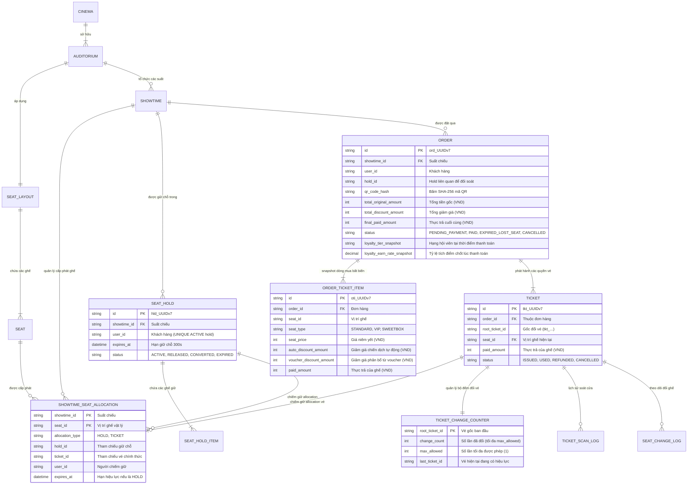
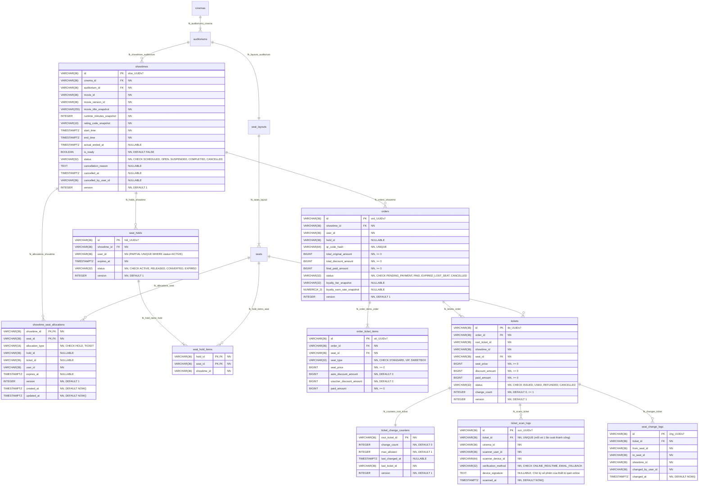
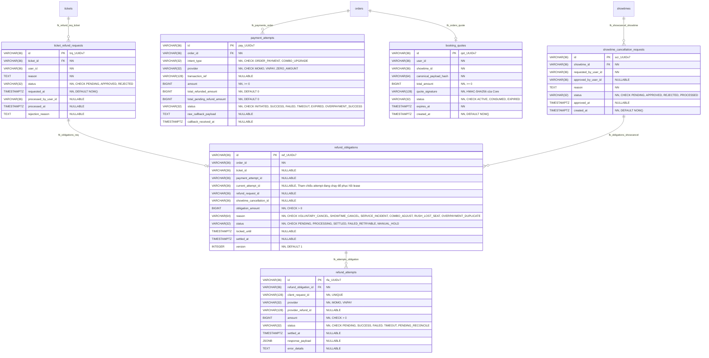

# Thiết kế dữ liệu Database Cinema Core

## 1. Trách nhiệm và nguồn

### Trách nhiệm của Service và Database
- Cinema Core là **hạt nhân giao dịch có thẩm quyền duy nhất (Single Source of Truth)** của toàn bộ nền tảng Movie Booking Platform. Service chịu trách nhiệm bảo toàn tính đúng đắn cho mọi giao dịch trọng yếu: sơ đồ phòng/ghế, lịch chiếu, giá vé, giữ ghế (hold), cấp phát ghế bất biến, đơn hàng, snapshot dòng mua, quyền vé theo ghế, soát vé, bộ đếm đổi ghế, thu tiền, hủy/hoàn tiền, giao bắp nước (combo), ca làm việc, ưu đãi voucher và điểm thưởng hội viên (scale 2 chữ số thập phân).
- Toàn bộ các module nội bộ của Cinema Core (Lịch/phòng, Ghế/hold, Đơn hàng, Thanh toán/hoàn tiền, Quyền vé/soát vé, Hội viên, Ưu đãi/Voucher, Combo và Search) cùng chia sẻ và làm việc trên một cơ sở dữ liệu PostgreSQL logic duy nhất (`cinema_core`). Các module tương tác cục bộ qua các interface và transaction ACID ngắn. Tuyệt đối không chia cắt database theo từng module.
- Các dịch vụ bên ngoài, ứng dụng client (Web/Mobile), BFF và AI Agent không bao giờ có thẩm quyền tự xác nhận vé, tự gia hạn hold, tự điều chỉnh tiền hoặc tự phát hành vé nếu chưa có giao dịch commit thành công có chữ ký số/chứng cứ từ Cinema Core.

### Nguồn nghiệp vụ và quyết định kỹ thuật
- [Use case B-01–B-09, R-01–R-08, O-01–O-07, L-01–L-02, L-09–L-10, M-02–M-04, M-08–M-10](../../../03-product/use-cases.md) và [Mô tả use case](../../../03-product/use-case-descriptions.md).
- [Quy tắc nghiệp vụ BR-01–BR-35](../../../03-product/use-cases.md#4-quy-tắc-đã-thống-nhất).
- [Kiến trúc microservices](../../004-service-decomposition/spec.md) và [Quyết định kiến trúc](../../004-service-decomposition/decisions.md).
- [ADR-0003](../../../06-decisions/0003-postgresql-and-redis-for-platform-data.md), [ADR-0004](../../../06-decisions/0004-redis-roles-and-seat-hold-coordination.md), [ADR-0005](../../../06-decisions/0005-drizzle-orm-and-kit-for-cinema-core.md), [ADR-0027](../../../06-decisions/0027-direct-http-and-node-crypto-for-payment-gateways.md), [ADR-0035](../../../06-decisions/0035-search-module-in-cinema-core.md), [ADR-0036](../../../06-decisions/0036-nestjs-fastify-for-cinema-core.md).
- [NFR phục hồi và tính đúng đắn](https://github.com/NhiBuaa/movie-booking-agent/blob/ad002e99936231fac0f8493830b9ec36dc3aedb2/docs/05-specs/nfr/recovery-and-correctness.md) (§9.15–§9.16). Xem [phạm vi NFR đã review](../spec.md#nguồn-nfr-mới-hơn-bản-đã-review) để đối chiếu các bổ sung sau snapshot.

---

## 2. ERD logic

Do phạm vi nghiệp vụ của Cinema Core rộng lớn và toàn diện, mô hình logic được chia thành hai nhóm nghiệp vụ liên kết chặt chẽ để đảm bảo tính trực quan và khả năng đọc.

### 2.1. Nhóm 1: Sơ đồ phòng chiếu, Suất chiếu, Cấp phát ghế, Giữ ghế, Đơn hàng, Vé và Đổi ghế



### 2.2. Nhóm 2: Tiền tệ, Thanh toán, Hủy vé/Hoàn tiền, Combo, Ưu đãi và Hội viên

```mermaid
erDiagram
    ORDER ||--o{ PAYMENT_ATTEMPT : "thực hiện thanh toán"
    ORDER ||--o{ ORDER_COMBO : "chứa bắp nước"
    ORDER ||--o{ ORDER_DISCOUNT : "áp dụng ưu đãi"
    TICKET ||--o{ TICKET_REFUND_REQUEST : "yêu cầu hủy tự nguyện"
    TICKET_REFUND_REQUEST ||--o| REFUND_OBLIGATION : "sinh nghĩa vụ hoàn tiền (>0đ)"
    SHOWTIME ||--o{ SHOWTIME_CANCELLATION_REQUEST : "đề nghị hủy toàn suất"
    SHOWTIME_CANCELLATION_REQUEST ||--o{ REFUND_OBLIGATION : "hoàn tiền toàn bộ vé bị hủy"
    REFUND_OBLIGATION ||--o{ REFUND_ATTEMPT : "thực hiện hoàn qua cổng"

    ORDER ||--o| ORDER_COMBO_FULFILLMENT : "nhận combo 1 lần duy nhất"
    ORDER ||--o{ COMBO_EXCEPTION_RECORD : "ghi nhận sự cố combo trước hoặc trong khi giao"
    CINEMA_SHIFT ||--o{ ORDER_COMBO_FULFILLMENT : "giao trong ca làm việc"

    LOYALTY_MEMBER ||--o{ LOYALTY_POINT_LOT : "sở hữu các lô điểm"
    LOYALTY_MEMBER ||--o{ LOYALTY_TRANSACTION : "lịch sử biến động điểm"
    LOYALTY_MEMBER ||--o{ LOYALTY_SPENDING : "chi tiêu vé soát 12 tháng"
    LOYALTY_MEMBER ||--o{ LOYALTY_ADJUSTMENT : "điều chỉnh sửa sai điểm"
    VOUCHER ||--o{ LOYALTY_POINT_REDEMPTION : "liên kết lô điểm đã đổi"
    VOUCHER ||--o{ VOUCHER_RESTORATION_RECORD : "khôi phục hoặc cấp bù 1 lần"

    PAYMENT_ATTEMPT {
        string id PK "pay_UUIDv7"
        string order_id FK "Đơn hàng"
        string provider "MOMO, VNPAY, ZERO_AMOUNT"
        string transaction_ref "Mã đối tác cổng"
        int amount "Số tiền thu (VND)"
        int total_refunded_amount "Tổng tiền đã hoàn tất (VND)"
        int total_pending_refund_amount "Tổng tiền đang giữ để hoàn (VND)"
        string status "INITIATED, SUCCESS, FAILED, TIMEOUT, EXPIRED, OVERPAYMENT_SUCCESS"
    }

    TICKET_REFUND_REQUEST {
        string id PK "trq_UUIDv7"
        string ticket_id FK "Vé yêu cầu hủy"
        string user_id "Khách hàng gửi yêu cầu"
        string status "PENDING, APPROVED, REJECTED"
        string reason "Lý do hủy vé"
        datetime requested_at "Thời điểm yêu cầu"
    }

    REFUND_OBLIGATION {
        string id PK "ref_UUIDv7"
        string order_id FK "Đơn hàng"
        string ticket_id "Vé liên quan (NULL nếu cả suất)"
        string payment_attempt_id "Lần thanh toán gốc để đối soát"
        string refund_request_id "Yêu cầu hủy vé liên quan (NULL nếu hủy suất)"
        int obligation_amount "Nghĩa vụ hoàn (VND, > 0)"
        string reason "VOLUNTARY_CANCEL, SHOWTIME_CANCEL, SERVICE_INCIDENT, COMBO_ADJUST, RUSH_LOST_SEAT, OVERPAYMENT_DUPLICATE"
        string status "PENDING, PROCESSING, SETTLED, FAILED_RETRYABLE, MANUAL_HOLD"
    }

    REFUND_ATTEMPT {
        string id PK "rfa_UUIDv7"
        string refund_obligation_id FK "Nghĩa vụ"
        string client_request_id "Mã merchant sinh trước khi gọi cổng (UNIQUE)"
        string provider_refund_id "Mã hoàn cổng"
        int amount "Số tiền gửi hoàn (VND)"
        string status "PENDING, SUCCESS, FAILED, TIMEOUT, PENDING_RECONCILE"
    }

    LOYALTY_MEMBER {
        string user_id PK "usr_UUIDv7"
        string current_tier "BASIC, LOYAL"
        int total_spending_12m "Chi tiêu xét hạng 12 tháng (VND)"
        decimal points_balance "Số dư điểm khả dụng (NUMERIC 10,2)"
    }
```



---

## 3. ERD chi tiết

> [!TIP] Hướng dẫn đọc sơ đồ chi tiết (Detailed ERD Reading Guide - Finding 27)
> Để đảm bảo khả năng đọc tối ưu cho các sơ đồ chi tiết có mật độ trường và quan hệ cao (đặc biệt Nhóm C có độ rộng viewBox lớn):
> 1. **Kích thước 100% & Cuộn ngang:** Khuyến nghị mở xem ở kích thước gốc (100% zoom hoặc chuột phải chọn "Open image/SVG in new tab") và sử dụng thanh cuộn ngang (horizontal scroll).
> 2. **Ba nhóm phân tách chuyên biệt:**
>    - **Nhóm A (Mục 3.1):** Lịch chiếu, Ghế, Cấp phát ghế, Đơn hàng, Vé và Đổi ghế.
>    - **Nhóm B (Mục 3.2):** Tiền tệ, Thanh toán, Nghĩa vụ hoàn tiền và Lần gửi hoàn đối tác.
>    - **Nhóm C (Mục 3.3):** Combo bắp nước, Giao nhận, Ca làm việc, Ưu đãi, Điểm thưởng hội viên và Outbox.

Để đảm bảo tính trực quan, chi tiết kỹ thuật của `cinema_core` được phân tách thành 3 nhóm sơ đồ vật lý theo miền nghiệp vụ chặt chẽ, loại bỏ sơ đồ khổng lồ khó quan sát.

### 3.1. Nhóm A: Sơ đồ rạp, Suất chiếu, Cấp phát ghế, Giữ chỗ, Đơn hàng, Vé và Đổi ghế



### 3.2. Nhóm B: Tiền tệ, Thanh toán, Nghĩa vụ và Lần hoàn tiền, Sự cố bồi hoàn



### 3.3. Nhóm C: Combo bắp nước, Giao nhận, Ca làm việc, Ưu đãi, Điểm thưởng hội viên và Outbox

```mermaid
erDiagram
    orders ||--o{ order_combos : "fk_combos_order"
    combos ||--o{ order_combos : "fk_combos_def"
    orders ||--o| order_combo_fulfillments : "fk_fulfills_order"
    cinema_shifts ||--o{ order_combo_fulfillments : "fk_fulfills_shift"
    orders ||--o{ combo_exception_records : "fk_exceptions_order"
    order_combos ||--o{ combo_exception_records : "fk_exceptions_combo"

    orders ||--o{ order_discounts : "fk_discounts_order"
    orders ||--o{ order_voucher_usages : "fk_voucher_usages_order"
    vouchers ||--o{ order_voucher_usages : "fk_usages_voucher"
    order_voucher_usages ||--|{ order_voucher_discounts : "fk_discounts_usage"
    order_voucher_usages ||--o| voucher_restoration_records : "fk_restorations_usage"
    vouchers ||--o{ loyalty_point_redemptions : "fk_redemptions_voucher"

    loyalty_members ||--o{ loyalty_point_lots : "fk_point_lots_member"
    loyalty_members ||--o{ loyalty_transactions : "fk_point_tx_member"
    loyalty_members ||--o{ loyalty_spendings : "fk_spendings_member"
    loyalty_members ||--o{ loyalty_adjustments : "fk_adjustments_member"
    loyalty_point_lots ||--o{ loyalty_point_redemptions : "fk_redemptions_lot"

    vouchers {
        VARCHAR(36) id PK "vch_UUIDv7"
        VARCHAR(36) user_id "NN"
        VARCHAR(64) code "NN, UNIQUE"
        VARCHAR(32) discount_type "NN, CHECK FIXED_AMOUNT, PERCENTAGE"
        NUMERIC(10_2) discount_value "NN, DEFAULT 10000"
        BIGINT max_discount_cap "NULLABLE"
        VARCHAR(36) applicable_movie_id "NULLABLE"
        VARCHAR(32) applicable_format "NULLABLE"
        TIMESTAMPTZ valid_from "NN"
        TIMESTAMPTZ valid_until "NN"
        BOOLEAN is_used "NN, DEFAULT FALSE"
        VARCHAR(32) status "NN, CHECK ACTIVE, USED, EXPIRED, REVOKED, DEFAULT ACTIVE"
        TIMESTAMPTZ used_at "NULLABLE"
        TIMESTAMPTZ revoked_at "NULLABLE"
    }

    order_voucher_usages {
        VARCHAR(36) id PK "ovu_UUIDv7"
        VARCHAR(36) order_id FK "NN"
        VARCHAR(36) voucher_id FK "NN"
        VARCHAR(64) voucher_code "NN"
        BIGINT discount_amount "NN, >= 0"
        TIMESTAMPTZ created_at "NN, DEFAULT NOW()"
    }

    order_voucher_discounts {
        VARCHAR(36) id PK "ovd_UUIDv7"
        VARCHAR(36) order_voucher_usage_id FK "NN"
        VARCHAR(32) target_item_type "NN, CHECK TICKET, COMBO"
        VARCHAR(36) target_item_id "NN"
        BIGINT allocated_discount_amount "NN, >= 0"
    }

    order_combo_fulfillments {
        VARCHAR(36) id PK "ful_UUIDv7"
        VARCHAR(36) order_id FK "NN, UNIQUE"
        VARCHAR(36) staff_user_id "NULLABLE"
        VARCHAR(36) cinema_id "NN"
        VARCHAR(36) cinema_shift_id FK "NULLABLE"
        DATE business_date "NN"
        VARCHAR(32) status "NN, CHECK PENDING, COMPLETED, PARTIALLY_FULFILLED, REPLACED, CANCELLED_OUT_OF_STOCK"
        TIMESTAMPTZ fulfilled_at "NULLABLE"
    }

    combo_exception_records {
        VARCHAR(36) id PK "cer_UUIDv7"
        VARCHAR(36) order_id FK "NN"
        VARCHAR(36) order_combo_id FK "NN"
        VARCHAR(32) exception_type "NN, CHECK OUT_OF_STOCK_REFUND, REPLACED_EQUAL, REPLACED_UPGRADE, REPLACED_DOWNGRADE, WRONG_ITEM_LOGGED, DISPATCHED_TO_WRONG_CUSTOMER, DAMAGED_ITEM"
        VARCHAR(36) replacement_combo_id "NULLABLE"
        BIGINT price_difference "NN, DEFAULT 0"
        BOOLEAN customer_agreed "NN, DEFAULT FALSE"
        VARCHAR(36) staff_user_id "NN"
        VARCHAR(36) approved_by_manager_id "NULLABLE"
        VARCHAR(36) payment_attempt_id "NULLABLE"
        VARCHAR(32) payment_status "NN, CHECK NONE, PAID, REFUNDED, DEFAULT NONE"
        BOOLEAN is_compensation_fulfilled "NN, DEFAULT FALSE"
        TIMESTAMPTZ compensation_fulfilled_at "NULLABLE"
        VARCHAR(36) compensation_staff_id "NULLABLE"
        TEXT resolution_notes "NN"
        TIMESTAMPTZ resolved_at "NN, DEFAULT NOW()"
    }

    cinema_shifts {
        VARCHAR(36) id PK "sft_UUIDv7"
        VARCHAR(36) cinema_id "NN"
        VARCHAR(64) shift_name "NN"
        DATE business_date "NN"
        TIMESTAMPTZ started_at "NN"
        TIMESTAMPTZ ended_at "NN"
        BOOLEAN is_closed "NN, DEFAULT FALSE"
    }

    loyalty_members {
        VARCHAR(36) user_id PK "usr_UUIDv7"
        VARCHAR(32) current_tier "NN, CHECK BASIC, LOYAL"
        BIGINT total_spending_12m "NN, DEFAULT 0"
        NUMERIC(10_2) points_balance "NN, DEFAULT 0.00"
        TIMESTAMPTZ tier_upgraded_at "NULLABLE"
    }

    loyalty_point_lots {
        VARCHAR(36) id PK "lot_UUIDv7"
        VARCHAR(36) user_id FK "NN"
        VARCHAR(36) order_id "NN"
        VARCHAR(36) ticket_id "NULLABLE, Vé nguồn nếu tích lũy từ soát vé"
        NUMERIC(10_2) points "NN, CHECK > 0"
        NUMERIC(10_2) points_remaining "NN, CHECK >= 0"
        VARCHAR(32) status "NN, CHECK ACTIVE, EXPIRED, REVOKED, DEFAULT ACTIVE"
        TIMESTAMPTZ expires_at "NN"
        TIMESTAMPTZ created_at "NN, DEFAULT NOW()"
        TIMESTAMPTZ updated_at "NN, DEFAULT NOW()"
    }

    loyalty_spendings {
        VARCHAR(36) id PK "lsp_UUIDv7"
        VARCHAR(36) user_id FK "NN"
        VARCHAR(36) order_id "NN"
        VARCHAR(36) ticket_id "NN"
        BIGINT amount "NN, CHECK > 0"
        TIMESTAMPTZ scanned_at "NN"
        TIMESTAMPTZ expires_at "NN"
        TIMESTAMPTZ created_at "NN, DEFAULT NOW()"
    }

    loyalty_point_redemptions {
        VARCHAR(36) id PK "lpr_UUIDv7"
        VARCHAR(36) voucher_id FK "NN"
        VARCHAR(36) point_lot_id FK "NN"
        NUMERIC(10_2) points_redeemed "NN, CHECK > 0"
        TIMESTAMPTZ created_at "NN, DEFAULT NOW()"
    }

    loyalty_transactions {
        VARCHAR(36) id PK "ltx_UUIDv7"
        VARCHAR(36) user_id FK "NN"
        VARCHAR(36) ticket_id "NULLABLE"
        NUMERIC(10_2) points_delta "NN"
        NUMERIC(10_2) balance_after "NN"
        VARCHAR(64) transaction_type "NN, CHECK EARN_SCAN, REDEEM, AUDIT_ADJUSTMENT, EXPIRE"
        VARCHAR(36) reference_id "NULLABLE"
        TEXT description "NULLABLE"
        TIMESTAMPTZ created_at "NN, DEFAULT NOW()"
    }

    loyalty_adjustments {
        VARCHAR(36) id PK "lad_UUIDv7"
        VARCHAR(36) user_id FK "NN"
        VARCHAR(36) point_lot_id FK "NULLABLE"
        NUMERIC(10_2) points_delta "NN"
        TEXT reason "NN"
        VARCHAR(36) adjusted_by_user_id "NN"
        VARCHAR(32) status "NN, CHECK PENDING, APPROVED, REJECTED, APPLIED, DEFAULT PENDING"
        TIMESTAMPTZ applied_at "NULLABLE"
        TIMESTAMPTZ created_at "NN, DEFAULT NOW()"
        TIMESTAMPTZ updated_at "NN, DEFAULT NOW()"
    }

    voucher_restoration_records {
        VARCHAR(36) id PK "vrr_UUIDv7"
        VARCHAR(36) order_voucher_usage_id FK "NN, UNIQUE (Chống cấp bù lặp)"
        VARCHAR(36) voucher_id FK "NN"
        VARCHAR(36) order_id "NN"
        VARCHAR(32) restoration_type "NN, CHECK RESTORED_ORIGINAL, ISSUED_COMPENSATION"
        VARCHAR(36) new_compensation_voucher_id "NULLABLE"
        BOOLEAN covers_scanned_ticket_exception "NN, DEFAULT FALSE"
        TIMESTAMPTZ restored_at "NN, DEFAULT NOW()"
    }
```



---

## 4. Từ điển dữ liệu toàn diện (100% các bảng)

### 4.1. Bảng cơ sở: `cinemas`, `auditoriums`, `seat_layouts`, `seats`

**Bảng `cinemas` (Cụm rạp chiếu phim):**
| Tên cột | Kiểu dữ liệu | Nullable | Default | Ý nghĩa / Đơn vị | Nguồn quy tắc |
|---|---|---|---|---|---|
| `id` | `VARCHAR(36)` | NOT NULL | Không có | Khóa chính, tiền tố `cin_` theo UUIDv7 | BR-01 |
| `code` | `VARCHAR(32)` | NOT NULL | Không có | Mã rạp viết tắt duy nhất (UNIQUE) | BR-01 |
| `name` | `VARCHAR(255)` | NOT NULL | Không có | Tên cụm rạp hiển thị | BR-01 |
| `city` | `VARCHAR(64)` | NOT NULL | Không có | Tỉnh/Thành phố | BR-01 |
| `address` | `TEXT` | NOT NULL | Không có | Địa chỉ cụ thể | BR-01 |
| `is_active` | `BOOLEAN` | NOT NULL | `TRUE` | Trạng thái hoạt động của rạp | BR-01 |
| `created_at`| `TIMESTAMPTZ` | NOT NULL | `NOW()` | Thời điểm tạo | Mục 4.3 `spec.md` |
| `updated_at`| `TIMESTAMPTZ` | NOT NULL | `NOW()` | Thời điểm cập nhật | Mục 4.3 `spec.md` |

**Bảng `auditoriums` (Phòng chiếu):**
| Tên cột | Kiểu dữ liệu | Nullable | Default | Ý nghĩa / Đơn vị | Nguồn quy tắc |
|---|---|---|---|---|---|
| `id` | `VARCHAR(36)` | NOT NULL | Không có | Khóa chính, tiền tố `aud_` theo UUIDv7 | BR-03 |
| `cinema_id` | `VARCHAR(36)` | NOT NULL | Không có | Khóa ngoại tham chiếu `cinemas(id)` | BR-01, BR-03 |
| `name` | `VARCHAR(64)` | NOT NULL | Không có | Tên phòng (Phòng 1, IMAX 1...) | BR-03 |
| `total_physical_seats` | `INTEGER` | NOT NULL | Không có | Tổng sức chứa ghế vật lý của phòng | BR-35, Q159 |
| `is_active` | `BOOLEAN` | NOT NULL | `TRUE` | Trạng thái hoạt động | BR-03 |
| `created_at`| `TIMESTAMPTZ` | NOT NULL | `NOW()` | Thời điểm tạo | Mục 4.3 `spec.md` |

**Bảng `seat_layouts` (Cấu hình sơ đồ ghế phòng chiếu):**
| Tên cột | Kiểu dữ liệu | Nullable | Default | Ý nghĩa / Đơn vị | Nguồn quy tắc |
|---|---|---|---|---|---|
| `id` | `VARCHAR(36)` | NOT NULL | Không có | Khóa chính, tiền tố `lay_` theo UUIDv7 | BR-03 |
| `auditorium_id` | `VARCHAR(36)` | NOT NULL | Không có | Khóa ngoại tham chiếu `auditoriums(id)` | BR-03 |
| `rows_count` | `INTEGER` | NOT NULL | Không có | Số hàng ghế | BR-03 |
| `columns_count` | `INTEGER` | NOT NULL | Không có | Số cột ghế | BR-03 |
| `version` | `INTEGER` | NOT NULL | `1` | Phiên bản sơ đồ ghế | Mục 4.4 `spec.md` |
| `created_at`| `TIMESTAMPTZ` | NOT NULL | `NOW()` | Thời điểm tạo | Mục 4.3 `spec.md` |

**Bảng `seats` (Vị trí ghế vật lý):**
| Tên cột | Kiểu dữ liệu | Nullable | Default | Ý nghĩa / Đơn vị | Nguồn quy tắc |
|---|---|---|---|---|---|
| `id` | `VARCHAR(36)` | NOT NULL | Không có | Khóa chính, tiền tố `set_` theo UUIDv7 | BR-03 |
| `seat_layout_id` | `VARCHAR(36)` | NOT NULL | Không có | Khóa ngoại tham chiếu `seat_layouts(id)` | BR-03 |
| `row_code` | `VARCHAR(4)` | NOT NULL | Không có | Ký hiệu hàng (A, B, C...) | BR-03 |
| `seat_number` | `INTEGER` | NOT NULL | Không có | Số ghế trong hàng (1, 2, 3...) | BR-03 |
| `seat_type` | `VARCHAR(32)` | NOT NULL | Không có | Loại: `STANDARD`, `VIP`, `SWEETBOX` | BR-03, BR-04 |
| `pair_id` | `VARCHAR(36)` | NULL | NULL | Cặp ghép ghế Sweetbox (bắt buộc cùng cặp) | BR-04 |
| `is_active` | `BOOLEAN` | NOT NULL | `TRUE` | Ghế có thể sử dụng (không hỏng hóc) | BR-03 |

---

### 4.2. Bảng `showtimes` và `showtime_seat_allocations` (Suất chiếu & Cấp phát ghế)

**Bảng `showtimes` (Suất chiếu phim):**
| Tên cột | Kiểu dữ liệu | Nullable | Default | Ý nghĩa / Đơn vị | Nguồn quy tắc |
|---|---|---|---|---|---|
| `id` | `VARCHAR(36)` | NOT NULL | Không có | Khóa chính, tiền tố `shw_` theo UUIDv7 | Mục 4.1 `spec.md` |
| `cinema_id` | `VARCHAR(36)` | NOT NULL | Không có | Khóa ngoại tham chiếu `cinemas(id)` | BR-01 |
| `auditorium_id` | `VARCHAR(36)` | NOT NULL | Không có | Khóa ngoại tham chiếu `auditoriums(id)` | BR-03 |
| `movie_id` | `VARCHAR(36)` | NOT NULL | Không có | ID phim từ Catalog Service (`mov_...`) | Q32, M-04 |
| `movie_version_id`| `VARCHAR(36)` | NOT NULL | Không có | ID phiên bản phim snapshot (`ver_...`) | Q32, M-04 |
| `movie_title_snapshot` | `VARCHAR(255)` | NOT NULL | Không có | Tựa đề tiếng Việt tại thời điểm lập suất | Kiến trúc mục 4 |
| `original_title_snapshot` | `VARCHAR(255)` | NOT NULL | Không có | Tựa đề gốc của phim | Kiến trúc mục 4 |
| `runtime_minutes_snapshot` | `INTEGER` | NOT NULL | Không có | Thời lượng chiếu (phút) của phiên bản | Kiến trúc mục 4 |
| `rating_code_snapshot` | `VARCHAR(10)` | NOT NULL | Không có | Phân loại tuổi (`P`, `K`, `T13`, `T16`, `T18`, `C`) | BR-31 |
| `format_type_snapshot` | `VARCHAR(32)` | NOT NULL | Không có | Định dạng (`2D`, `3D`, `IMAX`, `SCREENX`) | M-04 |
| `audio_type_snapshot` | `VARCHAR(32)` | NOT NULL | Không có | Âm thanh (`SUBTITLE`, `DUBBING`) | M-04 |
| `start_time` | `TIMESTAMPTZ` | NOT NULL | Không có | Giờ chiếu niêm yết (UTC) | BR-18, Q49 |
| `end_time` | `TIMESTAMPTZ` | NOT NULL | Không có | Giờ kết thúc dự kiến = `start_time + runtime` | BR-18, Q50 |
| `actual_ended_at` | `TIMESTAMPTZ` | NULL | NULL | Giờ kết thúc thực tế nhân viên xác nhận tại cửa | BR-30, Q122 |
| `is_ready` | `BOOLEAN` | NOT NULL | `FALSE` | Phòng đã dọn xong sẵn sàng đón khách | BR-30, Q122 |
| `status` | `VARCHAR(32)` | NOT NULL | `'SCHEDULED'` | Trạng thái: `SCHEDULED`, `OPEN`, `SUSPENDED`, `COMPLETED`, `CANCELLED` | BR-12, BR-18 |
| `cancellation_reason` | `TEXT` | NULL | NULL | Lý do hủy suất chiếu nếu bị hủy | BR-12 |
| `cancelled_at` | `TIMESTAMPTZ` | NULL | NULL | Thời điểm quyết định hủy suất | BR-12 |
| `cancelled_by_user_id`| `VARCHAR(36)` | NULL | NULL | Người phê duyệt hủy suất | BR-12 |
| `version` | `INTEGER` | NOT NULL | `1` | Phiên bản Optimistic Locking | Mục 4.4 `spec.md` |
| `created_at` | `TIMESTAMPTZ` | NOT NULL | `NOW()` | Thời điểm tạo suất chiếu | Mục 4.3 `spec.md` |
| `updated_at` | `TIMESTAMPTZ` | NOT NULL | `NOW()` | Thời điểm cập nhật gần nhất | Mục 4.3 `spec.md` |

**Bảng `showtime_seat_allocations` (Tài nguyên cấp phát ghế độc quyền):**
| Tên cột | Kiểu dữ liệu | Nullable | Default | Ý nghĩa / Đơn vị | Nguồn quy tắc |
|---|---|---|---|---|---|
| `showtime_id` | `VARCHAR(36)` | NOT NULL | Không có | Khóa chính kết hợp, khóa ngoại `showtimes(id)` | Finding 1, NFR-COR-01 |
| `seat_id` | `VARCHAR(36)` | NOT NULL | Không có | Khóa chính kết hợp, khóa ngoại `seats(id)` | Finding 1, NFR-COR-01 |
| `allocation_type` | `VARCHAR(16)`| NOT NULL | Không có | Loại cấp phát: `CHECK (allocation_type IN ('HOLD', 'TICKET'))` | Finding 1, BR-04, BR-07 |
| `hold_id` | `VARCHAR(36)` | NULL | NULL | Khóa ngoại tham chiếu `seat_holds(id)` nếu là `HOLD` | Finding 1, BR-04 |
| `ticket_id` | `VARCHAR(36)` | NULL | NULL | Khóa ngoại tham chiếu `tickets(id)` nếu là `TICKET` | Finding 1, BR-07 |
| `user_id` | `VARCHAR(36)` | NOT NULL | Không có | Định danh tài khoản khách hàng đang giữ hoặc sở hữu ghế | Finding 1 |
| `expires_at` | `TIMESTAMPTZ` | NULL | NULL | Hạn hiệu lực của cấp phát (bắt buộc NOT NULL nếu là `HOLD`, NULL nếu `TICKET`) | Finding 1, BR-05 |
| `version` | `INTEGER` | NOT NULL | `1` | Phiên bản Optimistic Locking | Mục 4.4 `spec.md` |
| `created_at` | `TIMESTAMPTZ` | NOT NULL | `NOW()` | Thời điểm cấp phát | Mục 4.3 `spec.md` |
| `updated_at` | `TIMESTAMPTZ` | NOT NULL | `NOW()` | Thời điểm cập nhật | Mục 4.3 `spec.md` |

---

### 4.3. Bảng `seat_holds` và `seat_hold_items` (Giữ chỗ ghế tạm thời)

**Bảng `seat_holds`:**
| Tên cột | Kiểu dữ liệu | Nullable | Default | Ý nghĩa / Đơn vị | Nguồn quy tắc |
|---|---|---|---|---|---|
| `id` | `VARCHAR(36)` | NOT NULL | Không có | Khóa chính, tiền tố `hld_` theo UUIDv7 | Mục 4.1 `spec.md` |
| `showtime_id` | `VARCHAR(36)` | NOT NULL | Không có | Khóa ngoại tham chiếu `showtimes(id)` | BR-04 |
| `user_id` | `VARCHAR(36)` | NOT NULL | Không có | Tài khoản khách hàng giữ chỗ (áp dụng Partial Unique Index `uq_user_active_hold` chặn 2 hold `ACTIVE`) | R2-N01, BR-04, DEC:311–313 |
| `expires_at` | `TIMESTAMPTZ` | NOT NULL | Không có | Hạn hiệu lực hold = `created_at + 300 seconds` | BR-04, BR-05 |
| `status` | `VARCHAR(32)` | NOT NULL | `'ACTIVE'` | Trạng thái: `ACTIVE`, `RELEASED`, `CONVERTED`, `EXPIRED` | BR-04, BR-05 |
| `version` | `INTEGER` | NOT NULL | `1` | Phiên bản Optimistic Locking | Mục 4.4 `spec.md` |
| `created_at` | `TIMESTAMPTZ` | NOT NULL | `NOW()` | Thời điểm tạo giữ chỗ | Mục 4.3 `spec.md` |
| `updated_at` | `TIMESTAMPTZ` | NOT NULL | `NOW()` | Thời điểm cập nhật | Mục 4.3 `spec.md` |

**Bảng `seat_hold_items`:**
| Tên cột | Kiểu dữ liệu | Nullable | Default | Ý nghĩa / Đơn vị | Nguồn quy tắc |
|---|---|---|---|---|---|
| `hold_id` | `VARCHAR(36)` | NOT NULL | Không có | Khóa chính kết hợp, khóa ngoại `seat_holds(id)` | BR-04 |
| `seat_id` | `VARCHAR(36)` | NOT NULL | Không có | Khóa chính kết hợp, khóa ngoại `seats(id)` | BR-04 |
| `showtime_id` | `VARCHAR(36)` | NOT NULL | Không có | Suất chiếu liên quan | BR-04 |

---

### 4.4. Bảng `orders` và `order_ticket_items` (Đơn hàng & Snapshot dòng mua)

**Bảng `orders`:**
| Tên cột | Kiểu dữ liệu | Nullable | Default | Ý nghĩa / Đơn vị | Nguồn quy tắc |
|---|---|---|---|---|---|
| `id` | `VARCHAR(36)` | NOT NULL | Không có | Khóa chính, tiền tố `ord_` theo UUIDv7 | Mục 4.1 `spec.md` |
| `showtime_id` | `VARCHAR(36)` | NOT NULL | Không có | Khóa ngoại tham chiếu `showtimes(id)` | BR-06 |
| `user_id` | `VARCHAR(36)` | NOT NULL | Không có | Tài khoản khách hàng sở hữu đơn hàng | BR-06 |
| `hold_id` | `VARCHAR(36)` | NULL | NULL | Khóa ngoại tham chiếu `seat_holds(id)` đối soát hold gốc | Finding 3, BR-06 |
| `qr_code_hash` | `VARCHAR(64)` | NOT NULL | Không có | Chuỗi băm SHA-256 mã QR đơn hàng | BR-07 |
| `total_original_amount` | `BIGINT` | NOT NULL | Không có | Tổng tiền gốc ban đầu (vé + combo), VND | BR-20 |
| `total_discount_amount` | `BIGINT` | NOT NULL | `0` | Tổng giá trị giảm trừ (voucher + khuyến mãi), VND | BR-20 |
| `final_paid_amount` | `BIGINT` | NOT NULL | Không có | Thực trả = `gốc - giảm` (>= 0), VND | BR-20, BR-21 |
| `status` | `VARCHAR(32)` | NOT NULL | `'PENDING_PAYMENT'`| Trạng thái: `PENDING_PAYMENT`, `PAID`, `EXPIRED_LOST_SEAT`, `CANCELLED` | Finding 6, BR-06 |
| `loyalty_tier_snapshot` | `VARCHAR(32)`| NULL | NULL | Snapshot hạng hội viên chốt tại thời điểm xác nhận thanh toán/phát hành vé (`PAID` - TX-02) | Finding 15, BR-28 |
| `loyalty_earn_rate_snapshot` | `NUMERIC(4,2)`| NULL | NULL | Snapshot tỷ lệ tích điểm áp dụng cho đơn chốt lúc phát hành vé (TX-02) | Finding 15, BR-28 |
| `version` | `INTEGER` | NOT NULL | `1` | Phiên bản Optimistic Locking | Mục 4.4 `spec.md` |
| `created_at` | `TIMESTAMPTZ` | NOT NULL | `NOW()` | Thời điểm tạo đơn hàng | Mục 4.3 `spec.md` |
| `updated_at` | `TIMESTAMPTZ` | NOT NULL | `NOW()` | Thời điểm cập nhật đơn hàng gần nhất | Mục 4.3 `spec.md` |

**Bảng `order_ticket_items` (Snapshot dòng mua vé bất biến tạo TRƯỚC KHI gọi cổng thanh toán):**
| Tên cột | Kiểu dữ liệu | Nullable | Default | Ý nghĩa / Đơn vị | Nguồn quy tắc |
|---|---|---|---|---|---|
| `id` | `VARCHAR(36)` | NOT NULL | Không có | Khóa chính, tiền tố `oti_` theo UUIDv7 | Finding 3, BR-06 |
| `order_id` | `VARCHAR(36)` | NOT NULL | Không có | Khóa ngoại tham chiếu `orders(id)` | Finding 3, BR-06 |
| `seat_id` | `VARCHAR(36)` | NOT NULL | Không có | Khóa ngoại tham chiếu `seats(id)` | Finding 3, BR-03 |
| `seat_type` | `VARCHAR(32)` | NOT NULL | Không có | Loại ghế: `STANDARD`, `VIP`, `SWEETBOX` | Finding 3, BR-03 |
| `seat_price` | `BIGINT` | NOT NULL | Không có | Giá niêm yết của ghế tại thời điểm mua (VND) | Finding 3, BR-20 |
| `auto_discount_amount` | `BIGINT` | NOT NULL | `0` | Số tiền giảm giá từ chiến dịch tự động phân bổ cho ghế (VND) | Finding 16, BR-20 |
| `voucher_discount_amount` | `BIGINT` | NOT NULL | `0` | Số tiền giảm giá từ voucher phân bổ cho riêng ghế này (VND) | Finding 16, BR-20 |
| `paid_amount` | `BIGINT` | NOT NULL | Không có | Tiền thực trả = `seat_price - auto_discount - voucher_discount` (VND) | Finding 3, BR-20 |

**Bảng `booking_quotes` (Bản báo giá thẩm định đặt vé bất biến có chữ ký số của Core):**
| Tên cột | Kiểu dữ liệu | Nullable | Default | Ý nghĩa / Đơn vị | Nguồn quy tắc |
|---|---|---|---|---|---|
| `id` | `VARCHAR(36)` | NOT NULL | Không có | Khóa chính báo giá, tiền tố `qot_` theo UUIDv7 | Finding 11, BR-17 |
| `user_id` | `VARCHAR(36)` | NOT NULL | Không có | Khách hàng được cấp báo giá | Finding 11, BR-17 |
| `showtime_id` | `VARCHAR(36)` | NOT NULL | Không có | Suất chiếu được báo giá | Finding 11, BR-17 |
| `canonical_payload_hash` | `VARCHAR(64)` | NOT NULL | Không có | Băm SHA-256 canonical payload các mục ghế, combo, voucher | Finding 11, BR-17 |
| `total_amount` | `BIGINT` | NOT NULL | Không có | Tổng tiền báo giá cuối cùng đã thẩm định (VND, >= 0) | Finding 11, BR-17 |
| `quote_signature` | `VARCHAR(128)` | NOT NULL | Không có | Chữ ký số HMAC-SHA256 bí mật của riêng Cinema Core | Finding 11, BR-17 |
| `status` | `VARCHAR(32)` | NOT NULL | `'ACTIVE'` | Trạng thái: `ACTIVE`, `CONSUMED`, `EXPIRED` | Finding 11 |
| `expires_at` | `TIMESTAMPTZ` | NOT NULL | Không có | Hạn hiệu lực báo giá (mặc định 10 phút kể từ lúc tạo) | Finding 11 |
| `created_at` | `TIMESTAMPTZ` | NOT NULL | `NOW()` | Thời điểm Core tạo báo giá thẩm định | Mục 4.3 `spec.md` |

---

### 4.5. Bảng `tickets`, `ticket_change_counters`, `ticket_scan_logs`, `seat_change_logs`

**Bảng `tickets` (Quyền vé theo từng vị trí ghế):**
| Tên cột | Kiểu dữ liệu | Nullable | Default | Ý nghĩa / Đơn vị | Nguồn quy tắc |
|---|---|---|---|---|---|
| `id` | `VARCHAR(36)` | NOT NULL | Không có | Khóa chính, tiền tố `tkt_` theo UUIDv7 | Mục 4.1 `spec.md` |
| `order_id` | `VARCHAR(36)` | NOT NULL | Không có | Khóa ngoại tham chiếu `orders(id)` | BR-07 |
| `root_ticket_id` | `VARCHAR(36)` | NOT NULL | Không có | ID vé gốc ban đầu trong chuỗi đổi vé (với vé gốc: `root_ticket_id = id`) | Finding 2, BR-19 |
| `showtime_id` | `VARCHAR(36)` | NOT NULL | Không có | Suất chiếu của vé | BR-06 |
| `seat_id` | `VARCHAR(36)` | NOT NULL | Không có | Vị trí ghế vật lý hiện tại | BR-07, BR-19 |
| `seat_price` | `BIGINT` | NOT NULL | Không có | Giá niêm yết của ghế tại thời điểm mua (VND) | BR-20 |
| `discount_amount` | `BIGINT` | NOT NULL | `0` | Giảm giá phân bổ cho vé (VND) | BR-20 |
| `paid_amount` | `BIGINT` | NOT NULL | Không có | Thực trả của vé (VND) | BR-20, BR-11 |
| `status` | `VARCHAR(32)` | NOT NULL | `'ISSUED'` | Trạng thái: `ISSUED`, `USED`, `REFUNDED`, `CANCELLED` | BR-07, BR-08, BR-19 |
| `change_count` | `INTEGER` | NOT NULL | `0` | Số lần đổi ghế thành công của vé gốc (tối đa 1) | BR-19, Q39 |
| `version` | `INTEGER` | NOT NULL | `1` | Phiên bản Optimistic Locking | Mục 4.4 `spec.md` |
| `created_at` | `TIMESTAMPTZ` | NOT NULL | `NOW()` | Thời điểm phát hành vé | Mục 4.3 `spec.md` |
| `updated_at` | `TIMESTAMPTZ` | NOT NULL | `NOW()` | Thời điểm cập nhật trạng thái gần nhất | Mục 4.3 `spec.md` |

**Bảng `ticket_change_counters` (Quản lý số lần đổi ghế bất biến):**
| Tên cột | Kiểu dữ liệu | Nullable | Default | Ý nghĩa / Đơn vị | Nguồn quy tắc |
|---|---|---|---|---|---|
| `root_ticket_id` | `VARCHAR(36)` | NOT NULL | Không có | Khóa chính, định danh vé gốc ban đầu | Finding 2, BR-19 |
| `change_count` | `INTEGER` | NOT NULL | `0` | Số lần đổi ghế đã hoàn thành | Finding 2, BR-19 |
| `max_allowed` | `INTEGER` | NOT NULL | `1` | Số lần tối đa được phép đổi (cố định 1) | Finding 2, BR-19 |
| `last_changed_at` | `TIMESTAMPTZ`| NULL | NULL | Thời điểm hoàn thành lần đổi gần nhất | Finding 2 |
| `last_ticket_id` | `VARCHAR(36)` | NOT NULL | Không có | Định danh vé hiện tại đang có hiệu lực | Finding 2 |
| `version` | `INTEGER` | NOT NULL | `1` | Phiên bản Optimistic Locking | Mục 4.4 `spec.md` |

**Bảng `ticket_scan_logs` (Nhật ký soát vé tại cửa):**
| Tên cột | Kiểu dữ liệu | Nullable | Default | Ý nghĩa / Đơn vị | Nguồn quy tắc |
|---|---|---|---|---|---|
| `id` | `VARCHAR(36)` | NOT NULL | Không có | Khóa chính, tiền tố `scn_` theo UUIDv7 | Mục 4.1 `spec.md` |
| `ticket_id` | `VARCHAR(36)` | NOT NULL | Không có | Khóa ngoại tham chiếu `tickets(id)`, ràng buộc `UNIQUE (ticket_id)` chống soát trùng | Finding 23, BR-08 |
| `cinema_id` | `VARCHAR(36)` | NOT NULL | Không có | Cụm rạp diễn ra hành động soát vé | BR-01 |
| `scanner_user_id`| `VARCHAR(36)` | NOT NULL | Không có | Tài khoản nhân viên soát vé quét mã | BR-08, O-01 |
| `scanner_device_id`| `VARCHAR(64)` | NOT NULL | Không có | Mã định danh thiết bị quét tại cửa | BR-08, F23, F25 |
| `verification_method` | `VARCHAR(32)` | NOT NULL | Không có | Phương thức soát online: `CHECK (verification_method IN ('ONLINE_REALTIME', 'EMAIL_FALLBACK'))` (BR-08 cấm soát offline) | BR-08, BR-09, O-02, F25 |
| `device_signature` | `TEXT` | NULL | NULL | Chữ ký số phiên của thiết bị xác thực online chống giả mạo | Finding 25, BR-08 |
| `scanned_at` | `TIMESTAMPTZ` | NOT NULL | `NOW()` | Thời điểm hệ thống Core ghi nhận soát vé thành công | BR-08 |

**Bảng `seat_change_logs` (Lịch sử đổi ghế trong cùng suất chiếu):**
| Tên cột | Kiểu dữ liệu | Nullable | Default | Ý nghĩa / Đơn vị | Nguồn quy tắc |
|---|---|---|---|---|---|
| `id` | `VARCHAR(36)` | NOT NULL | Không có | Khóa chính, tiền tố `chg_` theo UUIDv7 | Mục 4.1 `spec.md` |
| `ticket_id` | `VARCHAR(36)` | NOT NULL | Không có | Khóa ngoại tham chiếu `tickets(id)` vé mới | BR-19, Q34 |
| `from_seat_id` | `VARCHAR(36)` | NOT NULL | Không có | Vị trí ghế cũ trước khi đổi | BR-19, Q35 |
| `to_seat_id` | `VARCHAR(36)` | NOT NULL | Không có | Vị trí ghế mới sau khi đổi | BR-19, Q35 |
| `showtime_id` | `VARCHAR(36)` | NOT NULL | Không có | Suất chiếu diễn ra đổi ghế | BR-19, Q34 |
| `changed_by_user_id` | `VARCHAR(36)` | NOT NULL | Không có | Người thực hiện đổi (chính khách hàng sở hữu) | BR-19, Q42 |
| `changed_at` | `TIMESTAMPTZ` | NOT NULL | `NOW()` | Thời điểm đổi ghế thành công | BR-19, Q37 |

---

### 4.6. Bảng `payment_attempts`, `ticket_refund_requests`, `refund_obligations`, `refund_attempts`, `showtime_cancellation_requests`

**Bảng `payment_attempts` (Lần gọi thanh toán qua cổng):**
| Tên cột | Kiểu dữ liệu | Nullable | Default | Ý nghĩa / Đơn vị | Nguồn quy tắc |
|---|---|---|---|---|---|
| `id` | `VARCHAR(36)` | NOT NULL | Không có | Khóa chính, tiền tố `pay_` theo UUIDv7 | Mục 4.1 `spec.md` |
| `order_id` | `VARCHAR(36)` | NOT NULL | Không có | Khóa ngoại tham chiếu `orders(id)` | ADR-0027 |
| `intent_type` | `VARCHAR(32)` | NOT NULL | `'ORDER_PAYMENT'`| Mục đích thanh toán: `ORDER_PAYMENT` (thanh toán đơn gốc), `COMBO_UPGRADE` (thu thêm khi đổi combo đắt hơn) | Finding 17, BR-13 |
| `provider` | `VARCHAR(32)` | NOT NULL | Không có | Nhà cung cấp: `MOMO`, `VNPAY`, `ZERO_AMOUNT` | ADR-0027, BR-21 |
| `transaction_ref` | `VARCHAR(128)` | NULL | NULL | Mã tham chiếu giao dịch cổng đối tác | ADR-0027 |
| `amount` | `BIGINT` | NOT NULL | Không có | Số tiền yêu cầu thu qua cổng, VND (0 với `ZERO_AMOUNT`) | BR-21, ADR-0027 |
| `total_refunded_amount` | `BIGINT` | NOT NULL | `0` | Tổng tiền đã hoàn tất qua cổng thành công (VND, <= amount) | Finding 5, BR-27 |
| `total_pending_refund_amount` | `BIGINT` | NOT NULL | `0` | Số tiền đang giữ để hoàn/chờ đối soát (VND, đảm bảo refunded + pending <= amount) | Finding 5, BR-27 |
| `status` | `VARCHAR(32)` | NOT NULL | `'INITIATED'` | Trạng thái: `CHECK (status IN ('INITIATED', 'SUCCESS', 'FAILED', 'TIMEOUT', 'EXPIRED', 'OVERPAYMENT_SUCCESS'))` | Finding 6, R2-N02, ADR-0027 |
| `raw_callback_payload` | `TEXT` | NULL | NULL | Bản ghi thô payload webhook phục vụ đối soát | ADR-0027 |
| `callback_received_at` | `TIMESTAMPTZ` | NULL | NULL | Thời điểm nhận callback | ADR-0027 |
| `created_at` | `TIMESTAMPTZ` | NOT NULL | `NOW()` | Thời điểm tạo lệnh | Mục 4.3 `spec.md` |
| `updated_at` | `TIMESTAMPTZ` | NOT NULL | `NOW()` | Thời điểm cập nhật | Mục 4.3 `spec.md` |

**Bảng `ticket_refund_requests` (Yêu cầu hủy vé tự nguyện từ khách hàng):**
| Tên cột | Kiểu dữ liệu | Nullable | Default | Ý nghĩa / Đơn vị | Nguồn quy tắc |
|---|---|---|---|---|---|
| `id` | `VARCHAR(36)` | NOT NULL | Không có | Khóa chính, tiền tố `trq_` theo UUIDv7 | Finding 23, BR-10, B-08 |
| `ticket_id` | `VARCHAR(36)` | NOT NULL | Không có | Khóa ngoại tham chiếu `tickets(id)` | BR-10 |
| `user_id` | `VARCHAR(36)` | NOT NULL | Không có | Khách hàng sở hữu vé gửi yêu cầu | BR-10 |
| `reason` | `TEXT` | NOT NULL | Không có | Lý do hủy vé do khách cung cấp | BR-10 |
| `status` | `VARCHAR(32)` | NOT NULL | `'PENDING'` | Trạng thái: `CHECK (status IN ('PENDING', 'APPROVED', 'REJECTED'))` | BR-10 |
| `requested_at` | `TIMESTAMPTZ` | NOT NULL | `NOW()` | Thời điểm gửi yêu cầu hủy (phải trước giờ chiếu tối thiểu 12 tiếng theo BR-10; gửi đúng hạn được bảo lưu quyền hoàn tiền hợp lệ kể cả khi rạp xét duyệt trễ theo BR-25/Q74) | BR-10, BR-25 |
| `processed_by_user_id`| `VARCHAR(36)`| NULL | NULL | Quản lý/Hệ thống xử lý duyệt | BR-10 |
| `processed_at` | `TIMESTAMPTZ` | NULL | NULL | Thời điểm xử lý | BR-10 |
| `rejection_reason` | `TEXT` | NULL | NULL | Lý do từ chối nếu không hợp lệ | BR-10 |

**Bảng `refund_obligations` (Nghĩa vụ hoàn tiền bắt buộc > 0đ):**
| Tên cột | Kiểu dữ liệu | Nullable | Default | Ý nghĩa / Đơn vị | Nguồn quy tắc |
|---|---|---|---|---|---|
| `id` | `VARCHAR(36)` | NOT NULL | Không có | Khóa chính, tiền tố `ref_` theo UUIDv7 | Mục 4.1 `spec.md` |
| `order_id` | `VARCHAR(36)` | NOT NULL | Không có | Đơn hàng phát sinh nghĩa vụ hoàn | BR-27 |
| `ticket_id` | `VARCHAR(36)` | NULL | NULL | Vé liên quan nếu hủy vé lẻ; NULL nếu hủy toàn suất | BR-11, BR-12 |
| `payment_attempt_id` | `VARCHAR(36)` | NULL | NULL | Khóa ngoại `payment_attempts(id)` của giao dịch thu tương ứng | Finding 5, ADR-0027 |
| `current_attempt_id` | `VARCHAR(36)` | NULL | NULL | Khóa ngoại `refund_attempts(id)` đang xử lý (dùng để tra cứu đối soát khi tiếp quản lease hết hạn) | Finding 5 |
| `refund_request_id` | `VARCHAR(36)` | NULL | NULL | Khóa ngoại tham chiếu `ticket_refund_requests(id)` nếu từ hủy vé lẻ | Finding 23, BR-10 |
| `showtime_cancellation_id` | `VARCHAR(36)` | NULL | NULL | Tham chiếu đề nghị hủy suất nếu từ hủy suất | BR-12, R-06 |
| `obligation_amount` | `BIGINT` | NOT NULL | Không có | Tiền bắt buộc hoàn: `CHECK (obligation_amount > 0)` | Finding 8, BR-11, BR-27 |
| `reason` | `VARCHAR(64)` | NOT NULL | Không có | Lý do: `VOLUNTARY_CANCEL`, `SHOWTIME_CANCEL`, `SERVICE_INCIDENT`, `COMBO_ADJUST`, `RUSH_LOST_SEAT`, `OVERPAYMENT_DUPLICATE` | Finding 6, R2-N02, BR-10, 12, 24, 26 |
| `status` | `VARCHAR(32)` | NOT NULL | `'PENDING'` | Trạng thái: `PENDING`, `PROCESSING`, `SETTLED`, `FAILED_RETRYABLE`, `MANUAL_HOLD` | BR-27 |
| `settled_at` | `TIMESTAMPTZ` | NULL | NULL | Thời điểm nghĩa vụ hoàn tiền được quyết toán thành công | Finding 5, F23 |
| `locked_until` | `TIMESTAMPTZ` | NULL | NULL | Khóa claim của worker xử lý hoàn tiền (chống chạy đua claim đúp) | Finding 5 |
| `version` | `INTEGER` | NOT NULL | `1` | Phiên bản Optimistic Locking | Mục 4.4 `spec.md` |
| `created_at` | `TIMESTAMPTZ` | NOT NULL | `NOW()` | Mốc ghi nhận nghĩa vụ | Mục 4.3 `spec.md` |
| `updated_at` | `TIMESTAMPTZ` | NOT NULL | `NOW()` | Mốc cập nhật trạng thái | Mục 4.3 `spec.md` |

**Bảng `refund_attempts` (Lần gửi lệnh hoàn tiền sang cổng):**
| Tên cột | Kiểu dữ liệu | Nullable | Default | Ý nghĩa / Đơn vị | Nguồn quy tắc |
|---|---|---|---|---|---|
| `id` | `VARCHAR(36)` | NOT NULL | Không có | Khóa chính, tiền tố `rfa_` theo UUIDv7 | ADR-0027 |
| `refund_obligation_id` | `VARCHAR(36)` | NOT NULL | Không có | Khóa ngoại tham chiếu `refund_obligations(id)` | ADR-0027 |
| `client_request_id` | `VARCHAR(128)` | NOT NULL | Không có | Mã merchant duy nhất (UNIQUE) sinh trước khi gọi HTTP sang cổng | Finding 5, ADR-0027 |
| `provider` | `VARCHAR(32)` | NOT NULL | Không có | Cổng hoàn tiền: `MOMO`, `VNPAY` | ADR-0027 |
| `provider_refund_id` | `VARCHAR(128)` | NULL | NULL | Mã đối tác hoàn tiền do cổng trả về | ADR-0027 |
| `amount` | `BIGINT` | NOT NULL | Không có | Số tiền gửi hoàn qua cổng: `CHECK (amount > 0)` | Finding 8, BR-27 |
| `status` | `VARCHAR(32)` | NOT NULL | `'PENDING'` | Trạng thái: `CHECK (status IN ('PENDING', 'SUCCESS', 'FAILED', 'TIMEOUT', 'PENDING_RECONCILE'))` | Finding 6, ADR-0027 |
| `settled_at` | `TIMESTAMPTZ` | NULL | NULL | Thời điểm cổng thanh toán xác nhận hoàn tiền thành công | Finding 5, F23 |
| `response_payload` | `JSONB` | NULL | NULL | Chi tiết phản hồi kỹ thuật từ cổng thanh toán | Finding 5, F23 |
| `error_details` | `TEXT` | NULL | NULL | Chi tiết lỗi trả về từ API đối tác | ADR-0027 |
| `created_at` | `TIMESTAMPTZ` | NOT NULL | `NOW()` | Thời điểm gửi lệnh | Mục 4.3 `spec.md` |
| `updated_at` | `TIMESTAMPTZ` | NOT NULL | `NOW()` | Thời điểm cập nhật kết quả | Mục 4.3 `spec.md` |

**Bảng `showtime_cancellation_requests` (Yêu cầu hủy suất chiếu):**
| Tên cột | Kiểu dữ liệu | Nullable | Default | Ý nghĩa / Đơn vị | Nguồn quy tắc |
|---|---|---|---|---|---|
| `id` | `VARCHAR(36)` | NOT NULL | Không có | Khóa chính, tiền tố `scr_` theo UUIDv7 | BR-12, R-06 |
| `showtime_id` | `VARCHAR(36)` | NOT NULL | Không có | Khóa ngoại tham chiếu `showtimes(id)` | BR-12 |
| `requested_by_user_id`| `VARCHAR(36)` | NOT NULL | Không có | Nhân viên đề xuất hủy suất | BR-12 |
| `approved_by_user_id` | `VARCHAR(36)` | NULL | NULL | Quản lý rạp phê duyệt hủy suất | BR-12 |
| `reason` | `TEXT` | NOT NULL | Không có | Lý do kỹ thuật/sự cố buộc hủy suất | BR-12 |
| `status` | `VARCHAR(32)` | NOT NULL | `'PENDING'` | Trạng thái: `PENDING`, `APPROVED`, `REJECTED`, `PROCESSED` | BR-12 |
| `approved_at` | `TIMESTAMPTZ` | NULL | NULL | Thời điểm phê duyệt | BR-12 |
| `created_at` | `TIMESTAMPTZ` | NOT NULL | `NOW()` | Thời điểm tạo đề xuất | Mục 4.3 `spec.md` |

---

### 4.7. Bảng `combos`, `order_combos`, `order_combo_fulfillments`, `combo_exception_records`, `cinema_shifts`

**Bảng `combos` (Danh mục định nghĩa combo bắp nước):**
| Tên cột | Kiểu dữ liệu | Nullable | Default | Ý nghĩa / Đơn vị | Nguồn quy tắc |
|---|---|---|---|---|---|
| `id` | `VARCHAR(36)` | NOT NULL | Không có | Khóa chính, tiền tố `com_` theo UUIDv7 | BR-23 |
| `name` | `VARCHAR(255)` | NOT NULL | Không có | Tên combo (Bắp ngọt + 2 Nước...) | BR-23 |
| `description` | `TEXT` | NOT NULL | Không có | Mô tả thành phần chi tiết | BR-23 |
| `standard_price` | `BIGINT` | NOT NULL | Không có | Đơn giá niêm yết chuẩn (VND, >= 0) | BR-23 |
| `is_active` | `BOOLEAN` | NOT NULL | `TRUE` | Trạng thái mở bán | BR-23 |
| `created_at` | `TIMESTAMPTZ` | NOT NULL | `NOW()` | Thời điểm tạo | Mục 4.3 `spec.md` |

**Bảng `order_combos` (Combo đặt theo đơn hàng):**
| Tên cột | Kiểu dữ liệu | Nullable | Default | Ý nghĩa / Đơn vị | Nguồn quy tắc |
|---|---|---|---|---|---|
| `id` | `VARCHAR(36)` | NOT NULL | Không có | Khóa chính, tiền tố `ocm_` theo UUIDv7 | BR-23 |
| `order_id` | `VARCHAR(36)` | NOT NULL | Không có | Khóa ngoại tham chiếu `orders(id)` | BR-23 |
| `combo_id` | `VARCHAR(36)` | NOT NULL | Không có | Khóa ngoại tham chiếu `combos(id)` | BR-23 |
| `quantity` | `INTEGER` | NOT NULL | Không có | Số lượng đặt (> 0) | BR-23 |
| `unit_price` | `BIGINT` | NOT NULL | Không có | Đơn giá niêm yết tại thời điểm mua (VND) | BR-23 |
| `discount_amount`| `BIGINT` | NOT NULL | `0` | Giảm giá phân bổ cho combo (VND) | BR-23 |
| `paid_amount` | `BIGINT` | NOT NULL | Không có | Tiền thực trả cho combo (VND) | BR-23 |
| `status` | `VARCHAR(32)` | NOT NULL | `'PENDING'` | Trạng thái: `PENDING`, `FULFILLED`, `REFUNDED`, `CANCELLED` | BR-23 |

**Bảng `order_combo_fulfillments` (Giao nhận combo trọn gói 1 lần duy nhất theo đơn):**
| Tên cột | Kiểu dữ liệu | Nullable | Default | Ý nghĩa / Đơn vị | Nguồn quy tắc |
|---|---|---|---|---|---|
| `id` | `VARCHAR(36)` | NOT NULL | Không có | Khóa chính, tiền tố `ful_` theo UUIDv7 | Finding 17, BR-23 |
| `order_id` | `VARCHAR(36)` | NOT NULL | Không có | Khóa ngoại UNIQUE tham chiếu `orders(id)` (chỉ nhận 1 lần cả đơn) | Finding 17, BR-23 |
| `staff_user_id` | `VARCHAR(36)`| NULL | NULL | Nhân viên quầy bắp nước xác nhận giao (gán khi giao hàng) | Finding 17, O-03 |
| `cinema_id` | `VARCHAR(36)` | NOT NULL | Không có | Cụm rạp thực hiện giao bắp nước | Finding 17, BR-01 |
| `cinema_shift_id`| `VARCHAR(36)`| NULL | NULL | Khóa ngoại tham chiếu `cinema_shifts(id)` | Finding 17 |
| `business_date` | `DATE` | NOT NULL | Không có | Ngày nghiệp vụ gắn với suất chiếu (cho phép qua 0h đêm) | Finding 17, BR-23 |
| `status` | `VARCHAR(32)` | NOT NULL | `'PENDING'` | Trạng thái: `CHECK (status IN ('PENDING', 'COMPLETED', 'PARTIALLY_FULFILLED', 'REPLACED', 'CANCELLED_OUT_OF_STOCK'))` | Finding 17, BR-23 |
| `fulfilled_at` | `TIMESTAMPTZ` | NULL | NULL | Thời điểm khách nhận bắp nước thành công tại quầy | Finding 17, BR-23 |

**Bảng `combo_exception_records` (Hồ sơ sự cố giao nhận combo tại quầy - trước hoặc trong khi giao):**
| Tên cột | Kiểu dữ liệu | Nullable | Default | Ý nghĩa / Đơn vị | Nguồn quy tắc |
|---|---|---|---|---|---|
| `id` | `VARCHAR(36)` | NOT NULL | Không có | Khóa chính, tiền tố `cer_` theo UUIDv7 | Finding 17, BR-24 |
| `order_id` | `VARCHAR(36)` | NOT NULL | Không có | Khóa ngoại tham chiếu `orders(id)` | Finding 17 |
| `order_combo_id`| `VARCHAR(36)`| NOT NULL | Không có | Khóa ngoại tham chiếu `order_combos(id)` bị sự cố | Finding 17 |
| `exception_type` | `VARCHAR(32)`| NOT NULL | Không có | Loại sự cố: `CHECK (exception_type IN ('OUT_OF_STOCK_REFUND', 'REPLACED_EQUAL', 'REPLACED_UPGRADE', 'REPLACED_DOWNGRADE', 'WRONG_ITEM_LOGGED', 'DISPATCHED_TO_WRONG_CUSTOMER', 'DAMAGED_ITEM'))` | Finding 17, BR-24, O-07 |
| `replacement_combo_id`| `VARCHAR(36)`| NULL | NULL | Combo thay thế nếu khách đồng ý đổi loại khác | Finding 17, BR-24 |
| `price_difference` | `BIGINT` | NOT NULL | `0` | Chênh lệch giá (thu thêm > 0, hoàn tiền < 0 nếu bắp nước rẻ hơn hoặc hoàn tiền) | Finding 17, BR-24 |
| `customer_agreed` | `BOOLEAN` | NOT NULL | `FALSE` | Xác nhận khách hàng đồng ý phương án thay thế (chỉ set TRUE khi có sự kiện khách xác nhận) | Finding 17, BR-24 |
| `staff_user_id` | `VARCHAR(36)`| NOT NULL | Không có | Nhân viên quầy lập biên bản sự cố | Finding 17, O-03 |
| `approved_by_manager_id`| `VARCHAR(36)`| NULL | NULL | Quản lý rạp phê duyệt phương án giải quyết (tách riêng quyền duyệt chênh lệch/bồi thường) | Finding 17, O-04 |
| `payment_attempt_id` | `VARCHAR(36)`| NULL | NULL | Tham chiếu giao dịch thu thêm tiền nếu khách nâng cấp combo (`intent_type = 'COMBO_UPGRADE'`) | Finding 17, F23 |
| `payment_status` | `VARCHAR(32)`| NOT NULL | `'NONE'` | Trạng thái thu thêm tiền: `CHECK (payment_status IN ('NONE', 'PAID', 'REFUNDED'))` | Finding 17, F23 |
| `is_compensation_fulfilled`| `BOOLEAN`| NOT NULL| `FALSE` | Cờ chống giao bù nhiều lần cho cùng một sự cố | Finding 17, BR-24 |
| `compensation_fulfilled_at`| `TIMESTAMPTZ`| NULL| NULL | Thời điểm giao bù combo thành công tại quầy | Finding 17, F23 |
| `compensation_staff_id`| `VARCHAR(36)`| NULL| NULL | Nhân viên quầy xác nhận phát hàng bù | Finding 17, F23 |
| `resolution_notes` | `TEXT` | NOT NULL | Không có | Ghi chú phương án xử lý sự cố | Finding 17, BR-24 |
| `resolved_at` | `TIMESTAMPTZ` | NOT NULL | `NOW()` | Thời điểm xử lý xong sự cố | Finding 17 |

**Bảng `cinema_shifts` (Ca làm việc tại rạp):**
| Tên cột | Kiểu dữ liệu | Nullable | Default | Ý nghĩa / Đơn vị | Nguồn quy tắc |
|---|---|---|---|---|---|
| `id` | `VARCHAR(36)` | NOT NULL | Không có | Khóa chính, tiền tố `sft_` theo UUIDv7 | Finding 17 |
| `cinema_id` | `VARCHAR(36)` | NOT NULL | Không có | Khóa ngoại tham chiếu `cinemas(id)` | Finding 17 |
| `shift_name` | `VARCHAR(64)` | NOT NULL | Không có | Tên ca (Ca sáng, Ca chiều, Ca đêm qua 0h) | Finding 17 |
| `business_date` | `DATE` | NOT NULL | Không có | Ngày kinh doanh nghiệp vụ | Finding 17 |
| `started_at` | `TIMESTAMPTZ` | NOT NULL | Không có | Mốc bắt đầu ca | Finding 17 |
| `ended_at` | `TIMESTAMPTZ` | NOT NULL | Không có | Mốc kết thúc ca | Finding 17 |
| `is_closed` | `BOOLEAN` | NOT NULL | `FALSE` | Cờ đóng ca | Finding 17 |

---

### 4.8. Bảng `loyalty_members`, `loyalty_point_lots`, `loyalty_spendings`, `loyalty_point_redemptions`, `loyalty_transactions`, `vouchers`, `order_discounts`

**Bảng `loyalty_members` (Hồ sơ hội viên tích điểm):**
| Tên cột | Kiểu dữ liệu | Nullable | Default | Ý nghĩa / Đơn vị | Nguồn quy tắc |
|---|---|---|---|---|---|
| `user_id` | `VARCHAR(36)` | NOT NULL | Không có | Khóa chính, tham chiếu tài khoản (`usr_...`) | BR-28 |
| `current_tier` | `VARCHAR(32)` | NOT NULL | `'BASIC'` | Hạng hội viên: `BASIC`, `LOYAL` | BR-28 |
| `total_spending_12m` | `BIGINT` | NOT NULL | `0` | Tổng chi tiêu vé thực trả đã soát trong 12 tháng (VND) | BR-28 |
| `points_balance` | `NUMERIC(10,2)`| NOT NULL | `0.00` | Số dư điểm khả dụng (cho phép số âm theo BR-29) | Finding 15, BR-29 |
| `tier_upgraded_at` | `TIMESTAMPTZ`| NULL | NULL | Mốc thời gian nâng hạng Thân thiết gần nhất | BR-28 |
| `updated_at` | `TIMESTAMPTZ` | NOT NULL | `NOW()` | Thời điểm cập nhật trạng thái gần nhất | Mục 4.3 `spec.md` |

**Bảng `loyalty_point_lots` (Lô điểm tích lũy theo từng lần soát vé):**
| Tên cột | Kiểu dữ liệu | Nullable | Default | Ý nghĩa / Đơn vị | Nguồn quy tắc |
|---|---|---|---|---|---|
| `id` | `VARCHAR(36)` | NOT NULL | Không có | Khóa chính lô điểm, tiền tố `lot_` theo UUIDv7 | Finding 15, BR-28 |
| `user_id` | `VARCHAR(36)` | NOT NULL | Không có | Khóa ngoại tham chiếu `loyalty_members(user_id)` | Finding 15, BR-28 |
| `order_id` | `VARCHAR(36)` | NOT NULL | Không có | Khóa ngoại tham chiếu `orders(id)` gốc phát sinh điểm | Finding 23, BR-28 |
| `ticket_id` | `VARCHAR(36)` | NULL | NULL | Khóa ngoại tham chiếu `tickets(id)` cụ thể nếu từ soát vé (truy vết vé nguồn trong đơn nhiều vé) | Finding 15, BR-28 |
| `points` | `NUMERIC(10,2)`| NOT NULL | Không có | Số điểm gốc được cộng trong đợt này (> 0) | Finding 15, BR-28 |
| `points_remaining`| `NUMERIC(10,2)`| NOT NULL | Không có | Số điểm còn lại chưa bị tiêu thụ (>= 0) | Finding 15, BR-28 |
| `status` | `VARCHAR(32)` | NOT NULL | `'ACTIVE'` | Trạng thái lô điểm: `CHECK (status IN ('ACTIVE', 'EXPIRED', 'REVOKED'))` | Finding 15, F23 |
| `expires_at` | `TIMESTAMPTZ` | NOT NULL | Không có | Mốc hết hạn điểm = `created_at + 12 months` | Finding 15, BR-28 |
| `created_at` | `TIMESTAMPTZ` | NOT NULL | `NOW()` | Thời điểm tạo lô điểm | Mục 4.3 `spec.md` |
| `updated_at` | `TIMESTAMPTZ` | NOT NULL | `NOW()` | Thời điểm cập nhật số dư lô điểm gần nhất | Finding 15, F23 |

**Bảng `loyalty_spendings` (Theo dõi chi tiêu xét hạng trong cửa sổ trượt 12 tháng):**
| Tên cột | Kiểu dữ liệu | Nullable | Default | Ý nghĩa / Đơn vị | Nguồn quy tắc |
|---|---|---|---|---|---|
| `id` | `VARCHAR(36)` | NOT NULL | Không có | Khóa chính, tiền tố `lsp_` theo UUIDv7 | Finding 15, BR-28 |
| `user_id` | `VARCHAR(36)` | NOT NULL | Không có | Khóa ngoại tham chiếu `loyalty_members(user_id)` | Finding 15, BR-28 |
| `order_id` | `VARCHAR(36)` | NOT NULL | Không có | Đơn hàng phát sinh chi tiêu | Finding 15, BR-28 |
| `ticket_id` | `VARCHAR(36)` | NOT NULL | Không có | Vé đã soát cửa thành công | Finding 15, BR-28 |
| `amount` | `BIGINT` | NOT NULL | Không có | Số tiền vé thực trả (`paid_amount > 0`), VND | Finding 15, BR-28 |
| `scanned_at` | `TIMESTAMPTZ` | NOT NULL | Không có | Thời điểm soát vé thành công | Finding 15, BR-28 |
| `expires_at` | `TIMESTAMPTZ` | NOT NULL | Không có | Mốc hết hạn hiệu lực xét hạng = `scanned_at + 12 months` | Finding 15, BR-28 |
| `created_at` | `TIMESTAMPTZ` | NOT NULL | `NOW()` | Thời điểm ghi nhận | Mục 4.3 `spec.md` |

**Bảng `loyalty_point_redemptions` (Liên kết chi tiết giữa Voucher và các Lô điểm đã trừ):**
| Tên cột | Kiểu dữ liệu | Nullable | Default | Ý nghĩa / Đơn vị | Nguồn quy tắc |
|---|---|---|---|---|---|
| `id` | `VARCHAR(36)` | NOT NULL | Không có | Khóa chính, tiền tố `lpr_` theo UUIDv7 | Finding 15, BR-28 |
| `voucher_id` | `VARCHAR(36)` | NOT NULL | Không có | Khóa ngoại tham chiếu `vouchers(id)` | Finding 15, BR-28 |
| `point_lot_id` | `VARCHAR(36)` | NOT NULL | Không có | Khóa ngoại tham chiếu `loyalty_point_lots(id)` | Finding 15, BR-28 |
| `points_redeemed` | `NUMERIC(10,2)`| NOT NULL| Không có | Số điểm bị trừ từ lô này (> 0) | Finding 15, BR-28 |
| `created_at` | `TIMESTAMPTZ` | NOT NULL | `NOW()` | Thời điểm thực hiện đổi | Mục 4.3 `spec.md` |

**Bảng `loyalty_transactions` (Lịch sử biến động điểm):**
| Tên cột | Kiểu dữ liệu | Nullable | Default | Ý nghĩa / Đơn vị | Nguồn quy tắc |
|---|---|---|---|---|---|
| `id` | `VARCHAR(36)` | NOT NULL | Không có | Khóa chính giao dịch điểm, tiền tố `ltx_` theo UUIDv7 | Finding 15, BR-28 |
| `user_id` | `VARCHAR(36)` | NOT NULL | Không có | Khóa ngoại tham chiếu `loyalty_members(user_id)` | Finding 15, BR-28 |
| `ticket_id` | `VARCHAR(36)` | NULL | NULL | Vé liên quan nếu từ soát vé (`EARN_SCAN`) | Finding 15, BR-28 |
| `points_delta` | `NUMERIC(10,2)`| NOT NULL | Không có | Biến động (+ cộng điểm, - đổi voucher/thu hồi) | Finding 15, BR-28 |
| `balance_after` | `NUMERIC(10,2)`| NOT NULL | Không có | Số dư điểm sau khi thực thi giao dịch | Finding 15, F23 |
| `transaction_type`| `VARCHAR(64)` | NOT NULL | Không có | `CHECK (transaction_type IN ('EARN_SCAN', 'REDEEM', 'AUDIT_ADJUSTMENT', 'EXPIRE'))` | Finding 15, BR-28, F23 |
| `reference_id` | `VARCHAR(36)` | NULL | NULL | Tham chiếu tới `vouchers.id` hoặc `loyalty_adjustments.id` | Finding 15, F23 |
| `description` | `TEXT` | NULL | NULL | Diễn giải chi tiết giao dịch kiểm toán | Finding 15, F23 |
| `created_at` | `TIMESTAMPTZ` | NOT NULL | `NOW()` | Thời điểm ghi nhận giao dịch | Mục 4.3 `spec.md` |

**Bảng `vouchers` (Voucher ưu đãi giảm giá):**
| Tên cột | Kiểu dữ liệu | Nullable | Default | Ý nghĩa / Đơn vị | Nguồn quy tắc |
|---|---|---|---|---|---|
| `id` | `VARCHAR(36)` | NOT NULL | Không có | Khóa chính voucher, tiền tố `vch_` theo UUIDv7 | BR-28 |
| `user_id` | `VARCHAR(36)` | NOT NULL | Không có | Khóa ngoại tham chiếu khách hàng sở hữu | BR-28 |
| `code` | `VARCHAR(64)` | NOT NULL | Không có | Mã voucher duy nhất (UNIQUE) | BR-28 |
| `discount_type` | `VARCHAR(32)` | NOT NULL | `'FIXED_AMOUNT'`| Loại giảm giá: `FIXED_AMOUNT`, `PERCENTAGE` | Finding 16, BR-20 |
| `discount_value`| `NUMERIC(10,2)`| NOT NULL | `10000.00` | Mức giảm (số tiền VND hoặc phần trăm) | Finding 16, BR-28 |
| `max_discount_cap`| `BIGINT` | NULL | NULL | Trần giảm tối đa cho mã phần trăm (VND) | Finding 16, BR-20 |
| `applicable_movie_id`| `VARCHAR(36)`| NULL | NULL | Ràng buộc chỉ áp dụng cho phim cụ thể (nếu có) | Finding 16, BR-20 |
| `applicable_format` | `VARCHAR(32)`| NULL | NULL | Ràng buộc định dạng chiếu (`2D`, `3D`, `IMAX`) | Finding 16, BR-20 |
| `min_order_amount` | `BIGINT` | NULL | NULL | Giá trị đơn hàng tối thiểu để áp dụng (VND) | Finding 16, BR-20 |
| `valid_from` | `TIMESTAMPTZ` | NOT NULL | Không có | Mốc bắt đầu có hiệu lực | BR-28 |
| `valid_until` | `TIMESTAMPTZ` | NOT NULL | Không có | Mốc hết hạn = `cấp + 90 days` hoặc 14 ngày cấp bù | BR-28, BR-22, Q99 |
| `is_used` | `BOOLEAN` | NOT NULL | `FALSE` | Cờ đánh dấu voucher đã áp dụng cho đơn thanh toán | BR-28, BR-22 |
| `status` | `VARCHAR(32)` | NOT NULL | `'ACTIVE'` | Trạng thái: `CHECK (status IN ('ACTIVE', 'USED', 'EXPIRED', 'REVOKED'))` | Finding 15, F23 |
| `used_at` | `TIMESTAMPTZ` | NULL | NULL | Thời điểm áp dụng thành công | BR-28 |
| `revoked_at` | `TIMESTAMPTZ` | NULL | NULL | Thời điểm bị thu hồi do kiểm toán sửa sai (Q107) | Finding 15, F23 |

**Bảng `loyalty_adjustments` (Biên bản điều chỉnh sửa sai điểm có căn cứ kiểm toán):**
| Tên cột | Kiểu dữ liệu | Nullable | Default | Ý nghĩa / Đơn vị | Nguồn quy tắc |
|---|---|---|---|---|---|
| `id` | `VARCHAR(36)` | NOT NULL | Không có | Khóa chính, tiền tố `lad_` theo UUIDv7 | Finding 15, BR-28 |
| `user_id` | `VARCHAR(36)` | NOT NULL | Không có | Khóa ngoại tham chiếu `loyalty_members(user_id)` | Finding 15, BR-28 |
| `point_lot_id` | `VARCHAR(36)` | NULL | NULL | Khóa ngoại tham chiếu `loyalty_point_lots(id)` nếu gắn với lô cụ thể | Finding 15, BR-28 |
| `points_delta` | `NUMERIC(10,2)`| NOT NULL | Không có | Số điểm điều chỉnh (+ cộng bù, - thu hồi sai lệch) | Finding 15, BR-28 |
| `reason` | `TEXT` | NOT NULL | Không có | Căn cứ điều chỉnh điểm (khiếu nại, sự cố kỹ thuật) | Finding 15, BR-28 |
| `adjusted_by_user_id`| `VARCHAR(36)`| NOT NULL| Không có | Quản trị viên/Hệ thống thực hiện điều chỉnh | Finding 15 |
| `status` | `VARCHAR(32)` | NOT NULL | `'PENDING'` | Trạng thái: `CHECK (status IN ('PENDING', 'APPROVED', 'REJECTED', 'APPLIED'))` | Finding 15, F23 |
| `applied_at` | `TIMESTAMPTZ` | NULL | NULL | Thời điểm thực thi chốt biến động điểm thành công | Finding 15, F23 |
| `created_at` | `TIMESTAMPTZ` | NOT NULL | `NOW()` | Thời điểm tạo biên bản điều chỉnh | Mục 4.3 `spec.md` |
| `updated_at` | `TIMESTAMPTZ` | NOT NULL | `NOW()` | Thời điểm cập nhật trạng thái gần nhất | Finding 15, F23 |

**Bảng `order_discounts` (Ưu đãi áp dụng trên đơn hàng):**
| Tên cột | Kiểu dữ liệu | Nullable | Default | Ý nghĩa / Đơn vị | Nguồn quy tắc |
|---|---|---|---|---|---|
| `id` | `VARCHAR(36)` | NOT NULL | Không có | Khóa chính, tiền tố `ods_` theo UUIDv7 | BR-20 |
| `order_id` | `VARCHAR(36)` | NOT NULL | Không có | Khóa ngoại tham chiếu `orders(id)` | BR-20 |
| `voucher_id` | `VARCHAR(36)` | NULL | NULL | Khóa ngoại tham chiếu `vouchers(id)` (nếu có) | BR-20, BR-28 |
| `discount_type` | `VARCHAR(64)` | NOT NULL | Không có | Loại: `VOUCHER`, `AUTO_CAMPAIGN` | BR-20 |
| `total_discount` | `BIGINT` | NOT NULL | Không có | Giá trị giảm trừ (VND, > 0) | BR-20 |

**Bảng `order_voucher_usages` (Một lượt dùng voucher cho đơn hàng - Định danh cấp đơn):**
| Tên cột | Kiểu dữ liệu | Nullable | Default | Ý nghĩa / Đơn vị | Nguồn quy tắc |
|---|---|---|---|---|---|
| `id` | `VARCHAR(36)` | NOT NULL | Không có | Khóa chính lượt dùng, tiền tố `ovu_` theo UUIDv7 | Finding 16, BR-20, BR-27 |
| `order_id` | `VARCHAR(36)` | NOT NULL | Không có | Khóa ngoại tham chiếu `orders(id)` | Finding 16, BR-20 |
| `voucher_id` | `VARCHAR(36)` | NOT NULL | Không có | Khóa ngoại tham chiếu `vouchers(id)` | Finding 16, BR-28 |
| `voucher_code` | `VARCHAR(64)` | NOT NULL | Không có | Mã voucher sử dụng | Finding 16, BR-28 |
| `discount_amount` | `BIGINT` | NOT NULL | Không có | Tổng giá trị giảm trừ từ voucher cho đơn hàng (VND) | Finding 16, BR-20 |
| `created_at` | `TIMESTAMPTZ` | NOT NULL | `NOW()` | Thời điểm áp dụng voucher vào đơn | Mục 4.3 `spec.md` |

**Bảng `order_voucher_discounts` (Chi tiết phân bổ giảm giá voucher theo từng vé hoặc combo):**
| Tên cột | Kiểu dữ liệu | Nullable | Default | Ý nghĩa / Đơn vị | Nguồn quy tắc |
|---|---|---|---|---|---|
| `id` | `VARCHAR(36)` | NOT NULL | Không có | Khóa chính dòng phân bổ, tiền tố `ovd_` theo UUIDv7 | Finding 16, BR-20 |
| `order_voucher_usage_id`| `VARCHAR(36)`| NOT NULL | Không có | Khóa ngoại tham chiếu `order_voucher_usages(id)` | Finding 16, BR-20 |
| `target_item_type`| `VARCHAR(32)`| NOT NULL | Không có | Đối tượng áp dụng: `TICKET`, `COMBO` | Finding 16, BR-20 |
| `target_item_id` | `VARCHAR(36)` | NOT NULL | Không có | Khóa ngoại tham chiếu `order_ticket_items(id)` hoặc `order_combos(id)` | Finding 16, BR-20 |
| `allocated_discount_amount`| `BIGINT`| NOT NULL | Không có | Số tiền thực tế giảm trừ cho mục hàng này (VND) | Finding 16, BR-20 |

**Bảng `voucher_restoration_records` (Hồ sơ khôi phục hoặc cấp bù voucher - UNIQUE theo lượt dùng):**
| Tên cột | Kiểu dữ liệu | Nullable | Default | Ý nghĩa / Đơn vị | Nguồn quy tắc |
|---|---|---|---|---|---|
| `id` | `VARCHAR(36)` | NOT NULL | Không có | Khóa chính, tiền tố `vrr_` theo UUIDv7 | Finding 16, BR-22, BR-27 |
| `order_voucher_usage_id`| `VARCHAR(36)`| NOT NULL| Không có | Khóa UNIQUE chống cấp bù lặp: liên kết ĐÚNG 1 lượt dùng voucher `order_voucher_usages.id` | Finding 16, BR-22 |
| `voucher_id` | `VARCHAR(36)` | NOT NULL | Không có | Khóa ngoại tham chiếu `vouchers(id)` gốc | Finding 16, BR-28 |
| `order_id` | `VARCHAR(36)` | NOT NULL | Không có | Đơn hàng hủy/hoàn vé phát sinh khôi phục | Finding 16, BR-27 |
| `restoration_type`| `VARCHAR(32)`| NOT NULL | Không có | `RESTORED_ORIGINAL` (hoàn lại lượt cũ nếu voucher chưa hết hạn) hoặc `ISSUED_COMPENSATION` (cấp voucher bù 14 ngày bảo toàn điều kiện gốc) | Finding 16, BR-22, Q83, Q86 |
| `new_compensation_voucher_id`| `VARCHAR(36)`| NULL | NULL | Mã voucher mới nếu cấp bù | Finding 16, BR-22 |
| `covers_scanned_ticket_exception`| `BOOLEAN`| NOT NULL| `FALSE` | Đánh dấu ngoại lệ bao phủ vé đã soát khi suất bị hủy giữa chừng (Q83/Q86) | Finding 16, Q83, Q86 |
| `restored_at` | `TIMESTAMPTZ` | NOT NULL | `NOW()` | Thời điểm khôi phục/cấp bù | Finding 16, BR-22 |

---

### 4.9. Bảng hạ tầng: `idempotency_records` và `outbox_events`

**Bảng `idempotency_records` (Kiểm soát lặp yêu cầu và bảo toàn phản hồi - 2 pha nguyên tử kèm Fencing & Recovery):**
| Tên cột | Kiểu dữ liệu | Nullable | Default | Ý nghĩa / Đơn vị | Nguồn quy tắc |
|---|---|---|---|---|---|
| `user_id` | `VARCHAR(36)` | NOT NULL | Không có | Khóa chính kết hợp, định danh người gọi | Finding 4, NFR-COR-01 |
| `idempotency_key`| `VARCHAR(128)`| NOT NULL | Không có | Khóa chính kết hợp, mã do client gửi lên header | Finding 4, NFR-COR-01 |
| `operation_type` | `VARCHAR(64)` | NOT NULL | Không có | `HOLD_SEATS`, `PROCESS_PAYMENT`, `CHANGE_SEAT`, `SCAN_TICKET`, `REFUND_TICKET` | Finding 4 |
| `request_hash` | `VARCHAR(64)` | NOT NULL | Không có | Băm SHA-256 payload yêu cầu để chặn lạm dụng key khác dữ liệu | Finding 4, NFR-COR-01 |
| `status` | `VARCHAR(32)` | NOT NULL | Không có | Trạng thái: `CHECK (status IN ('PROCESSING', 'COMMITTED', 'FAILED'))` | Finding 4 |
| `owner_id` | `VARCHAR(64)` | NOT NULL | Không có | Định danh worker/pod hiện đang giữ khóa tiến trình | Finding 4 |
| `fence_token` | `BIGINT` | NOT NULL | `1` | Token đơn điệu tăng dần ngăn tiến trình cũ hồi sinh commit đè | Finding 4 |
| `attempt_count` | `INTEGER` | NOT NULL | `1` | Số lần thử tiếp quản/thực thi | Finding 4 |
| `response_status_code`| `INTEGER` | NULL | NULL | Mã HTTP phản hồi (200, 201, 400...) | Finding 4 |
| `response_payload` | `TEXT` | NULL | NULL | Dữ liệu phản hồi nguyên vẹn đã ký số của Core | Finding 4 |
| `locked_until` | `TIMESTAMPTZ` | NOT NULL | Không có | Thời hạn giữ khóa tiến trình (ví dụ `NOW() + 30 seconds`) | Finding 4 |
| `created_at` | `TIMESTAMPTZ` | NOT NULL | `NOW()` | Thời điểm tạo | Mục 4.3 `spec.md` |
| `updated_at` | `TIMESTAMPTZ` | NOT NULL | `NOW()` | Thời điểm cập nhật | Mục 4.3 `spec.md` |

**Bảng `outbox_events` (Transactional Outbox Pattern xuất sự kiện sang Kafka):**
| Tên cột | Kiểu dữ liệu | Nullable | Default | Ý nghĩa / Đơn vị | Nguồn quy tắc |
|---|---|---|---|---|---|
| `id` | `VARCHAR(36)` | NOT NULL | Không có | Khóa chính sự kiện, tiền tố `evt_` theo UUIDv7 | Finding 23, 25 |
| `aggregate_type` | `VARCHAR(64)` | NOT NULL | Không có | Thực thể nguồn (`ORDER`, `TICKET`, `SHOWTIME`, `LOYALTY`) | Finding 25 |
| `aggregate_id` | `VARCHAR(36)` | NOT NULL | Không có | Định danh thực thể nguồn | Finding 25 |
| `aggregate_sequence_number` | `BIGINT` | NOT NULL | Không có | Số thứ tự tăng dần đơn điệu theo thực thể để đảm bảo thứ tự | Finding 25 |
| `event_type` | `VARCHAR(64)` | NOT NULL | Không có | Loại sự kiện (`ORDER_CONFIRMED`, `TICKET_CANCELLED`...) | Finding 25 |
| `payload` | `JSONB` | NOT NULL | Không có | Dữ liệu sự kiện theo Claim Check Pattern (không chứa PII) | Finding 13, 25 |
| `created_at` | `TIMESTAMPTZ` | NOT NULL | `NOW()` | Thời điểm commit cùng transaction nghiệp vụ | Finding 25 |

---

## 5. Khóa, chỉ mục và ràng buộc

### 5.1. Ràng buộc toàn vẹn và Chống xung đột (Critical Invariants)

1. **Chống xung đột cấp phát ghế và bảo vệ toàn bộ tập ghế (Finding 1, R2-N01):**
   - Áp dụng khóa chính kết hợp trên `showtime_seat_allocations (showtime_id, seat_id)`.
   - Mỗi vị trí ghế trong một suất chiếu chỉ có thể tồn tại **tối đa một bản ghi cấp phát duy nhất** tại tầng vật lý DB.
   - Ràng buộc kiểm tra tính hợp lệ của cấp phát:
     `CHECK ((allocation_type = 'HOLD' AND hold_id IS NOT NULL AND expires_at IS NOT NULL) OR (allocation_type = 'TICKET' AND ticket_id IS NOT NULL))`
   - **Bảo vệ 1 hold ACTIVE duy nhất cho mỗi tài khoản (R2-N01, BR-04):**
     Tạo partial unique index trên PostgreSQL:
     ```sql
     CREATE UNIQUE INDEX uq_user_active_hold ON seat_holds (user_id) WHERE status = 'ACTIVE';
     ```
     Ràng buộc này ngăn chặn triệt để trường hợp hai request khác nhau lách qua idempotency key để giữ hai suất chiếu cùng lúc.
   - **Giao thức claim toàn bộ tập ghế và bảo vệ chủ quyền hiện hành (Finding 1):**
     - Thao tác claim ghế bắt buộc chèn các bản ghi cha `tickets` và `ticket_change_counters` trước, sau đó thực hiện lệnh cập nhật có điều kiện nghiêm ngặt ở chính mệnh đề WHERE:
       ```sql
       UPDATE showtime_seat_allocations
       SET allocation_type = 'TICKET',
           ticket_id = :ticket_id,
           hold_id = NULL,
           expires_at = NULL
       WHERE showtime_id = :showtime_id
         AND seat_id = :seat_id
         AND allocation_type = 'HOLD'
         AND hold_id = :hold_id
         AND expires_at > NOW();
       ```
     - Nếu số dòng cập nhật không đủ 100% số lượng ghế của đơn hàng (do hold đã hết hạn và bị giải phóng hoặc bị tài khoản khác chiếm), toàn bộ transaction bị rollback ngay lập tức, chuyển sang nhánh bồi hoàn tự động `EXPIRED_LOST_SEAT`. Tuyệt đối không cho phép ghi đè allocation của người khác!
     - **Đơn hàng 0đ (BR-21, Q77):** Bắt buộc `hold_id` phải còn hiệu lực tại thời điểm ghi (`expires_at > NOW()`). Nếu hold đã hết hạn, hệ thống từ chối xác nhận ngay lập tức và yêu cầu khách tạo lại phiên giữ chỗ mới; tuyệt đối không áp dụng quy trình đối soát khoản thu muộn (late payment reconciliation) cho đơn hàng 0đ mới.

2. **Chống chạy đua đổi ghế và bảo vệ quyền vé hiện hành (Finding 2, R3-N01):**
   - Khóa và kiểm tra vé hiện hành trước tiên:
     `SELECT * FROM tickets WHERE id = $current_ticket_id FOR UPDATE;`
     Bắt buộc kiểm tra: `tickets.status = 'ISSUED'` (loại trừ vé `REFUNDED`, `USED`, `CANCELLED` hoặc đang có `ticket_refund_requests` chờ duyệt), kiểm tra thời hạn đổi ghế (trước giờ chiếu tối thiểu 30 phút theo BR-19/Q37), kiểm tra tài khoản sở hữu.
   - Khóa dòng counter theo vé gốc:
     `SELECT * FROM ticket_change_counters WHERE root_ticket_id = $root_id FOR UPDATE;`
     Kiểm tra điều kiện `change_count < max_allowed` (mặc định tối đa 1 lần).
   - Đổi nguyên tử cả tập ghế / cặp ghế Sweetbox: Nếu đổi cặp Sweetbox, cả hai ghế phải được chuyển đổi cùng lúc trong `showtime_seat_allocations`.
   - Vô hiệu hóa vé cũ sang `CANCELLED`, tạo vé mới với `root_ticket_id = $root_id`, tăng `change_count = change_count + 1`.

3. **Bất biến snapshot dòng mua và đối soát trước khi gọi cổng (Finding 3):**
   - Bảng `orders` liên kết `hold_id` gốc. Toàn bộ chi tiết dòng mua vé (`order_ticket_items`) và combo (`order_combos`), phân bổ chiết khấu chiến dịch và voucher được lưu bất biến **ngay tại transaction tạo đơn hàng**, TRƯỚC KHI chuyển hướng người dùng sang cổng thanh toán.
   - Khi nhận webhook callback từ cổng thanh toán, hệ thống chỉ đọc lại snapshot này để đối chiếu và phát hành vé, tuyệt đối không tính toán lại hoặc tái tạo snapshot theo dữ liệu thời gian thực lúc callback.
   - Ràng buộc bảo toàn tiền:
     `CHECK (final_paid_amount = total_original_amount - total_discount_amount AND final_paid_amount >= 0)`
     `CHECK (paid_amount = seat_price - auto_discount_amount - voucher_discount_amount AND paid_amount >= 0)`

4. **Kiểm soát Idempotency hai pha nguyên tử kèm Fencing & Recovery (Finding 4):**
   - Khóa chính `(user_id, idempotency_key)` trên `idempotency_records`.
   - Bổ sung `owner_id`, `fence_token`, `attempt_count` để hỗ trợ phục hồi khi tiến trình xử lý bị crash giữa chừng:
     - Pha 1 (Claim Lock): Chèn bản ghi với `status = 'PROCESSING'`, `locked_until = NOW() + INTERVAL '30 seconds'`, `fence_token = 1`.
     - Phục hồi tiến trình crash (Recovery): Nếu bản ghi đang `PROCESSING` nhưng `locked_until < NOW()`, worker mới được phép tiếp quản bằng lệnh UPDATE tăng `fence_token = fence_token + 1` và gia hạn `locked_until`.
     - Pha 2 (Commit cùng nghiệp vụ): Cập nhật `status = 'COMMITTED'` và lưu `response_payload` kèm điều kiện `WHERE fence_token = $my_fence_token`. Nếu token không khớp (tiến trình cũ đã bị tước quyền), transaction nghiệp vụ bị rollback ngay lập tức, ngăn ngừa thực thi chồng chéo.

5. **Claim nghĩa vụ hoàn tiền và bảo vệ trần số tiền hoàn (Finding 5, Finding 6, R2-N02):**
   - **Claim nghĩa vụ hoàn nguyên tử tách biệt ba luồng (Finding 5):**
     Worker phân định rõ ràng giữa các trạng thái xử lý:
     ```sql
     SELECT id, status, current_attempt_id, payment_attempt_id, obligation_amount
     FROM refund_obligations
     WHERE (status = 'PENDING'
         OR (status = 'PROCESSING' AND locked_until < NOW())
         OR (status = 'FAILED_RETRYABLE' AND (locked_until IS NULL OR locked_until < NOW())))
     ORDER BY created_at FOR UPDATE SKIP LOCKED LIMIT 1;
     ```
   - **Nhánh 1 - Claim nghĩa vụ PENDING mới:**
     - Trong cùng một ACID transaction: Cập nhật `refund_obligations`: `status = 'PROCESSING'`, `locked_until = NOW() + INTERVAL '5 minutes'`.
     - Khóa khoản thu gốc: `SELECT * FROM payment_attempts WHERE id = $payment_attempt_id FOR UPDATE;`
     - Kiểm tra trần số dư: `total_refunded_amount + total_pending_refund_amount + obligation_amount <= amount`. Nếu vượt trần, rollback transaction và chuyển nghĩa vụ sang `MANUAL_HOLD`.
     - Reserve số tiền: `total_pending_refund_amount = total_pending_refund_amount + obligation_amount`.
     - Sinh `client_request_id` (UUID canonical 36 ký tự), chèn bản ghi `refund_attempts` (`status = 'PENDING'`), gán `refund_obligations.current_attempt_id = refund_attempts.id`.
     - **Commit transaction này TRƯỚC KHI gọi HTTP sang cổng thanh toán.**
   - **Nhánh 2 - Tiếp quản stale lease (status = 'PROCESSING' AND locked_until < NOW()):**
     - Tiền ĐÃ được reserve vào `total_pending_refund_amount` ở lần chạy trước và ĐÃ có `client_request_id` được lưu trong `refund_attempts` (trỏ bởi `current_attempt_id`).
     - **Bất biến an toàn:** Worker tiếp quản **TUYỆT ĐỐI KHÔNG reserve tiền lại** (tránh lỗi cộng dồn vượt trần cap) và **TUYỆT ĐỐI KHÔNG sinh `client_request_id` mới** (tránh gọi cổng lần 2 tạo giao dịch hoàn đúp).
     - Worker chỉ gia hạn `locked_until = NOW() + INTERVAL '5 minutes'`, đọc `client_request_id` cũ, và gọi API query trạng thái cổng thanh toán để đối soát trước.
   - **Nhánh 3 - Claim nghĩa vụ FAILED_RETRYABLE để thử lại (Finding 5):**
     - Tiền ĐÃ được reserve vào `payment_attempts.total_pending_refund_amount` ở lần chạy đầu tiên (Nhánh 1) và được BẢO LƯU NGUYÊN VẸN (single reserve).
     - **Bất biến an toàn:** Worker thử lại **TUYỆT ĐỐI KHÔNG reserve tiền lần 2** vào `payment_attempts.total_pending_refund_amount`.
     - Khóa bản ghi nghĩa vụ và attempt hiện hành:
       ```sql
       SELECT ro.id, ro.status, ro.current_attempt_id, ro.payment_attempt_id, ro.obligation_amount, ra.status AS attempt_status, ra.client_request_id
       FROM refund_obligations ro
       JOIN refund_attempts ra ON ro.current_attempt_id = ra.id
       WHERE ro.id = :obligation_id FOR UPDATE;
       ```
     - **Phân định rõ vòng đời attempt hiện hành (Finding 5):**
       + **Trường hợp A — Attempt hiện hành ĐÃ ở trạng thái `FAILED` dứt khoát** (đã được chốt bởi callback hoặc lần đối soát trước):
         Không cần chạy lại lệnh CAS cập nhật attempt cũ sang `FAILED` (vì nó đã là `FAILED` rồi). Trong CÙNG TRANSACTION đang giữ khóa nghĩa vụ:
         - Sinh attempt tiếp theo tuần tự:
           ```sql
           INSERT INTO refund_attempts (id, refund_obligation_id, client_request_id, provider, amount, status)
           VALUES (:new_attempt_id, :obligation_id, :new_client_request_id, :provider, :amount, 'PENDING');
           ```
         - Chuyển `current_attempt_id` và gia hạn lease nguyên tử có CAS:
           ```sql
           UPDATE refund_obligations
           SET current_attempt_id = :new_attempt_id, status = 'PROCESSING', locked_until = NOW() + INTERVAL '5 minutes'
           WHERE id = :obligation_id AND status = 'FAILED_RETRYABLE' AND current_attempt_id = :old_attempt_id;
           ```
         - BẮT BUỘC kiểm tra `rows_affected == 1`: Chỉ worker thắng CAS cập nhật nghĩa vụ mới được COMMIT transaction và gửi HTTP gọi cổng thanh toán với `:new_client_request_id` mới. Nếu `rows_affected == 0`: ROLLBACK và dừng lại ngay!
       + **Trường hợp B — Attempt hiện hành vẫn ở trạng thái chưa rõ (`status IN ('PENDING', 'PENDING_RECONCILE')` - Finding 5):**
         - **Bước B1 (Gia hạn lease và COMMIT trước khi gọi mạng - decisions004:340–342):**
           Trong transaction ngắn ban đầu:
           ```sql
           UPDATE refund_obligations
           SET status = 'PROCESSING', locked_until = NOW() + INTERVAL '5 minutes'
           WHERE id = :obligation_id AND status = 'FAILED_RETRYABLE' AND current_attempt_id = :old_attempt_id;
           COMMIT;
           ```
           *(Bất biến quan trọng decisions004:340–342: BẮT BUỘC COMMIT transaction gia hạn lease trước khi gọi HTTP GET đối soát cổng, giải phóng hoàn toàn khóa hàng `FOR UPDATE` và trả kết nối về connection pool, loại trừ nguy cơ callback SUCCESS hoặc tiến trình khác bị chặn đứng).*
         - **Bước B2 (Gọi HTTP Query đối soát cổng ngoài Transaction DB):**
           Worker thực hiện truy vấn đối soát: `GET /v1/refunds/{client_request_id}` bằng `client_request_id` cũ (tuyệt đối KHÔNG sinh `client_request_id` mới khi chưa rõ kết quả).
         - **Bước B3 (Mở Transaction mới sau Response có Terminal Gate và CAS - Finding 5):**
           Sau khi nhận phản hồi từ cổng (hoặc timeout/mạng lỗi), worker mở một **ACID transaction độc lập mới**, khóa và đọc lại trạng thái hiện hành:
           ```sql
           BEGIN;
           SELECT ro.status AS obligation_status, ro.current_attempt_id, ra.status AS attempt_status
           FROM refund_obligations ro
           JOIN refund_attempts ra ON ro.current_attempt_id = ra.id
           WHERE ro.id = :obligation_id FOR UPDATE;
           ```
           - **Gate kiểm tra bảo vệ kết quả terminal (Finding 5):**
             Nếu `ro.status == 'SETTLED'` HOẶC `ra.status == 'SUCCESS'` (do webhook hoặc tiến trình khác đã quyết toán thành công trước đó):
             **TUYỆT ĐỐI KHÔNG GHI ĐÈ!** Worker trả receipt thành công thực tế và `COMMIT` không can thiệp, DỪNG LẠI NGAY LẬP TỨC.
           - **Xử lý theo kết quả đối soát khi nghĩa vụ còn PROCESSING và đúng attempt (`current_attempt_id == :old_attempt_id`):**
             * *Nếu cổng xác nhận `SUCCESS`:*
               Thực thi CAS chốt `status = 'SUCCESS'`:
               ```sql
               UPDATE refund_attempts
               SET status = 'SUCCESS', settled_at = NOW(), response_payload = :payload, provider_refund_id = :provider_refund_id
               WHERE id = :old_attempt_id AND status IN ('PENDING', 'PENDING_RECONCILE');
               ```
               Nếu `rows_affected == 1`: trừ reserve và tăng thực hoàn trên `payment_attempts`, cập nhật `refund_obligations SET status = 'SETTLED', settled_at = NOW(), locked_until = NULL`, ghi outbox `REFUND_SETTLED`. COMMIT transaction.
             * *Nếu cổng xác nhận `FAILED` dứt khoát:*
               Thực thi CAS cập nhật attempt cũ:
               ```sql
               UPDATE refund_attempts
               SET status = 'FAILED', settled_at = NOW(), response_payload = :payload
               WHERE id = :old_attempt_id AND status IN ('PENDING', 'PENDING_RECONCILE');
               ```
               - **Nếu `rows_affected == 1` (Thắng CAS duy nhất):**
                 Chỉ worker thắng CAS mới được phép sinh attempt mới tuần tự (bảo lưu single reserve trong `payment_attempts.total_pending_refund_amount`):
                 ```sql
                 INSERT INTO refund_attempts (id, refund_obligation_id, client_request_id, provider, amount, status)
                 VALUES (:new_attempt_id, :obligation_id, :new_client_request_id, :provider, :obligation_amount, 'PENDING');
                 UPDATE refund_obligations SET current_attempt_id = :new_attempt_id, status = 'PROCESSING', locked_until = NOW() + INTERVAL '5 minutes' WHERE id = :obligation_id;
                 COMMIT;
                 ```
                 Sau đó gửi HTTP gọi cổng thanh toán với `:new_client_request_id` mới.
               - **Nếu `rows_affected == 0` (Thua CAS):**
                 `ROLLBACK` và **DỪNG LẠI NGAY LẬP TỨC!** Tuyệt đối không sinh attempt mới, không gọi cổng. Đọc lại trạng thái thực tế hiện hành của attempt và obligation từ database.
             * *Nếu cổng báo `NOT_FOUND` hoặc lỗi mạng/chưa rõ căn cứ (Gate Bảo vệ Nghĩa vụ đã Quyết toán - Finding 5):*
               **TUYỆT ĐỐI KHÔNG coi `NOT_FOUND` là thất bại dứt khoát** (request cũ có thể đang delay trên đường truyền tới cổng).
               Chỉ khi `obligation_status == 'PROCESSING'` và `attempt_status IN ('PENDING', 'PENDING_RECONCILE')`:
               ```sql
               UPDATE refund_obligations
               SET status = 'MANUAL_HOLD', locked_until = NULL
               WHERE id = :obligation_id AND status = 'PROCESSING' AND current_attempt_id = :old_attempt_id;

               UPDATE refund_attempts
               SET status = 'PENDING_RECONCILE'
               WHERE id = :old_attempt_id AND status = 'PENDING';
               COMMIT;
               ```
               (Bảo lưu single reserve trong `total_pending_refund_amount`, chuyển sang hàng đợi đối soát thủ công có biên bản với cổng mà không ghi đè dữ liệu đã quyết toán).
             * *Nếu cổng TIMEOUT hoặc MẠNG GIÁN ĐOẠN:*
               ```sql
               UPDATE refund_attempts SET status = 'PENDING_RECONCILE' WHERE id = :old_attempt_id AND status = 'PENDING';
               UPDATE refund_obligations SET status = 'FAILED_RETRYABLE', locked_until = NULL WHERE id = :obligation_id AND current_attempt_id = :old_attempt_id;
               COMMIT;
               ```
   - **Giao thức Xử lý Kết quả Hoàn tiền Duy nhất (Unified Refund Result Protocol - Finding 5):**
     - Mọi cập nhật kết quả (`SUCCESS`, `FAILED`) hoặc query đối soát đều BẮT BUỘC thực thi trong ACID transaction có CAS:
       ```sql
       UPDATE refund_attempts
       SET status = :terminal_status, settled_at = NOW(), response_payload = :payload, provider_refund_id = :provider_refund_id
       WHERE id = :attempt_id AND status IN ('PENDING', 'PENDING_RECONCILE');
       ```
     - **Nếu `rows_affected == 1` (Thắng CAS duy nhất):**
       - Khi `:terminal_status == 'SUCCESS'`:
         - Trừ reserve và tăng thực hoàn: `UPDATE payment_attempts SET total_pending_refund_amount = total_pending_refund_amount - :amount, total_refunded_amount = total_refunded_amount + :amount WHERE id = :payment_attempt_id;`
         - Quyết toán nghĩa vụ: `UPDATE refund_obligations SET status = 'SETTLED', settled_at = NOW(), locked_until = NULL WHERE id = :obligation_id;`
         - Ghi outbox (sinh `id` UUIDv7 canonical 36 ký tự và `aggregate_sequence_number` tăng dần cùng transaction): `INSERT INTO outbox_events (id, aggregate_type, aggregate_id, event_type, payload, aggregate_sequence_number) VALUES (:event_id, 'REFUND', :obligation_id, 'REFUND_SETTLED', :payload, :next_seq);`
       - Khi `:terminal_status == 'FAILED'`:
         - Nếu hết lượt retry hoặc lỗi vĩnh viễn (non-retryable):
           - Giải phóng reserve: `UPDATE payment_attempts SET total_pending_refund_amount = total_pending_refund_amount - :amount WHERE id = :payment_attempt_id;`
           - Chuyển kiểm toán viên thủ công: `UPDATE refund_obligations SET status = 'MANUAL_HOLD', locked_until = NULL WHERE id = :obligation_id;`
           - Ghi outbox: `INSERT INTO outbox_events (id, aggregate_type, aggregate_id, event_type, payload, aggregate_sequence_number) VALUES (:event_id, 'REFUND', :obligation_id, 'REFUND_FAILED_MANUAL_HOLD', :payload, :next_seq);`
         - Nếu còn lượt retry:
           - Chuyển nghĩa vụ sang `FAILED_RETRYABLE`: `UPDATE refund_obligations SET status = 'FAILED_RETRYABLE', locked_until = NULL WHERE id = :obligation_id;` (giữ nguyên reserve tiền trong `payment_attempts.total_pending_refund_amount`, tuyệt đối không đưa về `PENDING` để tránh bị claim tạo reserve lần 2; worker retry ở nhánh 3 sẽ tiếp quản, query cổng trước và chỉ sinh attempt mới nếu cổng báo FAILED dứt khoát).
     - **Nếu `rows_affected == 0` (Thua CAS):**
       - **Tuyệt đối KHÔNG thay đổi số dư `payment_attempts`, KHÔNG cập nhật `refund_obligations`, KHÔNG ghi outbox!**
       - Đọc lại trạng thái thực tế hiện hành từ database:
         ```sql
         SELECT ra.status AS attempt_status, ro.status AS obligation_status, ra.provider_refund_id, ra.settled_at
         FROM refund_attempts ra
         JOIN refund_obligations ro ON ra.refund_obligation_id = ro.id
         WHERE ra.id = :attempt_id;
         ```
       - Dựa trên `attempt_status` và `obligation_status` thực tế vừa đọc để trả về receipt tương ứng (nếu đã `SUCCESS`/`SETTLED` thì trả thành công; nếu `FAILED`/`MANUAL_HOLD` thì trả thất bại; nếu đang xử lý thì trả đang xử lý), loại trừ hoàn toàn việc trừ tiền đúp hoặc ghi đè trạng thái đã quyết toán.
     - **Khi Timeout / Network Error (Finding 5):**
       - Thực thi CAS cách ly: `UPDATE refund_attempts SET status = 'PENDING_RECONCILE' WHERE id = :attempt_id AND status = 'PENDING';`
       - **Nếu `rows_affected == 1` (Thắng CAS duy nhất):**
         - Giữ nguyên `total_pending_refund_amount` (bảo lưu single reserve).
         - Nếu còn lượt retry: `UPDATE refund_obligations SET status = 'FAILED_RETRYABLE', locked_until = NULL WHERE id = :obligation_id;` (tuyệt đối không đưa về `PENDING`).
         - Nếu hết lượt retry: `UPDATE refund_obligations SET status = 'MANUAL_HOLD', locked_until = NULL WHERE id = :obligation_id;` kèm ghi outbox `REFUND_FAILED_MANUAL_HOLD`.
       - **Nếu `rows_affected == 0` (Thua CAS):**
         - **DỪNG LẠI NGAY LẬP TỨC!** Tiến trình khác hoặc webhook đã xử lý xong sang terminal status, đọc lại trạng thái thực tế và TUYỆT ĐỐI KHÔNG ghi đè `refund_obligations` hay thay đổi số dư!
   - **Xử lý khoản thanh toán đúp (R2-N02):** `OVERPAYMENT_SUCCESS` là trạng thái terminal của payment attempt. Bảng `refund_obligations` có ràng buộc UNIQUE `(payment_attempt_id, reason)` với reason `OVERPAYMENT_DUPLICATE`.
     - Nếu attempt đã ở trạng thái `OVERPAYMENT_SUCCESS`: Đây là webhook replay từ cổng, trả về ngay HTTP 200 / receipt cũ mà KHÔNG tạo `refund_obligations` mới.
     - Nếu attempt chưa ở trạng thái `OVERPAYMENT_SUCCESS`: Ghi nhận `payment_attempts.status = 'OVERPAYMENT_SUCCESS'`, tự động tạo `refund_obligations` duy nhất 1 lần để hoàn trả 100% số tiền của attempt này.

6. **Nhận bắp nước trọn gói 1 lần duy nhất và xử lý sự cố (Finding 17):**
   - Trên `order_combo_fulfillments`: `order_id` có ràng buộc `UNIQUE`. Khi đơn hàng thanh toán thành công (TX-02), bản ghi được tạo ở trạng thái ban đầu `status = 'PENDING'`, `fulfilled_at = NULL`.
   - **Giao thức Nhận Combo Thông thường Đồng bộ Nguyên tử Dòng mua (Finding 17):**
     Khi nhân viên quét mã đơn hàng tại quầy bắp nước, việc kiểm tra điều kiện suất chiếu, cập nhật receipt và các dòng chi tiết `order_combos` BẮT BUỘC thực thi trong **CÙNG MỘT ACID TRANSACTION**:
     ```sql
     BEGIN;
     -- Bước 0: Khóa kiểm tra suất chiếu và đơn hàng hợp lệ (F17, F23)
     SELECT s.status AS showtime_status, s.cinema_id, o.status AS order_status
     FROM orders o
     JOIN showtimes s ON o.showtime_id = s.id
     WHERE o.id = :order_id FOR UPDATE;

     -- BẮT BUỘC kiểm tra điều kiện (F17, F23):
     -- Nếu showtime_status == 'CANCELLED' hoặc order_status != 'PAID': ROLLBACK ngay và từ chối xuất hàng!

     -- Bước 1: CAS cập nhật receipt trọn gói của đơn hàng
     UPDATE order_combo_fulfillments
     SET status = 'COMPLETED', fulfilled_at = NOW(), staff_user_id = :staff_id, cinema_shift_id = :shift_id
     WHERE order_id = :order_id AND status = 'PENDING';

     -- BẮT BUỘC kiểm tra rows_affected:
     -- Nếu rows_affected == 0: combo đã được giao trước đó hoặc đơn bị hủy -> ROLLBACK ngay và từ chối xuất hàng!

     -- Bước 2: Đồng bộ toàn bộ các dòng chi tiết order_combos của đơn sang trạng thái FULFILLED (Finding 17, F23)
     UPDATE order_combos
     SET status = 'FULFILLED'
     WHERE order_id = :order_id AND status = 'PENDING';

     -- BẮT BUỘC kiểm tra rows_affected:
     -- Phải khớp đúng số lượng dòng combo đang chờ (rows_affected == expected_pending_count), nếu không khớp -> ROLLBACK ngay!

     COMMIT;
     ```
     Nhờ việc đồng bộ nguyên tử này, các dòng combo đã giao nhận tại quầy chuyển ngay sang `status = 'FULFILLED'`, loại trừ 100% rủi ro khi hủy suất chiếu (TX-04) quét nhầm dòng `PENDING` để hoàn tiền combo đã giao!
   - **Giao thức Giao bù Sự cố có CAS Bảo vệ Đầy đủ Điều kiện Duyệt, Tiền và Guard Suất chiếu (Finding 17, F23):**
     Sự cố bắp nước (hết hàng, đổi loại combo) được quản lý qua `combo_exception_records`. Để ngăn ngừa xuất kho hàng bù khi suất chiếu đã bị hủy hoặc khách chưa đồng ý, việc giao bù/thay thế BẮT BUỘC thực thi trong **CÙNG MỘT ACID TRANSACTION**:
     ```sql
     BEGIN;
     -- Bước 0: Khóa kiểm tra suất chiếu và trạng thái dòng combo gốc (F17, F23)
     SELECT s.status AS showtime_status, s.cinema_id, oc.status AS combo_status
     FROM combo_exception_records cer
     JOIN order_combos oc ON cer.order_combo_id = oc.id
     JOIN orders o ON oc.order_id = o.id
     JOIN showtimes s ON o.showtime_id = s.id
     WHERE cer.id = :exception_id
     FOR UPDATE;

     -- BẮT BUỘC KIỂM TRA HÀNG RÀO SUẤT CHIẾU VÀ DÒNG MUA GỐC (Finding 17):
     -- Nếu showtime_status == 'CANCELLED': Suất chiếu đã bị hủy -> ROLLBACK ngay lập tức và từ chối xuất hàng!
     -- (Dòng combo chưa giao sẽ được chuyển sang quy trình hủy và hoàn tiền tự động theo TX-04, tuyệt đối không xuất kho phát hàng thay thế khi suất đã bị hủy).
     -- Nếu combo_status == 'CANCELLED': ROLLBACK ngay và từ chối xuất hàng!

     -- Bước 1: CAS cập nhật hồ sơ sự cố sang đã giao bù/thay thế
     UPDATE combo_exception_records
     SET is_compensation_fulfilled = TRUE,
         compensation_fulfilled_at = NOW(),
         compensation_staff_id = :staff_id
     WHERE id = :exception_id
       AND is_compensation_fulfilled = FALSE
       AND approved_by_manager_id IS NOT NULL
       AND customer_agreed = TRUE
       AND (exception_type != 'REPLACED_UPGRADE' OR payment_status = 'PAID');

     -- Kiểm tra rows_affected:
     -- Nếu rows_affected == 0: ROLLBACK ngay và từ chối xuất hàng!

     -- Bước 2: Đồng bộ dòng combo gốc sang FULFILLED (nếu chưa FULFILLED)
     UPDATE order_combos
     SET status = 'FULFILLED'
     WHERE id = :order_combo_id AND status = 'PENDING';

     COMMIT;
     ```
     - **Nếu Transaction thành công (`rows_affected == 1` và suất chiếu hợp lệ):** Cho phép nhân viên quầy xuất kho phát hàng bù cho khách.
     - **Nếu Transaction thất bại (`rows_affected == 0` hoặc vi phạm điều kiện):**
       - Hệ thống từ chối ngay lập tức!
       - Nếu suất chiếu đã bị hủy (`showtime_status == 'CANCELLED'`): cảnh báo suất đã hủy, combo sẽ được hoàn tiền tự động, cấm xuất kho!
       - Nếu chưa có phê duyệt quản lý (`approved_by_manager_id IS NULL`): cảnh báo yêu cầu quản lý rạp duyệt sự cố trước.
       - Nếu khách chưa đồng ý (`customer_agreed = FALSE`): cảnh báo chưa đủ điều kiện thỏa thuận với khách.
       - Nếu nâng cấp combo (`REPLACED_UPGRADE`) nhưng chưa thu tiền phụ thu (`payment_status != 'PAID'`): cảnh báo yêu cầu khách thanh toán khoản phụ thu chênh lệch trước khi phát hàng!
       - Nếu đã giao bù trước đó: hiển thị thông tin nhân viên và thời gian đã giao bù để chống nhận bù đúp.
   - **Xử lý hoàn tiền chênh lệch khi đổi combo giá thấp hơn (Finding 17, F23):** Nếu khách đổi sang combo giá trị thấp hơn (`exception_type = 'REPLACED_DOWNGRADE'`), hệ thống tự động chèn bản ghi `refund_obligations` hoàn phần tiền chênh lệch cho khách (`reason = 'COMBO_ADJUST'`) trước khi cho phép quầy xuất kho phát hàng.
   - **Thu thêm chênh lệch khi nâng cấp combo (Finding 17):** Nếu khách đổi sang combo giá trị cao hơn, tạo thêm `payment_attempts` với `intent_type = 'COMBO_UPGRADE'`. Khi nhận webhook thành công, cập nhật `combo_exception_records.payment_status = 'PAID'`, bảo đảm tính minh bạch dòng tiền và đối soát tài chính trước khi cho phép xuất kho.

---

## 6. Giao dịch và interface

### 6.1. Nhóm các Transaction Nguyên tử Cục bộ (Atomic Transaction Boundaries)

Cinema Core đảm bảo các nhóm hành động sau luôn thực thi trong **cùng một transaction PostgreSQL ACID duy nhất**:

1. **Transaction Giữ ghế (Hold Seats — TX-01):**
   - Kiểm tra suất chiếu mở bán và chưa chạm mốc dừng bán (T-5 phút theo BR-01).
   - Kiểm tra tài khoản người dùng chưa có hold `ACTIVE` bằng partial index `uq_user_active_hold`.
   - Chèn bản ghi `seat_holds` trước (`status = 'ACTIVE'`, `expires_at = NOW() + INTERVAL '300 seconds'`).
   - Chèn nguyên tử toàn bộ tập ghế vào `showtime_seat_allocations` (`allocation_type = 'HOLD'`, `hold_id = $hold_id`, `expires_at = $expires_at`). Nếu bất kỳ ghế nào trùng lặp -> Rollback toàn bộ.
   - Chèn các bản ghi `seat_hold_items`.
   - Cập nhật bản ghi `idempotency_records` sang `COMMITTED`.
   - Commit transaction.

2. **Transaction Xác nhận Thanh toán và Phát hành vé (Issue Tickets — TX-02 - Đảm bảo FK & Chống chạy đua):**
   - Khóa bản ghi đơn hàng: `SELECT * FROM orders WHERE id = $id FOR UPDATE`.
   - Khóa bản ghi thanh toán: `SELECT * FROM payment_attempts WHERE id = $attempt_id FOR UPDATE`.
   - **BƯỚC 1: Xử lý Khử trùng lặp (Dedupe) và Thanh toán đúp trước mọi nhánh tạo quyền/nghĩa vụ (R2-N02, Finding 7):**
     - **Phân nhánh theo mục đích thanh toán (Finding 17):**
       - Nếu `payment_attempts.intent_type = 'COMBO_UPGRADE'`: Cập nhật `payment_attempts.status = 'SUCCESS'`, cập nhật `combo_exception_records.payment_status = 'PAID'`, ghi nhận thu thêm tiền nâng cấp combo. Commit transaction và DỪNG LẠI (tuyệt đối không xem là overpayment để hoàn ngược).
     - **Nếu đơn hàng đã `PAID` hoặc attempt đã terminal:**
       - Nếu attempt này đã ở trạng thái terminal (`SUCCESS` hoặc `OVERPAYMENT_SUCCESS`): Đây là webhook replay từ cổng thanh toán, trả lại ngay biên lai thành công cũ (Idempotent 200 OK), DỪNG LẠI NGAY, tuyệt đối không tạo nghĩa vụ hoàn tiền lặp.
       - Nếu đơn đã `PAID` nhưng attempt này là một khoản thanh toán mới thành công (thanh toán đúp thật sự): Cập nhật `payment_attempts.status = 'OVERPAYMENT_SUCCESS'`, chèn bản ghi `refund_obligations` duy nhất 1 lần (`reason = 'OVERPAYMENT_DUPLICATE'`) để hoàn trả 100%, ghi `outbox_events`. Commit transaction và DỪNG LẠI.
   - **BƯỚC 2: Guard kiểm tra suất chiếu hủy (Finding 6, Finding 7):**
     - Khóa suất chiếu: `SELECT status FROM showtimes WHERE id = $showtime_id FOR UPDATE`.
     - Nếu `showtimes.status = 'CANCELLED'`: Suất chiếu đã bị hủy trong lúc khách đang thanh toán. Hệ thống **TUYỆT ĐỐI KHÔNG phát vé**.
     - Cập nhật `payment_attempts.status = 'SUCCESS'`.
     - Cập nhật `orders.status = 'CANCELLED'` (sử dụng trạng thái hợp lệ trong CHECK, Finding 6).
     - Tự động tạo bản ghi `refund_obligations` hoàn 100% số tiền với lý do chuẩn hóa `reason = 'SHOWTIME_CANCEL'`.
     - Ghi sự kiện `ORDER_PAYMENT_REFUND_SCHEDULED` vào `outbox_events` và commit transaction.
   - **Xử lý đơn hàng PENDING_PAYMENT bình thường (Finding 1):**
     - Đọc snapshot bất biến từ `order_ticket_items` đã lưu trước đó.
     - **BƯỚC 1: Chèn các bản ghi `tickets` trước** (`status = 'ISSUED'`, `root_ticket_id = id`, `seat_id = $seat_id`, kế thừa snapshot giá/chiết khấu).
     - **BƯỚC 2: Chèn các bản ghi `ticket_change_counters`** (`root_ticket_id = tickets.id`, `change_count = 0`, `max_allowed = 1`).
     - **BƯỚC 3: Cập nhật có điều kiện trên từng ghế trong `showtime_seat_allocations`:**
       ```sql
       UPDATE showtime_seat_allocations
       SET allocation_type = 'TICKET',
           ticket_id = :ticket_id,
           hold_id = NULL,
           expires_at = NULL
       WHERE showtime_id = :showtime_id
         AND seat_id = :seat_id
         AND allocation_type = 'HOLD'
         AND hold_id = :hold_id
         AND expires_at > NOW();
       ```
     - **Kiểm tra số dòng cập nhật:** Nếu tổng số dòng cập nhật KHÔNG ĐỦ 100% số ghế của đơn hàng (do có ghế hold đã hết hạn và bị giải phóng/chiếm bởi người khác):
       - **Rollback toàn bộ transaction.**
       - Bắt đầu transaction mới: Cập nhật `orders.status = 'EXPIRED_LOST_SEAT'`, `payment_attempts.status = 'SUCCESS'`.
       - Chèn bản ghi `refund_obligations` với `obligation_amount = payment_attempts.amount`, lý do `RUSH_LOST_SEAT`.
       - Ghi sự kiện `ORDER_PAYMENT_REFUND_SCHEDULED` vào `outbox_events`. Commit transaction và hoàn tiền 100% cho khách hàng.
     - **Nếu đủ 100% ghế claim thành công:**
       - **BƯỚC 4:** Cập nhật `orders.status = 'PAID'`.
       - **BƯỚC 5:** Cập nhật snapshot hội viên: lưu `loyalty_tier_snapshot` và `loyalty_earn_rate_snapshot` vào `orders`.
       - **BƯỚC 6:** Cập nhật `payment_attempts.status = 'SUCCESS'`.
       - **BƯỚC 7:** Chuyển `seat_holds.status = 'CONVERTED'`.
       - **BƯỚC 8:** Ghi bản ghi sự kiện `ORDER_CONFIRMED` vào bảng `outbox_events` (kèm `aggregate_sequence_number`).
       - Commit transaction.
   - **Áp dụng cho đơn hàng 0đ (Finding 1, BR-21):**
     Đơn hàng 0đ (dùng voucher 100% hoặc điểm) bắt buộc `hold_id` phải còn hiệu lực tại thời điểm ghi (`expires_at > NOW()`). Thực hiện đúng trình tự: chèn `tickets` trước, cập nhật `showtime_seat_allocations` có điều kiện `expires_at > NOW()`. Nếu không đủ ghế, rollback và từ chối xác nhận ngay lập tức, không áp dụng quy trình đối soát khoản thu muộn.

3. **Transaction Duyệt Hủy vé Tự nguyện (Approve Voluntary Refund — TX-03):**
   - Khóa vé `SELECT * FROM tickets WHERE id = $id FOR UPDATE`.
   - Kiểm tra: vé chưa từng soát (`tickets.status = 'ISSUED'`), thời gian gửi yêu cầu hủy (`ticket_refund_requests.requested_at`) phải trước giờ chiếu tối thiểu 12 tiếng theo BR-10. Nếu khách gửi đúng hạn trước mốc T-12h, việc Quản lý rạp xét duyệt sau mốc T-12h vẫn bảo lưu quyền hoàn tiền hợp lệ theo BR-25/Q74.
   - Cập nhật `tickets.status = 'REFUNDED'`.
   - Giải phóng vị trí ghế trong `showtime_seat_allocations` (`DELETE` bản ghi allocation tương ứng).
   - Nếu `tickets.paid_amount > 0`:
     - Chèn bản ghi `refund_obligations` với `obligation_amount = tickets.paid_amount`, lý do `VOLUNTARY_CANCEL`, liên kết `payment_attempt_id` và `refund_request_id`.
   - Nếu `tickets.paid_amount == 0` (vé 0đ):
     - TUYỆT ĐỐI KHÔNG chèn bản ghi vào `refund_obligations` (BR-27).
   - **Khôi phục voucher (Finding 16):** Kiểm tra bảng `order_voucher_usages`. Nếu TẤT CẢ các mục được hưởng ưu đãi từ voucher trong đơn hàng đều bị hủy và chưa từng soát cửa -> Cập nhật `vouchers.is_used = FALSE`, `used_at = NULL`. Ghi nhận hồ sơ vào `voucher_restoration_records` gắn với `order_voucher_usage_id` (ràng buộc UNIQUE `order_voucher_usage_id` chống cấp bù lặp).
   - Ghi sự kiện `TICKET_REFUNDED` vào `outbox_events`.
   - Commit transaction.

4. **Transaction Duyệt Hủy Suất chiếu (Showtime Cancellation — TX-04 - Hai pha):**
   - **Pha 1 (TX ngắn - Quyết định hủy cấp suất):**
     - Khóa suất chiếu `SELECT * FROM showtimes WHERE id = $id FOR UPDATE`.
     - Cập nhật `showtimes.status = 'CANCELLED'`, `cancelled_at = NOW()`, `cancelled_by_user_id = $uid`.
     - Chèn bản ghi `showtime_cancellation_requests` với `status = 'APPROVED'`.
     - Ghi sự kiện chính thức `SHOWTIME_CANCELLED` vào `outbox_events`.
     - Commit transaction ngay lập tức.
     - *Hàng rào khóa commit tức thì:* Mọi transaction soát vé tại cửa và đổi ghế kiểm tra `showtimes.status NOT IN ('CANCELLED', 'SUSPENDED')` sẽ bị từ chối ngay lập tức.
   - **Pha 2 (Async Worker nền - Xử lý bồi hoàn từng vé/đơn - Finding 7):**
     - Worker quét danh sách các vé HIỆN HÀNH ĐANG CÓ HIỆU LỰC của suất bị hủy: bao gồm cả vé `ISSUED` (chưa vào rạp) VÀ vé `USED` (khách đã soát vé vào rạp nhưng suất chiếu bị hủy giữa chừng do sự cố kỹ thuật của rạp theo BR-12/Q65).
     - **Gate số hàng thắng bảo vệ chuyển trạng thái (Finding 7):**
       ```sql
       UPDATE tickets
       SET status = 'CANCELLED'
       WHERE id = :ticket_id AND status IN ('ISSUED', 'USED');
       ```
     - **Kiểm tra kết quả cập nhật (rows affected):**
       - **CHỈ KHI `rows_affected > 0` (worker này chiến thắng chuyển trạng thái vé):**
         - Nếu `tickets.paid_amount > 0`: Chèn bản ghi `refund_obligations` với `obligation_amount = tickets.paid_amount`, `reason = 'SHOWTIME_CANCEL'`.
         - Khôi phục voucher hoặc cấp voucher bồi thường hạn 14 ngày bảo toàn điều kiện gốc theo BR-22 qua `voucher_restoration_records` gắn `order_voucher_usage_id` (đánh dấu `covers_scanned_ticket_exception = TRUE` nếu là vé đã `USED`).
         - Ghi sự kiện `TICKET_REFUNDED` vào `outbox_events`.
       - **Nếu `rows_affected == 0`:** Vé đã được xử lý bởi worker khác hoặc đã ở trạng thái terminal $\to$ Worker bỏ qua ngay lập tức, **TUYỆT ĐỐI KHÔNG chèn `refund_obligations` lặp**!
     - **Xử lý combo đi kèm có gate số hàng thắng (Finding 7, Q83/Q86):**
       - Đối với combo chưa nhận:
         ```sql
         UPDATE order_combos
         SET status = 'CANCELLED'
         WHERE id = :order_combo_id AND status = 'PENDING';
         ```
         - CHỈ KHI `rows_affected > 0` VÀ `order_combos.paid_amount > 0`: Chèn bản ghi `refund_obligations` hoàn tiền combo (`reason = 'SHOWTIME_CANCEL'`). Combo 0đ không tạo nghĩa vụ hoàn tiền giả.
       - Combo đã nhận hợp lệ tại quầy (`order_combos.status = 'FULFILLED'`): **GIỮ NGUYÊN theo Q83/Q86**, tuyệt đối không bồi thường thêm voucher hoặc hoàn tiền cho phần bắp nước đã tiêu dùng.
     - Commit từng vé/đơn độc lập.

5. **Transaction Đổi Ghế (Change Seat — TX-05):**
   - Khóa vé hiện hành: `SELECT * FROM tickets WHERE id = $current_ticket_id FOR UPDATE;`
   - Kiểm tra điều kiện tiên quyết: `tickets.status = 'ISSUED'` (tuyệt đối không cho đổi nếu vé đã `REFUNDED`, `USED`, `CANCELLED` hoặc đang có yêu cầu hủy vé chờ duyệt), kiểm tra trước giờ chiếu tối thiểu 30 phút theo BR-19/Q37, kiểm tra quyền sở hữu.
   - Khóa bộ đếm đổi vé: `SELECT * FROM ticket_change_counters WHERE root_ticket_id = $root_id FOR UPDATE;`
   - Kiểm tra điều kiện: `change_count < max_allowed` (mặc định tối đa 1 lần).
   - Khóa suất chiếu: kiểm tra `showtimes.status NOT IN ('CANCELLED', 'SUSPENDED')`.
   - Khóa ghế cũ và ghế mới. Ghế mới phải có cùng loại ghế (`seat_type`) và chưa có bản ghi trong `showtime_seat_allocations`. Đối với cặp Sweetbox, bắt buộc đổi đồng thời cả hai ghế trong cặp.
   - Cập nhật vé cũ `tickets.status = 'CANCELLED'`.
   - Chèn vé mới `tickets` (`status = 'ISSUED'`, `root_ticket_id = $root_id`, `seat_id = $new_seat_id`, kế thừa snapshot thanh toán).
   - Cập nhật `ticket_change_counters`: `change_count = change_count + 1`, `last_ticket_id = $new_ticket_id`, `last_changed_at = NOW()`.
   - Cập nhật `showtime_seat_allocations`: xóa allocation ở ghế cũ, chèn allocation mới ở ghế mới với `allocation_type = 'TICKET'`.
   - Chèn bản ghi `seat_change_logs`.
   - Ghi sự kiện `SEAT_CHANGED` vào `outbox_events`.
   - Commit transaction.

6. **Transaction Soát vé, Tích lũy Điểm và Xét hạng (Scan Ticket — TX-06):**
   - Khóa vé `SELECT * FROM tickets WHERE id = $id FOR UPDATE`.
   - Khóa và kiểm tra suất chiếu (Finding 7): `SELECT status, is_ready, actual_ended_at FROM showtimes WHERE id = $showtime_id FOR UPDATE;`. Bắt buộc `showtimes.status = 'OPEN'`, `is_ready = TRUE` và `actual_ended_at IS NULL` (nếu suất chiếu đã bị hủy hoặc tạm dừng, giao dịch soát vé bị từ chối ngay lập tức, ngăn chặn race condition).
   - Kiểm tra trạng thái vé: `tickets.status = 'ISSUED'`.
   - Cập nhật `tickets.status = 'USED'`.
   - Chèn bản ghi `ticket_scan_logs`.
   - Nếu `tickets.paid_amount > 0`:
     - Chèn bản ghi `loyalty_spendings` với `amount = tickets.paid_amount`, `scanned_at = NOW()`, `expires_at = NOW() + INTERVAL '12 months'`.
     - Đọc snapshot tỷ lệ tích điểm đã lưu trong đơn hàng (`orders.loyalty_earn_rate_snapshot`).
     - Tính điểm thưởng (scale 2 chữ số thập phân): Cơ bản 1 điểm / 10.000đ; Thân thiết 2 điểm / 10.000đ.
     - Chèn bản ghi `loyalty_point_lots` với `order_id = orders.id`, `ticket_id = tickets.id`, `points` và `points_remaining` kiểu `NUMERIC(10,2)`, `expires_at = NOW() + INTERVAL '12 months'`.
     - Chèn bản ghi `loyalty_transactions`.
     - Cập nhật `loyalty_members.points_balance = points_balance + $points`.
     - Cập nhật tổng chi tiêu 12 tháng: `total_spending_12m = (SELECT COALESCE(SUM(amount), 0) FROM loyalty_spendings WHERE user_id = $uid AND scanned_at >= NOW() - INTERVAL '12 months')`.
     - Nếu `total_spending_12m >= 3.000.000` và đang là `BASIC`: nâng hạng lên `LOYAL`, `tier_upgraded_at = NOW()`.
     - **Chu kỳ hạ hạng và gia hạn hội viên:** Hội viên hạng LOYAL có thời hạn 12 tháng kể từ `tier_upgraded_at`. Hết chu kỳ 12 tháng, hệ thống tự động tái tính cửa sổ chi tiêu; nếu `total_spending_12m >= 3.000.000đ`, gia hạn thêm 12 tháng (`tier_upgraded_at = NOW()`); nếu không đủ, hạ hạng về `BASIC`. Điểm thưởng hết hạn độc lập theo từng lô sau 12 tháng.

7. **Transaction Tái tính Cửa sổ Chi tiêu 12 tháng và Xét Hạng Định kỳ (Daily Tier Evaluation Cron — F15, BR-28):**
   - Worker chạy định kỳ hàng ngày quét toàn bộ hội viên có `current_tier = 'LOYAL'` và `tier_upgraded_at + INTERVAL '12 months' <= NOW()`:
     ```sql
     -- Khóa bi quan và tính toán cửa sổ trượt 12 tháng hiện hành chuẩn xác
     SELECT user_id, current_tier, tier_upgraded_at
     FROM loyalty_members
     WHERE current_tier = 'LOYAL' AND tier_upgraded_at <= NOW() - INTERVAL '12 months'
     FOR UPDATE;
     ```
   - Tái tính tổng chi tiêu thực tế trong 12 tháng qua:
     ```sql
     UPDATE loyalty_members
     SET total_spending_12m = (
             SELECT COALESCE(SUM(amount), 0)
             FROM loyalty_spendings
             WHERE user_id = loyalty_members.user_id
               AND scanned_at >= NOW() - INTERVAL '12 months'
         ),
         current_tier = CASE
             WHEN (SELECT COALESCE(SUM(amount), 0) FROM loyalty_spendings WHERE user_id = loyalty_members.user_id AND scanned_at >= NOW() - INTERVAL '12 months') >= 3000000 THEN 'LOYAL'
             ELSE 'BASIC'
         END,
         tier_upgraded_at = CASE
             WHEN (SELECT COALESCE(SUM(amount), 0) FROM loyalty_spendings WHERE user_id = loyalty_members.user_id AND scanned_at >= NOW() - INTERVAL '12 months') >= 3000000 THEN NOW()
             ELSE NULL
         END,
         updated_at = NOW()
     WHERE user_id = :uid;
     ```
   - Ngay cả khi hội viên không có phát sinh soát vé mới, giá trị `total_spending_12m` vẫn được tái tính lại về đúng số tiền thực tế trong cửa sổ trượt 12 tháng hiện hành, loại trừ triệt để tình trạng giữ số chi tiêu ảo cũ.

8. **Transaction Loại bỏ Điểm Hết hạn khỏi Số dư (Point Lot Expiry Worker — F15, BR-15):**
   - Quét các lô điểm `loyalty_point_lots` có `points_remaining > 0` và `expires_at <= NOW()`:
     ```sql
     BEGIN;
     -- Khóa hồ sơ hội viên
     SELECT user_id, points_balance FROM loyalty_members WHERE user_id = :uid FOR UPDATE;

     -- Khóa và tính tổng điểm hết hạn của các lô đến hạn
     SELECT id, points_remaining
     FROM loyalty_point_lots
     WHERE user_id = :uid AND points_remaining > 0 AND expires_at <= NOW()
     FOR UPDATE;

     -- Trừ điểm số dư khả dụng
     UPDATE loyalty_members
     SET points_balance = points_balance - :expired_sum, updated_at = NOW()
     WHERE user_id = :uid;

     -- Chốt lô điểm hết hạn
     UPDATE loyalty_point_lots
     SET points_remaining = 0, status = 'EXPIRED', updated_at = NOW()
     WHERE user_id = :uid AND points_remaining > 0 AND expires_at <= NOW();

     -- Ghi nhật ký giao dịch điểm kiểm toán (sử dụng đúng schema: transaction_type và points_delta - F23)
     INSERT INTO loyalty_transactions (
         id, user_id, transaction_type, points_delta, balance_after, description, created_at
     ) VALUES (
         :tx_id, :uid, 'EXPIRE', -:expired_sum, :new_balance, 'Hết hạn lô điểm sau 12 tháng', NOW()
     );
     COMMIT;
     ```

9. **Transaction Đổi Điểm lấy Voucher Nguyên tử (Redeem Points for Voucher — F15, L-02, BR-15, Q99, Q112):**
   - Khách hàng yêu cầu đổi 100 điểm tích lũy lấy 1 voucher trị giá 10.000đ:
     ```sql
     BEGIN;
     -- 1. Khóa bi quan hồ sơ hội viên
     SELECT user_id, points_balance FROM loyalty_members WHERE user_id = :uid FOR UPDATE;
     -- Nếu points_balance < 100: ROLLBACK và trả lỗi 400 Insufficient Points.

     -- 2. Khóa và kiểm tra chính xác tổng điểm còn hạn dưới khóa bi quan (Chống cache lệch khi worker expire trễ)
     SELECT id, points_remaining, expires_at
     FROM loyalty_point_lots
     WHERE user_id = :uid AND points_remaining > 0 AND expires_at > NOW() AND status = 'ACTIVE'
     ORDER BY expires_at ASC, created_at ASC, id ASC -- FEFO: First Expiring, First Out (Q112)
     FOR UPDATE;
     -- Nếu tổng points_remaining của các lô còn hạn < 100: ROLLBACK và trả lỗi 400.

     -- 3. Tạo Voucher mới với hạn sử dụng 90 ngày chuẩn xác theo Q99 (sử dụng đúng schema: discount_value, valid_from, valid_until - F23)
     INSERT INTO vouchers (
         id, code, discount_type, discount_value, user_id, status, valid_from, valid_until
     ) VALUES (
         :voucher_id, 'LOYAL10K_' || UPPER(SUBSTRING(gen_random_uuid()::text, 1, 8)),
         'FIXED_AMOUNT', 10000.00, :uid, 'ACTIVE', NOW(), NOW() + INTERVAL '90 days' -- Chuẩn 90 ngày theo Q99
     ) RETURNING id;

     -- 4. Trừ điểm theo nguyên tắc FEFO qua loyalty_point_redemptions
     -- Duyệt qua các lô điểm có hạn hết hạn sớm nhất, giảm points_remaining tương ứng cho đủ 100 điểm

     -- 5. Cập nhật số dư hội viên và ghi nhận giao dịch điểm kiểm toán (transaction_type, points_delta - F23)
     UPDATE loyalty_members
     SET points_balance = points_balance - 100, updated_at = NOW()
     WHERE user_id = :uid;

     INSERT INTO loyalty_transactions (
         id, user_id, transaction_type, points_delta, balance_after, reference_id, created_at
     ) VALUES (
         :tx_id, :uid, 'REDEEM', -100, :new_balance, :voucher_id, NOW()
     );
     COMMIT;
     ```
   - **Bảo đảm tính nguyên tử:** Toàn bộ việc khóa điểm FEFO, trừ điểm theo lô, cập nhật số dư và sinh voucher 90 ngày diễn ra trong cùng một ACID transaction. Nếu có bất kỳ lỗi nào, toàn bộ giao dịch được rollback nguyên vẹn.

10. **Transaction Sửa sai Điểm/Hạng có Căn cứ Kiểm toán (Loyalty Audit Adjustment — F15, L-10, BR-29, Q102–Q108):**
    - Khi Quản trị viên duyệt và kích hoạt áp dụng biên bản `loyalty_adjustments`:
      ```sql
      BEGIN;
      -- BƯỚC 1: Khóa và chuyển trạng thái biên bản điều chỉnh ngay đầu transaction bằng CAS (Finding 15)
      UPDATE loyalty_adjustments
      SET status = 'APPLIED', applied_at = NOW(), updated_at = NOW()
      WHERE id = :adjustment_id AND status = 'APPROVED';

      -- BẮT BUỘC KIỂM TRA rows_affected (Gate CAS biên bản):
      -- Nếu rows_affected == 0 (biên bản đã được áp dụng trước đó hoặc không hợp lệ):
      -- ROLLBACK ngay lập tức và trả về mã lỗi 409 Conflict / kết quả cũ, TUYỆT ĐỐI KHÔNG biến động điểm lần 2!

      -- BƯỚC 2: Khóa dòng hội viên phục vụ biến động số dư
      SELECT user_id, points_balance FROM loyalty_members WHERE user_id = :uid FOR UPDATE;

      -- Trường hợp 1: Điều chỉnh trừ điểm do cấp nhầm hoặc gian lận (Finding 15, Q107, BR-29)
      -- a) Nếu điểm cấp nhầm ĐÃ ĐƯỢC ĐỔI THÀNH VOUCHER và VOUCHER CHƯA SỬ DỤNG (Q107):
      -- BẮT BUỘC KIỂM TRA NGỮ CẢNH: Chỉ thu hồi khi voucher rảnh, KHÔNG nằm trong giao dịch thanh toán đang xử lý (Finding 15, Q107):
      UPDATE vouchers
      SET is_used = FALSE, status = 'REVOKED', revoked_at = NOW()
      WHERE id = :voucher_id
        AND is_used = FALSE
        AND status = 'ACTIVE'
        AND id NOT IN (SELECT ovu.voucher_id FROM order_voucher_usages ovu JOIN orders o ON ovu.order_id = o.id WHERE o.status = 'PENDING_PAYMENT');
      -- Nếu voucher đang bị giữ trong đơn hàng đang thanh toán: Từ chối thu hồi ngay lập tức, chờ kết quả thanh toán chốt dứt điểm!
      -- Nếu thu hồi voucher thành công và có phần điểm hợp lệ còn thừa: hoàn lại phần điểm đúng vào points_balance.

      -- b) CẬP NHẬT ĐỒNG BỘ LÔ ĐIỂM NGUỒN VÀ SỐ DƯ (Finding 15 - Chống trừ đúp khi worker expire chạy sau):
      -- Nếu biên bản gắn với lô điểm nguồn cụ thể (point_lot_id IS NOT NULL):
      -- Khóa và giảm trực tiếp points_remaining trên lô điểm nguồn:
      UPDATE loyalty_point_lots
      SET points_remaining = GREATEST(0, points_remaining - :revoke_amount),
          status = CASE WHEN points_remaining - :revoke_amount <= 0 THEN 'REVOKED' ELSE status END,
          updated_at = NOW()
      WHERE id = :point_lot_id AND user_id = :uid;

      -- Nếu biên bản không gắn với lô cụ thể mà là thu hồi điểm tổng thể:
      -- Duyệt trừ points_remaining theo nguyên tắc FEFO trên các lô còn ACTIVE để worker expire sau này KHÔNG quét trừ lần 2!

      -- Cập nhật số dư hội viên (cho phép points_balance nhận giá trị âm nếu khách đã tiêu hết điểm theo Q106/BR-29):
      UPDATE loyalty_members
      SET points_balance = points_balance + :delta_points, updated_at = NOW()
      WHERE user_id = :uid;

      -- Trường hợp 2: Bồi hoàn trả lại điểm do lỗi kỹ thuật/sự cố của rạp (Q108)
      -- Quy tắc hạn dùng Q108:
      -- a) Điểm đúng còn hạn: Giữ nguyên hạn gốc của lô ban đầu (:original_expires_at).
      -- b) Điểm đã hết hạn do sự cố của hệ thống/rạp và được xác minh KHÔNG GIAN LẬN: Cấp ngoại lệ 30 ngày kể từ ngày duyệt thành công (NOW() + INTERVAL '30 days').
      INSERT INTO loyalty_point_lots (
          id, user_id, order_id, points, points_remaining, status, expires_at, created_at, updated_at
      ) VALUES (
          :lot_id, :uid, :ref_order_id, :refund_points, :refund_points, 'ACTIVE',
          CASE
              WHEN :original_expires_at > NOW() THEN :original_expires_at -- Giữ hạn gốc nếu còn hạn
              ELSE NOW() + INTERVAL '30 days' -- Ngoại lệ 30 ngày cho điểm hết hạn do lỗi rạp (Q108)
          END,
          NOW(), NOW()
      );

      -- BƯỚC 3: Ghi nhận lịch sử giao dịch vào sổ cái loyalty_transactions
      INSERT INTO loyalty_transactions (
          id, user_id, ticket_id, points_delta, balance_after, transaction_type, reference_id, description, created_at
      ) VALUES (
          :tx_id, :uid, NULL, :delta_points, (SELECT points_balance FROM loyalty_members WHERE user_id = :uid), 'AUDIT_ADJUSTMENT', :adjustment_id, :reason, NOW()
      );
      COMMIT;
      ```

---

## 7. Vòng đời và bảo vệ dữ liệu

### 7.1. Phân định dữ liệu nhạy cảm và An toàn thanh toán
- Cinema Core tuyệt đối không lưu trữ thông tin thẻ ngân hàng, số thẻ tín dụng, ngày hết hạn hoặc mã CVV/CVC của khách hàng. Toàn bộ thông tin nhạy cảm thanh toán được xử lý trực tiếp bởi các đối tác cổng thanh toán được cấp phép (MoMo, VNPAY) tuân thủ tiêu chuẩn PCI-DSS (ADR-0027).
- Database chỉ lưu trữ mã giao dịch tham chiếu của đối tác (`transaction_ref`), số tiền thu/hoàn, trạng thái thanh toán và bản ghi payload webhook phục vụ đối soát tài chính.
- Mã QR của vé được bảo vệ bằng mã băm SHA-256 (`qr_code_hash`). Chuỗi thô mã QR được ký số bằng khóa riêng của Core và chỉ được trả về trên ứng dụng client sau khi xác thực danh tính khách hàng thành công.

### 7.2. Xử lý Trùng lặp và Idempotency (NFR-COR-01)
- Bảng `idempotency_records` lưu vết mọi yêu cầu thay đổi trạng thái (Lập hold, Thanh toán, Đổi ghế, Soát vé, Hoàn tiền).
- Khóa chính kết hợp: `(user_id, idempotency_key)`.
- Áp dụng cơ chế khóa hai pha nguyên tử kèm Fencing Token đã nêu tại Mục 5.1 và Mục 6.1. Khi một yêu cầu bị timeout giữa chừng và client gửi lại với cùng mã `Idempotency-Key`, Core không thực thi lại giao dịch mà trả về ngay kết quả đã commit trước đó.

### 7.3. Sao lưu và Khôi phục thảm họa (NFR-DR-01, NFR-DUR-01 - Đã duyệt NFR R8)
- **Phương pháp Sao lưu & Phục hồi Đã duyệt (NFR §9.7.3, §9.7.4):**
  - Áp dụng phương pháp sao lưu logic đầy đủ toàn bộ Cinema Core DB bằng `pg_dump` định dạng custom (`-Fc`) và phục hồi bằng `pg_restore` sang cơ sở dữ liệu Cinema Core sạch mới. Không áp dụng khôi phục cluster vật lý hoặc chuỗi WAL liên tục.
  - **Mục tiêu đã duyệt:** RTO $\le$ 60 phút, RPO $\le$ 24 giờ cho kịch bản mất Cinema Core Database thử. Toàn bộ 6 database còn lại của các dịch vụ khác được giữ nguyên vẹn.
  - **Số thế hệ backup đã duyệt (NFR §9.7.5, duyệt 2026-11-21):** Giữ **hai thế hệ backup hoàn chỉnh đã kiểm gần nhất**, luân chuyển sau khi bản mới kiểm thành công.
  - **Kích hoạt sao lưu đã duyệt (NFR §9.7.6, duyệt 2026-11-21):** Kích hoạt scripts độc lập theo nhu cầu (on-demand) trước mỗi bài diễn tập; chưa yêu cầu lịch định kỳ hàng ngày.
- Khi tiến trình ứng dụng restart đột ngột (NFR-DUR-01):
  - Toàn bộ trạng thái đã commit được bảo toàn 100%.
  - Các lượt hold không bị gia hạn thời gian; mốc hết hạn `expires_at` giữ nguyên mốc thời gian tuyệt đối ban đầu. Nếu worker chậm trễ, lượt hold hết hạn sẽ được giải phóng ngay khi worker hoạt động trở lại.
- Khi xảy ra sự cố mất database nghiệp vụ (NFR-DR-01):
  - Khôi phục sang cơ sở dữ liệu sạch thông qua bản sao lưu logic custom dump đã kiểm gần nhất bằng `pg_restore`.
  - Sau khi khôi phục, Core kích hoạt **Chế độ phục hồi (Fencing Recovery Mode - Finding 25)**:
    1. Đóng băng các tác vụ ghi người dùng (READ_ONLY).
    2. Nạp đối soát dòng tiền từ file đối soát thanh toán của cổng MoMo, VNPAY trong cửa sổ mất dữ liệu ($T_{\text{backup}} \to T_{\text{disaster}}$).
    3. Nạp lại các biên lai soát vé trực tuyến có chữ ký (`core_scan_receipt`) từ bộ đệm của máy quét quầy rạp; cập nhật chính xác vé sang `USED`, tuyệt đối không cho phép soát vé offline (tuân thủ BR-08).
    4. Mọi worker phát tác dụng phụ bên ngoài (hoàn tiền, gửi mail) bị tạm dừng (Side-Effect Fence) để tránh phát lại giao dịch cũ.

---

## 8. Kịch bản đối chiếu và phụ thuộc

### 8.1. Các kịch bản đối chiếu bất biến trọng yếu

1. **Kịch bản 1: Hai khách hàng tranh chấp cùng một ghế duy nhất trong cùng một suất chiếu**
   - *Hành vi:* Khách A và Khách B cùng bấm chọn ghế `A1` và gửi yêu cầu giữ chỗ gần như đồng thời (chênh lệch vài mili-giây).
   - *Kết quả mong đợi:* Nhờ khóa chính kết hợp `(showtime_id, seat_id)` trên bảng `showtime_seat_allocations`, chỉ có đúng một giao dịch ghi thành công bản ghi allocation với `allocation_type = 'HOLD'` và nhận thông báo thành công. Giao dịch còn lại lập tức vi phạm ràng buộc Unique Primary Key, transaction bị rollback sạch sẽ và trả về mã lỗi `SEAT_ALREADY_RESERVED` cho khách hàng thứ hai trong < 1 giây (đáp ứng NFR-COR-01).

2. **Kịch bản 2: Webhook cổng thanh toán báo thành công sau khi lượt giữ chỗ (Hold) đã hết hạn và ghế bị người khác mua**
   - *Hành vi:* Khách hàng giữ chỗ 300 giây. Khách thao tác chậm trên ứng dụng ví MoMo dẫn đến việc cổng gửi webhook xác nhận thanh toán thành công ở giây thứ 310 (khi hold đã chuyển sang `EXPIRED` và ghế đã bị người khác mua thành công vé `TICKET`).
   - *Kết quả mong đợi:* Core kiểm tra thấy đơn hàng không thể chiếm allocation ghế (ghế đã có bản ghi `TICKET` của khách khác). Theo quy tắc **BR-06**, Core tuyệt đối không tự ý đổi sang ghế khác cho khách. Core cập nhật `orders.status = 'EXPIRED_LOST_SEAT'`, ghi nhận khoản thu này vào `payment_attempts` với `status = 'SUCCESS'`, lập tức sinh một bản ghi nghĩa vụ hoàn tiền trong `refund_obligations` với lý do `RUSH_LOST_SEAT` để hoàn trả 100% số tiền đã thu cho khách hàng, đồng thời gửi thông báo giải thích rõ cho khách hàng.

3. **Kịch bản 3: Hai nhân viên soát vé tại hai cửa khác nhau cùng quét một mã QR vé của cùng một ghế**
   - *Hành vi:* Người cầm vé dùng ảnh chụp màn hình chia sẻ cho hai người cùng bước vào hai cửa soát vé số 1 và số 2 cùng một lúc.
   - *Kết quả mong đợi:* Transaction soát vé sử dụng khóa dòng `SELECT * FROM tickets WHERE id = $id FOR UPDATE`. Nhân viên nào gửi lệnh đến trước sẽ cập nhật thành công vé sang trạng thái `USED` và ghi log vào `ticket_scan_logs`. Lệnh quét tại cửa thứ hai khi đọc được dòng vé đã thấy `status = 'USED'`, lập tức từ chối và phát cảnh báo "Vé đã được sử dụng trước đó tại Cửa số 1 vào lúc HH:MM:SS" (đáp ứng BR-08).

4. **Kịch bản 4: Hai yêu cầu đổi ghế gửi đồng thời cho cùng một vé gốc**
   - *Hành vi:* Khách hàng mở 2 tab trình duyệt và bấm đổi ghế sang 2 ghế khác nhau cùng lúc cho cùng một vé.
   - *Kết quả mong đợi:* Cả hai yêu cầu đều thực thi `SELECT * FROM ticket_change_counters WHERE root_ticket_id = $root_id FOR UPDATE`. Yêu cầu thứ nhất nhận khóa dòng, kiểm tra `change_count == 0 < max_allowed`, cập nhật `change_count = 1`, vô hiệu hóa vé cũ và phát hành vé mới thành công. Yêu cầu thứ hai sau khi chờ và nhận khóa dòng, đọc thấy `change_count == 1 >= max_allowed`, lập tức bị từ chối với lỗi `MAX_CHANGE_LIMIT_REACHED` (đáp ứng Finding 2, BR-19).

### 8.2. Quyết định còn thiếu và phụ thuộc
- *OPEN-01 & OPEN-03 (Thanh toán & Hoàn tiền):* Cấu trúc nghĩa vụ hoàn tiền `refund_obligations` tách biệt với lần hoàn `refund_attempts` qua `client_request_id` để hỗ trợ đối soát hoàn tiền timeout an toàn.
- *OPEN-04 (Hội viên):* Cột `points_balance` trong bảng `loyalty_members` cho phép số âm (`NUMERIC(10,2)`, không CHECK `>= 0`) để xử lý đúng quy tắc BR-29 khi thu hồi voucher sai mà khách đã sử dụng.
