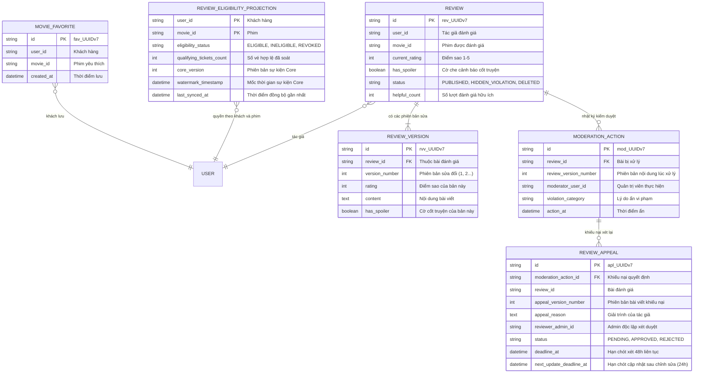

# Thiết kế dữ liệu Database Community

## 1. Trách nhiệm và nguồn

### Trách nhiệm của Service và Database
- Community Service sở hữu toàn bộ nội dung do khách hàng đóng góp trên nền tảng: danh sách phim yêu thích (Watchlist/Favorites), các bài đánh giá và chấm điểm phim (Reviews & Ratings), các phiên bản sửa đổi nội dung đánh giá (Review Versions), nhãn cảnh báo tiết lộ cốt truyện (Spoiler Warnings), quyết định xử lý kiểm duyệt (Moderation Actions) và các yêu cầu khiếu nại xét lại đánh giá bị ẩn (Review Appeals).
- Community Service quản lý bảng chiếu căn cứ đủ điều kiện đánh giá (Review Eligibility Projection) được cập nhật bất đồng bộ từ các sự kiện soát vé của Cinema Core thông qua Outbox–Debezium–Kafka. Để viết đánh giá phim, khách hàng bắt buộc phải có tài khoản đã mua vé xem phim đó và vé đã được soát thành công tại rạp (BR-16).
- Khi projection căn cứ tại chỗ chưa có dữ liệu hoặc đã vượt ngưỡng độ mới cho phép (*[Đề xuất kỹ thuật - Đang chờ phê duyệt]: 15 phút*), Community Service thực hiện cơ chế HTTP Fallback gọi đồng bộ sang Cinema Core để xác minh tức thời. Nếu Core không phản hồi, Community tạm dừng tiếp nhận đánh giá, tuyệt đối không tự ý cho phép đăng bài khi chưa đủ căn cứ (Kiến trúc mục 4).
- Community Service tính toán điểm đánh giá trung bình của từng bộ phim dựa trên các bài đánh giá đang ở trạng thái công khai (bao gồm cả các bài có che cảnh báo cốt truyện), hiển thị một chữ số thập phân kèm tổng số lượt đánh giá; khi chưa có bài đánh giá hợp lệ nào, hiển thị nhãn "Chưa có đánh giá" (giá trị `average_rating` là `NULL`) (BR-14, BR-32).

### Nguồn nghiệp vụ và quyết định kỹ thuật
- [Use case L-03–L-08](../../../03-product/use-cases.md) và [Mô tả use case](../../../03-product/use-case-descriptions.md).
- [Quy tắc nghiệp vụ BR-16, BR-32](../../../03-product/use-cases.md#4-quy-tắc-đã-thống-nhất).
- [Kiến trúc microservices](../../004-service-decomposition/spec.md) và [Quyết định kiến trúc](../../004-service-decomposition/decisions.md) (Mục 3, 4: Căn cứ đánh giá Core–Community, Projection và HTTP fallback).
- [ADR-0003](../../../06-decisions/0003-postgresql-and-redis-for-platform-data.md) (PostgreSQL cho Community Service).

---

## 2. ERD logic

Mô hình logic thể hiện sự gắn kết giữa nội dung của người dùng, quy trình kiểm duyệt/xét lại và bảng chiếu căn cứ quyền đánh giá.



---

## 3. ERD chi tiết

> [!TIP]
> **Hướng dẫn xem sơ đồ:** Để đọc rõ các nhãn cột và quan hệ phức tạp trong sơ đồ chi tiết, khuyến nghị xem tài liệu ở chế độ xem rộng hoặc 100% zoom, cuộn ngang, hoặc xem riêng từng phân vùng quan hệ.

Mô hình chi tiết toàn bộ các bảng trong database `community` với kiểu dữ liệu PostgreSQL, thuộc tính NULL/NOT NULL và khóa ngoại nội bộ.

```mermaid
erDiagram
    reviews ||--|{ review_versions : "fk_versions_review"
    reviews ||--o{ moderation_actions : "fk_moderations_review"
    moderation_actions ||--o{ review_appeals : "fk_appeals_moderation"

    movie_favorites {
        VARCHAR(36) id PK "fav_UUIDv7"
        VARCHAR(36) user_id "NN"
        VARCHAR(36) movie_id "NN"
        TIMESTAMPTZ created_at "NN, DEFAULT NOW()"
    }

    reviews {
        VARCHAR(36) id PK "rev_UUIDv7"
        VARCHAR(36) user_id "NN"
        VARCHAR(36) movie_id "NN"
        INTEGER current_rating "NN, CHECK 1 <= rating <= 5"
        BOOLEAN has_spoiler "NN, DEFAULT FALSE"
        VARCHAR(32) status "NN, CHECK PUBLISHED, HIDDEN_VIOLATION, DELETED"
        VARCHAR(36) current_moderation_action_id FK "NULLABLE, Tham chiếu moderation_actions(id)"
        INTEGER helpful_count "NN, DEFAULT 0, >= 0"
        INTEGER version "NN, DEFAULT 1"
        TIMESTAMPTZ created_at "NN, DEFAULT NOW()"
        TIMESTAMPTZ updated_at "NN, DEFAULT NOW()"
    }

    review_versions {
        VARCHAR(36) id PK "rvv_UUIDv7"
        VARCHAR(36) review_id FK "NN"
        INTEGER version_number "NN"
        INTEGER rating "NN, CHECK 1 <= rating <= 5"
        TEXT content "NULLABLE"
        BOOLEAN has_spoiler "NN, DEFAULT FALSE"
        TIMESTAMPTZ created_at "NN, DEFAULT NOW()"
    }

    moderation_actions {
        VARCHAR(36) id PK "mod_UUIDv7"
        VARCHAR(36) review_id FK "NN"
        INTEGER review_version_number "NN"
        VARCHAR(36) moderator_user_id "NN"
        VARCHAR(64) violation_category "NN, SPAM, HARASSMENT, HATE_SPEECH, INAPPROPRIATE"
        TEXT notes "NN"
        TIMESTAMPTZ action_at "NN, DEFAULT NOW()"
    }

    review_appeals {
        VARCHAR(36) id PK "apl_UUIDv7"
        VARCHAR(36) moderation_action_id FK "NN"
        VARCHAR(36) review_id "NN"
        VARCHAR(36) user_id "NN"
        INTEGER appeal_version_number "NN"
        TEXT author_explanation "NN"
        VARCHAR(32) status "NN, CHECK PENDING, PENDING_CLARIFICATION, APPROVED, REJECTED, CANCELLED"
        VARCHAR(36) reviewer_admin_id "NULLABLE"
        TEXT admin_resolution_notes "NULLABLE"
        TIMESTAMPTZ deadline_at "NN, created_at + 48 hours"
        TIMESTAMPTZ next_update_deadline_at "NULLABLE"
        TIMESTAMPTZ resolved_at "NULLABLE"
        TIMESTAMPTZ created_at "NN, DEFAULT NOW()"
        TIMESTAMPTZ updated_at "NN, DEFAULT NOW()"
    }

    review_eligibility_projections {
        VARCHAR(36) user_id PK "NN"
        VARCHAR(36) movie_id PK "NN"
        VARCHAR(32) eligibility_status "NN, CHECK ELIGIBLE, INELIGIBLE, REVOKED"
        INTEGER qualifying_tickets_count "NN, DEFAULT 1"
        VARCHAR(64) last_ticket_id "NULLABLE"
        INTEGER core_version "NN, DEFAULT 1"
        INTEGER restoration_epoch "NN, DEFAULT 1, Fencing Epoch phục hồi Core F25"
        TIMESTAMPTZ watermark_timestamp "NN"
        TIMESTAMPTZ last_synced_at "NN, DEFAULT NOW()"
    }

    movie_rating_summaries {
        VARCHAR(36) movie_id PK "NN"
        INTEGER total_reviews "NN, DEFAULT 0, >= 0"
        INTEGER sum_ratings "NN, DEFAULT 0, >= 0"
        NUMERIC(3_2) average_rating "NULLABLE, NULL khi total_reviews = 0"
        TIMESTAMPTZ updated_at "NN, DEFAULT NOW()"
    }

    outbox_events {
        VARCHAR(36) id PK "evt_UUIDv7"
        VARCHAR(64) aggregate_type "NN"
        VARCHAR(36) aggregate_id "NN"
        BIGINT aggregate_sequence_number "NN"
        VARCHAR(64) event_type "NN"
        JSONB payload "NN"
        TIMESTAMPTZ created_at "NN, DEFAULT NOW()"
    }

    community_consumer_inbox {
        VARCHAR(64) event_id PK "Mã định danh sự kiện duy nhất từ Kafka"
        VARCHAR(64) event_type "NN"
        TIMESTAMPTZ processed_at "NN, DEFAULT NOW()"
    }

    community_watermarks {
        VARCHAR(128) topic_partition PK "Tên topic và partition id"
        BIGINT last_offset "NN, offset vật lý của Kafka"
        TIMESTAMPTZ last_event_timestamp "NN"
        TIMESTAMPTZ updated_at "NN, DEFAULT NOW()"
    }
```



---

## 4. Từ điển dữ liệu toàn diện (100% các bảng)

### 4.1. Bảng `reviews` (Bài đánh giá phim chính)

| Tên cột | Kiểu dữ liệu | Nullable | Default | Ý nghĩa / Đơn vị | Nguồn quy tắc |
|---|---|---|---|---|---|
| `id` | `VARCHAR(36)` | NOT NULL | Không có | Khóa chính, tiền tố `rev_` theo chuẩn UUIDv7 | Mục 4.1 `spec.md` |
| `user_id` | `VARCHAR(36)` | NOT NULL | Không có | Khách hàng viết bài (`usr_...`) | BR-16 |
| `movie_id` | `VARCHAR(36)` | NOT NULL | Không có | Phim trong Catalog được đánh giá (`mov_...`) | BR-16 |
| `current_rating` | `INTEGER` | NOT NULL | Không có | Điểm số nguyên từ 1 đến 5 sao | BR-16 |
| `has_spoiler` | `BOOLEAN` | NOT NULL | `FALSE` | Đánh dấu bài có tiết lộ nội dung cốt truyện | BR-32 |
| `status` | `VARCHAR(32)` | NOT NULL | `'PUBLISHED'` | Trạng thái: `PUBLISHED`, `HIDDEN_VIOLATION`, `DELETED` | BR-16, BR-32 |
| `current_moderation_action_id` | `VARCHAR(36)` | NULL | NULL | Tham chiếu lệnh ẩn vi phạm hiện hành (`moderation_actions.id`) | Finding 20 |
| `helpful_count` | `INTEGER` | NOT NULL | `0` | Số lượt bạn đọc bấm "Hữu ích" cho bài viết (>= 0) | Trải nghiệm UI |
| `version` | `INTEGER` | NOT NULL | `1` | Số hiệu phiên bản dùng cho Optimistic Locking | Mục 4.4 `spec.md` |
| `created_at` | `TIMESTAMPTZ` | NOT NULL | `NOW()` | Thời điểm đăng bài lần đầu (UTC) | Mục 4.3 `spec.md` |
| `updated_at` | `TIMESTAMPTZ` | NOT NULL | `NOW()` | Thời điểm cập nhật nội dung gần nhất (UTC) | Mục 4.3 `spec.md` |

### 4.2. Bảng `review_versions` (Lịch sử các phiên bản sửa đổi của bài đánh giá)

| Tên cột | Kiểu dữ liệu | Nullable | Default | Ý nghĩa / Đơn vị | Nguồn quy tắc |
|---|---|---|---|---|---|
| `id` | `VARCHAR(36)` | NOT NULL | Không có | Khóa chính, tiền tố `rvv_` theo chuẩn UUIDv7 | Mục 4.1 `spec.md` |
| `review_id` | `VARCHAR(36)` | NOT NULL | Không có | Khóa ngoại tham chiếu `reviews(id)` | BR-16, BR-32 |
| `version_number`| `INTEGER` | NOT NULL | Không có | Số thứ tự phiên bản sửa đổi (1, 2, 3...) | BR-32 |
| `rating` | `INTEGER` | NOT NULL | Không có | Điểm số tại phiên bản này (1 đến 5 sao) | BR-16 |
| `content` | `TEXT` | NULL | NULL | Nội dung nhận xét bằng chữ (tùy chọn theo BR-16) | BR-16 |
| `has_spoiler` | `BOOLEAN` | NOT NULL | `FALSE` | Cờ cốt truyện tại phiên bản này | BR-32 |
| `created_at` | `TIMESTAMPTZ` | NOT NULL | `NOW()` | Thời điểm lưu phiên bản này (UTC) | Mục 4.3 `spec.md` |

### 4.3. Bảng `moderation_actions` (Quyết định xử lý vi phạm của Quản trị viên)

| Tên cột | Kiểu dữ liệu | Nullable | Default | Ý nghĩa / Đơn vị | Nguồn quy tắc |
|---|---|---|---|---|---|
| `id` | `VARCHAR(36)` | NOT NULL | Không có | Khóa chính, tiền tố `mod_` theo chuẩn UUIDv7 | Mục 4.1 `spec.md` |
| `review_id` | `VARCHAR(36)` | NOT NULL | Không có | Khóa ngoại tham chiếu `reviews(id)` | BR-32 |
| `review_version_number` | `INTEGER` | NOT NULL | Không có | Phiên bản nội dung chính xác tại thời điểm bị xử lý | BR-32 |
| `moderator_user_id` | `VARCHAR(36)` | NOT NULL | Không có | Quản trị viên thực hiện lệnh ẩn bài viết | BR-32, L-05 |
| `violation_category` | `VARCHAR(64)` | NOT NULL | Không có | Phân loại vi phạm: `SPAM`, `HARASSMENT`, `HATE_SPEECH`, `INAPPROPRIATE` | BR-32 |
| `notes` | `TEXT` | NOT NULL | Không có | Ghi chú giải thích vi phạm cụ thể của Quản trị viên | BR-32 |
| `action_at` | `TIMESTAMPTZ` | NOT NULL | `NOW()` | Thời điểm thực hiện xử lý ẩn bài viết (UTC) | Mục 4.3 `spec.md` |

### 4.4. Bảng `review_appeals` (Hồ sơ khiếu nại xét lại đánh giá bị ẩn)

| Tên cột | Kiểu dữ liệu | Nullable | Default | Ý nghĩa / Đơn vị | Nguồn quy tắc |
|---|---|---|---|---|---|
| `id` | `VARCHAR(36)` | NOT NULL | Không có | Khóa chính, tiền tố `apl_` theo chuẩn UUIDv7 | Mục 4.1 `spec.md` |
| `moderation_action_id` | `VARCHAR(36)` | NOT NULL | Không có | Khóa ngoại tham chiếu `moderation_actions(id)` | BR-32 |
| `review_id` | `VARCHAR(36)` | NOT NULL | Không có | Bài đánh giá đang khiếu nại | BR-32 |
| `user_id` | `VARCHAR(36)` | NOT NULL | Không có | Tác giả bài viết gửi khiếu nại | BR-32, L-07 |
| `appeal_version_number` | `INTEGER` | NOT NULL | Không có | Phiên bản nội dung bài viết thẩm định kèm khiếu nại | Finding 20, BR-32 |
| `author_explanation` | `TEXT` | NOT NULL | Không có | Giải trình của tác giả về nội dung đã sửa đổi | BR-32 |
| `status` | `VARCHAR(32)` | NOT NULL | `'PENDING'` | Trạng thái: `PENDING`, `PENDING_CLARIFICATION`, `APPROVED`, `REJECTED`, `CANCELLED` | BR-32, Finding 20, F23 |
| `reviewer_admin_id` | `VARCHAR(36)` | NULL | NULL | Quản trị viên độc lập thẩm định (phải khác `moderator_user_id`) | BR-32 |
| `admin_resolution_notes` | `TEXT` | NULL | NULL | Kết luận giải quyết của Quản trị viên thẩm định | BR-32, L-08 |
| `deadline_at` | `TIMESTAMPTZ` | NOT NULL | Không có | Hạn chót xử lý = `created_at + 48 hours` liên tục | BR-32 |
| `next_update_deadline_at`| `TIMESTAMPTZ`| NULL | NULL | Hạn chót cập nhật bổ sung sau khi sửa đổi (24h) | Finding 20, BR-32 |
| `resolved_at` | `TIMESTAMPTZ` | NULL | NULL | Thời điểm hoàn tất xét duyệt khiếu nại (UTC) | BR-32 |
| `created_at` | `TIMESTAMPTZ` | NOT NULL | `NOW()` | Thời điểm gửi hồ sơ khiếu nại (UTC) | Mục 4.3 `spec.md` |
| `updated_at` | `TIMESTAMPTZ` | NOT NULL | `NOW()` | Thời điểm cập nhật hồ sơ gần nhất (UTC) | Mục 4.3 `spec.md` |

### 4.5. Bảng `review_eligibility_projections` (Bảng chiếu quyền đánh giá nhận từ Core)

| Tên cột | Kiểu dữ liệu | Nullable | Default | Ý nghĩa / Đơn vị | Nguồn quy tắc |
|---|---|---|---|---|---|
| `user_id` | `VARCHAR(36)` | NOT NULL | Không có | Khóa chính kết hợp, định danh tài khoản khách hàng | BR-16 |
| `movie_id` | `VARCHAR(36)` | NOT NULL | Không có | Khóa chính kết hợp, định danh phim | BR-16 |
| `eligibility_status` | `VARCHAR(32)`| NOT NULL | Không có | `CHECK (eligibility_status IN ('ELIGIBLE', 'INELIGIBLE', 'REVOKED'))` | Finding 18, BR-16 |
| `qualifying_tickets_count`| `INTEGER` | NOT NULL | `1` | Số vé hợp lệ đã soát tại rạp cho phim này | Finding 18, BR-16 |
| `last_ticket_id`| `VARCHAR(36)` | NULL | NULL | Mã vé gần nhất làm căn cứ đủ điều kiện (`tkt_...`) | Kiến trúc mục 4 |
| `core_version` | `INTEGER` | NOT NULL | `1` | Số hiệu phiên bản sự kiện Core nhận được | Finding 18, Kiến trúc mục 4 |
| `restoration_epoch` | `INTEGER` | NOT NULL | `1` | Thế hệ phục hồi thẩm quyền của Core (Fencing Epoch chống response/event cũ trễ mạng ghi đè) | Finding 25 |
| `watermark_timestamp`| `TIMESTAMPTZ` | NOT NULL | Không có | Mốc thời gian tạo sự kiện tại Core để kiểm tra độ mới | Finding 18, Kiến trúc mục 4 |
| `last_synced_at` | `TIMESTAMPTZ` | NOT NULL | `NOW()` | Thời điểm cập nhật bản ghi projection tại Community | Finding 18, Mục 4.3 `spec.md` |

### 4.6. Bảng `movie_rating_summaries` (Tổng hợp điểm và số lượng đánh giá theo phim)

| Tên cột | Kiểu dữ liệu | Nullable | Default | Ý nghĩa / Đơn vị | Nguồn quy tắc |
|---|---|---|---|---|---|
| `movie_id` | `VARCHAR(36)` | NOT NULL | Không có | Khóa chính, định danh phim (`mov_...`) | BR-32 |
| `total_reviews` | `INTEGER` | NOT NULL | `0` | Tổng số bài đánh giá đang công bố (>= 0) | BR-32 |
| `sum_ratings` | `INTEGER` | NOT NULL | `0` | Tổng điểm sao của các bài đang công bố (>= 0) | BR-32 |
| `average_rating` | `NUMERIC(3,2)`| NULL | NULL | Điểm trung bình làm tròn 2 chữ số; NULL khi `total_reviews = 0` (hiển thị UI "Chưa có đánh giá") | Finding 19, BR-14, BR-32 |
| `updated_at` | `TIMESTAMPTZ` | NOT NULL | `NOW()` | Thời điểm cập nhật tổng hợp gần nhất (UTC) | Mục 4.3 `spec.md` |

### 4.7. Bảng `movie_favorites` (Danh sách phim yêu thích của người dùng)

| Tên cột | Kiểu dữ liệu | Nullable | Default | Ý nghĩa / Đơn vị | Nguồn quy tắc |
|---|---|---|---|---|---|
| `id` | `VARCHAR(36)` | NOT NULL | Không có | Khóa chính, tiền tố `fav_` theo UUIDv7 | L-03 |
| `user_id` | `VARCHAR(36)` | NOT NULL | Không có | Định danh tài khoản khách hàng | L-03 |
| `movie_id` | `VARCHAR(36)` | NOT NULL | Không có | Định danh phim yêu thích | L-03 |
| `created_at` | `TIMESTAMPTZ` | NOT NULL | `NOW()` | Thời điểm lưu phim vào danh sách | Mục 4.3 `spec.md` |

### 4.8. Bảng `community_consumer_inbox` (Khử trùng lặp sự kiện tiêu thụ Kafka - Finding 18)

| Tên cột | Kiểu dữ liệu | Nullable | Default | Ý nghĩa / Đơn vị | Nguồn quy tắc |
|---|---|---|---|---|---|
| `event_id` | `VARCHAR(64)` | NOT NULL | Không có | Khóa chính, mã định danh sự kiện duy nhất từ Kafka | Finding 18, NFR-COR-01 |
| `event_type` | `VARCHAR(64)` | NOT NULL | Không có | Loại sự kiện (ví dụ `REVIEW_ELIGIBILITY_UPDATED`) | Finding 18 |
| `processed_at` | `TIMESTAMPTZ` | NOT NULL | `NOW()` | Thời điểm xử lý sự kiện thành công (UTC) | Mục 4.3 `spec.md` |

### 4.9. Bảng `outbox_events` (Transactional Outbox Pattern xuất sự kiện)

| Tên cột | Kiểu dữ liệu | Nullable | Default | Ý nghĩa / Đơn vị | Nguồn quy tắc |
|---|---|---|---|---|---|
| `id` | `VARCHAR(36)` | NOT NULL | Không có | Khóa chính sự kiện, tiền tố `evt_` theo UUIDv7 | Finding 23, 25 |
| `aggregate_type` | `VARCHAR(64)` | NOT NULL | Không có | Thực thể nguồn (`REVIEW`, `MODERATION`) | Finding 25 |
| `aggregate_id` | `VARCHAR(36)` | NOT NULL | Không có | Định danh thực thể nguồn | Finding 25 |
| `aggregate_sequence_number` | `BIGINT` | NOT NULL | Không có | Số thứ tự tăng dần đơn điệu theo thực thể | Finding 25 |
| `event_type` | `VARCHAR(64)` | NOT NULL | Không có | Loại sự kiện (`REVIEW_PUBLISHED`, `REVIEW_HIDDEN`) | Finding 25 |
| `payload` | `JSONB` | NOT NULL | Không có | Dữ liệu sự kiện (không chứa PII) | Finding 13, 25 |
| `created_at` | `TIMESTAMPTZ` | NOT NULL | `NOW()` | Thời điểm commit cùng transaction nghiệp vụ | Finding 25 |

### 4.10. Bảng `community_watermarks` (Tiến độ xử lý phân vùng Consumer CDC - Finding 18, F23)

| Tên cột | Kiểu dữ liệu | Nullable | Default | Ý nghĩa / Đơn vị | Nguồn quy tắc |
|---|---|---|---|---|---|
| `topic_partition` | `VARCHAR(128)`| NOT NULL | Không có | Khóa chính, định dạng `topic_name-partition_id` | Finding 18, F23 |
| `last_offset` | `BIGINT` | NOT NULL | Không có | Vị trí offset vật lý đã xử lý thành công | Finding 18, F25 |
| `last_event_timestamp` | `TIMESTAMPTZ` | NOT NULL | Không có | Mốc thời gian sự kiện đã xử lý gần nhất | Finding 18 |
| `updated_at` | `TIMESTAMPTZ` | NOT NULL | `NOW()` | Thời điểm cập nhật tiến độ | Mục 4.3 `spec.md` |

---

## 5. Khóa, chỉ mục và ràng buộc

### 5.1. Khóa chính và Khóa ngoại nội bộ

- `movie_favorites.id`: Primary Key (`pk_movie_favorites`).
- `reviews.id`: Primary Key (`pk_reviews`).
- `review_versions.id`: Primary Key (`pk_review_versions`). Khóa ngoại `fk_versions_review` trỏ tới `reviews(id)` với `ON DELETE CASCADE`.
- `moderation_actions.id`: Primary Key (`pk_moderations`). Khóa ngoại `fk_moderations_review` trỏ tới `reviews(id)` với `ON DELETE CASCADE`.
- `review_appeals.id`: Primary Key (`pk_review_appeals`). Khóa ngoại `fk_appeals_moderation` trỏ tới `moderation_actions(id)` với `ON DELETE CASCADE`.
- `review_eligibility_projections(user_id, movie_id)`: Composite Primary Key (`pk_review_eligibility`).
- `movie_rating_summaries.movie_id`: Primary Key (`pk_movie_rating_summaries`).

### 5.2. Ràng buộc toàn vẹn dữ liệu (CHECK & UNIQUE)

1. **Quy tắc mỗi tài khoản chỉ có 1 bài đánh giá cho 1 bộ phim (BR-16):**
   - Trên bảng `reviews`:
     `UNIQUE (user_id, movie_id)`
2. **Phiên bản bài đánh giá là duy nhất theo bài viết (Finding 20):**
   - Trên bảng `review_versions`:
     `UNIQUE (review_id, version_number)`
3. **Quy tắc mỗi bài đánh giá chỉ có tối đa 1 khiếu nại đang mở (Pending hoặc Pending Clarification - Finding 20):**
   - Tạo Partial Unique Index thống nhất trên `review_appeals`:
     ```sql
     CREATE UNIQUE INDEX uq_open_review_appeal ON review_appeals (review_id) WHERE status IN ('PENDING', 'PENDING_CLARIFICATION');
     ```
4. **Quy tắc phân định người xét duyệt khiếu nại (BR-32):**
   - Ràng buộc ứng dụng: Quản trị viên giải quyết khiếu nại (`reviewer_admin_id`) bắt buộc phải **khác** với Quản trị viên đã thực hiện lệnh ẩn bài viết trước đó (`moderator_user_id`).
5. **Quy tắc không gia hạn thời gian xét duyệt khiếu nại (BR-32):**
   - Cột `deadline_at` trong `review_appeals` được ấn định cố định bằng `created_at + INTERVAL '48 hours'`. Mọi hành động cập nhật giải trình không được phép thay đổi mốc `deadline_at` này.
6. **Giới hạn giá trị điểm số hợp lệ (Finding 23):**
   - Trên bảng `reviews`:
     `CHECK (current_rating >= 1 AND current_rating <= 5)`
   - Trên bảng `review_versions`:
     `CHECK (rating >= 1 AND rating <= 5)`

### 5.3. Chỉ mục tối ưu hóa truy vấn (Indexes)

1. `idx_reviews_movie_feed`: B-Tree trên `reviews(movie_id, created_at DESC) WHERE status = 'PUBLISHED'` — Tải danh sách bài đánh giá công khai của phim.
2. `idx_reviews_user_my_reviews`: B-Tree trên `reviews(user_id, updated_at DESC)` — Hiển thị danh sách đánh giá cá nhân của khách hàng.
3. `idx_review_appeals_open`: B-Tree trên `review_appeals(deadline_at ASC) WHERE status IN ('PENDING', 'PENDING_CLARIFICATION')` — Hàng đợi xét duyệt khiếu nại đang mở của Quản trị viên (Finding 20).
4. `idx_movie_favorites_user`: B-Tree trên `movie_favorites(user_id, created_at DESC)` — Danh sách phim yêu thích.

---

## 6. Giao dịch và interface

### 6.1. Giao thức Đăng bài Đánh giá và Quy tắc Đóng góp Tổng hợp Thống nhất (Finding 18, Finding 19)

- Khi khách hàng gửi bài đánh giá mới (`L-04`):
  1. **Giao thức Tiêu thụ Sự kiện Nguyên tử và Khử trùng lặp (Transactional Consumer Protocol - Finding 18):**
     - Khi nhận sự kiện `REVIEW_ELIGIBILITY_UPDATED` từ Kafka, worker thực thi trong **CÙNG MỘT ACID TRANSACTION**:
       ```sql
       BEGIN;
       -- Ghi nhận inbox khử trùng lặp
       INSERT INTO community_consumer_inbox (event_id, event_type, processed_at)
       VALUES (:event_id, :event_type, NOW())
       ON CONFLICT (event_id) DO NOTHING;

       -- Nếu rows_affected == 0: sự kiện đã được xử lý trước đó, COMMIT và ACK offset ngay lập tức.

       -- Cập nhật projection có điều kiện Fencing Epoch và phiên bản nghiêm ngặt (Finding 25)
       INSERT INTO review_eligibility_projections (user_id, movie_id, eligibility_status, qualifying_tickets_count, core_version, restoration_epoch, watermark_timestamp, last_synced_at)
       VALUES (:uid, :mid, :status, :count, :version, :epoch, :event_timestamp, NOW())
       ON CONFLICT (user_id, movie_id) DO UPDATE SET
         eligibility_status = EXCLUDED.eligibility_status,
         qualifying_tickets_count = EXCLUDED.qualifying_tickets_count,
         core_version = EXCLUDED.core_version,
         restoration_epoch = EXCLUDED.restoration_epoch,
         watermark_timestamp = EXCLUDED.watermark_timestamp,
         last_synced_at = NOW()
       WHERE EXCLUDED.restoration_epoch > review_eligibility_projections.restoration_epoch
          OR (EXCLUDED.restoration_epoch = review_eligibility_projections.restoration_epoch AND EXCLUDED.core_version > review_eligibility_projections.core_version);

       -- Cập nhật mốc watermark tiến độ phân vùng
       INSERT INTO community_watermarks (topic_partition, last_offset, last_event_timestamp, updated_at)
       VALUES (:partition, :offset, :event_timestamp, NOW())
       ON CONFLICT (topic_partition) DO UPDATE SET
         last_offset = EXCLUDED.last_offset,
         last_event_timestamp = EXCLUDED.last_event_timestamp,
         updated_at = NOW();
       COMMIT;
       ```
     - **Bất biến giao thức:** CHỈ commit Kafka offset sau khi transaction PostgreSQL đã COMMIT thành công. Nếu crash giữa chừng, transaction rollback và Kafka re-deliver an toàn.

  2. **Cổng Phủ và Trạng thái UNKNOWN khi Đăng bài (Coverage Gate Protocol - Finding 18):**
     - Khi khách hàng gửi bài đánh giá:
       - Tra cứu `review_eligibility_projections` và `community_watermarks`.
       - **Đánh giá mốc bao phủ (Coverage Assessment):**
         - Nếu **KHÔNG tìm thấy bản ghi projection** HOẶC phân vùng CDC liên quan chưa hoàn tất giai đoạn backfill / catch-up (tức là phân vùng còn tồn tại khoảng trống hoặc `watermark_timestamp` chưa bắt kịp mốc nguồn cắt `source_cut_timestamp` / `source_cut_sequence` của đợt chuyển giao snapshot):
           Trạng thái quyền đánh giá được xác định là **`UNKNOWN`** (Chưa xác định độ phủ, khác hoàn toàn `INELIGIBLE`).
         - Khi ở trạng thái **`UNKNOWN`**: Community Service kích hoạt **Cổng Phủ (Coverage Gate)** gọi trực tiếp REST API nội bộ của Cinema Core:
           `GET /internal/v1/customers/{user_id}/movies/{movie_id}/eligibility`
           Cinema Core (nguồn chân lý độc quyền) thẩm định và trả về kết quả kèm `core_version` và mốc chứng thực nguồn `verified_as_of` (thời điểm Core cấp chứng thực, tuyệt đối không dùng `NOW()` cục bộ của Community thay thế căn cứ nguồn).
           Community thực thi conditional update:
           ```sql
           INSERT INTO review_eligibility_projections (user_id, movie_id, eligibility_status, qualifying_tickets_count, core_version, restoration_epoch, watermark_timestamp, last_synced_at)
           VALUES (:uid, :mid, :status, :count, :version, :epoch, :verified_as_of, NOW())
           ON CONFLICT (user_id, movie_id) DO UPDATE SET
             eligibility_status = EXCLUDED.eligibility_status,
             qualifying_tickets_count = EXCLUDED.qualifying_tickets_count,
             core_version = EXCLUDED.core_version,
             restoration_epoch = EXCLUDED.restoration_epoch,
             watermark_timestamp = EXCLUDED.watermark_timestamp,
             last_synced_at = NOW()
           WHERE EXCLUDED.restoration_epoch > review_eligibility_projections.restoration_epoch
              OR (EXCLUDED.restoration_epoch = review_eligibility_projections.restoration_epoch AND EXCLUDED.core_version > review_eligibility_projections.core_version);
           ```
       - **Đọc lại kết luận hiện hành sau Cổng Phủ:**
         `SELECT eligibility_status FROM review_eligibility_projections WHERE user_id = :uid AND movie_id = :mid;`
         - Nếu `eligibility_status == 'ELIGIBLE'`: Cho phép tiếp tục đăng bài.
         - Nếu `eligibility_status IN ('REVOKED', 'INELIGIBLE')`: Từ chối đăng bài ngay lập tức.
         - Nếu Cinema Core gặp sự cố không thể truy vấn: Trả về thông báo "Hệ thống đang đồng bộ dữ liệu vé của bạn, vui lòng thử lại sau ít phút", tuyệt đối không cho phép đăng khi quyền chưa được chứng minh.
  2. **Thực thi transaction PostgreSQL cục bộ:**
     - Chèn bản ghi vào `reviews` (`status = 'PUBLISHED'`, `current_rating = :rating`).
     - Chèn bản ghi phiên bản đầu tiên vào `review_versions` (`version_number = 1`, `rating = :rating`).
     - Áp dụng **Quy tắc Đóng góp Tổng hợp Thống nhất (Unified Rating Contribution Invariant)** với `old_weight = 0`, `new_weight = 1`, `new_rating = :rating`:
       ```sql
       INSERT INTO movie_rating_summaries (movie_id, total_reviews, sum_ratings, average_rating)
       VALUES (:movie_id, 1, :rating, ROUND(:rating::numeric, 2))
       ON CONFLICT (movie_id) DO UPDATE SET
         total_reviews = movie_rating_summaries.total_reviews + 1,
         sum_ratings = movie_rating_summaries.sum_ratings + EXCLUDED.sum_ratings,
         average_rating = ROUND((movie_rating_summaries.sum_ratings + EXCLUDED.sum_ratings)::numeric / (movie_rating_summaries.total_reviews + 1), 2);
       ```
     - Ghi sự kiện `REVIEW_PUBLISHED` vào `outbox_events`.
     - Commit transaction.

### 6.2. Giao thức Xử lý Kiểm duyệt, Khôi phục Appeal và Sửa Đánh giá (Finding 18, Finding 19, Finding 20)

- **Cập nhật Căn cứ Đủ điều kiện do Core làm chủ (Finding 18):**
  - Cinema Core sở hữu độc quyền kết luận đủ điều kiện theo cặp `(user_id, movie_id)` và phát tán dữ liệu qua sự kiện Kafka `REVIEW_ELIGIBILITY_UPDATED` (kèm `is_eligible` và `core_version`) hoặc phản hồi qua HTTP Query API.
  - **Cơ chế Fencing Epoch bảo vệ nhất quán và Đường dẫn Phục hồi sau Sự cố (Finding 18, Finding 25):**
    - Cả hai kênh Event và HTTP đều tuân thủ chung một quy tắc Fencing Epoch đơn điệu (Finding 25):
      `WHERE EXCLUDED.restoration_epoch > review_eligibility_projections.restoration_epoch OR (EXCLUDED.restoration_epoch = review_eligibility_projections.restoration_epoch AND EXCLUDED.core_version > review_eligibility_projections.core_version);`
    - **Đường dẫn Cập nhật Phục hồi Thẩm quyền khi Core lùi mốc thời gian (Finding 25):** Khi Cinema Core gặp sự cố thảm họa và phục hồi lùi lại mốc bản sao lưu cũ (`restored_as_of`), Core phát thông điệp điều khiển `SYSTEM_RESTORATION_NOTICE` kèm thế hệ phục hồi mới `restoration_epoch = :new_epoch` (`:new_epoch > current_epoch`).
    - Khi đó, mọi chứng thực quyền đánh giá qua HTTP Cổng Phủ hoặc sự kiện CDC từ Core đều mang `restoration_epoch` mới, cho phép thiết lập lại trạng thái thẩm quyền sau phục hồi một cách an toàn.
    - Trong cùng một thế hệ (`EXCLUDED.restoration_epoch == stored.restoration_epoch`), các sự kiện hoặc HTTP response trễ mạng mang `core_version` cũ (ví dụ response HTTP v5 về muộn sau khi Kafka đã chốt `REVOKED` v6) **tuyệt đối không thể ghi đè**, loại bỏ hoàn toàn hiện tượng đảo ngược trạng thái thu hồi trong cùng thế hệ (Finding 25).
  - Nếu khách hàng có nhiều vé (ví dụ 1 vé đã soát A và 1 vé chưa soát B), việc hoàn vé B không làm mất quyền của vé A; Core tính toán lại và giữ nguyên `is_eligible = TRUE`. Community tuyệt đối **KHÔNG tự ý suy giảm quyền đánh giá** khi nhận sự kiện refund vé riêng lẻ.
- **Quy tắc Đóng góp Tổng hợp Thống nhất (Unified Rating Contribution Invariant - Finding 19):**
  - Mọi thao tác thay đổi trạng thái hoặc điểm số bài đánh giá (Đăng mới, Sửa bài 5 sao -> 1 sao, Ẩn vi phạm, Khôi phục appeal, Xóa bài) BẮT BUỘC thực thi trong cùng một ACID transaction với trình tự:
    1. **Khóa bi quan dòng review trước tiên:**
       ```sql
       SELECT status, current_rating FROM reviews WHERE id = :review_id FOR UPDATE;
       ```
    2. Đọc `old_status`, `old_rating` chính xác từ dòng đã khóa.
    3. Tính delta theo công thức thống nhất:
       - `old_weight = CASE WHEN old_status = 'PUBLISHED' THEN 1 ELSE 0 END`
       - `new_weight = CASE WHEN new_status = 'PUBLISHED' THEN 1 ELSE 0 END`
       - `delta_count = new_weight - old_weight`
       - `delta_sum = (new_rating * new_weight) - (old_rating * old_weight)`
    4. Cập nhật bảng tổng hợp `movie_rating_summaries` có kiểm tra chống chia cho 0:
       ```sql
       UPDATE movie_rating_summaries
       SET total_reviews = total_reviews + :delta_count,
           sum_ratings = sum_ratings + :delta_sum,
           average_rating = CASE
             WHEN (total_reviews + :delta_count) > 0
             THEN ROUND((sum_ratings + :delta_sum)::numeric / (total_reviews + :delta_count), 2)
             ELSE NULL
           END
       WHERE movie_id = :movie_id;
       ```
    5. Cập nhật `reviews` và commit transaction.
- **Sửa điểm đánh giá (Edit Review — ví dụ 5 sao -> 1 sao):**
  - Bài viết vẫn giữ `status = 'PUBLISHED'`. `old_weight = 1, new_weight = 1`.
  - `delta_count = 0`, `delta_sum = 1 - 5 = -4`.
  - Bảng tổng hợp cập nhật giảm đúng 4 điểm tổng mà không đổi `total_reviews`.
- **Ẩn vi phạm (`status = 'HIDDEN_VIOLATION'` — L-05):**
  - Khóa dòng: `SELECT status, current_rating FROM reviews WHERE id = :review_id FOR UPDATE;`
  - Nếu bài đang là `PUBLISHED`: `old_weight = 1, new_weight = 0`, `delta_count = -1`, `delta_sum = -current_rating`.
  - Chèn bản ghi `moderation_actions`. Chuyển `reviews.status = 'HIDDEN_VIOLATION'`, lưu `current_moderation_action_id`.
  - Cập nhật `movie_rating_summaries` theo công thức delta thống nhất. Nếu `total_reviews` về 0 thì `average_rating = NULL`.
- **Khôi phục bài viết qua Khiếu nại thành công (Finding 19, Finding 20):**
  - Quản trị viên duyệt khiếu nại: Trong cùng transaction:
    1. Khóa và claim bản ghi appeal (hỗ trợ cả PENDING và PENDING_CLARIFICATION - Finding 20):
       `SELECT * FROM review_appeals WHERE id = :appeal_id AND status IN ('PENDING', 'PENDING_CLARIFICATION') FOR UPDATE;`
    2. Khóa bản ghi review:
       `SELECT * FROM reviews WHERE id = :review_id FOR UPDATE;`
    3. **Kiểm tra an toàn gắn kết quyết định (Finding 20):**
       - Nếu `reviews.status == 'DELETED'`: Từ chối khôi phục vì tác giả đã xóa bài.
       - Bắt buộc `review_appeals.moderation_action_id == reviews.current_moderation_action_id`. Nếu bài viết đã bị ẩn lần thứ 2 do vi phạm mới (`current_moderation_action_id` đã đổi), appeal của lần ẩn trước tuyệt đối không được phép khôi phục lần ẩn mới!
       - Quản trị viên thẩm định (`reviewer_admin_id`) bắt buộc phải khác với Quản trị viên đã ra quyết định ẩn ban đầu (`moderator_user_id`).
    4. Khôi phục nội dung bài viết theo `appeal_version_number`. Chuyển `reviews.status = 'PUBLISHED'`, `review_appeals.status = 'APPROVED'`, `resolved_at = NOW()`.
    5. Cập nhật `movie_rating_summaries`: `old_weight = 0, new_weight = 1`, `delta_count = +1`, `delta_sum = +current_rating`, tính lại `average_rating`.
    6. **Xử lý khiếu nại thiếu căn cứ và Quy tắc Thông báo 24 giờ (Tuân thủ Q142 & Finding 20):**
       - Khi Quản trị viên xét duyệt thấy khiếu nại thiếu căn cứ hoặc cần giải trình thêm: Chuyển appeal sang `status = 'PENDING_CLARIFICATION'`, lưu yêu cầu làm rõ vào `admin_resolution_notes`, thiết lập hạn chót cập nhật `next_update_deadline_at = NOW() + INTERVAL '24 hours'`.
       - **Tuân thủ tuyệt đối Q142:** Quản trị viên có trách nhiệm thông báo vướng mắc và cập nhật tiến độ mỗi 24 giờ khi hồ sơ đang chờ. **Hết hạn 24 giờ mà tác giả chưa phản hồi, hồ sơ VẪN GIỮ NGUYÊN MỞ, TUYỆT ĐỐI KHÔNG tự động bác bỏ (`REJECTED`) hay tự động phê duyệt đơn.**
       - **Bảo toàn SLA 48 giờ:** Khi tác giả gửi giải trình bổ sung trong cùng phiên bản khiếu nại, hệ thống chuyển lại `status = 'PENDING'` để Quản trị viên tiếp tục xử lý; thời hạn chót 48 giờ ban đầu (`deadline_at`) **TUYỆT ĐỐI KHÔNG bị reset** mà vẫn tính từ thời điểm mở hồ sơ ban đầu.
- **Xóa bài viết (Delete Review — L-04 & Finding 19):**
  - Khi tác giả xóa bài viết:
    - Nếu bài đang là `PUBLISHED`: `old_weight = 1, new_weight = 0`, `delta_count = -1`, `delta_sum = -current_rating`. Cập nhật trừ điểm trong `movie_rating_summaries`.
    - Nếu bài đang là `HIDDEN_VIOLATION`: `old_weight = 0, new_weight = 0`, `delta_count = 0, delta_sum = 0`. Tuyệt đối không trừ điểm lần thứ hai vì điểm số đã được trừ khi chuyển sang ẩn.
    - Cập nhật `reviews.status = 'DELETED'`.

---

## 7. Vòng đời và bảo vệ dữ liệu

### 7.1. Độc lập nội dung và Tính toàn vẹn của Đánh giá đã đăng
- Khi một vé xem phim sau đó bị đính chính hoặc có khiếu nại dịch vụ ở Core, quyền đánh giá trong bảng projection có thể chuyển sang `REVOKED`. Tuy nhiên, tuân thủ nguyên tắc thiết kế tại [Kiến trúc microservices](../../004-service-decomposition/spec.md), **Community Service tuyệt đối không tự động xóa hoặc ẩn bài đánh giá đã đăng hợp lệ trước đó** của khách hàng.
- Khi khách hàng chủ động xóa bài đánh giá của mình (`L-04`):
  - Chuyển `reviews.status = 'DELETED'`.
  - Giảm trừ điểm trong `movie_rating_summaries` nếu bài viết đang ở trạng thái `PUBLISHED`.
  - Giữ lại các bản ghi `review_versions` trong cơ sở dữ liệu để phục vụ kiểm toán nội dung nếu bài viết từng bị khiếu nại vi phạm.

### 7.2. Quyền riêng tư và Ẩn danh hóa theo BR-38
- Khi khách hàng thực hiện xóa tài khoản thành công tại Identity Service:
  - Identity phát sự kiện `USER_ANONYMIZED` qua Kafka.
  - Community Service cập nhật các bài đánh giá của khách hàng đó: tên tác giả hiển thị được chuyển thành `"Người dùng ẩn danh"`, avatar bị gỡ bỏ.
  - Nội dung bài đánh giá và số điểm sao vẫn được bảo toàn nguyên vẹn trên trang chi tiết phim để không làm sai lệch điểm trung bình và thống kê chất lượng phim của cộng đồng.

---

## 8. Kịch bản đối chiếu và phụ thuộc

### 8.1. Các kịch bản đối chiếu bất biến trọng yếu

1. **Kịch bản 1: Khách hàng mua vé nhưng chưa vào xem phim, cố tình viết đánh giá phim sớm**
   - *Hành vi:* Khách hàng A mua vé xem suất 20:00 tối nay. Lúc 15:00 chiều, khách mở ứng dụng gửi bài đánh giá chấm 5 sao cho phim.
   - *Kết quả mong đợi:* Community Service kiểm tra bảng `review_eligibility_projections` thấy bản ghi của `(user_id, movie_id)` có `eligibility_status != 'ELIGIBLE'` (do vé chưa được soát tại cửa rạp). Hệ thống từ chối tiếp nhận bài đánh giá, trả về thông báo "Bạn chỉ có thể đánh giá bộ phim này sau khi vé đã được soát tại rạp" (đáp ứng 100% BR-16).
2. **Kịch bản 2: Sự cố Kafka trễ khiến sự kiện soát vé chưa kịp đồng bộ sang Community**
   - *Hành vi:* Khách hàng vừa được soát vé vào rạp lúc 19:30. Khách mở ứng dụng đánh giá phim lúc 19:31. Kafka Connect bị trễ 5 phút nên sự kiện `TICKET_SCANNED` từ Core chưa đến Community.
   - *Kết quả mong đợi:* Khi kiểm tra projection tại chỗ thấy chưa có dữ liệu hoặc đã cũ, Community kích hoạt HTTP Fallback gọi tức thời sang Cinema Core `GET /internal/v1/customers/{user_id}/movies/{movie_id}/eligibility`. Core xác nhận vé đã `USED` thành công. Community cập nhật projection cục bộ và cho phép khách hàng đăng bài thành công ngay lập tức mà không bị gián đoạn trải nghiệm.
3. **Kịch bản 3: Tác giả khiếu nại bài viết bị ẩn nhưng đã quá 48 tiếng chưa có Quản trị viên xử lý**
   - *Hành vi:* Quản trị viên ẩn bài viết ngày 10/11. Tác giả sửa bài và gửi khiếu nại lúc 10:00 ngày 11/11 (`deadline_at = 10:00 ngày 13/11`). Đến 11:00 ngày 13/11 vẫn chưa có Quản trị viên nào vào xử lý.
   - *Kết quả mong đợi:* Hệ thống phát cảnh báo vi phạm SLA tới Quản trị viên toàn chuỗi. Theo quy tắc **BR-32**, hệ thống tuyệt đối không tự động khôi phục bài viết cũng như không tự động bác khiếu nại chỉ vì hết giờ. Hồ sơ vẫn giữ trạng thái `PENDING` và được đẩy lên đầu danh sách ưu tiên cao nhất trong giao diện quản trị.

### 8.2. Quyết định còn thiếu và phụ thuộc (OPEN-08)
- *Cửa sổ độ mới của Projection:* Ngưỡng `freshness_threshold = 15 phút` là **Đề xuất kỹ thuật (Engineering Proposal)** để cân bằng giữa tải mạng HTTP nội bộ và độ trễ sự kiện Kafka. Con số này có thể cấu hình và điều chỉnh sau khi đo đạc môi trường thực tế mà không thay đổi kiến trúc.
