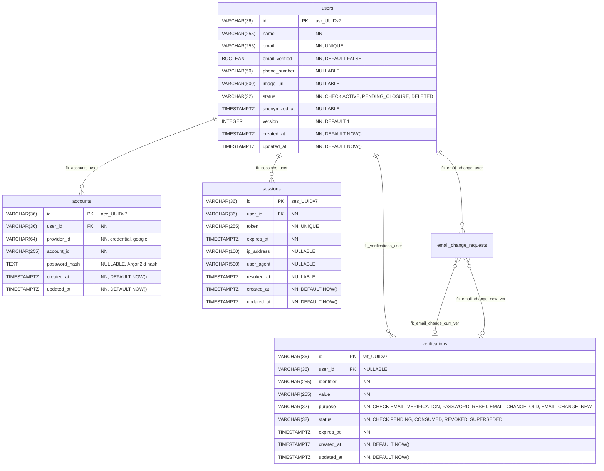
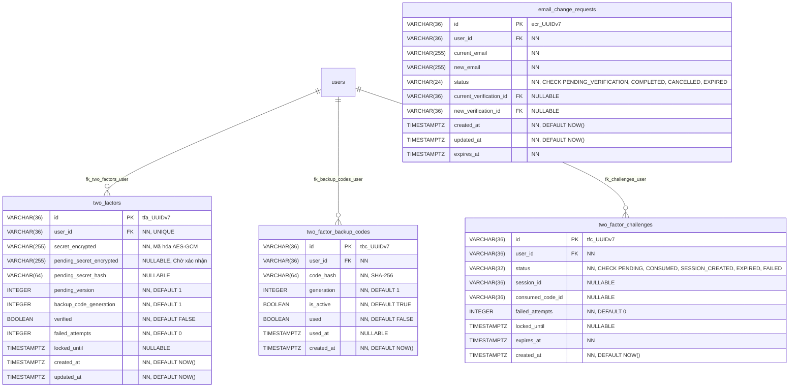
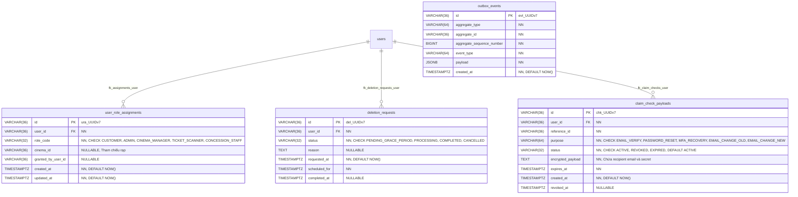

# Thiết kế dữ liệu Database Identity & Access

## 1. Trách nhiệm và nguồn

### Trách nhiệm của Service và Database
- Identity & Access Service sở hữu toàn bộ vòng đời danh tính người dùng, thông tin xác thực, phiên làm việc (Session Management dựa trên Better Auth v1.2.9+ theo ADR-0008), trạng thái xác minh email và cơ chế bảo mật nâng cao (Multi-Factor Authentication - MFA) cho toàn bộ bốn ứng dụng trong nền tảng (Customer Web/Mobile, Organizer Web/Mobile).
- Service sở hữu việc phân quyền vai trò vận hành (`CUSTOMER`, `ADMIN`, `CINEMA_MANAGER`, `TICKET_SCANNER`, `CONCESSION_STAFF`) và gán phạm vi rạp (`cinema_id`) được phân công cho nhân sự rạp qua bảng chuẩn hóa `user_role_assignments` (use case M-05, M-06).
- Service phát hành bằng chứng xác thực (Signed JWT / Claims Token) để các microservices nghiệp vụ (Cinema Core, Community, Agent, Reporting, Notification) xác minh cục bộ danh tính người gọi mà không cần gọi HTTP đồng bộ về Identity trong từng yêu cầu soát vé hay giao combo.
- Service quản lý cơ chế gửi email bảo mật thông qua mô hình Claim Check: lưu trữ dữ liệu xác minh (hash), lưu trữ payload gửi mã hóa có thời hạn ngắn, và chỉ gửi tham chiếu không mang tính bí mật sang Notification Service để chuyển phát qua Resend (ADR-0018).

### Nguồn nghiệp vụ và quyết định kỹ thuật
- [Use case A-01–A-08, M-05, M-06](../../../03-product/use-cases.md) và [Mô tả use case](../../../03-product/use-case-descriptions.md).
- [ADR-0008](../../../06-decisions/0008-better-auth-with-direct-login.md) (Better Auth v1.2.9+ cho xác thực trực tiếp và quản lý phiên).
- [NFR-SEC-01 §9.14](https://github.com/NhiBuaa/movie-booking-agent/blob/ad002e99936231fac0f8493830b9ec36dc3aedb2/docs/05-specs/nfr/security.md) (các mục có trong snapshot đã review):
  - Mục 9.14.1: Phạm vi đăng xuất vô hiệu phiên hiện tại (Option A), không mặc định ngắt các phiên độc lập khác.
  - Mục 9.14.2: MFA bắt buộc cho Quản trị viên toàn chuỗi và Quản lý rạp bằng TOTP kết hợp bộ mã dự phòng dùng một lần.
  - Mục 9.14.3: Chưa hỗ trợ khôi phục tự động khi mất cả TOTP và mã dự phòng trong mốc demo.
  - Mục 9.14.4: Quy tắc đổi yếu tố TOTP và tạo lại bộ mã dự phòng (phải xác thực lại mật khẩu và yếu tố hiện có).
- [Quyết định kiến trúc 7 service](../../004-service-decomposition/decisions.md) (Thời hạn bằng chứng quyền vận hành: 90 phút, làm mới 15 phút, tiếp tục soát vé 60 phút khi mất liên lạc).
- NFR §9.14.6 mở rộng MFA lúc đăng nhập tới `TICKET_SCANNER` và `CONCESSION_STAFF`. Luồng cấp phiên, hết hạn và thu hồi trong bản này cần đối chiếu tiếp các yêu cầu mới hơn theo [Mục 1 của đặc tả](../spec.md#nguồn-nfr-mới-hơn-bản-đã-review).

---

## 2. ERD logic

Sơ đồ thể hiện sự phân định giữa các bảng cốt lõi do Better Auth quản lý và các bảng mở rộng nghiệp vụ phân quyền và bảo mật do hệ thống thiết kế.

```mermaid
erDiagram
    USER ||--o{ SESSION : "duy trì các phiên"
    USER ||--o{ ACCOUNT : "phương thức đăng nhập"
    USER ||--o{ TWO_FACTOR : "cấu hình xác thực 2 bước"
    USER ||--o{ TWO_FACTOR_BACKUP_CODE : "sở hữu bộ mã dự phòng"
    USER ||--o{ USER_ROLE_ASSIGNMENT : "được phân công vai trò & phạm vi rạp"
    USER ||--o{ DELETION_REQUEST : "yêu cầu xóa tài khoản"
    USER ||--o{ EMAIL_CHANGE_REQUEST : "yêu cầu đổi địa chỉ email"
    USER ||--o{ CLAIM_CHECK_PAYLOAD : "các payload xác minh tạm"

    USER {
        string id PK "Định danh người dùng (usr_...)"
        string name "Họ và tên"
        string email "Địa chỉ email (duy nhất)"
        boolean email_verified "Trạng thái đã xác minh"
        string phone_number "Số điện thoại liên hệ"
        string status "ACTIVE, PENDING_CLOSURE, DELETED"
    }

    SESSION {
        string id PK "Định danh phiên"
        string user_id FK "Tham chiếu người dùng"
        string token "Session Token (duy nhất)"
        datetime expires_at "Thời điểm hết hạn phiên"
    }

    ACCOUNT {
        string id PK "Định danh tài khoản xác thực"
        string user_id FK "Tham chiếu người dùng"
        string provider_id "credential, google..."
        string password_hash "Mật khẩu mã hóa Argon2id"
    }

    TWO_FACTOR {
        string id PK "Định danh cấu hình 2FA"
        string user_id FK "Tham chiếu người dùng"
        string secret_encrypted "Khóa bí mật TOTP đang active (mã hóa)"
        string pending_secret_encrypted "Khóa TOTP mới đang chờ xác minh"
        boolean verified "Đã kích hoạt thành công"
    }

    TWO_FACTOR_BACKUP_CODE {
        string id PK "Định danh mã"
        string user_id FK "Tham chiếu người dùng"
        string code_hash "Băm mã dự phòng (SHA-256)"
        boolean used "Đã sử dụng hay chưa (dùng 1 lần)"
        datetime used_at "Thời điểm sử dụng"
    }

    USER_ROLE_ASSIGNMENT {
        string id PK "ura_UUIDv7"
        string user_id FK "Tham chiếu người dùng"
        string role_code "CUSTOMER, ADMIN, CINEMA_MANAGER, TICKET_SCANNER, CONCESSION_STAFF"
        string cinema_id "Phạm vi rạp (NULL nếu ADMIN, NOT NULL nếu nhân sự rạp)"
        string granted_by_user_id "Người cấp quyền"
    }

    EMAIL_CHANGE_REQUEST {
        string id PK "Định danh yêu cầu đổi email"
        string user_id FK "Tham chiếu người dùng"
        string current_email "Email hiện tại"
        string new_email "Email mới muốn đổi"
        string status "PENDING_VERIFICATION, COMPLETED, CANCELLED, EXPIRED"
        datetime expires_at "Thời hạn xác thực"
    }

    CLAIM_CHECK_PAYLOAD {
        string id PK "Mã tham chiếu Claim Check"
        string user_id FK "Tham chiếu người dùng"
        string purpose "EMAIL_VERIFY, PASSWORD_RESET, MFA_RECOVERY"
        string encrypted_payload "Nội dung mã hóa chứa email recipient và token"
        datetime expires_at "Thời điểm hết hạn payload"
    }
```



---

## 3. ERD chi tiết

> [!TIP] Hướng dẫn đọc sơ đồ chi tiết (Detailed ERD Reading Guide - Finding 27)
> Sơ đồ chi tiết Identity & Access bao gồm toàn bộ thực thể tài khoản, phiên làm việc, MFA, phân quyền và Claim Check (viewBox rộng hơn 4.500px). Để quan sát tối ưu và đọc rõ từng thuộc tính:
> 1. **Kích thước 100% & Cuộn ngang:** Khuyến nghị mở xem ở kích thước gốc (100% zoom hoặc chuột phải chọn "Open image/SVG in new tab") và sử dụng thanh cuộn ngang (horizontal scroll).
> 2. **Hai nhóm sơ đồ phân tách:**
>    - **Nhóm 1 (Mục 3.1 & 3.2):** Tài khoản người dùng, Phiên xác thực, Xác minh email/OTP và Thử thách MFA/TOTP.
>    - **Nhóm 2 (Mục 3.3):** Phân công vai trò (`user_role_assignments`), Yêu cầu xóa tài khoản, Claim Check và Outbox.

Để đảm bảo tính trực quan và khả năng quan sát kỹ thuật, mô hình vật lý được chia thành hai nhóm sơ đồ chi tiết.

### 3.1. Nhóm 1: Tài khoản người dùng, Phiên xác thực và Xác minh (Core Auth)



### 3.2. Nhóm 2: Bảo mật nâng cao 2FA (TOTP, Mã dự phòng & Challenges)



### 3.3. Nhóm 3: Phân quyền, Yêu cầu xóa và Hạ tầng Claim Check / Outbox



---

## 4. Từ điển dữ liệu toàn diện (100% các bảng)

### 4.1. Bảng `users` (Hồ sơ người dùng)

| Tên cột | Kiểu dữ liệu | Nullable | Default | Ý nghĩa / Đơn vị | Nguồn quy tắc |
|---|---|---|---|---|---|
| `id` | `VARCHAR(36)` | NOT NULL | Không có | Khóa chính, tiền tố `usr_` theo UUIDv7 | Mục 4.1 `spec.md` |
| `name` | `VARCHAR(255)` | NOT NULL | Không có | Họ và tên người dùng hiển thị | Better Auth Core |
| `email` | `VARCHAR(255)` | NOT NULL | Không có | Địa chỉ email duy nhất, dùng làm tên đăng nhập | BR-02, Better Auth |
| `email_verified` | `BOOLEAN` | NOT NULL | `FALSE` | Trạng thái email đã được xác minh qua mã/link gửi email | BR-02, Q4 |
| `phone_number` | `VARCHAR(50)` | NULL | NULL | Số điện thoại liên hệ (tùy chọn) | BR-02 |
| `image_url` | `VARCHAR(500)` | NULL | NULL | URL ảnh đại diện của người dùng | Better Auth Core |
| `status` | `VARCHAR(32)` | NOT NULL | `'ACTIVE'` | Trạng thái: `ACTIVE`, `PENDING_CLOSURE`, `DELETED` | BR-38 |
| `anonymized_at` | `TIMESTAMPTZ` | NULL | NULL | Mốc thời gian thực hiện ẩn danh hóa thông tin nhân thân | BR-38, NFR-PRIV-01 |
| `version` | `INTEGER` | NOT NULL | `1` | Số hiệu phiên bản Optimistic Locking | Mục 4.4 `spec.md` |
| `created_at` | `TIMESTAMPTZ` | NOT NULL | `NOW()` | Thời điểm tạo tài khoản (UTC) | Mục 4.3 `spec.md` |
| `updated_at` | `TIMESTAMPTZ` | NOT NULL | `NOW()` | Thời điểm cập nhật bản ghi gần nhất (UTC) | Mục 4.3 `spec.md` |

### 4.2. Bảng `accounts` (Phương thức xác thực)

| Tên cột | Kiểu dữ liệu | Nullable | Default | Ý nghĩa / Đơn vị | Nguồn quy tắc |
|---|---|---|---|---|---|
| `id` | `VARCHAR(36)` | NOT NULL | Không có | Khóa chính, tiền tố `acc_` theo UUIDv7 | Better Auth Core |
| `user_id` | `VARCHAR(36)` | NOT NULL | Không có | Khóa ngoại tham chiếu `users(id)` | Better Auth Core |
| `provider_id` | `VARCHAR(64)` | NOT NULL | Không có | Loại định danh xác thực: `'credential'`, `'google'` | ADR-0008 |
| `account_id` | `VARCHAR(255)` | NOT NULL | Không có | Định danh tài khoản từ nhà cung cấp (email hoặc sub) | Better Auth Core |
| `password_hash` | `TEXT` | NULL | NULL | Mật khẩu băm bằng Argon2id; NULL nếu dùng OAuth | ADR-0008 |
| `created_at` | `TIMESTAMPTZ` | NOT NULL | `NOW()` | Thời điểm tạo phương thức (UTC) | Mục 4.3 `spec.md` |
| `updated_at` | `TIMESTAMPTZ` | NOT NULL | `NOW()` | Thời điểm cập nhật mật khẩu gần nhất (UTC) | Mục 4.3 `spec.md` |

### 4.3. Bảng `sessions` (Phiên đăng nhập người dùng)

| Tên cột | Kiểu dữ liệu | Nullable | Default | Ý nghĩa / Đơn vị | Nguồn quy tắc |
|---|---|---|---|---|---|
| `id` | `VARCHAR(36)` | NOT NULL | Không có | Khóa chính, tiền tố `ses_` theo UUIDv7 | Better Auth Core |
| `user_id` | `VARCHAR(36)` | NOT NULL | Không có | Khóa ngoại tham chiếu `users(id)` | Better Auth Core |
| `token` | `VARCHAR(255)` | NOT NULL | Không có | Chuỗi mã phiên bí mật duy nhất lưu trên client | Better Auth Core |
| `expires_at` | `TIMESTAMPTZ` | NOT NULL | Không có | Mốc thời gian hết hạn của phiên | Better Auth Core |
| `ip_address` | `VARCHAR(100)` | NULL | NULL | Địa chỉ IP của client đăng nhập để đối soát an ninh | NFR-SEC-01 |
| `user_agent` | `VARCHAR(500)` | NULL | NULL | Chuỗi User-Agent nhận dạng thiết bị client | NFR-SEC-01 |
| `revoked_at` | `TIMESTAMPTZ` | NULL | NULL | Mốc thời gian phiên bị thu hồi/đăng xuất (NULL nếu active) | NFR-SEC-01 mục 9.14.1 |
| `created_at` | `TIMESTAMPTZ` | NOT NULL | `NOW()` | Thời điểm khởi tạo phiên (UTC) | Mục 4.3 `spec.md` |
| `updated_at` | `TIMESTAMPTZ` | NOT NULL | `NOW()` | Thời điểm làm mới phiên gần nhất (UTC) | Better Auth Core |

### 4.4. Bảng `verifications` (Mã xác minh theo chuẩn Better Auth mở rộng)

| Tên cột | Kiểu dữ liệu | Nullable | Default | Ý nghĩa / Đơn vị | Nguồn quy tắc |
|---|---|---|---|---|---|
| `id` | `VARCHAR(36)` | NOT NULL | Không có | Khóa chính, tiền tố `vrf_` theo UUIDv7 | Better Auth Core |
| `user_id` | `VARCHAR(36)` | NULL | NULL | Khóa ngoại tham chiếu `users(id)` | Finding 23 |
| `identifier` | `VARCHAR(255)`| NOT NULL | Không có | Định danh mục đích (địa chỉ email nhận) | Better Auth Core |
| `value` | `VARCHAR(255)`| NOT NULL | Không có | Giá trị token / OTP băm SHA-256 | Better Auth Core |
| `purpose` | `VARCHAR(32)` | NOT NULL | `'EMAIL_VERIFICATION'` | `CHECK (purpose IN ('EMAIL_VERIFICATION', 'PASSWORD_RESET', 'EMAIL_CHANGE_OLD', 'EMAIL_CHANGE_NEW'))` | Finding 13, Use case A-04 |
| `status` | `VARCHAR(32)` | NOT NULL | `'PENDING'` | `CHECK (status IN ('PENDING', 'CONSUMED', 'REVOKED', 'SUPERSEDED'))` | Finding 13 |
| `expires_at` | `TIMESTAMPTZ` | NOT NULL | Không có | Thời điểm hết hạn hiệu lực | Better Auth Core |
| `created_at` | `TIMESTAMPTZ` | NOT NULL | `NOW()` | Thời điểm tạo | Mục 4.3 `spec.md` |
| `updated_at` | `TIMESTAMPTZ` | NOT NULL | `NOW()` | Thời điểm cập nhật | Mục 4.3 `spec.md` |

### 4.5. Bảng `email_change_requests` (Yêu cầu đổi địa chỉ email an toàn - Finding 13)
Lưu vết quy trình đổi email hai bước bảo vệ tài khoản người dùng:

| Tên cột | Kiểu dữ liệu | Ràng buộc | Mô tả |
|---|---|---|---|
| `id` | `VARCHAR(36)` | PK | Mã định danh yêu cầu đổi email (`ecr_UUIDv7`) |
| `user_id` | `VARCHAR(36)` | FK, NN | Tham chiếu người dùng (`users.id`) |
| `current_email` | `VARCHAR(255)` | NN | Địa chỉ email hiện tại của tài khoản |
| `new_email` | `VARCHAR(255)` | NN | Địa chỉ email mới đang yêu cầu thay thế |
| `status` | `VARCHAR(24)` | NN | Trạng thái: `PENDING_VERIFICATION`, `COMPLETED`, `CANCELLED`, `EXPIRED` |
| `current_verification_id` | `VARCHAR(36)` | FK, NULLABLE | Tham chiếu token xác minh gửi về email hiện tại (`verifications.id`) |
| `new_verification_id` | `VARCHAR(36)` | FK, NULLABLE | Tham chiếu token xác minh gửi về email mới (`verifications.id`) |
| `created_at` | `TIMESTAMPTZ` | NN, DEFAULT NOW() | Thời điểm tạo yêu cầu |
| `updated_at` | `TIMESTAMPTZ` | NN, DEFAULT NOW() | Thời điểm cập nhật trạng thái yêu cầu gần nhất |
| `expires_at` | `TIMESTAMPTZ` | NN | Thời điểm hết hạn yêu cầu đổi email |

### 4.6. Bảng `user_role_assignments` (Phân công vai trò và phạm vi rạp hợp nhất)

| Tên cột | Kiểu dữ liệu | Nullable | Default | Ý nghĩa / Đơn vị | Nguồn quy tắc |
|---|---|---|---|---|---|
| `id` | `VARCHAR(36)` | NOT NULL | Không có | Khóa chính, tiền tố `ura_` theo UUIDv7 | Finding 9, Use case M-05, M-06 |
| `user_id` | `VARCHAR(36)` | NOT NULL | Không có | Khóa ngoại tham chiếu `users(id)` | Finding 9 |
| `role_code` | `VARCHAR(32)` | NOT NULL | Không có | `CHECK (role_code IN ('CUSTOMER', 'ADMIN', 'CINEMA_MANAGER', 'TICKET_SCANNER', 'CONCESSION_STAFF'))` | Finding 9, BR-01 |
| `cinema_id` | `VARCHAR(36)` | NULL | NULL | Định danh rạp được giao (`cin_...`); bắt buộc NULL nếu `ADMIN`, bắt buộc NOT NULL nếu nhân sự rạp | Finding 9, BR-01, ADR-0002 |
| `granted_by_user_id` | `VARCHAR(36)` | NULL | NULL | `user_id` của Quản trị viên đã cấp quyền này | Kiểm toán phân quyền |
| `created_at` | `TIMESTAMPTZ` | NOT NULL | `NOW()` | Thời điểm cấp vai trò (UTC) | Mục 4.3 `spec.md` |
| `updated_at` | `TIMESTAMPTZ` | NOT NULL | `NOW()` | Thời điểm cập nhật phân công (UTC) | Mục 4.3 `spec.md` |

### 4.7. Bảng `two_factors` (Cấu hình xác thực đa yếu tố TOTP)

| Tên cột | Kiểu dữ liệu | Nullable | Default | Ý nghĩa / Đơn vị | Nguồn quy tắc |
|---|---|---|---|---|---|
| `id` | `VARCHAR(36)` | NOT NULL | Không có | Khóa chính, tiền tố `tfa_` theo UUIDv7 | Better Auth 2FA Plugin |
| `user_id` | `VARCHAR(36)` | NOT NULL | Không có | Khóa ngoại tham chiếu `users(id)`, UNIQUE | NFR-SEC-01 mục 9.14.2 |
| `secret_encrypted`| `VARCHAR(255)`| NOT NULL | Không có | Khóa bí mật TOTP đang active, lưu mã hóa | NFR-SEC-01 mục 9.14.2 |
| `pending_secret_encrypted`| `VARCHAR(255)`| NULL | NULL | Khóa TOTP mới đang chờ xác minh qua mã thử đầu tiên | Finding 14, NFR-SEC-01 mục 9.14.4 |
| `pending_secret_hash` | `VARCHAR(64)` | NULL | NULL | Băm SHA-256 của pending secret phục vụ CAS atomic activation | Finding 14 |
| `pending_version` | `INTEGER` | NOT NULL | `1` | Phiên bản cấu hình pending để serialize việc kích hoạt | Finding 14 |
| `backup_code_generation`| `INTEGER` | NOT NULL | `1` | Thế hệ bộ mã dự phòng hiện hành | Finding 14 |
| `verified` | `BOOLEAN` | NOT NULL | `FALSE` | Trạng thái đã xác minh thành công qua Authenticator | NFR-SEC-01 mục 9.14.2 |
| `failed_attempts` | `INTEGER` | NOT NULL | `0` | Số lần nhập sai mã TOTP liên tiếp trong cửa sổ hiện tại | NFR-SEC-01 mục 9.14.2 |
| `locked_until` | `TIMESTAMPTZ` | NULL | NULL | Thời điểm tài khoản bị tạm khóa challenge do thử sai | NFR-SEC-01 mục 9.14.2 |
| `created_at` | `TIMESTAMPTZ` | NOT NULL | `NOW()` | Thời điểm bắt đầu thiết lập TOTP (UTC) | Mục 4.3 `spec.md` |
| `updated_at` | `TIMESTAMPTZ` | NOT NULL | `NOW()` | Thời điểm cập nhật cấu hình TOTP (UTC) | Mục 4.3 `spec.md` |

### 4.8. Bảng `two_factor_backup_codes` (Bộ mã dự phòng một lần)

| Tên cột | Kiểu dữ liệu | Nullable | Default | Ý nghĩa / Đơn vị | Nguồn quy tắc |
|---|---|---|---|---|---|
| `id` | `VARCHAR(36)` | NOT NULL | Không có | Khóa chính, tiền tố `tbc_` theo UUIDv7 | NFR-SEC-01 mục 9.14.2 |
| `user_id` | `VARCHAR(36)` | NOT NULL | Không có | Khóa ngoại tham chiếu `users(id)` | NFR-SEC-01 mục 9.14.2 |
| `code_hash` | `VARCHAR(64)` | NOT NULL | Không có | Băm SHA-256 của mã dự phòng (mã thô chỉ hiển thị 1 lần) | NFR-SEC-01 mục 9.14.2 |
| `generation` | `INTEGER` | NOT NULL | `1` | Thế hệ mã gắn với lần regenerate | Finding 14 |
| `is_active` | `BOOLEAN` | NOT NULL | `TRUE` | Trạng thái còn hiệu lực (bị set FALSE khi regenerate) | Finding 14 |
| `used` | `BOOLEAN` | NOT NULL | `FALSE` | Đánh dấu mã đã được tiêu thụ; không cho phép tái sử dụng | Finding 10, NFR-SEC-01 mục 9.14.2 |
| `used_at` | `TIMESTAMPTZ` | NULL | NULL | Mốc thời gian mã được tiêu thụ để xác thực thành công | Finding 10, NFR-SEC-01 mục 9.14.2 |
| `created_at` | `TIMESTAMPTZ` | NOT NULL | `NOW()` | Thời điểm sinh bộ mã dự phòng mới (UTC) | Mục 4.3 `spec.md` |

### 4.9. Bảng `two_factor_challenges` (Lưu vết phiên xác thực 2FA bền vững - Finding 10, Finding 23)

| Tên cột | Kiểu dữ liệu | Nullable | Default | Ý nghĩa / Đơn vị | Nguồn quy tắc |
|---|---|---|---|---|---|
| `id` | `VARCHAR(36)` | NOT NULL | Không có | Khóa chính challenge, tiền tố `tfc_` theo UUIDv7 | Finding 10 |
| `user_id` | `VARCHAR(36)` | NOT NULL | Không có | Khóa ngoại tham chiếu `users(id)` | Finding 10 |
| `status` | `VARCHAR(32)` | NOT NULL | `'PENDING'` | `CHECK (status IN ('PENDING', 'CONSUMED', 'SESSION_CREATED', 'EXPIRED', 'FAILED'))` | Finding 10, Finding 23 |
| `session_id` | `VARCHAR(36)` | NULL | NULL | Định danh phiên tạo thành công (trả lại nếu client retry) | Finding 10 |
| `consumed_code_id` | `VARCHAR(36)`| NULL | NULL | Định danh mã dự phòng đã tiêu thụ cho challenge này | Finding 10 |
| `failed_attempts` | `INTEGER` | NOT NULL | `0` | Số lần nhập sai mã xác thực trong phiên challenge | Finding 10 |
| `locked_until` | `TIMESTAMPTZ` | NULL | NULL | Hạn tạm khóa sau 5 lần nhập sai liên tiếp | Finding 10 |
| `expires_at` | `TIMESTAMPTZ` | NOT NULL | Không có | Thời hạn của challenge (ví dụ 5 phút) | Finding 10 |
| `created_at` | `TIMESTAMPTZ` | NOT NULL | `NOW()` | Thời điểm tạo challenge | Mục 4.3 `spec.md` |

### 4.10. Bảng `deletion_requests` (Yêu cầu xóa tài khoản)

| Tên cột | Kiểu dữ liệu | Nullable | Default | Ý nghĩa / Đơn vị | Nguồn quy tắc |
|---|---|---|---|---|---|
| `id` | `VARCHAR(36)` | NOT NULL | Không có | Khóa chính, tiền tố `del_` theo UUIDv7 | BR-38 |
| `user_id` | `VARCHAR(36)` | NOT NULL | Không có | Khóa ngoại tham chiếu `users(id)` | BR-38 |
| `status` | `VARCHAR(32)` | NOT NULL | `'PENDING_GRACE_PERIOD'` | Trạng thái: `PENDING_GRACE_PERIOD`, `PROCESSING`, `COMPLETED`, `CANCELLED` | Finding 14, BR-38 |
| `reason` | `TEXT` | NULL | NULL | Lý do yêu cầu xóa tài khoản (tùy chọn) | BR-38 |
| `requested_at` | `TIMESTAMPTZ` | NOT NULL | `NOW()` | Mốc thời gian khách hàng gửi yêu cầu xóa | BR-38 |
| `scheduled_for` | `TIMESTAMPTZ` | NOT NULL | Không có | Mốc thời gian dự kiến thi hành xóa (sau 30 ngày grace period) | Finding 14, BR-38 |
| `completed_at` | `TIMESTAMPTZ` | NULL | NULL | Mốc thời gian hoàn tất quy trình ẩn danh / đóng tài khoản | BR-38 |

### 4.11. Bảng `claim_check_payloads` (Nội dung mã hóa Claim Check - Finding 13, Finding 23)

| Tên cột | Kiểu dữ liệu | Nullable | Default | Ý nghĩa / Đơn vị | Nguồn quy tắc |
|---|---|---|---|---|---|
| `id` | `VARCHAR(36)` | NOT NULL | Không có | Khóa chính, tiền tố `chk_` theo UUIDv7 (Mã tham chiếu Claim Check) | Kiến trúc mục 4, Finding 13 |
| `user_id` | `VARCHAR(36)` | NOT NULL | Không có | Khóa ngoại tham chiếu `users(id)` | Kiến trúc mục 4 |
| `reference_id` | `VARCHAR(36)` | NOT NULL | Không có | Định danh đối tượng nghiệp vụ liên kết (polymorphic reference), được kiểm soát logic theo `purpose`: tham chiếu logic `verifications(id)` khi `purpose IN ('EMAIL_VERIFY', 'PASSWORD_RESET', 'MFA_RECOVERY')`, hoặc tham chiếu logic `email_change_requests(id)` khi `purpose IN ('EMAIL_CHANGE_OLD', 'EMAIL_CHANGE_NEW')`. Không tạo FK vật lý đa bảng | Finding 13, F23 |
| `purpose` | `VARCHAR(64)` | NOT NULL | Không có | Mục đích: `CHECK (purpose IN ('EMAIL_VERIFY', 'PASSWORD_RESET', 'MFA_RECOVERY', 'EMAIL_CHANGE_OLD', 'EMAIL_CHANGE_NEW'))` | Kiến trúc mục 4, Finding 13 |
| `status` | `VARCHAR(32)` | NOT NULL | `'ACTIVE'` | Trạng thái: `CHECK (status IN ('ACTIVE', 'REVOKED', 'EXPIRED'))` | Finding 13, F23 |
| `encrypted_payload`| `TEXT` | NOT NULL | Không có | Dữ liệu nội dung email (chứa email recipient và OTP/URL) mã hóa có xác thực theo §7.1 | Finding 13, NFR-PRIV-01, ADR-0018, F26 |
| `expires_at` | `TIMESTAMPTZ` | NOT NULL | Không có | Thời điểm hết hạn payload. Giá trị TTL theo mục đích còn cần đặc tả | NFR-PRIV-01, F26 |
| `created_at` | `TIMESTAMPTZ` | NOT NULL | `NOW()` | Thời điểm tạo bản ghi payload (UTC) | Mục 4.3 `spec.md` |
| `revoked_at` | `TIMESTAMPTZ` | NULL | NULL | Thời điểm thu hồi khi yêu cầu bị hủy hoặc thay thế | Finding 13, F23 |

### 4.12. Bảng `outbox_events` (Transactional Outbox Pattern xuất sự kiện sang Kafka)

| Tên cột | Kiểu dữ liệu | Nullable | Default | Ý nghĩa / Đơn vị | Nguồn quy tắc |
|---|---|---|---|---|---|
| `id` | `VARCHAR(36)` | NOT NULL | Không có | Khóa chính sự kiện, tiền tố `evt_` theo UUIDv7 | Finding 23, 25 |
| `aggregate_type` | `VARCHAR(64)` | NOT NULL | Không có | Thực thể nguồn (`USER`, `ROLE`, `AUTH`) | Finding 25 |
| `aggregate_id` | `VARCHAR(36)` | NOT NULL | Không có | Định danh thực thể nguồn | Finding 25 |
| `aggregate_sequence_number` | `BIGINT` | NOT NULL | Không có | Số thứ tự tăng dần đơn điệu theo thực thể | Finding 25 |
| `event_type` | `VARCHAR(64)` | NOT NULL | Không có | Loại sự kiện (`USER_ROLE_UPDATED`, `USER_DELETED`...) | Finding 25 |
| `payload` | `JSONB` | NOT NULL | Không có | Dữ liệu sự kiện (không chứa PII) | Finding 13, 25 |
| `created_at` | `TIMESTAMPTZ` | NOT NULL | `NOW()` | Thời điểm commit cùng transaction nghiệp vụ | Finding 25 |

---

## 5. Khóa, chỉ mục và ràng buộc

### 5.1. Khóa chính và Khóa ngoại nội bộ

- `users.id`: Primary Key (`pk_users`).
- `accounts.id`: Primary Key (`pk_accounts`). Khóa ngoại `fk_accounts_user` trỏ tới `users(id)` với `ON DELETE CASCADE`.
- `sessions.id`: Primary Key (`pk_sessions`). Khóa ngoại `fk_sessions_user` trỏ tới `users(id)` với `ON DELETE CASCADE`.
- `verifications.id`: Primary Key (`pk_verifications`).
- `user_role_assignments.id`: Primary Key (`pk_user_role_assignments`). Khóa ngoại `fk_assignments_user` trỏ tới `users(id)` với `ON DELETE CASCADE`.
- `two_factors.id`: Primary Key (`pk_two_factors`). Khóa ngoại `fk_two_factors_user` trỏ tới `users(id)` với `ON DELETE CASCADE`.
- `two_factor_backup_codes.id`: Primary Key (`pk_backup_codes`). Khóa ngoại `fk_backup_codes_user` trỏ tới `users(id)` với `ON DELETE CASCADE`.
- `deletion_requests.id`: Primary Key (`pk_deletion_requests`). Khóa ngoại `fk_deletion_requests_user` trỏ tới `users(id)` với `ON DELETE RESTRICT`.
- `claim_check_payloads.id`: Primary Key (`pk_claim_checks`). Khóa ngoại `fk_claim_checks_user` trỏ tới `users(id)` với `ON DELETE CASCADE`.

### 5.2. Ràng buộc toàn vẹn dữ liệu (CHECK & UNIQUE)

- `users`:
  - `UNIQUE (email)`: Mỗi địa chỉ email chỉ thuộc về duy nhất một tài khoản.
  - `CHECK (status IN ('ACTIVE', 'PENDING_CLOSURE', 'DELETED'))`: Trạng thái tài khoản hợp lệ.
- `accounts`:
  - `UNIQUE (provider_id, account_id)`: Một tài khoản từ nhà cung cấp liên kết duy nhất với một bản ghi xác thực.
- `sessions`:
  - `UNIQUE (token)`: Token phiên là duy nhất trên toàn hệ thống.
- `user_role_assignments`:
  - Ràng buộc quan hệ vai trò và phạm vi rạp (Finding 9):
    `CHECK ((role_code = 'ADMIN' AND cinema_id IS NULL) OR (role_code IN ('CINEMA_MANAGER', 'TICKET_SCANNER', 'CONCESSION_STAFF') AND cinema_id IS NOT NULL) OR (role_code = 'CUSTOMER' AND cinema_id IS NULL))`
  - `UNIQUE (user_id, role_code, cinema_id)`: Không gán trùng lặp cùng một vai trò tại cùng một rạp cho một người dùng.
- `two_factors`:
  - `UNIQUE (user_id)`: Mỗi người dùng chỉ có tối đa một cấu hình xác thực TOTP active.
  - `CHECK (failed_attempts >= 0)`: Số lần thử sai không âm.
- `two_factor_backup_codes`:
  - `UNIQUE (user_id, code_hash)`: Các mã dự phòng của cùng một người dùng không được trùng hash.
- `claim_check_payloads`:
  - `CHECK (purpose IN ('EMAIL_VERIFY', 'PASSWORD_RESET', 'MFA_RECOVERY', 'EMAIL_CHANGE_OLD', 'EMAIL_CHANGE_NEW'))`: Mục đích gửi rõ ràng, đồng bộ 100% với Data Dictionary (Finding 13, Finding 23).
  - `CHECK (status IN ('ACTIVE', 'REVOKED', 'EXPIRED'))`: Trạng thái vòng đời của payload tạm (Finding 13, Finding 23).
- `email_change_requests`:
  - `CHECK (status IN ('PENDING_VERIFICATION', 'COMPLETED', 'CANCELLED', 'EXPIRED'))`: Trạng thái quy trình đổi email 2 bước.

### 5.3. Chỉ mục tối ưu hóa truy vấn (Indexes)

1. `idx_sessions_token`: Unique B-Tree index trên `sessions(token)` — Xác minh phiên đăng nhập trực tiếp qua chỉ mục B-Tree, giảm thiểu I/O đĩa.
2. `idx_sessions_user_active`: B-Tree index trên `sessions(user_id, expires_at) WHERE revoked_at IS NULL` — Phục vụ liệt kê các phiên đang sống và hỗ trợ đăng xuất phiên hiện tại.
3. `idx_backup_codes_lookup`: B-Tree index trên `two_factor_backup_codes(user_id, code_hash) WHERE used = FALSE AND is_active = TRUE` — Phục vụ câu lệnh atomic update tiêu thụ mã dự phòng.
4. `idx_user_role_assignments_lookup`: B-Tree index trên `user_role_assignments(user_id)` — Phục vụ trích xuất quyền và phạm vi rạp để đóng gói vào JWT claims.
5. `idx_claim_checks_expires`: B-Tree index trên `claim_check_payloads(expires_at) WHERE status = 'ACTIVE'` — Worker định kỳ dọn dẹp hoặc chuyển trạng thái các payload Claim Check quá hạn.
6. `uq_open_email_change_user`: Partial Unique B-Tree index trên `email_change_requests(user_id) WHERE status = 'PENDING_VERIFICATION'` — Chặn tuyệt đối 2 yêu cầu đổi email cùng mở song song cho một tài khoản (Finding 13):
   ```sql
   CREATE UNIQUE INDEX uq_open_email_change_user ON email_change_requests(user_id) WHERE status = 'PENDING_VERIFICATION';
   ```

---

## 6. Giao dịch và interface

### 6.1. Giao thức Đăng xuất phiên làm việc (NFR-SEC-01 Mục 9.14.1 - Phương án A)
- **Hành vi:** Khi người dùng bấm Đăng xuất trên Web hoặc Mobile:
  1. Client gửi yêu cầu kèm token phiên hiện tại lên Identity API `POST /api/auth/sign-out`.
  2. Identity thực thi transaction cục bộ cập nhật: `UPDATE sessions SET revoked_at = NOW(), updated_at = NOW() WHERE token = $current_token`.
  3. Server phản hồi thành công và xóa HTTP Cookie phiên tại trình duyệt.
  4. Ứng dụng client (Web/Mobile) nhận phản hồi thành công lập tức xóa sạch trạng thái phiên trong bộ nhớ và xóa vé/QR offline trong MMKV / SecureStore của tài khoản đó (NFR-SEC-01 mục 9.14.1).
  5. **Tính độc lập:** Các phiên đăng nhập khác của cùng tài khoản trên thiết bị hoặc trình duyệt khác (`other_session_id != current_session_id`) không bị ảnh hưởng và vẫn hoạt động bình thường theo phương án A đã duyệt.

### 6.2. Giao thức Challenge và Xác minh MFA Nguyên tử (NFR-SEC-01 Mục 9.14.2 & Finding 10)
- Khi tài khoản có vai trò `ADMIN` hoặc `CINEMA_MANAGER` đăng nhập bằng mật khẩu đúng:
  1. Identity kiểm tra bảng `two_factors` thấy `verified = TRUE`. Hệ thống tạo bản ghi `two_factor_challenges (id = $challenge_id, user_id, status = 'PENDING', expires_at = NOW() + INTERVAL '5 minutes')` *[Thời hạn 5 phút đã duyệt ngày 2026-11-28 theo TECH-PROP-09 tại spec.md Mục 7]*.
  2. Client hiển thị màn hình yêu cầu nhập mã TOTP từ Authenticator hoặc Mã dự phòng.
  3. **Phục hồi Phiên sau Mất mạng ĐƯA LÊN ĐẦU TIÊN và Khóa Bi quan (Recovery-First & Pessimistic Lock - Finding 10):**
     - Bắt đầu ACID transaction và khóa dòng challenge:
       ```sql
       SELECT * FROM two_factor_challenges WHERE id = $challenge_id FOR UPDATE;
       ```
     - **BƯỚC PHỤC HỒI MẠNG (Xử lý trước gate PENDING - Finding 10):**
       - Nếu challenge có `status = 'SESSION_CREATED'`:
         - Tra cứu phiên liên kết: `SELECT * FROM sessions WHERE id = challenge.session_id;`
         - **Điều kiện trả lại receipt phiên cũ:** CHỈ trả lại phiên làm việc nếu phiên còn hiệu lực (`expires_at > NOW()`) VÀ chưa bị thu hồi (`revoked_at IS NULL`).
         - Nếu phiên đã hết hạn hoặc đã bị thu hồi: Transaction từ chối ngay lập tức (401 Unauthorized), chuyển challenge sang `FAILED`, yêu cầu người dùng đăng nhập lại.
         - Transaction commit và trả kết quả phiên hợp lệ cũ cho client, dừng lại ngay lập tức (idempotent recovery).
     - **Gate kiểm tra trạng thái mở PENDING:**
       - Nếu `status != 'PENDING'` HOẶC `expires_at <= NOW()` HOẶC (`locked_until IS NOT NULL` AND `locked_until > NOW()`):
         - Transaction từ chối ngay lập tức (401 Unauthorized hoặc 429 Too Many Requests nếu bị khóa tạm thời).
  4. Nếu nhập mã TOTP: Identity giải mã `secret_encrypted`, tính mã TOTP theo thời gian UTC với cửa sổ ±1 bước (30 giây) *[TECH-PROP-09]* và kiểm tra tính hợp lệ.
  5. **Xác minh mã dự phòng và Ghi nhận Thất bại có Commit (Atomic Verify & Commit Failure Counter - Finding 10):**
     - Nếu nhập mã dự phòng: Identity băm mã bằng SHA-256 (`$code_hash`), thực thi:
       ```sql
       UPDATE two_factor_backup_codes
       SET used = TRUE, used_at = NOW()
       WHERE user_id = $user_id AND code_hash = $code_hash AND used = FALSE AND is_active = TRUE
       RETURNING id;
       ```
     - **Xử lý khi Mã Dự phòng hoặc TOTP sai (rows_affected == 0 - Finding 10):**
       - Khi nhập sai mã: **BẮT BUỘC THỰC THI VÀ COMMIT TRANSACTION GHI NHẬN THẤT BẠI**:
         ```sql
         UPDATE two_factor_challenges
         SET failed_attempts = failed_attempts + 1,
             status = CASE WHEN failed_attempts + 1 >= 5 THEN 'FAILED' ELSE status END,
             locked_until = CASE WHEN failed_attempts + 1 >= 5 THEN NOW() + INTERVAL '15 minutes' ELSE locked_until END
         WHERE id = $challenge_id;
         COMMIT;
         ```
       - **Bất biến bảo mật:** Bắt buộc commit việc tăng `failed_attempts` để bảo toàn số lần đếm sai chống tấn công vét cạn (Brute-force); TUYỆT ĐỐI KHÔNG rollback transaction làm mất bộ đếm lỗi! Sau đó trả về mã lỗi 401 Unauthorized (hoặc 429 nếu bị khóa 15 phút).
  6. **Liên kết challenge và cấp phiên bền vững khi xác minh thành công:**
     - Khi xác minh thành công (TOTP đúng hoặc mã dự phòng consume trả về đúng 1 hàng):
       - Tạo bản ghi `sessions` chính thức.
       - Cập nhật `two_factor_challenges`: `status = 'SESSION_CREATED'`, `consumed_code_id = $backup_code_id`, `session_id = $new_session_id`.
       - Commit transaction cấp phiên.

### 6.3. Giao thức Đổi yếu tố MFA và Tạo lại bộ mã dự phòng (NFR-SEC-01 Mục 9.14.4 & Finding 14)
- **Quy tắc bắt buộc đã duyệt:** Không cho phép đổi yếu tố TOTP hoặc sinh lại mã dự phòng chỉ nhờ phiên đăng nhập có sẵn. Người dùng bắt buộc phải xác thực lại (Re-authentication) bằng mật khẩu tài khoản và yếu tố 2FA hiện tại.
- **Kích hoạt TOTP mới có CAS bảo vệ chống chạy đua (Finding 14):**
  - Khóa bí mật TOTP mới được lưu tạm vào `pending_secret_encrypted`, kèm băm SHA-256 `pending_secret_hash` và `pending_version = pending_version + 1`.
  - Khóa `secret_encrypted` cũ vẫn tiếp tục bảo vệ tài khoản cho đến khi người dùng nhập thử nghiệm thành công 1 mã TOTP sinh ra từ cấu hình mới.
  - Khi xác nhận thành công: Hệ thống thực thi transaction nguyên tử có điều kiện:
    ```sql
    UPDATE two_factors
    SET secret_encrypted = pending_secret_encrypted,
        pending_secret_encrypted = NULL,
        pending_secret_hash = NULL,
        verified = TRUE,
        updated_at = NOW()
    WHERE user_id = $user_id
      AND pending_version = $expected_version
      AND pending_secret_hash = $submitted_hash;
    ```
    Nếu cấu hình pending đã bị thay đổi bởi request khác trong lúc người dùng đang nhập mã -> số dòng affected = 0 -> từ chối kích hoạt, ngăn chặn triệt để race condition.
- **Tạo lại bộ mã dự phòng có Serialize và Đánh số thế hệ (Finding 14):**
  - Khóa cấu hình 2FA: `SELECT id, backup_code_generation FROM two_factors WHERE user_id = $uid FOR UPDATE;`
  - Tăng `backup_code_generation = backup_code_generation + 1`.
  - Vô hiệu hóa toàn bộ mã của thế hệ cũ: `UPDATE two_factor_backup_codes SET is_active = FALSE WHERE user_id = $uid;`
  - Chèn 10 bản ghi mã mới gắn với `generation = $new_generation`.
  - Hiển thị 10 mã thô trên giao diện yêu cầu người dùng sao lưu an toàn; mã thô không bao giờ được lưu trữ hay ghi log.

### 6.4. Giao thức Claim Check gửi email xác minh và Vòng đời Đổi email an toàn (ADR-0018, Finding 13 & Use case A-04)

1. **Vòng đời Đổi địa chỉ Email an toàn 2 bước (Serialize theo tài khoản & Ngữ cảnh hiện hành - Finding 13):**
   - **Bước 1 (Xác thực chủ thể, Xác thực lại Mật khẩu và Khởi tạo yêu cầu có Khóa Người Dùng - Q162, A-04):**
     - **BẮT BUỘC XÁC THỰC LẠI MẬT KHẨU HIỆN TẠI (Re-authentication Gate - Q162, Finding 13):**
       Trước khi khởi tạo yêu cầu, khách hàng đang giữ phiên BẮT BUỘC phải nhập đúng mật khẩu hiện tại (`verify_password(current_password, user.password_hash)`). Nếu sai mật khẩu hoặc không cung cấp, hệ thống từ chối ngay lập tức, triệt tiêu rủi ro chiếm quyền khi máy mở phiên công cộng.
     - Bắt đầu ACID transaction và **khóa bi quan tài khoản người dùng**:
       ```sql
       SELECT id, email, version, status FROM users WHERE id = :uid FOR UPDATE;
       ```
     - Kiểm tra điều kiện tiên quyết: `status = 'ACTIVE'` và `email = :current_email`. Nếu email hiện tại không khớp (do vừa bị đổi bởi phiên khác), từ chối ngay lập tức.
     - Vô hiệu hóa yêu cầu đổi email cũ đang mở (nếu có):
       `UPDATE email_change_requests SET status = 'CANCELLED', updated_at = NOW() WHERE user_id = :uid AND status = 'PENDING_VERIFICATION';`
     - Thu hồi các token xác thực và claim check payload của yêu cầu cũ:
       `UPDATE verifications SET status = 'REVOKED' WHERE user_id = :uid AND purpose IN ('EMAIL_CHANGE_OLD', 'EMAIL_CHANGE_NEW') AND status = 'PENDING';`
       `UPDATE claim_check_payloads SET status = 'REVOKED', revoked_at = NOW() WHERE user_id = :uid AND purpose IN ('EMAIL_CHANGE_OLD', 'EMAIL_CHANGE_NEW') AND status = 'ACTIVE';`
      - **Sinh trước định danh 2 token xác minh và liên kết trực tiếp vào yêu cầu (Finding 13, F23):**
        - Sinh định danh UUIDv7 canonical 36 ký tự: `:v_old_id`, `:v_new_id`, `:req_id` (chuẩn `VARCHAR(36)`, tuyệt đối không gắn tiền tố làm độ dài vượt 36 ký tự).
        - **Bảo đảm thứ tự toàn vẹn khóa ngoại (FK Insertion Order):** Chèn 2 token xác minh vào `verifications` TRƯỚC để tạo thực thể được tham chiếu:
          ```sql
          -- Token 1 gửi về email cũ (bảng verifications không có cột reference_id, liên kết qua FK của email_change_requests)
          INSERT INTO verifications (id, user_id, identifier, value, purpose, status, expires_at)
          VALUES (:v_old_id, :uid, :current_email, :token_hash_old, 'EMAIL_CHANGE_OLD', 'PENDING', NOW() + INTERVAL '24 hours');

          -- Token 2 gửi về email mới
          INSERT INTO verifications (id, user_id, identifier, value, purpose, status, expires_at)
          VALUES (:v_new_id, :uid, :new_email, :token_hash_new, 'EMAIL_CHANGE_NEW', 'PENDING', NOW() + INTERVAL '24 hours');
          ```
        - Chèn bản ghi yêu cầu đổi email mới tham chiếu tới 2 token vừa chèn (bảo vệ bởi partial unique index `uq_open_email_change_user`, thời hạn 24 giờ trong SQL minh họa là đề xuất kỹ thuật còn mở):
          ```sql
          INSERT INTO email_change_requests (
              id, user_id, current_email, new_email, status, current_verification_id, new_verification_id, expires_at, updated_at
          ) VALUES (
              :req_id, :uid, :current_email, :new_email, 'PENDING_VERIFICATION', :v_old_id, :v_new_id, NOW() + INTERVAL '24 hours', NOW()
          );
          ```
        - Chèn 2 bản ghi vào `claim_check_payloads` với `reference_id = :req_id`, `status = 'ACTIVE'`.
        - Ghi 2 sự kiện outbox `USER_EMAIL_CHANGE_REQUESTED` (sinh `id` UUIDv7 canonical 36 ký tự và `aggregate_sequence_number` tăng dần cùng transaction; payload chỉ chứa `{user_id, request_id, claim_id}`, tuyệt đối không chứa email rõ) và commit transaction:
          ```sql
          INSERT INTO outbox_events (id, aggregate_type, aggregate_id, event_type, payload, aggregate_sequence_number)
          VALUES
              (:evt_id_old, 'USER', :uid, 'USER_EMAIL_CHANGE_REQUESTED', jsonb_build_object('user_id', :uid, 'request_id', :req_id, 'claim_id', :claim_old_id, 'target', 'OLD'), :seq1),
              (:evt_id_new, 'USER', :uid, 'USER_EMAIL_CHANGE_REQUESTED', jsonb_build_object('user_id', :uid, 'request_id', :req_id, 'claim_id', :claim_new_id, 'target', 'NEW'), :seq2);
          COMMIT;
          ```
   - **Bước 2 (Xác nhận token và Chốt thay đổi có Đối soát Ngữ cảnh Hiện hành):**
     - Khi cả hai email bấm link xác thực, `verifications.status` lần lượt chuyển sang `CONSUMED`.
     - **Chốt thay đổi email trong ACID transaction duy nhất:**
       ```sql
       BEGIN;
       -- Khóa bản ghi yêu cầu đổi email
       SELECT * FROM email_change_requests WHERE id = :req_id FOR UPDATE;
       -- Khóa tài khoản người dùng
       SELECT id, email, version FROM users WHERE id = :uid FOR UPDATE;

       -- KIỂM TRA ĐIỀU KIỆN CHẶT CHẼ TRƯỚC KHI GHI (Finding 13):
       -- 1. email_change_requests.status = 'PENDING_VERIFICATION' VÀ expires_at > NOW()
       -- 2. users.email = email_change_requests.current_email (Nếu email hiện hành đã bị thay đổi trước đó -> HỦY NGAY!)
       -- 3. Cả 2 verifications tương ứng (current_verification_id và new_verification_id) đều có status = 'CONSUMED'

       UPDATE users
       SET email = :new_email, email_verified = TRUE, version = version + 1, updated_at = NOW()
       WHERE id = :uid;

       UPDATE email_change_requests
       SET status = 'COMPLETED', updated_at = NOW()
       WHERE id = :req_id;

       -- Thu hồi toàn bộ phiên làm việc trên các thiết bị khác
       UPDATE sessions SET revoked_at = NOW() WHERE user_id = :uid AND id != :current_session_id;

       -- Ghi sự kiện outbox BẢO MẬT: TUYỆT ĐỐI KHÔNG ghi new_email dạng rõ (Finding 13, Spec 348)
       INSERT INTO outbox_events (id, aggregate_type, aggregate_id, event_type, payload, aggregate_sequence_number)
       VALUES (
           :evt_id, 'USER', :uid, 'EMAIL_CHANGED',
           jsonb_build_object('user_id', :uid, 'request_id', :req_id, 'version', :new_version),
           :next_seq
       );
       COMMIT;
       ```

2. **Giao thức Claim Check và Kiểm soát Truy xuất An toàn tại Identity (Finding 13):**
   - **Transactional Outbox:** Toàn bộ thông điệp gửi email bảo mật đều lưu payload mã hóa tại `claim_check_payloads` và chỉ phát sự kiện tối giản trên Kafka: `{ claim_id, purpose, expires_at, source_service = 'IDENTITY' }`. Tuyệt đối không chứa email recipient hay nội dung bí mật trên Kafka topic.
   - **Kiểm soát Truy xuất khi Notification gọi GET `/internal/claim-check/{claim_id}` (Owner Access Gate - Finding 13):**
     Khi Notification Service gọi lấy payload giải mã, Identity thực thi kiểm tra chặt chẽ trước khi trả về dữ liệu:
     1. Khóa đọc payload: kiểm tra `expires_at > NOW()` và `status = 'ACTIVE'` (nếu payload đã bị `REVOKED` hoặc quá hạn -> trả HTTP 410 Gone / 403 Forbidden).
     2. **Kiểm tra trạng thái nghiệp vụ gốc:**
        - Nếu là `purpose LIKE 'EMAIL_CHANGE%'`: Tra cứu `email_change_requests` liên kết. Nếu yêu cầu đã bị `CANCELLED`, `EXPIRED` hoặc tài khoản đang ở trạng thái `PENDING_CLOSURE` -> Identity **TỪ CHỐI GIẢI MÃ**, không trả về recipient email và nội dung thư!
        - Nếu token xác minh tương ứng trong `verifications` đã bị `REVOKED` hoặc `SUPERSEDED` -> Identity từ chối ngay lập tức.
     3. Việc gọi GET của Notification chỉ phục vụ giải mã tạm trong RAM để gửi qua nhà cung cấp Resend, tuyệt đối KHÔNG tự ý tiêu thụ (consume) hoặc vô hiệu hóa mã xác thực `verifications`.

---

## 7. Vòng đời và bảo vệ dữ liệu

### 7.1. Dữ liệu nhạy cảm và Chuẩn hóa mã hóa
- Mật khẩu người dùng: Luôn băm bằng thuật toán **Argon2id** theo ADR-0008. Bộ tham số an toàn (`m=65536, t=3, p=4`) đã được duyệt làm cấu hình thiết kế ngày 2026-11-28 theo `[TECH-PROP-09]` tại [spec.md Mục 7](../spec.md); vẫn phải đo benchmark trên môi trường triển khai theo ADR-0008 trước khi xác nhận phù hợp vận hành. Không bao giờ lưu trữ mật khẩu ở dạng thô hay dùng các thuật toán lỗi thời.
- Khóa bí mật TOTP: Mã hóa bảo vệ bằng khóa riêng. AES-256-GCM và khóa do KMS quản lý là phương án kỹ thuật còn mở.
- Mã dự phòng: Chỉ lưu bản băm SHA-256 (`code_hash`). Không thể khôi phục mã dự phòng gốc từ cơ sở dữ liệu.
- Payload Claim Check: Mã hóa có xác thực và tách biệt khóa theo thiết kế Claim Check. AES-256-GCM và TTL cụ thể cho từng mục đích là các chi tiết kỹ thuật còn mở.

### 7.2. Ma trận Xóa tài khoản 4 Nhóm Dữ liệu và Xử lý Ngoại lệ 24h (BR-38 & Finding 14)

Quy trình xóa tài khoản phân định rạch ròi thành **4 Nhóm Dữ liệu** để bảo đảm quyền riêng tư, an toàn bảo mật, toàn vẹn chứng từ kế toán thuế và xử lý từng phần khi có ngoại lệ:

#### 1. Ma trận 4 Nhóm Dữ liệu Xóa & Xử lý Từng phần (Finding 14)

| Nhóm dữ liệu | Các bảng / Thực thể liên quan | Hành động hệ thống | Căn cứ pháp lý & Kỹ thuật | Trách nhiệm xử lý & Thời hạn (SLA) |
|---|---|---|---|---|
| **Nhóm 1: Thu hồi Quyền hạn & Token Không cần thiết (Access & Token Revocation)** | `verifications`, `claim_check_payloads`, `two_factor_challenges`, `email_change_requests` | Hủy toàn bộ token chưa dùng (`status = 'REVOKED'`), hủy yêu cầu đổi email (`CANCELLED`); thu hồi các phiên đăng nhập thông thường, chuyển sang **Phiên giới hạn (Restricted Session)** cho phép theo dõi đơn/khoản hoàn. | Triệt tiêu rủi ro lạm dụng tài khoản trong khi bảo đảm quyền theo dõi dịch vụ đã mua (NFR-SEC-01, Finding 14). | Tự động thi hành ngay khi khách gửi yêu cầu xóa (`A-07`). |
| **Nhóm 2: Xử lý Từng phần & Ẩn danh hóa PII (Partial Purge & PII Anonymization - Finding 14)** | `users`, `accounts`, `two_factors`, `two_factor_backup_codes`, `user_role_assignments` | **Xử lý từng phần độc lập (Finding 14):** Xóa ngay PII không cần thiết (avatar, bio, tùy chọn cá nhân hóa); chỉ giữ lại thông tin tối thiểu gắn với nghĩa vụ hoàn tiền cho đến khi hoàn tất. Khi hết ràng buộc và hết thời hạn ân hạn: xóa trắng `name`, `phone_number`; ẩn danh hóa `email = 'deleted_' \|\| id \|\| '@anonymous.local'`; xóa mật khẩu băm, TOTP; gán `status = 'DELETED'`, `anonymized_at = NOW()`. | Quyền được lãng quên theo GDPR / Nghị định 13/2023/NĐ-CP, kết hợp bảo vệ quyền tài sản khách hàng. | Tự động thi hành từng phần theo tiến độ giải phóng ràng buộc và thời hạn ân hạn [TECH-PROP-09]. |
| **Nhóm 3: Lưu trữ Chứng từ Giao dịch Pháp lý (Legal & Financial Retention - Q170, Finding 14)** | `orders`, `tickets`, `payment_attempts`, `refund_obligations`, `invoice_records`, `deletion_requests` | **Bảo tồn nguyên vẹn** chứng từ giao dịch tiền tệ, mã hóa đơn và dữ liệu hoàn tiền; chỉ lưu giữ `users.id` như khóa ngoại mồ côi (trỏ tới bản ghi đã ẩn danh ở Nhóm 2). Tuyệt đối không xóa vật lý các bảng tài chính này. Thời hạn lưu trữ pháp lý cụ thể tuân thủ chính sách chưa chọn theo Q170 (không tự chốt thời hạn 5–10 năm). | Luật Kế toán và Luật Quản lý Thuế Việt Nam; chính sách lưu trữ chi tiết phụ thuộc Q170 chưa chốt. | Hệ thống lưu trữ tĩnh, phân quyền chỉ đọc phục vụ kiểm toán tài chính nhà nước. |
| **Nhóm 4: Chờ đóng, Bảo toàn Quyền lợi & Cam kết 24h (Pending Closure, Rights Protection & 24h SLA - Finding 14)** | Tài khoản còn: suất chiếu tương lai chưa diễn ra, khoản hoàn tiền đang kẹt (`MANUAL_HOLD`, `PENDING_RECONCILE`), hoặc khiếu nại đánh giá đang mở | Cập nhật `users.status = 'PENDING_CLOSURE'`. Cấp quyền truy cập hạn chế: **cho phép xem vé/QR để vào rạp**, nhận combo bắp nước đã mua trong ca chiếu (BR-23), bảo toàn hệ quả tích điểm từ đơn cũ khi soát vé (BR-14, Q90, Q101), theo dõi khoản hoàn (`R-04`), và **quyền rút lại yêu cầu hủy tài khoản**. Chặn mua vé mới, mua combo mới, đổi điểm lấy voucher mới, áp dụng voucher mới (Q166). Quyền lợi chưa dùng chỉ chấm dứt khi hoàn tất `DELETED` (Q167). | BR-38, Q166–Q170 (Bảo toàn quyền tài sản, xử lý từng phần và cam kết phản hồi có nội dung nghiệp vụ trong 24h). | **Quản trị viên phụ trách cam kết phản hồi có nội dung nghiệp vụ trong vòng 24 giờ** (qua email hoặc cổng hỗ trợ). Khi sự vụ ngoại lệ hoàn tất, worker tự động hoàn tất Nhóm 2. |

#### 2. Quy trình Xử lý Ngoại lệ Từng phần và Bảo vệ Quyền lợi Khách hàng (Finding 14)
- **Khi người dùng gửi yêu cầu xóa trong lúc còn vé chưa xem hoặc khoản hoàn đang chờ xử lý:**
   1. **Bảo vệ quyền lợi đã mua và quyền rút yêu cầu (Finding 14):**
      - Hệ thống chuyển tài khoản sang trạng thái `PENDING_CLOSURE`.
      - **Quyền được bảo lưu trong thời gian chờ:** Khách hàng vẫn có thể đăng nhập ở chế độ hạn chế để:
        + Xem mã vé và QR để vào rạp xem phim bình thường đối với các suất chiếu chưa diễn ra.
        + Nhận các mặt hàng combo bắp nước đã mua trong ca phục vụ của suất chiếu (BR-23).
        + Bảo toàn hệ quả tích điểm từ các vé của đơn hàng đã mua trước khi gửi yêu cầu xóa khi vé được soát tại rạp (BR-14, Q90, Q101).
        + Theo dõi tiến độ quyết toán khoản tiền hoàn (`R-04`) hoặc khiếu nại đánh giá (`L-07`).
        + **Rút lại yêu cầu đóng tài khoản (Cancel Closure Request)** bất kỳ lúc nào trước khi tài khoản chuyển sang `DELETED`.
      - **Hành vi bị chặn nghiêm ngặt (theo Q166):** Chặn đặt vé mới (`B-01`), chặn mua combo mới (`B-03`), chặn đổi điểm lấy voucher mới (`L-02`), chặn áp dụng voucher mới vào đơn hàng.
   2. **Gate Xác nhận Từ bỏ Quyền lợi Hội viên (Forfeit Confirmation Gate - Finding 14, Q167):**
      - Nếu tài khoản còn điểm thưởng tích lũy hoặc voucher chưa sử dụng, giao diện yêu cầu khách hàng **bắt buộc xác nhận đồng ý từ bỏ (forfeit)** các quyền lợi chưa sử dụng này khi tài khoản hoàn tất đóng (`customer_forfeit_confirmed = TRUE` theo Q167). Chỉ khi tài khoản chuyển sang trạng thái `DELETED`, toàn bộ quyền lợi chưa sử dụng mới chính thức chấm dứt. Không tự động xóa tài khoản khi khách chưa xác nhận.
  3. **Xử lý Từng phần PII Độc lập (Partial Anonymization):**
     - Dữ liệu PII không cần thiết cho việc xử lý các giao dịch đang chờ (ảnh đại diện, tiểu sử, tùy chọn cá nhân hóa) được xóa ngay lập tức.
     - Chỉ lưu giữ tạm thời thông tin tối thiểu gắn với việc đối soát khoản tiền hoàn cho đến khi cổng thanh toán chuyển trạng thái `SETTLED`.
  4. **Cam kết Phản hồi Nghiệp vụ 24h:**
     - Bộ phận Hỗ trợ Vận hành & Pháp chế tiếp nhận thông báo ngoại lệ và **cam kết phản hồi có nội dung rõ ràng cho khách hàng trong vòng 24 giờ** (thông báo tài khoản đang được bảo lưu để quyết toán khoản hoàn hoặc chờ hoàn tất suất chiếu).
  5. **Tự động Hoàn tất khi Hết Ràng buộc:**
     - Ngay khi suất chiếu kết thúc và khoản hoàn chuyển sang terminal `SETTLED`, tiến trình nền tự động kích hoạt thực thi **Nhóm 2** để hoàn tất ẩn danh hóa tài khoản mà người dùng không cần phải gửi lại yêu cầu.

---

## 8. Kịch bản đối chiếu và phụ thuộc

### 8.1. Các kịch bản đối chiếu trọng yếu

1. **Kịch bản 1: Identity Service gián đoạn khi nhân viên đang soát vé tại cửa (Quyết định quyền vận hành)**
   - *Hành vi:* Nhân viên soát vé đã đăng nhập vào Organizer Mobile tại rạp. Identity Service đột ngột gặp sự cố mạng hoặc khởi động lại.
   - *Kết quả mong đợi:* Thiết bị nhân viên đang giữ Claims Token vận hành có hiệu lực 90 phút (làm mới mỗi 15 phút khi khỏe). Khi Identity mất liên lạc, nhân viên tiếp tục thực hiện soát vé bình thường trong tối đa 60 phút mục tiêu theo quyết định kiến trúc đã duyệt. Cinema Core tự kiểm tra tính hợp lệ của chữ ký token và phạm vi rạp cục bộ mà không gọi sang Identity.
2. **Kịch bản 2: Nhân viên bị thu hồi quyền vận hành hoặc phân công sang rạp khác**
   - *Hành vi:* Quản lý thu hồi vai trò `TICKET_SCANNER` của nhân viên A tại rạp B lúc 10:00.
   - *Kết quả mong đợi:* Identity cập nhật bảng `user_role_assignments` và phát sự kiện thu hồi quyền qua Outbox Kafka. Khi token cũ hết hạn làm mới (tối đa 15 phút), ứng dụng buộc phải làm mới token và bị Identity từ chối cấp quyền soát vé mới. Nếu Core đã nhận được sự kiện thu hồi tức thời, Core lập tức từ chối các yêu cầu soát vé tiếp theo của nhân viên A ngay cả khi token 90 phút chưa hết hạn.
3. **Kịch bản 3: Quản trị viên mất cả thiết bị TOTP và bộ mã dự phòng (NFR-SEC-01 Mục 9.14.3)**
   - *Hành vi:* Quản trị viên biết đúng mật khẩu nhưng làm mất điện thoại và không còn giữ mã dự phòng.
   - *Kết quả mong đợi:* Hệ thống từ chối cấp quyền đăng nhập khu vực quản trị. Không có đường khôi phục tự động qua email hay quên mật khẩu để tự ý tắt MFA theo phương án A đã duyệt ngày 2026-11-18. Thông báo trung thực rằng hệ thống chưa hỗ trợ khôi phục tự động cho trường hợp này trong mốc portfolio hiện tại.

### 8.2. Quyết định còn thiếu và phụ thuộc
- *Chính sách phiên Web/Mobile:* Đã duyệt Phương án A (đăng xuất phiên hiện tại, giữ phiên độc lập, xóa dữ liệu riêng tư trên app).
- *Phương thức MFA:* TOTP và mã dự phòng một lần đã duyệt cho Admin chuỗi và Quản lý rạp theo NFR §9.14.2. Yêu cầu mở rộng cho nhân viên hiện trường theo §9.14.6 được dẫn tại Mục 1.
- *Mất cả TOTP và mã dự phòng:* Đã duyệt không hỗ trợ khôi phục tự động ở mốc demo (Phương án A, ngày 2026-11-18). Không hỏi lại các quyết định này.
