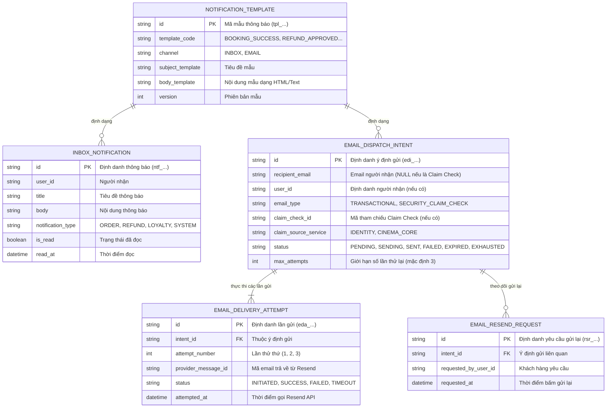
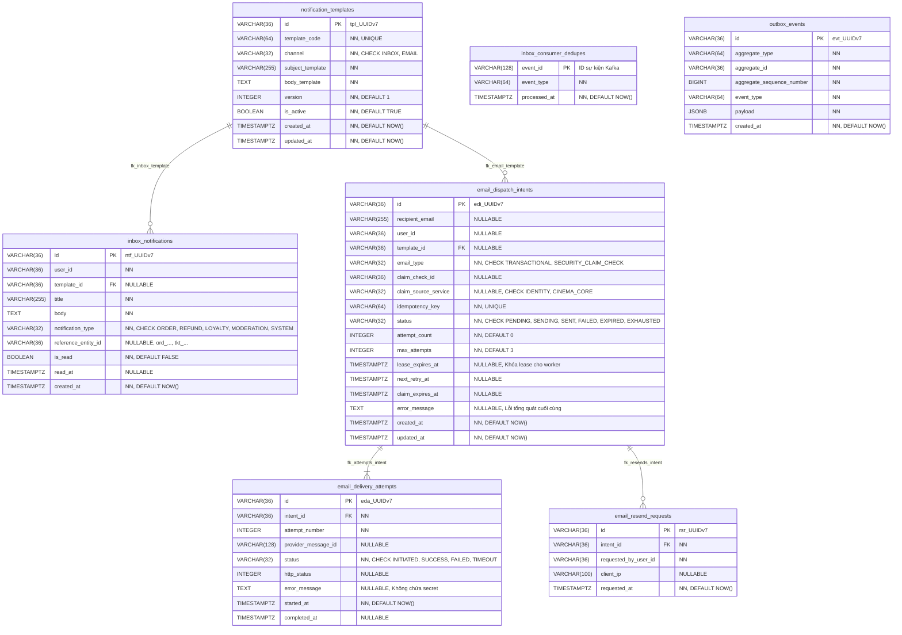
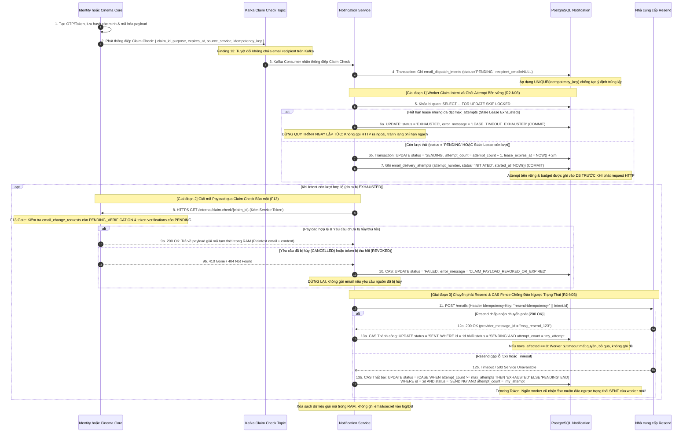

# Thiết kế dữ liệu Database Notification

## 1. Trách nhiệm và nguồn

### Trách nhiệm của Service và Database
- Notification Service sở hữu toàn bộ hộp thông báo trong ứng dụng (In-App Inbox Notifications) cho khách hàng và nhân sự vận hành trên cả bốn ứng dụng (Customer Web/Mobile, Organizer Web/Mobile theo use case L-06).
- Notification Service quản lý vòng đời chuyển phát email dịch vụ thông qua đối tác Resend (ADR-0018): ghi nhận ý định gửi (Email Dispatch Intents), quản lý số lần thử lại (Delivery Attempts), theo dõi mã định danh đối tác (`resend_message_id`) và xử lý các sự kiện webhook phản hồi trạng thái từ nhà cung cấp (Delivered, Bounced, Complained).
- Notification Service tiếp nhận các yêu cầu gửi email chứa mã bảo mật (xác minh email, khôi phục mật khẩu, mã xác nhận nhận combo) thông qua mô hình Claim Check: Service chỉ nhận mã tham chiếu mờ (Claim ID) qua Kafka hoặc HTTPS nội bộ (không chứa email hay secret - Finding 13), sau đó sử dụng danh tính dịch vụ (Service Identity Token) gọi HTTPS sang service chủ quản (Identity hoặc Core) để lấy payload tạm thời giải mã trong bộ nhớ RAM và chuyển tiếp sang Resend.
- **Bất biến an toàn dữ liệu:** Notification Service tuyệt đối **không lưu trữ nội dung plaintext của mã OTP, token khôi phục mật khẩu hay bất kỳ thông tin bí mật nào vào cơ sở dữ liệu, hàng đợi, log chẩn đoán, trace hay Dead Letter Queue (DLQ)**. Lấy payload không đồng nghĩa với tiêu thụ mã xác minh. Lỗi gửi email không bao giờ đảo ngược giao dịch vé đã commit tại Cinema Core hay phát hành vé mới (BR-33).

### Nguồn nghiệp vụ và quyết định kỹ thuật
- [Use case N-01, L-06](../../../03-product/use-cases.md) và [Mô tả use case](../../../03-product/use-case-descriptions.md).
- [Quy tắc nghiệp vụ BR-33](../../../03-product/use-cases.md#4-quy-tắc-đã-thống-nhất) (Hộp thông báo và email; chưa hỗ trợ SMS/push; lỗi email không đảo giao dịch Core; chống spam gửi lại).
- [Kiến trúc microservices](../../004-service-decomposition/spec.md) và [Quyết định kiến trúc](../../004-service-decomposition/decisions.md) (Mục 3, 4: Claim Check cho email bảo mật).
- [ADR-0018](../../../06-decisions/0018-resend-for-transactional-email.md) (Resend cho email giao dịch).
- [NFR-PRIV-01](https://github.com/NhiBuaa/movie-booking-agent/blob/ad002e99936231fac0f8493830b9ec36dc3aedb2/docs/05-specs/nfr/privacy-and-audit.md) (Bảo vệ thông tin bí mật và nhật ký kỹ thuật).

---

## 2. ERD logic

Mô hình logic phân định rõ ràng giữa kênh thông báo nội bộ trong ứng dụng (In-App Inbox) và kênh chuyển phát email ngoại vi (Email Dispatch & Attempts).



---

## 3. ERD chi tiết

> [!TIP]
> **Hướng dẫn xem sơ đồ:** Để đọc rõ các nhãn cột và quan hệ phức tạp trong sơ đồ chi tiết, khuyến nghị xem tài liệu ở chế độ xem rộng hoặc 100% zoom, cuộn ngang, hoặc xem riêng từng phân vùng quan hệ.

Mô hình chi tiết toàn bộ các bảng trong database `notification` với kiểu dữ liệu PostgreSQL, các thuộc tính ràng buộc và quan hệ khóa ngoại nội bộ.



---

## 4. Từ điển dữ liệu toàn diện (100% các bảng)

### 4.1. Bảng `notification_templates` (Mẫu thông báo và email)

| Tên cột | Kiểu dữ liệu | Nullable | Default | Ý nghĩa / Đơn vị | Nguồn quy tắc |
|---|---|---|---|---|---|
| `id` | `VARCHAR(36)` | NOT NULL | Không có | Khóa chính, tiền tố `tpl_` theo UUIDv7 | Mục 4.1 `spec.md` |
| `template_code` | `VARCHAR(64)` | NOT NULL | Không có | Mã mẫu định danh duy nhất (UNIQUE) | Quản lý mẫu |
| `channel` | `VARCHAR(32)` | NOT NULL | Không có | Kênh gửi: `INBOX`, `EMAIL` | BR-33 |
| `subject_template` | `VARCHAR(255)` | NOT NULL | Không có | Tiêu đề mẫu hỗ trợ biến thay thế | Quản lý mẫu |
| `body_template` | `TEXT` | NOT NULL | Không có | Nội dung mẫu HTML hoặc văn bản có định dạng | Quản lý mẫu |
| `version` | `INTEGER` | NOT NULL | `1` | Phiên bản mẫu nội dung | Quản lý mẫu |
| `is_active` | `BOOLEAN` | NOT NULL | `TRUE` | Cờ kích hoạt sử dụng mẫu | Quản lý mẫu |
| `created_at` | `TIMESTAMPTZ` | NOT NULL | `NOW()` | Thời điểm tạo mẫu (UTC) | Mục 4.3 `spec.md` |
| `updated_at` | `TIMESTAMPTZ` | NOT NULL | `NOW()` | Thời điểm cập nhật mẫu gần nhất (UTC) | Mục 4.3 `spec.md` |

### 4.2. Bảng `inbox_notifications` (Hộp thông báo trong ứng dụng)

| Tên cột | Kiểu dữ liệu | Nullable | Default | Ý nghĩa / Đơn vị | Nguồn quy tắc |
|---|---|---|---|---|---|
| `id` | `VARCHAR(36)` | NOT NULL | Không có | Khóa chính, tiền tố `ntf_` theo UUIDv7 | Mục 4.1 `spec.md` |
| `user_id` | `VARCHAR(36)` | NOT NULL | Không có | Định danh tài khoản người nhận (`usr_...`) | Use case L-06 |
| `template_id` | `VARCHAR(36)` | NULL | NULL | Mẫu thông báo đã áp dụng (nếu có) | Quản lý mẫu |
| `title` | `VARCHAR(255)` | NOT NULL | Không có | Tiêu đề thông báo hiển thị trong hộp thư | Use case L-06 |
| `body` | `TEXT` | NOT NULL | Không có | Nội dung thông báo hiển thị chi tiết | Use case L-06 |
| `notification_type`| `VARCHAR(32)` | NOT NULL | Không có | Loại: `ORDER`, `REFUND`, `LOYALTY`, `MODERATION`, `SYSTEM` | BR-33 |
| `reference_entity_id`| `VARCHAR(36)`| NULL | NULL | ID thực thể liên quan (`ord_...`, `tkt_...`) | Trải nghiệm UI |
| `is_read` | `BOOLEAN` | NOT NULL | `FALSE` | Cờ đánh dấu người dùng đã mở xem thông báo | Use case L-06 |
| `read_at` | `TIMESTAMPTZ` | NULL | NULL | Thời điểm người dùng đọc thông báo (UTC) | Use case L-06 |
| `created_at` | `TIMESTAMPTZ` | NOT NULL | `NOW()` | Thời điểm tạo thông báo trong hộp thư (UTC) | Mục 4.3 `spec.md` |

### 4.3. Bảng `email_dispatch_intents` (Ý định gửi email)

| Tên cột | Kiểu dữ liệu | Nullable | Default | Ý nghĩa / Đơn vị | Nguồn quy tắc |
|---|---|---|---|---|---|
| `id` | `VARCHAR(36)` | NOT NULL | Không có | Khóa chính, tiền tố `edi_` theo UUIDv7 | Mục 4.1 `spec.md` |
| `recipient_email` | `VARCHAR(255)` | NULL | NULL | Địa chỉ email người nhận (NULL nếu là Claim Check, giải mã trong RAM) | Finding 13, ADR-0018 |
| `user_id` | `VARCHAR(36)` | NULL | NULL | Tài khoản người nhận (nếu có) | BR-33 |
| `template_id` | `VARCHAR(36)` | NULL | NULL | Mẫu email liên quan (nếu không dùng Claim Check) | Quản lý mẫu |
| `email_type` | `VARCHAR(32)` | NOT NULL | Không có | `TRANSACTIONAL`, `SECURITY_CLAIM_CHECK` | Kiến trúc mục 4 |
| `claim_check_id` | `VARCHAR(36)` | NULL | NULL | Mã tham chiếu Claim Check nếu là email bảo mật (`chk_...`) | Kiến trúc mục 4 |
| `claim_source_service`| `VARCHAR(32)`| NULL | NULL | Dịch vụ sở hữu payload: `IDENTITY`, `CINEMA_CORE` | Kiến trúc mục 4 |
| `idempotency_key` | `VARCHAR(64)` | NOT NULL | Không có | Khóa chống trùng lặp gửi thư (UNIQUE) | BR-33, ADR-0018 |
| `status` | `VARCHAR(32)` | NOT NULL | `'PENDING'` | Trạng thái: `PENDING`, `SENDING`, `SENT`, `FAILED`, `EXPIRED`, `EXHAUSTED` | BR-33, R2-N03 |
| `attempt_count` | `INTEGER` | NOT NULL | `0` | Số lần đã gọi sang API Resend | ADR-0018 |
| `max_attempts` | `INTEGER` | NOT NULL | `3` | Giới hạn số lần thử lại tối đa cho phép | BR-33 |
| `lease_expires_at`| `TIMESTAMPTZ` | NULL | NULL | Hạn chót khóa lease xử lý của worker (chống crash treo dòng) | R2-N03 |
| `next_retry_at` | `TIMESTAMPTZ` | NULL | NULL | Mốc thời gian thử lại tiếp theo theo Exponential Backoff | ADR-0018 |
| `claim_expires_at`| `TIMESTAMPTZ` | NULL | NULL | Mốc thời gian hết hạn của payload bảo mật | Kiến trúc mục 4 |
| `error_message` | `TEXT` | NULL | NULL | Thông điệp lỗi tổng quát sau khi cạn lượt thử (không chứa PII/secret) | Finding 23, R2-N03 |
| `created_at` | `TIMESTAMPTZ` | NOT NULL | `NOW()` | Thời điểm tạo ý định gửi thư (UTC) | Mục 4.3 `spec.md` |
| `updated_at` | `TIMESTAMPTZ` | NOT NULL | `NOW()` | Thời điểm cập nhật trạng thái ý định gần nhất (UTC) | Mục 4.3 `spec.md` |

### 4.4. Bảng `email_delivery_attempts` (Nhật ký các lần gọi API Resend)

| Tên cột | Kiểu dữ liệu | Nullable | Default | Ý nghĩa / Đơn vị | Nguồn quy tắc |
|---|---|---|---|---|---|
| `id` | `VARCHAR(36)` | NOT NULL | Không có | Khóa chính, tiền tố `eda_` theo UUIDv7 | Mục 4.1 `spec.md` |
| `intent_id` | `VARCHAR(36)` | NOT NULL | Không có | Khóa ngoại tham chiếu `email_dispatch_intents(id)` | ADR-0018 |
| `attempt_number` | `INTEGER` | NOT NULL | Không có | Số thứ tự lần thử (1, 2, 3) | ADR-0018 |
| `provider_message_id` | `VARCHAR(128)` | NULL | NULL | Mã tin nhắn do Resend trả về sau khi chấp nhận gửi | ADR-0018 |
| `status` | `VARCHAR(32)` | NOT NULL | Không có | Kết quả: `CHECK (status IN ('INITIATED', 'SUCCESS', 'FAILED', 'TIMEOUT'))` | ADR-0018, F23 |
| `http_status` | `INTEGER` | NULL | NULL | Mã HTTP phản hồi từ API Resend | Giám sát kỹ thuật |
| `error_message` | `TEXT` | NULL | NULL | Thông điệp lỗi kỹ thuật (tuyệt đối không chứa secret/OTP) | NFR-PRIV-01 |
| `started_at` | `TIMESTAMPTZ` | NOT NULL | `NOW()` | Thời điểm bắt đầu gọi HTTP (lưu trước khi gọi) | Finding 13, R2-N03, F23 |
| `completed_at` | `TIMESTAMPTZ` | NULL | NULL | Thời điểm nhận phản hồi kết quả từ Resend | F23 |

### 4.5. Bảng `email_resend_requests` (Yêu cầu gửi lại email và chống Spam)

| Tên cột | Kiểu dữ liệu | Nullable | Default | Ý nghĩa / Đơn vị | Nguồn quy tắc |
|---|---|---|---|---|---|
| `id` | `VARCHAR(36)` | NOT NULL | Không có | Khóa chính, tiền tố `rsr_` theo UUIDv7 | Mục 4.1 `spec.md` |
| `intent_id` | `VARCHAR(36)` | NOT NULL | Không có | Ý định gửi email được yêu cầu gửi lại | BR-33, Q148 |
| `requested_by_user_id`| `VARCHAR(36)`| NOT NULL | Không có | Khách hàng thực hiện bấm nút gửi lại | BR-33 |
| `client_ip` | `VARCHAR(100)` | NULL | NULL | Địa chỉ IP của client phục vụ Rate Limiting | BR-33 |
| `requested_at` | `TIMESTAMPTZ` | NOT NULL | `NOW()` | Mốc thời gian bấm gửi lại (UTC) | Mục 4.3 `spec.md` |

### 4.6. Bảng `inbox_consumer_dedupes` (Khử trùng lặp sự kiện tiêu thụ từ Kafka)

| Tên cột | Kiểu dữ liệu | Nullable | Default | Ý nghĩa / Đơn vị | Nguồn quy tắc |
|---|---|---|---|---|---|
| `event_id` | `VARCHAR(128)`| NOT NULL | Không có | Khóa chính, ID sự kiện Kafka | BR-33 |
| `event_type` | `VARCHAR(64)` | NOT NULL | Không có | Loại sự kiện nhận được | BR-33 |
| `processed_at` | `TIMESTAMPTZ` | NOT NULL | `NOW()` | Thời điểm xử lý sự kiện | Mục 4.3 `spec.md` |

### 4.7. Bảng `outbox_events` (Transactional Outbox Pattern xuất sự kiện)

| Tên cột | Kiểu dữ liệu | Nullable | Default | Ý nghĩa / Đơn vị | Nguồn quy tắc |
|---|---|---|---|---|---|
| `id` | `VARCHAR(36)` | NOT NULL | Không có | Khóa chính sự kiện, tiền tố `evt_` theo UUIDv7 | Finding 23, 25 |
| `aggregate_type` | `VARCHAR(64)` | NOT NULL | Không có | Thực thể nguồn (`NOTIFICATION`, `DISPATCH`) | Finding 25 |
| `aggregate_id` | `VARCHAR(36)` | NOT NULL | Không có | Định danh thực thể nguồn | Finding 25 |
| `aggregate_sequence_number` | `BIGINT` | NOT NULL | Không có | Số thứ tự tăng dần đơn điệu theo thực thể | Finding 25 |
| `event_type` | `VARCHAR(64)` | NOT NULL | Không có | Loại sự kiện (`NOTIFICATION_READ`, `EMAIL_SENT`) | Finding 25 |
| `payload` | `JSONB` | NOT NULL | Không có | Dữ liệu sự kiện (không chứa PII) | Finding 13, 25 |
| `created_at` | `TIMESTAMPTZ` | NOT NULL | `NOW()` | Thời điểm commit cùng transaction nghiệp vụ | Finding 25 |

---

## 5. Khóa, chỉ mục và ràng buộc

### 5.1. Khóa chính và Khóa ngoại nội bộ

- `notification_templates.id`: Primary Key (`pk_notification_templates`).
- `inbox_notifications.id`: Primary Key (`pk_inbox_notifications`). Khóa ngoại `fk_inbox_template` trỏ tới `notification_templates(id)` với `ON DELETE SET NULL`.
- `email_dispatch_intents.id`: Primary Key (`pk_email_dispatch_intents`). Khóa ngoại `fk_email_template` trỏ tới `notification_templates(id)` với `ON DELETE SET NULL`.
- `email_delivery_attempts.id`: Primary Key (`pk_email_delivery_attempts`). Khóa ngoại `fk_attempts_intent` trỏ tới `email_dispatch_intents(id)` với `ON DELETE CASCADE`.
- `email_resend_requests.id`: Primary Key (`pk_email_resend_requests`). Khóa ngoại `fk_resends_intent` trỏ tới `email_dispatch_intents(id)` với `ON DELETE CASCADE`.
- `inbox_consumer_dedupes.event_id`: Primary Key (`pk_consumer_dedupes`).

### 5.2. Ràng buộc toàn vẹn dữ liệu (CHECK & UNIQUE)

1. **Khóa chống gửi trùng lặp email:**
   - Trên bảng `email_dispatch_intents`: `UNIQUE (idempotency_key)`
2. **Quy tắc không gửi lại mã bảo mật đã hết hạn (BR-33):**
   - Logic worker trước khi gọi API Resend bắt buộc kiểm tra: nếu `email_type = 'SECURITY_CLAIM_CHECK'` và `NOW() > claim_expires_at`, hệ thống cập nhật `status = 'EXPIRED'` và hủy bỏ lần gửi.
3. **Giới hạn số lần thử lại tối đa và chuyển trạng thái kiệt sức (BR-33, R2-N03):**
   - Trên bảng `email_dispatch_intents`: `CHECK (attempt_count <= max_attempts)`.
   - `CHECK (status IN ('PENDING', 'SENDING', 'SENT', 'FAILED', 'EXPIRED', 'EXHAUSTED'))`.
   - Khi `attempt_count >= max_attempts` mà cuộc gọi vẫn thất bại, bản ghi được cập nhật sang `status = 'EXHAUSTED'`, không để treo vĩnh viễn ở trạng thái chờ thử lại.
4. **Tính nhất quán giữa phân loại email và tham chiếu Claim Check:**
   - Ràng buộc: Nếu `email_type = 'SECURITY_CLAIM_CHECK'` thì bắt buộc `claim_check_id IS NOT NULL` và `claim_source_service IS NOT NULL`.

### 5.3. Chỉ mục tối ưu hóa truy vấn (Indexes)

1. `idx_inbox_notifications_user_unread`: B-Tree trên `inbox_notifications(user_id, is_read, created_at DESC)` — Hiển thị số lượng thông báo chưa đọc và danh sách thông báo.
2. `idx_email_intents_pending_retry`: B-Tree trên `email_dispatch_intents(next_retry_at) WHERE status = 'PENDING'` — Worker định kỳ quét các email cần gửi lại.
3. `idx_resend_rate_limit`: B-Tree trên `email_resend_requests(requested_by_user_id, requested_at DESC)` — Kiểm tra giới hạn tần suất bấm "Gửi lại mã" của người dùng (BR-33 và Q149 yêu cầu kiểm quyền, trạng thái hiện hành và chống spam). Giới hạn 1 lần mỗi 60 giây là đề xuất kỹ thuật còn mở.
4. `idx_delivery_attempts_provider_id`: B-Tree trên `email_delivery_attempts(provider_message_id)` — Xử lý webhook phản hồi từ Resend.

---

## 6. Giao dịch và interface

### 6.1. Quy trình Thực thi Claim Check Chuyển phát Email Bảo mật và Thử lại (TX-07, Finding 13, R2-N03, F27)



- **Giao thức Worker Claim Intent, Attempt Bền vững và Fencing Token (Finding R2-N03):**
  1. **Claim có Transaction và Khóa bi quan:**
     - Worker tìm kiếm và khóa đúng 1 bản ghi bằng lệnh:
       ```sql
       BEGIN;
       SELECT id, status, attempt_count, max_attempts
       FROM email_dispatch_intents
       WHERE (status = 'PENDING' AND (next_retry_at IS NULL OR next_retry_at <= NOW()))
          OR (status = 'SENDING' AND lease_expires_at < NOW())
       ORDER BY created_at
       FOR UPDATE SKIP LOCKED
       LIMIT 1;
       ```
  2. **Bảo vệ Ràng buộc Hạn ngạch và Dừng hẳn khi Kiệt sức (EXHAUSTED Stop):**
     - Nếu phát hiện `status = 'SENDING' AND lease_expires_at < NOW()` VÀ `attempt_count >= max_attempts`:
       - Worker **tuyệt đối không tăng thêm `attempt_count`** (tránh vi phạm ràng buộc CHECK `attempt_count <= max_attempts`).
       - Cập nhật chuyển thẳng sang trạng thái kiệt sức:
         ```sql
         UPDATE email_dispatch_intents
         SET status = 'EXHAUSTED', error_message = 'LEASE_TIMEOUT_EXHAUSTED', updated_at = NOW()
         WHERE id = :id;
         COMMIT;
         ```
       - **Dừng hẳn luồng xử lý của bản ghi này**, ghi log cảnh báo để đội vận hành can thiệp thủ công. Tuyệt đối không tiến hành gọi HTTP sang Identity hay Resend!
  3. **Lưu Bền vững Attempt và Khóa Lease trước khi gọi HTTP:**
     - Nếu bản ghi còn lượt thử (`attempt_count < max_attempts`):
       - Worker thực thi trong cùng transaction:
         ```sql
         UPDATE email_dispatch_intents
         SET status = 'SENDING',
             attempt_count = attempt_count + 1,
             lease_expires_at = NOW() + INTERVAL '2 minutes',
             updated_at = NOW()
         WHERE id = :id;

         INSERT INTO email_delivery_attempts (
             id, intent_id, attempt_number, status, started_at
         ) VALUES (
             :attempt_id, :id, :new_attempt_count, 'INITIATED', NOW()
         );
         COMMIT;
         ```
       - Nhờ commit trước khi gọi HTTP, số lần thử `attempt_count` và thời hạn lease luôn được bảo toàn bền vững ngay cả khi tiến trình worker bị sập nguồn (crash) đột ngột giữa chừng.
  4. **CAS Fencing Token Ngăn chặn Worker Cũ Đảo ngược Trạng thái (R2-N03):**
     - *Kịch bản rủi ro:* Worker A hết hạn lease (treo mạng). Worker B tiếp quản bản ghi, tăng `attempt_count = 2` và gửi Resend thành công, cập nhật `status = 'SENT'`. Ngay sau đó, Worker A nhận được lỗi 5xx muộn từ Resend và cố gắng cập nhật `status = 'PENDING'`, làm đảo ngược trạng thái `SENT` thành `PENDING` và gây ra việc gửi email trùng lặp lần 3!
     - *Giải pháp triệt để:* Mọi thao tác cập nhật kết quả sau khi gọi Resend đều phải sử dụng cơ chế CAS (Compare-and-Swap) có điều kiện chặn `status = 'SENDING' AND attempt_count = :my_attempt_count`:
       ```sql
       -- Cập nhật thành công từ Worker:
       UPDATE email_dispatch_intents
       SET status = 'SENT', updated_at = NOW()
       WHERE id = :id AND status = 'SENDING' AND attempt_count = :my_attempt_count;

       -- Cập nhật thất bại từ Worker:
       UPDATE email_dispatch_intents
       SET status = CASE WHEN attempt_count >= max_attempts THEN 'EXHAUSTED' ELSE 'PENDING' END,
           next_retry_at = NOW() + (INTERVAL '1 minute' * POWER(2, attempt_count - 1)),
           error_message = :error_detail,
           updated_at = NOW()
       WHERE id = :id AND status = 'SENDING' AND attempt_count = :my_attempt_count;
       ```
     - Nếu `rows_affected == 0`: Chứng tỏ bản ghi đã bị worker khác tiếp quản hoặc đã được chốt trạng thái cuối. Worker cũ hủy bỏ cập nhật ngay lập tức, loại trừ 100% rủi ro đảo ngược trạng thái.

---

## 7. Vòng đời và bảo vệ dữ liệu

### 7.1. Bất biến Không lưu trữ Plaintext Bí mật
- Toàn bộ cơ sở dữ liệu `notification` tuyệt đối không có bất kỳ cột nào lưu trữ mật khẩu, OTP, URL khôi phục mật khẩu hay khóa bí mật.
- Bảng `email_delivery_attempts` chỉ lưu mã phản hồi của Resend (`provider_message_id`) và thông điệp lỗi kỹ thuật chung của nhà cung cấp (ví dụ: `"Invalid recipient domain"`).

### 7.2. Chính sách Lưu trữ và Dọn dẹp (Finding 26)
- **[Đề xuất kỹ thuật - Đang chờ phê duyệt]:**
  - Thông báo hộp thư trong ứng dụng (`inbox_notifications`): Thời hạn lưu trữ đề xuất là 90 ngày kể từ ngày tạo đối với các thông báo đã đọc (`is_read = TRUE`).
  - Nhật ký các lần gọi gửi email (`email_delivery_attempts`): Thời hạn lưu trữ đề xuất là 30 ngày phục vụ đối soát kỹ thuật.
  - Sau thời hạn trên, worker dọn dẹp nền tự động xóa các bản ghi cũ để giải phóng dung lượng lưu trữ mà không ảnh hưởng đến các giao dịch tài chính.

---

## 8. Kịch bản đối chiếu và phụ thuộc

### 8.1. Các kịch bản đối chiếu bất biến trọng yếu

1. **Kịch bản 1: Resend gặp sự cố hoàn toàn khi đang gửi email xác nhận đặt vé thành công (R2-N03, BR-33)**
   - *Hành vi:* Khách hàng đã thanh toán thành công đơn hàng tại Core, Core phát sự kiện `ORDER_CONFIRMED`. Notification tiếp nhận sự kiện nhưng gọi API Resend liên tục thất bại cả 3 lần thử (`attempt_count = 3 >= max_attempts`).
   - *Kết quả mong đợi:* Ý định gửi chuyển sang trạng thái `EXHAUSTED` (dừng hẳn chu trình thử lại tự động, ghi nhận lỗi và phát cảnh báo vận hành). Tuy nhiên, vé xem phim của khách hàng tại Cinema Core vẫn giữ nguyên trạng thái `ISSUED` hợp lệ, khách hàng vẫn mở được vé và mã QR trên ứng dụng để vào rạp xem phim. Lỗi chuyển phát email hoàn toàn bị cô lập, không làm đảo ngược giao dịch hay hủy vé của khách (đáp ứng 100% BR-33).
2. **Kịch bản 2: Notification Service cố gắng gửi email chứa mã OTP xác minh đã hết hạn**
   - *Hành vi:* Người dùng yêu cầu mã xác minh email lúc 10:00 (hạn 15 phút, hết hạn lúc 10:15). Do mạng nội bộ bị nghẽn, đến 10:16 Notification Service mới xử lý đến lượt gửi này.
   - *Kết quả mong đợi:* Trước khi gọi sang Identity để lấy payload, Notification kiểm tra thấy `claim_expires_at = 10:15 < NOW()`. Notification lập tức hủy bỏ lượt gửi, cập nhật trạng thái `EXPIRED` và ghi log cảnh báo. Hệ thống tuyệt đối không gửi một bức thư chứa mã bảo mật đã chết đến hộp thư của người dùng (đáp ứng BR-33).
3. **Kịch bản 3: Kafka phát lại sự kiện xác nhận thanh toán do phục hồi sau sự cố**
   - *Hành vi:* Sau khi khôi phục cụm Kafka, sự kiện `ORDER_CONFIRMED` của đơn hàng `ord_01j7abc` được gửi lại lần thứ hai cho Notification Consumer.
   - *Kết quả mong đợi:* Bảng `inbox_consumer_dedupes` hoặc ràng buộc `UNIQUE(idempotency_key)` trên `email_dispatch_intents` phát hiện sự kiện này đã được xử lý thành công trước đó. Transaction bỏ qua sự kiện trùng lặp này mà không gửi thêm bất kỳ email nào sang Resend.

### 8.2. Quyết định còn thiếu và phụ thuộc
- *Kênh chuyển phát:* Đã duyệt chỉ hỗ trợ Hộp thông báo trong ứng dụng và Email (Resend). Chưa hỗ trợ SMS hoặc Mobile Push Notifications trong mốc demo (BR-33).
- *Thời hạn dọn dẹp:* Đề xuất 90 ngày cho inbox và 30 ngày cho delivery attempts là đề xuất kỹ thuật tối ưu hóa dung lượng.
