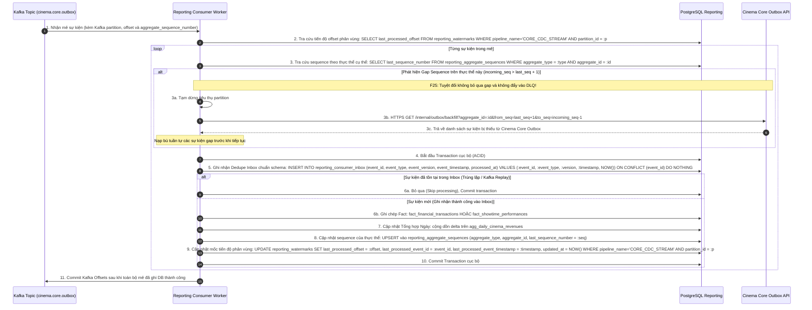

# Thiết kế dữ liệu Database Reporting

## 1. Trách nhiệm và nguồn

### Trách nhiệm của Service và Database
- Reporting Service sở hữu toàn bộ các mô hình đọc tổng hợp (Read Models, Analytics Aggregates & Fact Tables) phục vụ công tác giám sát vận hành rạp và báo cáo tài chính doanh thu cho Quản trị viên toàn chuỗi (ACT-ADMIN) và Quản lý rạp (ACT-MANAGER theo use case M-07).
- Toàn bộ dữ liệu trong database `reporting` là **dữ liệu thứ cấp (Secondary Projection / Read-only Replicas)** được tổng hợp bất đồng bộ từ các luồng sự kiện của Cinema Core qua Outbox–Debezium–Kafka. Database `reporting` **tuyệt đối không phải là nguồn thẩm quyền tài chính**, không lưu trữ chứng từ gốc và không phát sinh giao dịch tiền tệ hay quyền vé.
- Reporting Service tuân thủ nghiêm ngặt nguyên tắc **Tối thiểu hóa dữ liệu và Bảo vệ quyền riêng tư**: database chỉ lưu trữ các chiều kích thước tổng hợp (Rạp, Ngày chiếu, Suất chiếu, Phim) và các chỉ số tài chính/vận hành tổng hợp (Thực thu, Đã hoàn, Còn phải hoàn, Doanh thu bán ròng, Tỷ lệ lấp đầy ghế, Tỷ lệ soát vé). Database tuyệt đối không sao chép danh sách đơn hàng cá nhân, tên khách hàng, email, số điện thoại hay bất kỳ thông tin nhận dạng cá nhân (PII) nào từ Core (BR-35).
- Service quản lý mốc bao phủ dữ liệu (Data Coverage Watermark) và cơ chế tái dựng mô hình (Full Rebuild Pipeline) độc lập. Việc replay sự kiện để tái dựng báo cáo chỉ diễn ra nội bộ trong database `reporting`, hoàn toàn cách ly và không bao giờ gây ra tác dụng phụ gửi lại email hay phát lệnh hoàn tiền ra bên ngoài (Kiến trúc mục 6).

### Nguồn nghiệp vụ và quyết định kỹ thuật
- [Use case M-07](../../../03-product/use-cases.md) và [Mô tả use case](../../../03-product/use-case-descriptions.md).
- [Quy tắc nghiệp vụ BR-35](../../../03-product/use-cases.md#4-quy-tắc-đã-thống-nhất) (Báo cáo tổng hợp, không PII, ngày lịch giờ Việt Nam, công thức doanh thu bán ròng, quy tắc tỷ lệ lấp đầy ghế và tỷ lệ soát vé theo Q159).
- [Kiến trúc microservices](../../004-service-decomposition/spec.md) và [Quyết định kiến trúc](../../004-service-decomposition/decisions.md) (Mục 3, 6: Consumer chống lặp, Tách biệt mô hình đọc và Khả năng tái dựng).
- [ADR-0003](../../../06-decisions/0003-postgresql-and-redis-for-platform-data.md) (PostgreSQL cho Reporting Service).

---

## 2. ERD logic

Mô hình logic thể hiện sự phân tách giữa các bảng kích thước tham chiếu (Dimensions), các bảng sự kiện tài chính/vận hành hạt nhân (Facts) và các bảng tổng hợp định kỳ (Aggregates).

```mermaid
erDiagram
    DIM_CINEMA ||--o{ FACT_FINANCIAL_TRANSACTION : "phát sinh tại"
    DIM_CINEMA ||--o{ FACT_SHOWTIME_PERFORMANCE : "tổ chức tại"
    DIM_CINEMA ||--o{ AGG_DAILY_CINEMA_REVENUE : "tổng kết ngày"

    DIM_MOVIE ||--o{ FACT_SHOWTIME_PERFORMANCE : "chiếu phim"
    DIM_SHOWTIME ||--o| FACT_SHOWTIME_PERFORMANCE : "đo lường suất"

    DIM_CINEMA {
        string cinema_id PK "Định danh rạp (cin_...)"
        string name "Tên rạp"
        string city "Thành phố / Tỉnh"
    }

    DIM_MOVIE {
        string movie_id PK "Định danh phim (mov_...)"
        string title "Tựa đề phim"
        string rating_code "Phân loại độ tuổi"
    }

    DIM_SHOWTIME {
        string showtime_id PK "Định danh suất (shw_...)"
        string cinema_id FK "Thuộc rạp"
        string movie_id FK "Chiếu phim"
        date business_date "Ngày kinh doanh (Giờ VN)"
        datetime start_time "Giờ bắt đầu"
        int total_seats "Tổng số ghế phòng"
        string status "COMPLETED, CANCELLED..."
    }

    FACT_FINANCIAL_TRANSACTION {
        string event_id PK "ID sự kiện Core Outbox"
        string cinema_id FK "Rạp"
        string showtime_id FK "Suất chiếu"
        date business_date "Ngày kinh doanh (Giờ VN)"
        string transaction_type "TICKET_REVENUE, COMBO_REVENUE, REFUND_SETTLED..."
        string reason "Lý do: CUSTOMER_CANCEL, SHOWTIME_CANCEL, COMBO_ADJUST..."
        bigint amount "Giá trị tiền (VND)"
        datetime event_timestamp "Thời điểm phát sinh sự kiện"
    }

    REPORTING_REBUILD_CHECKPOINT {
        string pipeline_name PK "CORE_CDC_STREAM"
        datetime incident_restored_as_of PK "Mốc khôi phục sự cố"
        string status "PREPARED, REPLAYING, COMPLETED"
        boolean prefix_coverage_verified "Đã nạp đủ sự kiện trước cut"
        string recovery_mode "KAFKA_CATCHUP, AUTHORITATIVE_BASELINE"
        datetime prepared_at "Thời điểm chuẩn bị"
        datetime completed_at "Thời điểm hoàn tất"
    }

    FACT_SHOWTIME_PERFORMANCE {
        string showtime_id PK "Suất chiếu"
        string cinema_id FK "Rạp"
        string movie_id FK "Phim"
        date business_date "Ngày kinh doanh (Giờ VN)"
        int physical_seats_capacity "Tổng sức chứa ghế vật lý"
        int seats_sold "Số ghế bán thành công"
        int seats_scanned "Số ghế đã vào xem thực tế"
        int tickets_cancelled "Số vé bị hủy"
        int tickets_affected_cancellation "Số vé bị hủy suất chiếu"
        numeric occupancy_rate "Tỷ lệ lấp đầy ghế (%)"
        numeric scan_rate "Tỷ lệ vào rạp so với sức chứa (%)"
    }

    AGG_DAILY_CINEMA_REVENUE {
        string id PK "cin_... + business_date"
        string cinema_id FK "Rạp"
        date business_date "Ngày kinh doanh (Giờ VN)"
        bigint gross_sales_amount "Doanh thu gộp đơn hàng (VND)"
        bigint approved_cancellations_amount "Giá trị hủy vé được duyệt (VND)"
        bigint actual_refunds_settled_amount "Tiền hoàn thực tế qua cổng (VND)"
        bigint pending_refund_obligations "Nghĩa vụ hoàn tiền còn treo cuối ngày (VND)"
        bigint unmatched_payments_amount "Tiền treo thừa/chưa khớp (VND)"
        bigint net_revenue "Doanh thu bán ròng = Gộp - Hủy duyệt (VND)"
        int total_tickets_issued "Tổng vé phát hành"
        int total_tickets_cancelled "Tổng vé hủy chủ động"
        int total_tickets_affected_by_showtime_cancellation "Tổng vé hủy suất"
        int total_tickets_scanned "Tổng vé soát"
        int total_combos_sold "Tổng combo bán"
        int total_combos_fulfilled "Tổng combo nhận"
        int total_combos_refunded "Tổng combo hoàn"
    }
```



---

## 3. ERD chi tiết

> [!TIP]
> **Hướng dẫn xem sơ đồ:** Để đọc rõ các nhãn cột và quan hệ phức tạp trong sơ đồ chi tiết, khuyến nghị xem tài liệu ở chế độ xem rộng hoặc 100% zoom, cuộn ngang, hoặc xem riêng từng phân vùng quan hệ.

Để đảm bảo khả năng render tối ưu và không bị kéo dãn bề ngang (> 4.400px theo Finding 27), mô hình chi tiết database `reporting` được chia thành 2 nhóm logic:

### 3.1. Nhóm Kích thước và Sự kiện Hạt nhân (Dimensions & Facts)

```mermaid
erDiagram
    dim_cinemas ||--o{ dim_showtimes : "fk_showtimes_cinema"
    dim_movies ||--o{ dim_showtimes : "fk_showtimes_movie"
    dim_cinemas ||--o{ fact_financial_transactions : "fk_facts_cinema"
    dim_showtimes ||--o| fact_showtime_performances : "fk_perf_showtime"
    dim_cinemas ||--o{ fact_showtime_performances : "fk_perf_cinema"
    dim_movies ||--o{ fact_showtime_performances : "fk_perf_movie"

    dim_cinemas {
        VARCHAR(36) cinema_id PK "cin_UUIDv7"
        VARCHAR(255) name "NN"
        VARCHAR(100) city "NN"
        TIMESTAMPTZ updated_at "NN, DEFAULT NOW()"
    }

    dim_movies {
        VARCHAR(36) movie_id PK "mov_UUIDv7"
        VARCHAR(255) title "NN"
        VARCHAR(10) rating_code "NN"
        INTEGER runtime_minutes "NN"
        TIMESTAMPTZ updated_at "NN, DEFAULT NOW()"
    }

    dim_showtimes {
        VARCHAR(36) showtime_id PK "shw_UUIDv7"
        VARCHAR(36) cinema_id FK "NN"
        VARCHAR(36) movie_id FK "NN"
        DATE business_date "NN, Ngày chiếu theo giờ VN"
        TIMESTAMPTZ start_time "NN"
        TIMESTAMPTZ end_time "NN"
        VARCHAR(32) format_type "NN, 2D, 3D, IMAX"
        VARCHAR(32) status "NN, OPEN, COMPLETED, CANCELLED"
        INTEGER total_physical_seats "NN, >= 0"
        TIMESTAMPTZ updated_at "NN, DEFAULT NOW()"
    }

    fact_financial_transactions {
        VARCHAR(64) event_id PK "ID sự kiện duy nhất từ Core"
        VARCHAR(36) cinema_id FK "NN"
        VARCHAR(36) showtime_id "NULLABLE"
        DATE business_date "NN, Ngày phát sinh giao dịch tiền"
        VARCHAR(64) transaction_type "NN, CHECK TICKET_REVENUE, COMBO_REVENUE, REFUND_SETTLED, OBLIGATION_CREATED, UNMATCHED_PAYMENT, SHOWTIME_CANCEL_REFUND"
        VARCHAR(64) reason "NULLABLE, CHECK CUSTOMER_CANCEL, SHOWTIME_CANCEL, COMBO_ADJUST, SERVICE_INCIDENT, LOST_SEAT, OVERPAYMENT"
        BIGINT amount "NN, Giá trị tiền chính xác (VND)"
        TIMESTAMPTZ event_timestamp "NN"
        TIMESTAMPTZ ingested_at "NN, DEFAULT NOW()"
    }

    fact_showtime_performances {
        VARCHAR(36) showtime_id PK,FK "shw_UUIDv7"
        VARCHAR(36) cinema_id FK "NN"
        VARCHAR(36) movie_id FK "NN"
        DATE business_date "NN, Ngày chiếu theo giờ VN"
        TIMESTAMPTZ start_time "NN"
        TIMESTAMPTZ end_time "NN"
        TIMESTAMPTZ actual_ended_at "NULLABLE"
        VARCHAR(32) showtime_status "NN, CHECK OPEN, COMPLETED, CANCELLED"
        INTEGER physical_seats_capacity "NN, >= 0"
        INTEGER seats_sold "NN, DEFAULT 0, >= 0"
        INTEGER seats_scanned "NN, DEFAULT 0, >= 0"
        INTEGER tickets_cancelled "NN, DEFAULT 0, >= 0"
        INTEGER tickets_affected_cancellation "NN, DEFAULT 0, >= 0"
        INTEGER combos_sold "NN, DEFAULT 0, >= 0"
        INTEGER combos_fulfilled "NN, DEFAULT 0, >= 0"
        NUMERIC(5,2) occupancy_rate "NULLABLE, NULL khi capacity = 0"
        NUMERIC(5,2) scan_rate "NULLABLE, NULL khi capacity = 0"
        TIMESTAMPTZ updated_at "NN, DEFAULT NOW()"
    }
```

### 3.2. Nhóm Tổng hợp Ngày và Kiểm soát Tiến độ (Aggregates & Pipeline Watermarks)

```mermaid
erDiagram
    dim_cinemas ||--o{ agg_daily_cinema_revenues : "fk_daily_cinema"

    agg_daily_cinema_revenues {
        VARCHAR(64) id PK "cinema_id + '_' + business_date"
        VARCHAR(36) cinema_id FK "NN"
        DATE business_date "NN, Ngày kinh doanh dòng tiền"
        VARCHAR(32) status "NN, DEFAULT 'ACTIVE', ACTIVE/REBUILDING_RECONCILING"
        BIGINT verified_receipts_amount "NN, DEFAULT 0, Thực thu qua cổng"
        BIGINT gross_sales_amount "NN, DEFAULT 0, Doanh số bán"
        BIGINT approved_cancellations_amount "NN, DEFAULT 0, Giảm trừ hủy duyệt"
        BIGINT actual_refunds_settled_amount "NN, DEFAULT 0, Tiền hoàn thực tế"
        BIGINT pending_refund_obligations "NN, DEFAULT 0, Nghĩa vụ hoàn tiền treo"
        BIGINT unmatched_payments_amount "NN, DEFAULT 0, Tiền thừa chưa khớp"
        BIGINT net_revenue "NN, DEFAULT 0, Doanh số bán ròng"
        INTEGER total_tickets_issued "NN, DEFAULT 0"
        INTEGER total_tickets_cancelled "NN, DEFAULT 0"
        INTEGER total_tickets_affected_by_showtime_cancellation "NN, DEFAULT 0"
        INTEGER total_tickets_scanned "NN, DEFAULT 0"
        INTEGER total_combos_sold "NN, DEFAULT 0"
        INTEGER total_combos_fulfilled "NN, DEFAULT 0"
        INTEGER total_combos_refunded "NN, DEFAULT 0"
        INTEGER showtimes_scheduled "NN, DEFAULT 0"
        INTEGER showtimes_cancelled "NN, DEFAULT 0"
        TIMESTAMPTZ updated_at "NN, DEFAULT NOW()"
    }

    reporting_consumer_inbox {
        VARCHAR(128) event_id PK "ID sự kiện Kafka"
        VARCHAR(64) event_type "NN"
        INTEGER event_version "NN, DEFAULT 1"
        TIMESTAMPTZ event_timestamp "NN"
        TIMESTAMPTZ processed_at "NN, DEFAULT NOW()"
    }

    reporting_watermarks {
        VARCHAR(64) pipeline_name PK "DEFAULT 'CORE_CDC_STREAM'"
        INTEGER partition_id PK "Kafka topic partition id"
        BIGINT last_processed_offset "NN, offset vat ly Kafka"
        VARCHAR(128) last_processed_event_id "NN"
        TIMESTAMPTZ last_processed_event_timestamp "NN"
        TIMESTAMPTZ updated_at "NN, DEFAULT NOW()"
    }

    reporting_aggregate_sequences {
        VARCHAR(64) aggregate_type PK "Thuc the nguon: ORDER, TICKET, SHOWTIME"
        VARCHAR(36) aggregate_id PK "Dinh danh thuc the nguon"
        BIGINT last_sequence_number "NN, so thu tu tang dan don dieu"
        TIMESTAMPTZ updated_at "NN, DEFAULT NOW()"
    }

    reporting_rebuild_checkpoints {
        VARCHAR(64) pipeline_name PK "DEFAULT 'CORE_CDC_STREAM'"
        TIMESTAMPTZ incident_restored_as_of PK "Moc khoi phuc su co Cinema Core"
        VARCHAR(32) status "NN, CHECK PREPARED, REPLAYING, COMPLETED"
        BOOLEAN prefix_coverage_verified "NN, DEFAULT FALSE, Kiem chung bao phu tien to"
        VARCHAR(32) recovery_mode "NN, DEFAULT 'KAFKA_CATCHUP'"
        TIMESTAMPTZ prepared_at "NN, DEFAULT NOW()"
        TIMESTAMPTZ completed_at "NULLABLE"
    }

    outbox_events {
        VARCHAR(36) id PK "evt_UUIDv7"
        VARCHAR(64) aggregate_type "NN"
        VARCHAR(36) aggregate_id "NN"
        BIGINT aggregate_sequence_number "NN"
        VARCHAR(64) event_type "NN"
        JSONB payload "NN"
        TIMESTAMPTZ created_at "NN, DEFAULT NOW()"
    }
```



---

## 4. Từ điển dữ liệu toàn diện (100% các bảng)

### 4.1. Bảng `dim_cinemas` (Kích thước rạp chiếu)

| Tên cột | Kiểu dữ liệu | Nullable | Default | Ý nghĩa / Đơn vị | Nguồn quy tắc |
|---|---|---|---|---|---|
| `cinema_id` | `VARCHAR(36)` | NOT NULL | Không có | Khóa chính, mã rạp từ Core (`cin_...`) | BR-01 |
| `name` | `VARCHAR(255)` | NOT NULL | Không có | Tên rạp | BR-01 |
| `city` | `VARCHAR(100)` | NOT NULL | Không có | Tỉnh / Thành phố | BR-01 |
| `updated_at`| `TIMESTAMPTZ` | NOT NULL | `NOW()` | Thời điểm cập nhật | Mục 4.3 `spec.md` |

### 4.2. Bảng `dim_movies` (Kích thước phim)

| Tên cột | Kiểu dữ liệu | Nullable | Default | Ý nghĩa / Đơn vị | Nguồn quy tắc |
|---|---|---|---|---|---|
| `movie_id` | `VARCHAR(36)` | NOT NULL | Không có | Khóa chính, mã phim (`mov_...`) | M-01 |
| `title` | `VARCHAR(255)` | NOT NULL | Không có | Tựa đề phim tiếng Việt | M-01 |
| `rating_code` | `VARCHAR(10)` | NOT NULL | Không có | Mã tuổi (`P`, `K`, `T13`, `T16`, `T18`, `C`) | BR-31 |
| `runtime_minutes`| `INTEGER` | NOT NULL | Không có | Thời lượng chiếu (phút) | M-01 |
| `updated_at`| `TIMESTAMPTZ` | NOT NULL | `NOW()` | Thời điểm cập nhật | Mục 4.3 `spec.md` |

### 4.3. Bảng `dim_showtimes` (Kích thước suất chiếu)

| Tên cột | Kiểu dữ liệu | Nullable | Default | Ý nghĩa / Đơn vị | Nguồn quy tắc |
|---|---|---|---|---|---|
| `showtime_id` | `VARCHAR(36)` | NOT NULL | Không có | Khóa chính, mã suất chiếu từ Core (`shw_...`) | BR-35 |
| `cinema_id` | `VARCHAR(36)` | NOT NULL | Không có | Khóa ngoại tham chiếu `dim_cinemas(cinema_id)` | BR-35 |
| `movie_id` | `VARCHAR(36)` | NOT NULL | Không có | Khóa ngoại tham chiếu `dim_movies(movie_id)` | BR-35 |
| `business_date` | `DATE` | NOT NULL | Không có | Ngày chiếu theo giờ Việt Nam (UTC+7) | BR-35 |
| `start_time` | `TIMESTAMPTZ` | NOT NULL | Không có | Thời điểm bắt đầu suất chiếu niêm yết | BR-35 |
| `end_time` | `TIMESTAMPTZ` | NOT NULL | Không có | Thời điểm kết thúc suất chiếu dự kiến | BR-35 |
| `format_type` | `VARCHAR(32)` | NOT NULL | Không có | Định dạng chiếu: `2D`, `3D`, `IMAX`, `SCREENX` | Use case M-04 |
| `status` | `VARCHAR(32)` | NOT NULL | Không có | Trạng thái suất: `OPEN`, `COMPLETED`, `CANCELLED` | BR-35 |
| `total_physical_seats`| `INTEGER` | NOT NULL | Không có | Tổng sức chứa ghế vật lý phòng chiếu | BR-35 |
| `updated_at` | `TIMESTAMPTZ` | NOT NULL | `NOW()` | Thời điểm cập nhật kích thước suất (UTC) | Mục 4.3 `spec.md` |

### 4.4. Bảng `fact_financial_transactions` (Giao dịch tài chính hạt nhân)

| Tên cột | Kiểu dữ liệu | Nullable | Default | Ý nghĩa / Đơn vị | Nguồn quy tắc |
|---|---|---|---|---|---|
| `event_id` | `VARCHAR(64)` | NOT NULL | Không có | Khóa chính, ID sự kiện duy nhất từ Core Outbox | Kiến trúc mục 3 |
| `cinema_id` | `VARCHAR(36)` | NOT NULL | Không có | Rạp phát sinh dòng tiền (`cin_...`) | BR-01, BR-35 |
| `showtime_id` | `VARCHAR(36)` | NULL | NULL | Suất chiếu liên quan (NULL nếu là combo mua riêng) | BR-35 |
| `business_date` | `DATE` | NOT NULL | Không có | Ngày kinh doanh của dòng tiền theo giờ Việt Nam (ngày thanh toán / hoàn tiền) | BR-35, Finding 21 |
| `transaction_type`| `VARCHAR(64)`| NOT NULL | Không có | Loại: `TICKET_REVENUE`, `COMBO_REVENUE`, `REFUND_SETTLED`, `OBLIGATION_CREATED`, `UNMATCHED_PAYMENT`, `SHOWTIME_CANCEL_REFUND` | BR-35, Finding 23 |
| `reason` | `VARCHAR(64)` | NULL | NULL | Lý do phát sinh giao dịch / nguồn giảm bán hoặc nghĩa vụ: `CUSTOMER_CANCEL`, `SHOWTIME_CANCEL`, `COMBO_ADJUST`, `SERVICE_INCIDENT`, `LOST_SEAT`, `OVERPAYMENT` | Mục 5.2, Finding 21, Finding 25 |
| `amount` | `BIGINT` | NOT NULL | Không có | Số tiền biến động chính xác, đơn vị VND | Mục 4.2 `spec.md` |
| `event_timestamp` | `TIMESTAMPTZ` | NOT NULL | Không có | Mốc thời gian commit giao dịch gốc tại Cinema Core | BR-35 |
| `ingested_at` | `TIMESTAMPTZ` | NOT NULL | `NOW()` | Thời điểm Reporting tiêu thụ sự kiện thành công (UTC) | Kiểm toán luồng |

### 4.5. Bảng `fact_showtime_performances` (Hiệu suất vận hành từng suất chiếu)

| Tên cột | Kiểu dữ liệu | Nullable | Default | Ý nghĩa / Đơn vị | Nguồn quy tắc |
|---|---|---|---|---|---|
| `showtime_id` | `VARCHAR(36)` | NOT NULL | Không có | Khóa chính, khóa ngoại tham chiếu `dim_showtimes(showtime_id)` | BR-35 |
| `cinema_id` | `VARCHAR(36)` | NOT NULL | Không có | Khóa ngoại tham chiếu `dim_cinemas(cinema_id)` | BR-35 |
| `movie_id` | `VARCHAR(36)` | NOT NULL | Không có | Khóa ngoại tham chiếu `dim_movies(movie_id)` | BR-35 |
| `business_date` | `DATE` | NOT NULL | Không có | Ngày chiếu của suất theo giờ Việt Nam | BR-35 |
| `start_time` | `TIMESTAMPTZ` | NOT NULL | Không có | Giờ chiếu niêm yết (UTC) | BR-35 |
| `end_time` | `TIMESTAMPTZ` | NOT NULL | Không có | Giờ kết thúc dự kiến (UTC) | BR-35 |
| `actual_ended_at` | `TIMESTAMPTZ` | NULL | NULL | Giờ kết thúc thực tế (NULL nếu chưa kết thúc) | BR-30 |
| `showtime_status` | `VARCHAR(32)` | NOT NULL | Không có | Trạng thái: `OPEN`, `COMPLETED`, `CANCELLED` | BR-35 |
| `physical_seats_capacity`| `INTEGER`| NOT NULL | Không có | Tổng sức chứa ghế vật lý (ghế đôi Sweetbox tính 2 ghế) | BR-35 |
| `seats_sold` | `INTEGER` | NOT NULL | `0` | Số ghế đã bán thành công (Sweetbox tính 2 ghế) | BR-35 |
| `seats_scanned` | `INTEGER` | NOT NULL | `0` | Số ghế thực tế đã quét vé vào rạp (Sweetbox tính 2 ghế) | BR-35 |
| `tickets_cancelled` | `INTEGER` | NOT NULL | `0` | Số vé bị khách hàng chủ động hủy trước giờ chiếu | R2-N06 |
| `tickets_affected_cancellation` | `INTEGER` | NOT NULL | `0` | Số vé bị ảnh hưởng do rạp hủy suất chiếu (tính cả vé 0đ) | R2-N06 |
| `combos_sold` | `INTEGER` | NOT NULL | `0` | Số phần combo bắp nước bán kèm suất chiếu | R2-N06 |
| `combos_fulfilled` | `INTEGER` | NOT NULL | `0` | Số phần combo đã trả cho khách tại quầy | R2-N06 |
| `occupancy_rate`| `NUMERIC(5,2)`| NULL | NULL | Tỷ lệ lấp đầy = `(seats_sold / physical_seats_capacity) * 100` (%); NULL khi capacity = 0 | Finding 21, BR-35 |
| `scan_rate` | `NUMERIC(5,2)`| NULL | NULL | Tỷ lệ vào rạp so với sức chứa = `(seats_scanned / physical_seats_capacity) * 100` (%); NULL khi capacity = 0 | Finding 21, BR-35, Q159 |
| `updated_at` | `TIMESTAMPTZ` | NOT NULL | `NOW()` | Thời điểm cập nhật bản ghi gần nhất (UTC) | Mục 4.3 `spec.md` |

### 4.6. Bảng `agg_daily_cinema_revenues` (Tổng hợp tài chính và vận hành theo ngày và rạp)

| Tên cột | Kiểu dữ liệu | Nullable | Default | Ý nghĩa / Đơn vị | Nguồn quy tắc |
|---|---|---|---|---|---|
| `id` | `VARCHAR(64)` | NOT NULL | Không có | Khóa chính dạng chuỗi kết hợp `cinema_id + '_' + business_date` | Chuẩn hóa bảng tổng hợp |
| `cinema_id` | `VARCHAR(36)` | NOT NULL | Không có | Khóa ngoại tham chiếu `dim_cinemas(cinema_id)` | BR-35 |
| `business_date` | `DATE` | NOT NULL | Không có | Ngày kinh doanh dòng tiền theo giờ Việt Nam | BR-35 |
| `status` | `VARCHAR(32)` | NOT NULL | `'ACTIVE'` | Trạng thái tổng hợp (`'ACTIVE'`, `'REBUILDING_RECONCILING'`) phục vụ phân lập và hòa giải khi rebuild | Finding 23, Finding 25 |
| `verified_receipts_amount` | `BIGINT` | NOT NULL | `0` | Thực thu xác minh qua cổng thanh toán phát sinh trong ngày (VND) | Finding 21, BR-35 |
| `gross_sales_amount` | `BIGINT` | NOT NULL | `0` | Doanh thu bán gộp của đơn hàng được xác nhận trong ngày (VND) | Finding 21, BR-35 |
| `approved_cancellations_amount` | `BIGINT` | NOT NULL | `0` | Tổng giá trị giảm bán được duyệt trong ngày (VND, gồm hủy vé, hủy suất, điều chỉnh giảm combo, sự cố) | Finding 21, BR-35, Q158 |
| `actual_refunds_settled_amount` | `BIGINT` | NOT NULL | `0` | Tiền hoàn thực tế cổng thanh toán báo thành công trong ngày (VND) | Finding 21, BR-35 |
| `pending_refund_obligations` | `BIGINT` | NOT NULL | `0` | Số dư nghĩa vụ hoàn tiền còn tồn đọng cuối ngày (VND, gồm hủy vé, hủy suất, mất ghế, thu thừa) | Finding 21, BR-35 |
| `unmatched_payments_amount` | `BIGINT` | NOT NULL | `0` | Tiền treo thanh toán thừa/chưa khớp đơn (VND) | Finding 21, R2-N02 |
| `net_revenue` | `BIGINT` | NOT NULL | `0` | Doanh thu bán ròng = `gross_sales_amount - approved_cancellations_amount` (VND) | Finding 21, BR-35 |
| `total_tickets_issued` | `INTEGER` | NOT NULL | `0` | Tổng số lượt vé phát hành thành công trong ngày | R2-N06, BR-35 |
| `total_tickets_cancelled` | `INTEGER` | NOT NULL | `0` | Tổng số lượt vé bị khách hàng hủy chủ động | R2-N06 |
| `total_tickets_affected_by_showtime_cancellation` | `INTEGER` | NOT NULL | `0` | Tổng vé bị ảnh hưởng do suất hủy (tính cả vé 0đ / voucher) | R2-N06 |
| `total_tickets_scanned` | `INTEGER` | NOT NULL | `0` | Tổng số lượt vé đã soát vào rạp thành công trong ngày | R2-N06, BR-35 |
| `total_combos_sold` | `INTEGER` | NOT NULL | `0` | Tổng số phần combo bắp nước bán ra trong ngày | R2-N06 |
| `total_combos_fulfilled`| `INTEGER` | NOT NULL | `0` | Tổng số phần combo đã nhận tại quầy trong ngày | R2-N06 |
| `total_combos_refunded` | `INTEGER` | NOT NULL | `0` | Tổng số phần combo đã hoàn tiền trong ngày | R2-N06 |
| `showtimes_scheduled` | `INTEGER` | NOT NULL | `0` | Tổng số suất chiếu được lập lịch trong ngày | BR-35 |
| `showtimes_cancelled` | `INTEGER` | NOT NULL | `0` | Tổng số suất chiếu bị hủy bỏ trong ngày | BR-35 |
| `updated_at` | `TIMESTAMPTZ` | NOT NULL | `NOW()` | Thời điểm cập nhật bản ghi tổng hợp gần nhất (UTC) | Mục 4.3 `spec.md` |

### 4.7. Bảng `reporting_consumer_inbox` (Khử trùng lặp sự kiện tiêu thụ từ Kafka)

| Tên cột | Kiểu dữ liệu | Nullable | Default | Ý nghĩa / Đơn vị | Nguồn quy tắc |
|---|---|---|---|---|---|
| `event_id` | `VARCHAR(128)`| NOT NULL | Không có | Khóa chính, ID sự kiện Kafka | Kiến trúc mục 3 |
| `event_type` | `VARCHAR(64)` | NOT NULL | Không có | Loại sự kiện nhận được | Kiến trúc mục 3 |
| `event_version`| `INTEGER` | NOT NULL | `1` | Phiên bản sự kiện | Kiến trúc mục 3 |
| `event_timestamp`| `TIMESTAMPTZ`| NOT NULL | Không có | Thời điểm sinh sự kiện tại Core | Kiến trúc mục 3 |
| `processed_at` | `TIMESTAMPTZ` | NOT NULL | `NOW()` | Thời điểm xử lý sự kiện | Mục 4.3 `spec.md` |

### 4.8. Bảng `reporting_watermarks` (Mốc bao phủ và tiến độ phân vùng Kafka - Finding 23, Finding 25)

| Tên cột | Kiểu dữ liệu | Nullable | Default | Ý nghĩa / Đơn vị | Nguồn quy tắc |
|---|---|---|---|---|---|
| `pipeline_name` | `VARCHAR(64)` | NOT NULL | `'CORE_CDC_STREAM'` | Khóa chính kết hợp, định danh đường ống dữ liệu CDC | Kiến trúc mục 6 |
| `partition_id` | `INTEGER` | NOT NULL | `0` | Khóa chính kết hợp, phân vùng Kafka của topic nguồn | Finding 23, 25 |
| `last_processed_offset` | `BIGINT` | NOT NULL | Không có | Vị trí offset vật lý Kafka đã commit thành công vào DB (dùng tính consumer_lag = log_end_offset - (last_processed_offset + 1)) | Finding 25 |
| `last_processed_event_id` | `VARCHAR(128)` | NOT NULL | Không có | ID của sự kiện gần nhất đã được xử lý vào database | Kiến trúc mục 6 |
| `last_processed_event_timestamp` | `TIMESTAMPTZ` | NOT NULL | Không có | Mốc thời gian nguồn của sự kiện Core gần nhất đã áp dụng (giữ nguyên để theo dõi freshness, tuyệt đối không gán NOW hay mốc cut) | Kiến trúc mục 6, Finding 25 |
| `updated_at` | `TIMESTAMPTZ` | NOT NULL | `NOW()` | Thời điểm cập nhật watermark phân vùng (UTC) | Kiến trúc mục 6 |

### 4.9. Bảng `reporting_aggregate_sequences` (Tiến độ thứ tự tuần tự theo từng Thực thể Nguồn - Finding 25)

| Tên cột | Kiểu dữ liệu | Nullable | Default | Ý nghĩa / Đơn vị | Nguồn quy tắc |
|---|---|---|---|---|---|
| `aggregate_type` | `VARCHAR(64)` | NOT NULL | Không có | Khóa chính kết hợp: loại thực thể nguồn (`ORDER`, `TICKET`, `SHOWTIME`) | Finding 25 |
| `aggregate_id` | `VARCHAR(36)` | NOT NULL | Không có | Khóa chính kết hợp: định danh thực thể nguồn | Finding 25 |
| `last_sequence_number` | `BIGINT` | NOT NULL | Không có | Số thứ tự `aggregate_sequence_number` đơn điệu cao nhất đã xử lý của thực thể | Finding 25 |
| `updated_at` | `TIMESTAMPTZ` | NOT NULL | `NOW()` | Thời điểm cập nhật tiến độ thực thể | Mục 4.3 `spec.md` |

### 4.10. Bảng `reporting_rebuild_checkpoints` (Biên lai và Tiến độ Phục hồi Sự cố - Finding 25)

| Tên cột | Kiểu dữ liệu | Nullable | Default | Ý nghĩa / Đơn vị | Nguồn quy tắc |
|---|---|---|---|---|---|
| `pipeline_name` | `VARCHAR(64)` | NOT NULL | Không có | Khóa chính 1, tên luồng CDC (`CORE_CDC_STREAM`) | Finding 25, decisions004 |
| `incident_restored_as_of` | `TIMESTAMPTZ` | NOT NULL | Không có | Khóa chính 2, mốc thời gian phục hồi thảm họa của Cinema Core | Finding 25, NFR R8 |
| `status` | `VARCHAR(32)` | NOT NULL | Không có | Trạng thái phục hồi: `PREPARED`, `REPLAYING`, `COMPLETED` | Finding 25 |
| `prefix_coverage_verified` | `BOOLEAN` | NOT NULL | `FALSE` | Cờ kiểm chứng 100% phân vùng đã nạp đủ phần sự kiện tài chính trước cut | Finding 25, decisions004 |
| `recovery_mode` | `VARCHAR(32)` | NOT NULL | `'KAFKA_CATCHUP'` | Chế độ phục hồi: `KAFKA_CATCHUP` (tiêu thụ Kafka), `AUTHORITATIVE_BASELINE` (thay số dư Core khi mất retention) | Finding 25 |
| `prepared_at` | `TIMESTAMPTZ` | NOT NULL | `NOW()` | Thời điểm hoàn tất chuẩn bị và commit local transaction (UTC) | Finding 25 |
| `completed_at` | `TIMESTAMPTZ` | NULL | NULL | Thời điểm hoàn tất replay và đồng bộ dữ liệu hoàn toàn (UTC) | Finding 25 |

### 4.11. Bảng `outbox_events` (Transactional Outbox Pattern xuất sự kiện)

| Tên cột | Kiểu dữ liệu | Nullable | Default | Ý nghĩa / Đơn vị | Nguồn quy tắc |
|---|---|---|---|---|---|
| `id` | `VARCHAR(36)` | NOT NULL | Không có | Khóa chính sự kiện, tiền tố `evt_` theo UUIDv7 | Finding 23, 25 |
| `aggregate_type` | `VARCHAR(64)` | NOT NULL | Không có | Thực thể nguồn (`DAILY_REPORT`, `METRIC`) | Finding 25 |
| `aggregate_id` | `VARCHAR(36)` | NOT NULL | Không có | Định danh thực thể nguồn | Finding 25 |
| `aggregate_sequence_number` | `BIGINT` | NOT NULL | Không có | Số thứ tự tăng dần đơn điệu theo thực thể | Finding 25 |
| `event_type` | `VARCHAR(64)` | NOT NULL | Không có | Loại sự kiện (`REPORT_GENERATED`) | Finding 25 |
| `payload` | `JSONB` | NOT NULL | Không có | Dữ liệu sự kiện (không chứa PII) | Finding 13, 25 |
| `created_at` | `TIMESTAMPTZ` | NOT NULL | `NOW()` | Thời điểm commit cùng transaction nghiệp vụ | Finding 25 |

---

## 5. Khóa, chỉ mục và ràng buộc

### 5.1. Khóa chính và Khóa ngoại nội bộ

- `dim_cinemas.cinema_id`: Primary Key (`pk_dim_cinemas`).
- `dim_movies.movie_id`: Primary Key (`pk_dim_movies`).
- `dim_showtimes.showtime_id`: Primary Key (`pk_dim_showtimes`). Khóa ngoại `fk_showtimes_cinema` trỏ tới `dim_cinemas(cinema_id)` với `ON DELETE RESTRICT`; `fk_showtimes_movie` trỏ tới `dim_movies(movie_id)` với `ON DELETE RESTRICT`.
- `fact_financial_transactions.event_id`: Primary Key (`pk_fact_financial`). Khóa ngoại `fk_facts_cinema` trỏ tới `dim_cinemas(cinema_id)` với `ON DELETE RESTRICT`.
- `fact_showtime_performances.showtime_id`: Primary Key (`pk_fact_performances`).
  - Khóa ngoại `fk_perf_showtime` trỏ tới `dim_showtimes(showtime_id)` với `ON DELETE RESTRICT`.
  - Khóa ngoại `fk_perf_cinema` trỏ tới `dim_cinemas(cinema_id)` với `ON DELETE RESTRICT`.
  - Khóa ngoại `fk_perf_movie` trỏ tới `dim_movies(movie_id)` với `ON DELETE RESTRICT`.
- `agg_daily_cinema_revenues.id`: Primary Key (`pk_agg_daily_cinema`). Khóa ngoại `fk_daily_cinema` trỏ tới `dim_cinemas(cinema_id)` với `ON DELETE RESTRICT`.
- `agg_daily_cinema_revenues.status`: Ràng buộc trạng thái `CHECK (status IN ('ACTIVE', 'REBUILDING_RECONCILING'))` đảm bảo tính toàn vẹn trạng thái bản ghi khi vận hành và tái dựng (Finding 23).
- `reporting_consumer_inbox.event_id`: Primary Key (`pk_reporting_inbox`).
- `reporting_watermarks(pipeline_name, partition_id)`: Composite Primary Key (`pk_reporting_watermarks`). Cho phép các phân vùng khác nhau của cùng một đường ống CDC vận hành song song độc lập.
- `reporting_aggregate_sequences(aggregate_type, aggregate_id)`: Composite Primary Key (`pk_reporting_aggregate_sequences`). Theo dõi tiến độ đơn điệu theo từng thực thể nguồn độc lập.
- `reporting_rebuild_checkpoints(pipeline_name, incident_restored_as_of)`: Composite Primary Key (`pk_reporting_rebuild_checkpoints`). Định danh duy nhất biên lai chuẩn bị phục hồi theo sự cố và đường ống (Finding 25).
- `outbox_events.id`: Primary Key (`pk_reporting_outbox`).

### 5.2. Ràng buộc toàn vẹn và Công thức Nghiệp vụ (Finding 21, R2-N06, BR-35, Q156, Q158, Q159)

1. **Công thức tính Sáu Chỉ số Tài chính Tách bạch Toàn diện (Finding 21, BR-35, Q158):**
   - **Thực thu xác minh qua cổng (`verified_receipts_amount`):** Tổng tiền nhận được từ các giao dịch thanh toán thành công qua cổng (MoMo, VNPAY, thẻ nội địa/quốc tế) phát sinh trong ngày kinh doanh dòng tiền theo giờ Việt Nam (UTC+7, sự kiện `PAYMENT_ATTEMPT_SUCCESS`).
   - **Doanh thu bán gộp (`gross_sales_amount`):** Tổng giá trị đơn hàng được xác nhận thành công trong ngày kinh doanh theo mốc `confirmed_at` (sự kiện `ORDER_CONFIRMED`).
   - **Giảm trừ doanh số bán được duyệt (`approved_cancellations_amount` - F21):**
     - Bao phủ toàn bộ các khoản giảm trừ phần bán hàng đã được phê duyệt hợp lệ trong ngày kinh doanh theo giờ Việt Nam:
       1. Khách hàng chủ động hủy vé hợp lệ (`CUSTOMER_CANCEL`).
       2. Suất chiếu bị hủy bắt buộc (`SHOWTIME_CANCEL`).
       3. Điều chỉnh giảm giá trị combo bắp nước tại quầy do đổi loại hoặc hết hàng (`COMBO_ADJUST`, ví dụ: combo 60k đổi sang combo 50k, giảm bán 10k).
       4. Bồi hoàn hoặc giảm trừ đơn hàng do sự cố dịch vụ chiếu phim/vận hành rạp (`SERVICE_INCIDENT`).
     - Ánh xạ sự kiện nguồn từ Cinema Core: `ORDER_CANCELLED`, `TICKET_CANCELLED`, `COMBO_ADJUSTED`, `SERVICE_INCIDENT_ADJUSTED`.
   - **Doanh thu bán ròng (`net_revenue`):**
     $$\text{net\_revenue} = \text{gross\_sales\_amount} - \text{approved\_cancellations\_amount}$$
   - **Tiền hoàn thực tế đã quyết toán (`actual_refunds_settled_amount`):** Tổng số tiền cổng thanh toán chuyển trả thành công cho khách hàng trong ngày kinh doanh (sự kiện `REFUND_SETTLED`). Tuyệt đối không lấy giá trị này trừ vào `net_revenue` lần thứ hai để tránh giảm trừ kép.
   - **Số dư nghĩa vụ hoàn tiền còn tồn đọng cuối kỳ (`pending_refund_obligations` - F21):**
     $$\text{pending\_refund\_obligations} = \text{opening\_balance} + \text{obligations\_created\_amount} - \text{actual\_refunds\_settled\_amount}$$
     - *Phạm vi bao phủ toàn bộ 6 nguồn nghĩa vụ hoàn của Core (`obligations_created_amount`):*
       1. Hủy vé chủ động (`CUSTOMER_CANCEL`)
       2. Suất chiếu hủy (`SHOWTIME_CANCEL`)
       3. Mất ghế sau thanh toán do tranh chấp giữ chỗ (`LOST_SEAT`)
       4. Thanh toán thừa / trùng lặp qua cổng (`OVERPAYMENT`)
       5. Điều chỉnh giảm hoặc hoàn tiền combo bắp nước (`COMBO_ADJUST`)
       6. Đền bù hoặc xử lý sự cố chất lượng dịch vụ (`SERVICE_INCIDENT`)
     - *Bất biến độc lập dòng tiền:* Các khoản thanh toán thừa (`OVERPAYMENT`) và mất ghế (`LOST_SEAT`) chỉ làm tăng nghĩa vụ hoàn tiền (`obligations_created_amount`), **tuyệt đối không được tính vào doanh thu bán gộp (`gross_sales_amount`) hay giảm bán (`approved_cancellations_amount`)**, và số dư cuối kỳ không bị tính trùng lặp.
     - *Cơ chế lưu trữ và phân định nguồn trong Fact (F21, F25):* Để phục vụ tính toán chính xác 6 chỉ số và hỗ trợ hoàn tác/tái tổng hợp hoàn hảo, bảng `fact_financial_transactions` lưu trữ rõ ràng:
       + Cột `transaction_type`: `TICKET_REVENUE`, `COMBO_REVENUE`, `REFUND_SETTLED`, `OBLIGATION_CREATED`, `UNMATCHED_PAYMENT`, `SHOWTIME_CANCEL_REFUND`.
       + Cột `reason`: `CHECK (reason IS NULL OR reason IN ('CUSTOMER_CANCEL', 'SHOWTIME_CANCEL', 'COMBO_ADJUST', 'SERVICE_INCIDENT', 'LOST_SEAT', 'OVERPAYMENT'))`.
       + Bốn nguồn giảm bán được duyệt (`approved_cancellations_amount`): được xác định khi `transaction_type = 'SHOWTIME_CANCEL_REFUND'` HOẶC (`transaction_type = 'OBLIGATION_CREATED'` VÀ `reason IN ('CUSTOMER_CANCEL', 'SHOWTIME_CANCEL', 'COMBO_ADJUST', 'SERVICE_INCIDENT')`).
       + Hai nguồn nghĩa vụ độc lập (`LOST_SEAT`, `OVERPAYMENT`): mang `transaction_type = 'OBLIGATION_CREATED'` và `reason IN ('LOST_SEAT', 'OVERPAYMENT')`, được cộng vào `pending_refund_obligations`, tuyệt đối không tính vào `gross_sales_amount` hay `approved_cancellations_amount`.
     - *Ràng buộc trạng thái Rebuild Checkpoint và Kiểm chứng Bao phủ Tiền tố (F25):* Bảng `reporting_rebuild_checkpoints` áp dụng:
       + `CHECK (status IN ('PREPARED', 'REPLAYING', 'COMPLETED'))`.
       + `CHECK (recovery_mode IN ('KAFKA_CATCHUP', 'AUTHORITATIVE_BASELINE'))`.
       + Điều kiện bảo đảm bao phủ tiền tố (`prefix_coverage_verified`): Cờ này chỉ được chuyển sang `TRUE` khi và chỉ khi 100% các phân vùng Kafka đã nạp đầy đủ toàn bộ sự kiện tài chính trước mốc cut (`event_timestamp < :restored_as_of`) theo chế độ `KAFKA_CATCHUP`, HOẶC đã hòa giải materialize số dư tài chính chuẩn xác từ Cinema Core qua UPSERT (bao gồm khởi tạo số dư thẩm quyền cho ngày chưa có aggregate trước cut và đưa số dư về baseline 0 cho các khóa chỉ tồn tại sau cut trong phạm vi được Core chứng minh đầy đủ) và nạp đầy đủ facts/inbox tiền tố theo chế độ `AUTHORITATIVE_BASELINE`.
       + Điều kiện chuyển trạng thái `COMPLETED` (F25-A, F25-B): Chỉ được chốt hoàn tất phục hồi khi:
         1. `prefix_coverage_verified = TRUE`.
         2. Toàn bộ các phân vùng Kafka đã được kiểm chứng tiêu thụ đến điểm cuối phân vùng theo tiến độ đã commit trong DB: `consumer_lag(p) = log_end_offset(p) - (last_processed_offset(p) + 1) <= 0` (hỗ trợ phân vùng nhàn rỗi/idle).
         3. Số dư tài chính khớp 100% kiểm toán giữa facts và aggregates trên toàn bộ hợp miền khóa rạp/ngày $K_{impacted}$ (bao gồm cả ngày nạp baseline trước cut và ngày chỉ phát sinh sau cut).
   - **Tiền treo thanh toán chưa khớp đơn (`unmatched_payments_amount`):** Khoản tiền ghi nhận thành công từ cổng thanh toán cho các giao dịch bị lỗi hoặc trùng lặp chưa khớp vé (sự kiện `OVERPAYMENT_LOGGED`).

2. **Quy tắc Phân bổ Ngày Dòng tiền vs Ngày Suất chiếu (Finding 21, BR-35, Q158):**
   - **Dòng tiền tài chính (Thực thu, Doanh thu, Giảm bán và Tiền hoàn):** Toàn bộ số liệu tài chính được ghi nhận theo ngày kinh doanh dòng tiền thực tế (`business_date`) tính theo mốc giờ Việt Nam (UTC+7, theo đúng Q158).
   - **Hiệu suất vận hành và Tỷ lệ lấp đầy phòng chiếu:** Ghi nhận theo ngày diễn ra suất chiếu (`dim_showtimes.business_date`).

3. **Quy tắc Bộ đếm Vận hành và Xử lý Delta Điều chỉnh Định danh Nguồn (R2-N06):**
   - Hạt nhân (Grain) của bộ đếm vận hành là `(cinema_id, showtime_id, business_date)`.
   - Mọi sự kiện điều chỉnh số liệu (vé, combo) phát ra từ Cinema Core bắt buộc mang đầy đủ các trường ngữ cảnh định danh: `event_id`, `order_id`, `showtime_id`, `previous_quantity`, `new_quantity`, `version`.
   - Worker tiêu thụ sự kiện tính toán giá trị chênh lệch chuẩn xác:
     $$\Delta = \text{new\_quantity} - \text{previous\_quantity}$$
   - Trong cùng một ACID transaction PostgreSQL:
     - Worker kiểm tra và ghi nhận `event_id` vào bảng `reporting_consumer_inbox`.
     - Thực hiện cộng dồn delta nguyên tử: `counter = counter + :delta` trên bảng tổng hợp `agg_daily_cinema_revenues` hoặc `fact_showtime_performances`.
     - Nhờ cơ chế idempotency inbox kết hợp với delta có định danh nguồn, hệ thống loại bỏ hoàn toàn rủi ro đếm trùng (double-counting) hoặc cộng dồn sai khi sự kiện đến ngoài thứ tự (out-of-order events).

4. **Công thức tính Tỷ lệ Lấp đầy và Tỷ lệ Soát vé (Finding 21, BR-35, Q159):**
   - Tỷ lệ lấp đầy (`occupancy_rate`):
     $$\text{occupancy\_rate} = \begin{cases} \frac{\text{seats\_sold}}{\text{physical\_seats\_capacity}} \times 100\% & \text{khi } \text{physical\_seats\_capacity} > 0 \\ \text{NULL} & \text{khi } \text{physical\_seats\_capacity} = 0 \end{cases}$$
   - Tỷ lệ soát vé vào rạp so với sức chứa (`scan_rate`):
     $$\text{scan\_rate} = \begin{cases} \frac{\text{seats\_scanned}}{\text{physical\_seats\_capacity}} \times 100\% & \text{khi } \text{physical\_seats\_capacity} > 0 \\ \text{NULL} & \text{khi } \text{physical\_seats\_capacity} = 0 \end{cases}$$
   - *Quy tắc mẫu số:* Mẫu số tính trên tổng sức chứa ghế vật lý của các suất chiếu đã kết thúc bình thường trong kỳ báo cáo (`showtime_status = 'COMPLETED'`); các suất chiếu bị hủy (`status = 'CANCELLED'`) được loại hoàn toàn khỏi mẫu số. Nếu trong ngày không có suất nào kết thúc bình thường (mẫu số = 0), giá trị lưu trữ là `NULL` và giao diện người dùng hiển thị nhãn "Chưa có dữ liệu".

5. **Quy tắc đếm ghế Sweetbox và Sức chứa (BR-35):**
   - Ghế đôi Sweetbox được tính tương đương **2 ghế** cả ở mẫu số (sức chứa vật lý) và tử số (số ghế bán / số ghế soát).

6. **Quy tắc đếm vé bị ảnh hưởng bởi Suất chiếu hủy (R2-N06):**
   - Chỉ số `total_tickets_affected_by_showtime_cancellation` ghi nhận toàn bộ các vé đã phát hành hợp lệ của suất chiếu bị hủy, bao gồm cả vé mua thông thường, vé đổi ghế, vé 0đ và vé áp dụng voucher 100%. Tuyệt đối không tồn tại khái niệm "đổi suất" theo quy định nghiệp vụ BR-18.

---

### 5.3. Chỉ mục tối ưu hóa truy vấn báo cáo (Indexes)

1. `idx_agg_daily_cinema_date`: B-Tree trên `agg_daily_cinema_revenues(cinema_id, business_date DESC)` — Màn hình báo cáo doanh thu theo rạp.
2. `idx_fact_financial_date_type`: B-Tree trên `fact_financial_transactions(business_date, transaction_type)` — Đối soát doanh thu chi tiết.
3. `idx_fact_perf_movie_date`: B-Tree trên `fact_showtime_performances(movie_id, business_date)` — Phân tích hiệu suất theo phim.

---

## 6. Giao dịch và interface

### 6.1. Quy trình Tiêu thụ Sự kiện Chống trùng lặp, Kiểm soát Gap và Watermark (F21, F25, F27)

Reporting Service tiêu thụ các sự kiện nghiệp vụ từ Kafka topic `cinema.core.outbox`:



- **Nguyên tắc Phân biệt Thứ tự Aggregate vs Offset Phân vùng và Kiểm soát Gap (Finding F25, P2):**
  - **Phân biệt rạch ròi hai khái niệm tuần tự:**
    1. `aggregate_sequence_number`: Số thứ tự tăng dần đơn điệu do PostgreSQL Cinema Core sinh ra cho từng thực thể nghiệp vụ (`aggregate_id`) trong bảng `outbox_events`. Dùng để kiểm soát tính liên tục và trọn vẹn nghiệp vụ của từng đơn hàng, vé, suất chiếu.
    2. `kafka_offset`: Vị trí offset vật lý của thông điệp trong từng phân vùng (`partition_id`) của Kafka topic. Dùng để lưu trữ mốc tiến độ đọc của consumer group.
  - **Cơ chế Chặn Gap Tuyệt đối (Strict No-Gap-Skipping):** Khi worker phát hiện khoảng hở chuỗi nghiệp vụ (`incoming_sequence > last_seen_sequence + 1` cho cùng một aggregate), worker **tuyệt đối không được bỏ qua để xử lý tiếp, cũng không được đẩy vào Dead Letter Queue (DLQ)** (vì việc bỏ qua sự kiện hủy vé hay hoàn tiền sẽ làm sai lệch vĩnh viễn số dư tài chính cuối ngày!).
  - Thay vào đó, worker lập tức tạm dừng tiêu thụ partition bị gap, kích hoạt pipeline gọi API truy xuất bù (`backfill`) từ bảng `outbox_events` của Cinema Core, xử lý hoàn tất các sự kiện bị thiếu theo đúng thứ tự tuần tự, sau đó mới tiếp tục tiêu thụ dòng dữ liệu thông thường.
  - **Khử trùng lặp đa tầng:** Bảng `reporting_consumer_inbox` áp dụng `PRIMARY KEY (event_id)`. Khi Kafka replay hoặc gửi lại mẻ dữ liệu, lệnh `INSERT ... ON CONFLICT DO NOTHING` bảo đảm không bao giờ cộng dồn delta doanh thu hay số lượng hai lần.

### 6.3. Hòa giải và Khôi phục khi Cinema Core phục hồi lùi lại mốc cũ (Reconciliation & Partition Rebuild - Finding 25)

Khi Cinema Core gặp sự cố thảm họa và phải khôi phục từ bản sao lưu gần nhất (RPO tối đa 24 giờ theo NFR R8 §9.7.3), mốc thời gian và trạng thái của Core bị lùi về quá khứ (mốc `restored_as_of`). Trong khi đó, database `reporting` cùng 5 DB vệ tinh khác vẫn đang nguyên vẹn dữ liệu ở mốc tương lai trước khi sự cố xảy ra:
- **Bất biến an toàn:** Tuyệt đối KHÔNG xóa mù toàn bộ database báo cáo hay reset mù toàn bộ Kafka offsets!
- **Phân định rõ mốc thời gian và thứ tự sequence (F25):** `aggregate_sequence_number` là chuỗi thứ tự tăng dần riêng biệt cho từng thực thể nguồn (`aggregate_id`), không phải là một con số scalar toàn hệ thống. Mốc khôi phục của Core được định danh bằng mốc thời gian phục hồi thẩm quyền: `restored_as_of`.
- **Giao thức Rebuild Partition Nguyên tử, Kiểm soát Bao phủ Tiền tố và Chuẩn bị Bền vững (Controlled Prefix Catch-up & Atomic Rebuild Protocol - F25):**

  1. **Nhận thông điệp phục hồi:** Cinema Core sau khi phục hồi sẽ phát thông điệp điều khiển `SYSTEM_RESTORATION_NOTICE` qua Kafka với thông tin mốc phục hồi: `{ restored_as_of }`.
  2. **Xác định Cửa sổ Sự cố và Phạm vi Tiền tố:**
     - Phạm vi Tiền tố (Prefix Window): `event_timestamp < :restored_as_of` — chứa các giao dịch hợp lệ đã được commit và tồn tại trong bản sao lưu của Cinema Core.
     - Cửa sổ Sự cố (Incident Window): `event_timestamp >= :restored_as_of` — chứa các giao dịch phát sinh sau mốc sao lưu đã bị rollback/mất tại Cinema Core.
  3. **Pha 1A — Kiểm tra Tiến độ Phân vùng và Bắt kịp Tiền tố có Kiểm soát (Controlled Prefix Catch-up & Partition Drain - F25):**
     - **Bất biến sống còn (No-Skip Invariant):** Tuyệt đối KHÔNG ĐƯỢC PHÉP nâng watermark hay seek qua bất kỳ sự kiện nào trước cut (`event_timestamp < :restored_as_of`) khi sự kiện đó chưa từng được nạp vào database Reporting!
     - Worker đọc tiến độ hiện tại của tất cả các phân vùng trong bảng `reporting_watermarks`:
       ```sql
       SELECT partition_id, last_processed_offset, last_processed_event_id, last_processed_event_timestamp
       FROM reporting_watermarks
       WHERE pipeline_name = 'CORE_CDC_STREAM';
       ```
     - Với từng phân vùng `partition_id`:
       + **Nhánh 1 (Partition đã bắt kịp: `last_processed_event_timestamp >= :restored_as_of`):**
         Phân vùng này đã tiêu thụ qua mốc phục hồi, toàn bộ phần sự kiện trước cut đã nằm đầy đủ trong facts và inbox. Xác định vị trí offset an toàn cuối cùng trước cut (`safe_prefix_offset_p`) là vị trí ngay trước bản ghi đầu tiên có `event_timestamp >= :restored_as_of` trên phân vùng đó (ví dụ với P0 là offset 99). Lấy đúng `safe_prefix_event_id_p` và `safe_prefix_event_ts_p` của bản ghi an toàn này. Đánh dấu `prefix_coverage_p = TRUE`.
       + **Nhánh 2 (Partition bị trễ nhưng Kafka còn retention: `last_processed_event_timestamp < :restored_as_of` — Phản ví dụ P1 mới đọc tới offset 800/10:00, cut 12:00 tại offset 900):**
         Worker **TUYỆT ĐỐI KHÔNG nhảy cóc (no-skip)**. Worker duy trì tiến trình tiêu thụ tuần tự có kiểm soát (drain prefix) từ offset hiện tại (801) cho tới khi chạm bản ghi đầu tiên có `event_timestamp >= :restored_as_of` (offset 900):
         * Toàn bộ các sự kiện trong khoảng tiền tố `[10:00, 12:00)` — bao gồm sự kiện đơn hàng A tại offset 850 (11:00, 100.000đ) — được xử lý tuần tự qua inbox và nạp đầy đủ vào `fact_financial_transactions` và cộng dồn vào `agg_daily_cinema_revenues` theo đúng quy trình ACID thông thường (Mục 6.1). Doanh số bán gộp của ngày ghi nhận đủ 100.000đ của đơn A!
         * Ngay khi đọc được bản ghi có `event_timestamp >= :restored_as_of` (offset 900), worker dừng tiêu thụ trên phân vùng này.
         * Chốt vị trí an toàn cuối cùng trước cut: `safe_prefix_offset_p1 = 899`, cùng `safe_prefix_event_id_p1` và `safe_prefix_event_ts_p1` (ví dụ: timestamp thực tế của sự kiện 899 là 11:59:00Z).
         * Đánh dấu `prefix_coverage_p1 = TRUE`.
       + **Nhánh 3 (Phát hiện Phân vùng bị đứt đoạn / Kafka mất Retention trước cut - F25-A):**
         Nếu hạ tầng Kafka gặp sự cố lưu trữ khiến broker không còn các thông điệp trước cut để catch-up (`OffsetOutOfRangeException` hoặc retention xóa sớm), worker đánh dấu phân vùng đó rơi vào chế độ cần hòa giải: `recovery_mode = 'AUTHORITATIVE_BASELINE'`. Chốt vị trí an toàn cuối cùng trước cut là vị trí ngay trước bản ghi khả dụng đầu tiên sau cut (`safe_prefix_offset_p = cut_start_offset - 1`). Metadata sự kiện nguồn cuối cùng (`safe_prefix_event_id_p`, `safe_prefix_event_ts_p`) được trích xuất từ bản ghi tiền tố cuối cùng được Cinema Core chứng minh trong snapshot facts.
     - **Xác định Chế độ Phục hồi Toàn cục (Global Recovery Mode Determination):**
       + Nếu 100% các phân vùng đều bắt kịp đầy đủ qua Nhánh 1 & Nhánh 2: Xác định chế độ phục hồi là `KAFKA_CATCHUP`.
       + Nếu có ít nhất một phân vùng bị mất retention (Nhánh 3): Kích hoạt chế độ hòa giải `AUTHORITATIVE_BASELINE`.
     - **Điều kiện hoàn tất Pha 1A:** Toàn bộ 100% các phân vùng phải xác nhận đã đạt bao phủ tiền tố (`prefix_coverage_verified = TRUE`).
  4. **Pha 1B — Thu thập Snapshot Baseline ngoài Transaction DB (Zero-Lock Network Fetching):**
     - *(Bất biến decisions004:340–342: TUYỆT ĐỐI KHÔNG mở transaction DB hoặc giữ khóa khi gọi HTTP ra ngoài. Tuyệt đối KHÔNG ghi bất kỳ dữ liệu nào vào target database trong pha này!).*
     - Reporting Service gọi REST API nội bộ sang Cinema Core (nguồn thẩm quyền duy nhất theo kiến trúc 004):
       + **Thu thập Snapshot Baseline Vận hành:**
         `GET /internal/v1/reporting/operational-baseline?restored_as_of=:restored_as_of`
         Cinema Core cung cấp:
         * Theo suất chiếu: `{ showtime_id, seats_sold, seats_scanned, tickets_cancelled, tickets_affected_cancellation, combos_sold, combos_fulfilled }`.
         * Theo rạp/ngày: `{ cinema_id, business_date, total_tickets_issued, total_tickets_cancelled, total_tickets_affected_by_showtime_cancellation, total_tickets_scanned, total_combos_sold, total_combos_fulfilled, total_combos_refunded }`.
       + **NẾU `recovery_mode = 'AUTHORITATIVE_BASELINE'` (Thu thập Baseline Tài chính, Facts Tiền tố và Xác minh Phạm vi Đầy đủ - F25-A):**
         *Xác định Miền Khóa Tác động ($K_{impacted}$):* Reporting xác định tập hợp toàn bộ các cặp khóa `(cinema_id, business_date)` cần hòa giải số dư:
         $$K_{impacted} = K_{core\_snapshot} \cup K_{reporting\_incident}$$
         Trong đó:
         - $K_{reporting\_incident}$ là tập các khóa có mặt trong Reporting phát sinh giao dịch hoặc số dư trong Cửa sổ Sự cố (`event_timestamp >= :restored_as_of` trong `fact_financial_transactions` hoặc `agg_daily_cinema_revenues`). Ví dụ: khóa `(C, D1)` chỉ phát sinh giao dịch B (20.000đ) sau cut.
         - $K_{core\_snapshot}$ là tập các khóa có số dư tài chính tại Cinema Core tính đến mốc cut (ví dụ: `(C, D0)`).
         Reporting gọi REST API nội bộ:
         `GET /internal/v1/reporting/financial-baseline?restored_as_of=:restored_as_of`
         Cinema Core (nguồn thẩm quyền duy nhất theo kiến trúc 004) cung cấp payload với hợp đồng phạm vi đầy đủ:
         * **Hợp đồng Chứng minh Phạm vi Đầy đủ (`authoritative_coverage_scope` - F25-A):**
           - Danh sách rạp hợp lệ (`valid_cinemas`: toàn bộ các rạp đang hoạt động).
           - Dải ngày kinh doanh được bao phủ (`coverage_start_date`, `coverage_end_date`), bao gồm toàn bộ các ngày có dữ liệu lịch sử và các ngày cận kề mốc cut (bao phủ $D0$ và $D1$).
           - Cờ xác nhận phân trang và độ đầy đủ: `pagination: { total_pages, current_page, is_complete: true }`, `total_records: N`, và `scope_checksum: "..."`.
         * **Số dư tài chính tích lũy tại mốc cut (`core_financial_daily_baselines`):**
           - Với các khóa có phát sinh giao dịch trước cut: `{ cinema_id, business_date, verified_receipts_amount, gross_sales_amount, approved_cancellations_amount, actual_refunds_settled_amount, pending_refund_obligations, unmatched_payments_amount }` (ví dụ: `(C, D0)` với `gross_sales_amount = 100.000đ` cho đơn hàng A).
           - **Xác nhận Đóng cho Khóa không có contribution tại mốc cut (Explicit Zero Baseline Confirmation - F25-A):**
             Với bất kỳ khóa `(cinema_id, business_date) \in K_{impacted}` thuộc phạm vi rạp hợp lệ và dải ngày khảo sát mà Cinema Core **không có bất kỳ giao dịch tài chính nào trước cut** (như ngày $D1$ chỉ phát sinh sau cut do Core phục hồi từ backup $D0$):
             Cinema Core xác nhận rõ ràng bản ghi baseline zero (0) trong payload: `{ cinema_id: 'C', business_date: 'D1', verified_receipts_amount: 0, gross_sales_amount: 0, approved_cancellations_amount: 0, actual_refunds_settled_amount: 0, pending_refund_obligations: 0, unmatched_payments_amount: 0 }`.
             *(Hoặc hợp đồng quy định: Với mọi khóa $(c, d) \in K_{reporting\_incident}$ nằm trong `authoritative_coverage_scope` đã được Core chứng minh đầy đủ mà không có trong danh sách baseline dương, Core xác nhận đóng: zero contribution tại cut; Reporting tự động sinh bản ghi baseline zero cho đủ 6 chỉ số đưa vào staging memory).*
         * **Quy tắc An toàn về Phản hồi API (Fail-Closed Completeness Gate - F25-A):**
           - NẾU response từ Core bị thiếu trang (`is_complete != TRUE`), lỗi timeout/network, checksum không khớp, hoặc có khóa thuộc $K_{reporting\_incident}$ nằm ngoài phạm vi được Core chứng minh đầy đủ (`authoritative_coverage_scope`):
             **TUYỆT ĐỐI CHẶN Pha 2 (Preparation Gate BLOCKED)**!
           - **TUYỆT ĐỐI KHÔNG tự tiện suy diễn "thiếu dữ liệu / thiếu trang" thành "số dư = 0"**!
           - Hệ thống giữ nguyên trạng thái `REBUILDING_RECONCILING`, không mở transaction ghi target database, ghi log cảnh báo và chờ retry an toàn.
         * Bằng chứng facts tiền tố bị thiếu (`core_financial_prefix_facts`): danh sách các giao dịch tài chính đã commit trong Core tại mốc sao lưu với đầy đủ các trường bắt buộc theo hợp đồng: `{ event_id, cinema_id, showtime_id, business_date, transaction_type, reason, amount, event_type, event_version, event_timestamp }` (gồm bản ghi đơn hàng A 100.000đ với đúng `event_type = 'ORDER_CONFIRMED'`, `event_version = 1`, `event_timestamp = '2026-11-22 11:00:00+07'`).
     - Toàn bộ dữ liệu snapshot này được kiểm tra toàn vẹn (validate schema, checksum, scope completeness) và nạp vào bộ nhớ tạm thời (in-memory staging `:staged_authoritative_daily_baselines`, `:staged_financial_prefix_facts`). Chưa có bất kỳ thao tác ghi nào vào cơ sở dữ liệu Reporting!
  5. **Pha 2 — Thực thi Chuỗi Hoàn tác & Chuẩn bị Rebuild trong MỘT Transaction ACID Cục bộ Duy nhất:**
     - Mọi thay đổi dữ liệu chuẩn bị (kiểm tra biên lai, hoàn tác tài chính hoặc thay baseline tài chính, nạp baseline vận hành, xóa fact, xóa inbox, lưu checkpoint phân vùng và ghi biên lai preparation) BẮT BUỘC thực thi trong cùng một ACID transaction PostgreSQL cục bộ:
       ```sql
       BEGIN;

       -- 5.1. Incident Rebuild Receipt Guard: Khóa và kiểm tra biên lai phục hồi theo sự cố (F25)
       SELECT status, prefix_coverage_verified, recovery_mode
       FROM reporting_rebuild_checkpoints
       WHERE pipeline_name = 'CORE_CDC_STREAM'
         AND incident_restored_as_of = :restored_as_of
       FOR UPDATE;

       -- Nhánh A: Nếu đã tồn tại bản ghi với status IN ('PREPARED', 'REPLAYING', 'COMPLETED'):
       -- Bước chuẩn bị cho sự cố này ĐÃ ĐƯỢC COMMIT THÀNH CÔNG trước đó (idempotency guard chống crash/retry lặp).
       -- Lập tức ROLLBACK transaction cục bộ này để TUYỆT ĐỐI KHÔNG hoàn tác tài chính,
       -- KHÔNG gán lại baseline tài chính hay baseline vận hành lần hai!
       -- (Ngăn chặn hoàn toàn rủi ro notice lặp hoặc retry ghi đè aggregate từ 120.000đ về 100.000đ!).
       -- Tiến trình chuyển tiếp ngay:
       --   - Nếu status = 'PREPARED': Chuyển sang Pha 3 để đọc mapping offset đã lưu và seek Kafka consumer.
       --   - Nếu status = 'REPLAYING': Tiếp tục tiến trình replay ở Pha 4.
       --   - Nếu status = 'COMPLETED': Toàn bộ quá trình phục hồi đã hoàn tất, bỏ qua.

       -- Nhánh B: Nếu chưa tồn tại bản ghi:
       -- Đây là lần chuẩn bị đầu tiên cho sự cố tại mốc :restored_as_of. Tiếp tục thực thi:
       -- CHỌN RÕ MỘT TRONG HAI ĐƯỜNG XỬ LÝ TÀI CHÍNH (F25-A):

       -- =========================================================================
       -- ĐƯỜNG 1: recovery_mode = 'KAFKA_CATCHUP' (Khi 100% phân vùng còn retention)
       -- =========================================================================
       -- 5.2a. Hoàn tác đầy đủ 6 chỉ số tài chính trên agg_daily_cinema_revenues từ fact_financial_transactions TRƯỚC KHI XÓA:
       -- CHỈ hoàn tác các facts phát sinh trong Cửa sổ Sự cố (event_timestamp >= :restored_as_of).
       -- Các sự kiện tiền tố trước cut (như đơn hàng A lúc 11:00) KHÔNG nằm trong Cửa sổ Sự cố nên KHÔNG BỊ HOÀN TÁC,
       -- doanh thu bán gộp vẫn bảo toàn nguyên vẹn 100.000đ của đơn A!
       -- Đảo đúng contribution có dấu của từng chỉ số theo chuẩn công thức Mục 5.2 (F21, F25):
       -- - Thực thu (delta_verified) và Doanh số bán gộp (delta_gross): bao phủ CẢ vé và combo (TICKET_REVENUE, COMBO_REVENUE).
       -- - Giảm bán được duyệt (delta_cancel): bao phủ ĐỦ 4 nguồn giảm bán (SHOWTIME_CANCEL_REFUND HOẶC OBLIGATION_CREATED với reason IN ('CUSTOMER_CANCEL', 'SHOWTIME_CANCEL', 'COMBO_ADJUST', 'SERVICE_INCIDENT')).
       --   TUYỆT ĐỐI KHÔNG tính LOST_SEAT và OVERPAYMENT vào delta_cancel (tuân thủ Mục 5.2/438).
       -- - Tiền hoàn thực tế (delta_refund): hoàn tác khoản tiền hoàn đã quyết toán (REFUND_SETTLED).
       -- - Nghĩa vụ hoàn tiền treo (delta_obligations): TRỪ toàn bộ 6 nguồn nghĩa vụ đã tạo (OBLIGATION_CREATED) và CỘNG LẠI khoản đã quyết toán (REFUND_SETTLED) vì quyết toán đã làm giảm số dư pending theo công thức pending = opening + created - settled!
       -- - Tiền treo chưa khớp (delta_unmatched): trừ khoản thanh toán thừa (UNMATCHED_PAYMENT).
       UPDATE agg_daily_cinema_revenues agg
       SET verified_receipts_amount = agg.verified_receipts_amount - COALESCE(fin.delta_verified, 0),
           gross_sales_amount = agg.gross_sales_amount - COALESCE(fin.delta_gross, 0),
           approved_cancellations_amount = agg.approved_cancellations_amount - COALESCE(fin.delta_cancel, 0),
           actual_refunds_settled_amount = agg.actual_refunds_settled_amount - COALESCE(fin.delta_refund, 0),
           pending_refund_obligations = agg.pending_refund_obligations - COALESCE(fin.delta_obligations, 0) + COALESCE(fin.delta_refund, 0),
           unmatched_payments_amount = agg.unmatched_payments_amount - COALESCE(fin.delta_unmatched, 0),
           net_revenue = (agg.gross_sales_amount - COALESCE(fin.delta_gross, 0)) - (agg.approved_cancellations_amount - COALESCE(fin.delta_cancel, 0)),
           status = 'REBUILDING_RECONCILING',
           updated_at = NOW()
       FROM (
           SELECT cinema_id, business_date,
                  SUM(amount) FILTER (WHERE transaction_type IN ('TICKET_REVENUE', 'COMBO_REVENUE')) AS delta_verified,
                  SUM(amount) FILTER (WHERE transaction_type IN ('TICKET_REVENUE', 'COMBO_REVENUE')) AS delta_gross,
                  SUM(amount) FILTER (
                      WHERE transaction_type = 'SHOWTIME_CANCEL_REFUND'
                         OR (transaction_type = 'OBLIGATION_CREATED' AND reason IN ('CUSTOMER_CANCEL', 'SHOWTIME_CANCEL', 'COMBO_ADJUST', 'SERVICE_INCIDENT'))
                  ) AS delta_cancel,
                  SUM(amount) FILTER (WHERE transaction_type = 'REFUND_SETTLED') AS delta_refund,
                  SUM(amount) FILTER (WHERE transaction_type = 'OBLIGATION_CREATED') AS delta_obligations,
                  SUM(amount) FILTER (WHERE transaction_type = 'UNMATCHED_PAYMENT') AS delta_unmatched
           FROM fact_financial_transactions
           WHERE event_timestamp >= :restored_as_of
           GROUP BY cinema_id, business_date
       ) fin
       WHERE agg.cinema_id = fin.cinema_id AND agg.business_date = fin.business_date
         AND :recovery_mode = 'KAFKA_CATCHUP';

       -- =========================================================================
       -- ĐƯỜNG 2: recovery_mode = 'AUTHORITATIVE_BASELINE' (Khi Kafka mất retention)
       -- =========================================================================
       -- (TUYỆT ĐỐI KHÔNG CHẠY LỆNH HOÀN TÁC CONTRIBUTION 5.2a Ở TRÊN - LOẠI TRỪ TRỪ TRÙNG LẶP F25-A!).
       -- 5.2b. GÁN TRỰC TIẾP / MATERIALIZE Baseline Tài chính Thẩm quyền từ Cinema Core (F25-A):
       -- Sử dụng UPSERT (INSERT ... ON CONFLICT (id) DO UPDATE) trên toàn bộ hợp miền khóa K_impacted:
       -- - Với các ngày kinh doanh chưa từng xuất hiện dòng tổng hợp trước cut (ví dụ D0): INSERT khởi tạo chính xác số dư thẩm quyền (100.000đ).
       -- - Với các ngày kinh doanh chỉ có số dư phát sinh sau cut (ví dụ D1 đang có 20.000đ):
       --   Bản ghi baseline zero (0đ) do Core xác nhận đóng được DO UPDATE gán trực tiếp, đưa toàn bộ 6 chỉ số về 0 và net_revenue = 0!
       --   Số dư cũ 20.000đ sau cut được loại bỏ hoàn toàn về baseline 0 ngay trong transaction trước khi xóa facts sau cut!
       -- Thiết lập trực tiếp 6 chỉ số tài chính về số dư thẩm quyền tại mốc cut do Cinema Core cung cấp.
       -- Phép gán trực tiếp này áp dụng cùng một cơ chế REPLACEMENT nhất quán cho toàn bộ hợp miền khóa K_impacted,
       -- TUYỆT ĐỐI KHÔNG trộn lẫn undo và replacement trên cùng một contribution!
       INSERT INTO agg_daily_cinema_revenues (
           id, cinema_id, business_date, status,
           verified_receipts_amount, gross_sales_amount,
           approved_cancellations_amount, actual_refunds_settled_amount,
           pending_refund_obligations, unmatched_payments_amount,
           net_revenue, total_tickets_issued, total_tickets_cancelled,
           total_tickets_affected_by_showtime_cancellation, total_tickets_scanned,
           total_combos_sold, total_combos_fulfilled, total_combos_refunded,
           showtimes_scheduled, showtimes_cancelled, updated_at
       )
       SELECT
           (fbl.cinema_id || '_' || fbl.business_date::text) AS id,
           fbl.cinema_id,
           fbl.business_date,
           'REBUILDING_RECONCILING' AS status,
           fbl.verified_receipts_amount,
           fbl.gross_sales_amount,
           fbl.approved_cancellations_amount,
           fbl.actual_refunds_settled_amount,
           fbl.pending_refund_obligations,
           fbl.unmatched_payments_amount,
           (fbl.gross_sales_amount - fbl.approved_cancellations_amount) AS net_revenue,
           0, 0, 0, 0, 0, 0, 0, 0, 0,
           NOW()
       FROM core_financial_daily_baselines fbl
       WHERE :recovery_mode = 'AUTHORITATIVE_BASELINE'
       ON CONFLICT (id) DO UPDATE
       SET verified_receipts_amount = EXCLUDED.verified_receipts_amount,
           gross_sales_amount = EXCLUDED.gross_sales_amount,
           approved_cancellations_amount = EXCLUDED.approved_cancellations_amount,
           actual_refunds_settled_amount = EXCLUDED.actual_refunds_settled_amount,
           pending_refund_obligations = EXCLUDED.pending_refund_obligations,
           unmatched_payments_amount = EXCLUDED.unmatched_payments_amount,
           net_revenue = EXCLUDED.net_revenue,
           status = 'REBUILDING_RECONCILING',
           updated_at = NOW();

       -- 5.2c. Nạp Bằng chứng Facts và Inbox Tiền tố Bền vững từ Core (F25-A):
       -- Nạp danh sách các facts tiền tố bị thiếu (gồm đơn hàng A 100.000đ) vào fact_financial_transactions và inbox,
       -- bảo đảm đầy đủ các trường NOT NULL nguồn (event_type, event_version, event_timestamp).
       -- Đảm bảo bằng chứng dữ liệu chi tiết luôn đầy đủ để công thức kiểm toán ở Pha 4 khớp 100%!
       INSERT INTO fact_financial_transactions (
           event_id, cinema_id, showtime_id, business_date,
           transaction_type, reason, amount, event_timestamp
       )
       SELECT event_id, cinema_id, showtime_id, business_date,
              transaction_type, reason, amount, event_timestamp
       FROM core_financial_prefix_facts
       WHERE :recovery_mode = 'AUTHORITATIVE_BASELINE'
       ON CONFLICT (event_id) DO NOTHING;

       INSERT INTO reporting_consumer_inbox (
           event_id, event_type, event_version, event_timestamp, processed_at
       )
       SELECT event_id, event_type, event_version, event_timestamp, NOW()
       FROM core_financial_prefix_facts
       WHERE :recovery_mode = 'AUTHORITATIVE_BASELINE'
       ON CONFLICT (event_id) DO NOTHING;

       -- =========================================================================
       -- CÁC BƯỚC CHUNG CHO CẢ HAI ĐƯỜNG (5.3 -> 5.8)
       -- =========================================================================
       -- 5.3. Phối hợp với Snapshot Vận hành — GÁN TRỰC TIẾP Baseline Vận hành từ Cinema Core:
       -- (Bất biến bảo vệ chống đếm lặp F25: Gán trực tiếp SET seats_sold = bl.seats_sold thay vì cộng dồn delta!
       -- Do đó, dù đơn hàng A đã được nạp ở Pha 1A hay nạp qua baseline facts ở 5.2c, số ghế bán vẫn được gán
       -- chính xác theo snapshot thẩm quyền của Core, tuyệt đối không bao giờ bị cộng 2 lần ghế, soát vé hay combo!).
       UPDATE fact_showtime_performances fsp
       SET seats_sold = bl.seats_sold,
           seats_scanned = bl.seats_scanned,
           tickets_cancelled = bl.tickets_cancelled,
           tickets_affected_cancellation = bl.tickets_affected_cancellation,
           combos_sold = bl.combos_sold,
           combos_fulfilled = bl.combos_fulfilled,
           occupancy_rate = CASE WHEN fsp.physical_seats_capacity > 0 THEN ROUND((bl.seats_sold::numeric / fsp.physical_seats_capacity) * 100, 2) ELSE NULL END,
           scan_rate = CASE WHEN fsp.physical_seats_capacity > 0 THEN ROUND((bl.seats_scanned::numeric / fsp.physical_seats_capacity) * 100, 2) ELSE NULL END,
           updated_at = NOW()
       FROM core_operational_showtime_baselines bl
       WHERE fsp.showtime_id = bl.showtime_id;

       -- 5.4. Đồng bộ các bộ đếm số lượng vận hành trên agg_daily_cinema_revenues về baseline:
       UPDATE agg_daily_cinema_revenues agg
       SET total_tickets_issued = cbl.total_tickets_issued,
           total_tickets_cancelled = cbl.total_tickets_cancelled,
           total_tickets_affected_by_showtime_cancellation = cbl.total_tickets_affected_by_showtime_cancellation,
           total_tickets_scanned = cbl.total_tickets_scanned,
           total_combos_sold = cbl.total_combos_sold,
           total_combos_fulfilled = cbl.total_combos_fulfilled,
           total_combos_refunded = cbl.total_combos_refunded,
           updated_at = NOW()
       FROM core_operational_daily_baselines cbl
       WHERE agg.cinema_id = cbl.cinema_id AND agg.business_date = cbl.business_date;

       -- 5.5. Xóa Fact Tài chính CHỈ trong Cửa sổ Sự cố SAU KHI đã hoàn tác Aggregates:
       DELETE FROM fact_financial_transactions WHERE event_timestamp >= :restored_as_of;

       -- 5.6. BẮT BUỘC xóa Dedupe Inbox CHỈ trong Cửa sổ Sự cố (F25):
       DELETE FROM reporting_consumer_inbox WHERE event_timestamp >= :restored_as_of;
       -- (Các sự kiện tiền tố trước cut như đơn hàng A được bảo lưu 100% trong facts và inbox!).

       -- 5.7. Cập nhật mốc checkpoint watermark cục bộ RIÊNG TỪNG PHÂN VÙNG (Partition-Specific Watermarks - F25):
       -- Chỉ ghi nhận last-safe offset khi phân vùng đó đã đạt kiểm chứng bao phủ tiền tố đầy đủ!
       -- Giá trị target_last_offset, target_last_event_id và target_last_event_timestamp lấy đúng theo bản ghi
       -- sự kiện nguồn thực tế cuối cùng trước cut (ví dụ: P0 offset 99 lúc 11:58, P1 offset 899 lúc 11:59).
       -- TUYỆT ĐỐI KHÔNG gán mốc cut (:restored_as_of) vào last_processed_event_timestamp; mốc cut đã được
       -- lưu độc lập và bền vững trong reporting_rebuild_checkpoints.incident_restored_as_of.
       UPDATE reporting_watermarks rw
       SET last_processed_offset = p.target_last_offset,
           last_processed_event_id = p.target_last_event_id,
           last_processed_event_timestamp = p.target_last_event_timestamp,
           updated_at = NOW()
       FROM (VALUES
           (0, :last_safe_offset_p0, :last_safe_event_id_p0, :last_safe_event_ts_p0),
           (1, :last_safe_offset_p1, :last_safe_event_id_p1, :last_safe_event_ts_p1)
       ) AS p(partition_id, target_last_offset, target_last_event_id, target_last_event_timestamp)
       WHERE rw.pipeline_name = 'CORE_CDC_STREAM'
         AND rw.partition_id = p.partition_id;

       -- 5.8. Ghi nhận Biên lai Chuẩn bị Bền vững (Incident Preparation Receipt):
       INSERT INTO reporting_rebuild_checkpoints (
           pipeline_name,
           incident_restored_as_of,
           status,
           prefix_coverage_verified,
           recovery_mode,
           prepared_at
       ) VALUES (
           'CORE_CDC_STREAM',
           :restored_as_of,
           'PREPARED',
           TRUE,
           :recovery_mode,
           NOW()
       );

       COMMIT;
       ```
  6. **Pha 3 — Đặt lại vị trí đọc Kafka và Tiêu thụ Replay (Sau khi Local Transaction COMMIT thành công):**
     - Sau khi Pha 2 đã commit thành công bền vững, worker truy xuất danh sách mapping phân vùng đã lưu trong database:
       ```sql
       SELECT partition_id, last_processed_offset
       FROM reporting_watermarks
       WHERE pipeline_name = 'CORE_CDC_STREAM';
       ```
     - Với từng phân vùng, worker thực hiện lệnh seek trên Kafka Consumer tới vị trí bắt đầu đọc lại:
       $$\text{seek\_offset} = \text{last\_processed\_offset} + 1$$
       (Ví dụ: P0 seek về $99 + 1 = 100$, P1 seek về $899 + 1 = 900$).
     - Chuyển trạng thái biên lai chuẩn bị sang `REPLAYING`:
       ```sql
       UPDATE reporting_rebuild_checkpoints
       SET status = 'REPLAYING'
       WHERE pipeline_name = 'CORE_CDC_STREAM' AND incident_restored_as_of = :restored_as_of;
       ```
     - Kích hoạt tiến trình tiêu thụ lại dòng sự kiện từ Kafka topic.
  7. **Pha 4 — Tái tổng hợp và Chốt Hoàn tất Rebuild (Verified Completion Gate - F25-A, F25-B):**
     - Khi các sự kiện CDC phát lại từ Core được nạp lại, worker cộng dồn lại các delta vào `fact_financial_transactions`, `fact_showtime_performances` và `agg_daily_cinema_revenues`.
     - Cập nhật tuần tự `reporting_aggregate_sequences.last_sequence_number` theo từng thực thể và `reporting_watermarks.last_processed_offset` theo từng phân vùng.
     - *Bảo toàn mốc thời gian nguồn trung thực:* `reporting_watermarks.last_processed_event_timestamp` luôn ghi nhận timestamp nguồn của sự kiện gần nhất từ Cinema Core (để theo dõi độ tươi của dữ liệu); tuyệt đối không giả gán `NOW()` hay mốc cut vào cột này.
     - **Điều kiện Chốt Hoàn tất (`COMPLETED`) và Mở Lại Báo cáo Hoạt động (`ACTIVE`) (F25-A, F25-B):**
       Chỉ được chuyển trạng thái khi thỏa mãn đồng thời cả 3 điều kiện kiểm chứng:
       1. **Kiểm chứng Bao phủ Tiền tố:** Biên lai phục hồi xác nhận tiền tố đã được nạp đầy đủ: `prefix_coverage_verified = TRUE`.
       2. **Kiểm chứng Điểm cuối Phân vùng Kafka (Log End Offset & Partition Lag Gate - F25-B):**
          Worker truy vấn metadata từ Kafka Broker (`KafkaConsumer.endOffsets`) để lấy vị trí cuối log loại trừ (`log_end_offset`) của từng phân vùng tại thời điểm chốt đối soát.
          Mọi phân vùng $p$ của pipeline `CORE_CDC_STREAM` bắt buộc phải đạt điểm cuối log theo công thức chuẩn hóa dựa trên tiến độ đã commit trong DB:
          $$\forall p \in \text{Partitions}: \quad \text{consumer\_lag}(p) = \text{log\_end\_offset}(p) - (\text{last\_processed\_offset}(p) + 1) \le 0$$
          - Trong đó: `last_processed_offset(p)` là offset của bản ghi cuối cùng đã được xử lý và commit bền vững vào DB (`reporting_watermarks`). Do Kafka dùng offset 0-indexed và `log_end_offset` là vị trí tiếp theo sau bản ghi cuối của log, vị trí đọc tiếp theo là `last_processed_offset(p) + 1`.
          - *Xử lý phân vùng nhàn rỗi (Idle Partition Handling):* Nếu phân vùng không có sự kiện mới kể từ mốc cut (ví dụ P0 có `last_processed_offset = 99`, broker báo `log_end_offset = 100`), thì $\text{consumer\_lag} = 100 - (99 + 1) = 0 \le 0$. Điều kiện log-end ĐẠT ngay lập tức mà không bị chặn vô hạn bởi tuổi sự kiện!
          - *Xử lý phân vùng còn tồn đọng (Lagging Partition Blocking):* Nếu một phân vùng vẫn còn thông điệp chưa được tiêu thụ và xử lý vào DB (ví dụ P1 có `last_processed_offset = 1050`, broker báo `log_end_offset = 1200`), thì $\text{consumer\_lag} = 1200 - (1050 + 1) = 149 > 0$. Gate lập tức CHẶN hoàn tất cho tới khi phân vùng đó đọc xong toàn bộ các offset từ 1051 đến 1199 (đạt `last_processed_offset = 1199`, $\text{consumer\_lag} = 1200 - (1199 + 1) = 0$).
       3. **Đối soát Kiểm toán Tài chính Khớp 100% giữa Facts và Aggregates (F25-A):**
          $$\text{agg.gross\_sales\_amount} = \sum \text{amount (TICKET\_REVENUE, COMBO\_REVENUE)}$$
          $$\text{agg.net\_revenue} = \text{agg.gross\_sales\_amount} - \text{agg.approved\_cancellations\_amount}$$
          - Ở chế độ `KAFKA_CATCHUP`: Bảng facts chứa đầy đủ các facts tiền tố đã catch-up và các facts sau cut đã replay.
          - Ở chế độ `AUTHORITATIVE_BASELINE`: Bảng facts chứa đầy đủ các facts tiền tố đã nạp bù từ baseline của Core (`core_financial_prefix_facts`) và các facts sau cut đã replay.
          - Đối soát kiểm toán được thực hiện trên toàn bộ hợp miền khóa `(cinema_id, business_date)` ($K_{impacted}$) giữa facts và aggregates; nhờ bước materialize baseline bằng UPSERT ở Pha 2 (Mục 5.2b):
            + Khóa $D0$ (thiếu aggregate trước cut): aggregate = 120.000đ, facts = 120.000đ (100.000đ prefix + 20.000đ replay) $\implies$ Khớp 100%!
            + Khóa $D1$ (chỉ phát sinh sau cut): aggregate = 20.000đ (0đ baseline + 20.000đ replay), facts = 20.000đ (0đ prefix + 20.000đ replay) $\implies$ Khớp 100%!
          Khi đối soát khớp 100% trên toàn bộ $K_{impacted}$, thực thi lệnh chốt:
         ```sql
         UPDATE reporting_rebuild_checkpoints
         SET status = 'COMPLETED',
             completed_at = NOW()
         WHERE pipeline_name = 'CORE_CDC_STREAM' AND incident_restored_as_of = :restored_as_of;

         UPDATE agg_daily_cinema_revenues
         SET status = 'ACTIVE'
         WHERE status = 'REBUILDING_RECONCILING';
         ```
  8. **Khả năng Chống chịu Lỗi Toàn diện (Crash / Retry / Idempotency Matrix - F25):**
     - *Kịch bản A (Crash trong Pha 2 trước khi COMMIT):* Transaction PostgreSQL tự động ROLLBACK 100%. Không có bảng tổng hợp nào bị trừ dở dang, facts/inbox chưa bị xóa, và không có biên lai nào được ghi. Khi worker khởi động lại hoặc nhận lại thông báo phục hồi, kiểm tra `reporting_rebuild_checkpoints` không thấy bản ghi, an toàn thực thi lại Pha 2 từ đầu.
     - *Kịch bản B (Crash sau Pha 2 COMMIT nhưng trước khi Pha 3 seek Kafka hoàn tất):* Dữ liệu chuẩn bị và watermark cục bộ đã được commit bền vững. Khi worker khởi động lại, kiểm tra `reporting_rebuild_checkpoints` thấy `status = 'PREPARED'`. Worker lập tức bỏ qua Pha 2 (không bao giờ hoàn tác tài chính hay gán baseline lần hai), đọc mapping `(partition_id, last_processed_offset)` từ `reporting_watermarks` để seek Kafka và cập nhật `status = 'REPLAYING'`.
     - *Kịch bản C (Nhận thông báo phục hồi trùng lặp khi đang REPLAYING hoặc đã COMPLETED - Notice Lặp Idempotency Guard - F25-A):*
       + *Tình huống:* Worker đang replay (đã nạp sự kiện mới 20.000đ sau cut, `gross_sales_amount = 120.000đ`), Cinema Core vô tình phát lại `SYSTEM_RESTORATION_NOTICE` cho cùng mốc `restored_as_of`.
       + *Xử lý an toàn:* Pha 2 mở transaction và khóa biên lai `SELECT ... FOR UPDATE`. Phát hiện `status IN ('REPLAYING', 'COMPLETED')`, transaction ROLLBACK ngay lập tức!
       + *Kết quả:* Tuyệt đối không chạy lại gán baseline tài chính (100.000đ), không chạy lại undo (trừ 20.000đ), aggregate 120.000đ được bảo toàn nguyên vẹn, không bị reset lùi!
     - *Kịch bản D (Live Consumer bị trễ trước mốc phục hồi — Phản ví dụ hai partition P0 và P1 trong đường Kafka còn Retention):*
       + *Tình huống:* Cut phục hồi là 12:00. P0 đã ở 12:05 và nhận `SYSTEM_RESTORATION_NOTICE`. P1 bị trễ mới tiêu thụ tới 10:00 (offset 800). Đơn hàng A (11:00, 100.000đ) nằm ở offset 850 trên P1 chưa được đọc. Bản ghi đầu tiên từ cut trên P1 nằm ở offset 900. Sau cut có thêm sự kiện đơn hàng B giá 20.000đ.
       + *Xử lý chuẩn xác:* Worker không nhảy cóc qua offset 850. P1 thực hiện catch-up tiền tố từ offset 801 đến 899. Sự kiện đơn A tại offset 850 được nạp vào facts và inbox, `gross_sales_amount` ghi nhận đủ 100.000đ. Khi chạm offset 900, worker dừng đọc và chốt `safe_prefix_offset_p1 = 899`.
       + *Pha 2 hoàn tác an toàn (Đường KAFKA_CATCHUP):* Chỉ hoàn tác facts có `event_timestamp >= 12:00`. Sự kiện đơn A (11:00) không bị hoàn tác và không bị xóa, doanh thu vẫn giữ đủ 100.000đ. Snapshot vận hành của Core gán trực tiếp `seats_sold = 1`, bảo đảm ghế chỉ tính đúng một lần, không cộng lặp. Checkpoint watermark lưu P0 = 99, P1 = 899 với đúng event timestamp thực tế của các bản ghi nguồn an toàn cuối cùng (ví dụ: 11:58 và 11:59).
       + *Pha 3 seek:* P0 seek 100, P1 seek 900.
       + *Pha 4 replay:* Đơn hàng B (20.000đ) được nạp lại vào facts và cộng dồn vào aggregate $\implies \text{gross\_sales\_amount} = 100.000\text{đ} + 20.000\text{đ} = 120.000\text{đ}$.
       + *Kết quả:* Toàn bộ dữ liệu tài chính trước cut được bảo toàn 100.000đ, replay sau cut đưa về đúng 120.000đ, dữ liệu vận hành đúng 1 lần!
     - *Kịch bản E (Kafka bị mất Retention trước cut — Phục hồi Baseline Tài chính và Đối soát Kiểm toán Đầy đủ - F25-A):*
       + *Trường hợp 1 (Khóa D0 chưa có dòng aggregate trước cut):*
         * Tình huống: Ngày D0 có duy nhất đơn hàng A (100.000đ) phát sinh trước cut. Consumer bị trễ từ ngày trước, broker Kafka đã xóa dọn dữ liệu trước mốc cut do retention, nên Reporting DB chưa từng có dòng `agg_daily_cinema_revenues` cho `(rạp C, ngày D0)`. Sau cut có thêm đơn hàng mới (20.000đ).
         * Xử lý chuẩn xác: Hệ thống kích hoạt chế độ `AUTHORITATIVE_BASELINE`. Pha 1B gọi API Core lấy `core_financial_daily_baselines` (chứa `(rạp C, ngày D0)` với gross = 100.000đ) và `core_financial_prefix_facts` (chứa đơn A 100.000đ đầy đủ các trường NOT NULL: `event_type`, `event_version`, `event_timestamp`).
         * Pha 2 thực thi nguyên tử:
           - Bước 5.2b thực hiện **UPSERT**: Khởi tạo mới dòng `(rạp C, ngày D0)` trên `agg_daily_cinema_revenues` với `gross_sales_amount = 100.000đ`, `status = 'REBUILDING_RECONCILING'`. TUYỆT ĐỐI KHÔNG chạy lệnh undo trừ contribution sau cut!
           - Bước 5.2c nạp đơn hàng A từ `core_financial_prefix_facts` vào `fact_financial_transactions` và `reporting_consumer_inbox` với đầy đủ `event_type`, `event_version`, `event_timestamp`, thỏa mãn 100% ràng buộc NOT NULL.
           - Xóa facts và inbox sau cut (`>= :restored_as_of`).
           - Bước 5.7 lưu watermark cho các phân vùng với `last_processed_event_timestamp` lấy đúng timestamp nguồn của bản ghi an toàn cuối cùng (ví dụ 11:59:00Z), tuyệt đối không gán mốc cut.
           - Ghi nhận biên lai `recovery_mode = 'AUTHORITATIVE_BASELINE'`. Commit transaction.
         * Pha 4 replay và kiểm toán: Replay đọc lại đơn mới (20.000đ), cộng dồn vào aggregate: $\text{gross} = 100.000\text{đ} + 20.000\text{đ} = 120.000\text{đ}$. Bảng facts hiện có: đơn A (100.000đ từ baseline facts) + đơn mới (20.000đ từ replay) = 120.000đ. Đối soát $\text{SUM(facts)} = \text{aggregate} = 120.000\text{đ}$ khớp 100%!
       + *Trường hợp 2 (Khóa D1 chỉ tồn tại ở Reporting do phát sinh sau cut — Phản ví dụ R17):*
         * Tình huống: Mốc cut là 23:00 ngày D0. Sau cut, ngày D1 phát sinh đơn B (20.000đ); Reporting đã nạp fact B và aggregate `(rạp C, ngày D1) = 20.000đ`. Cinema Core phục hồi từ backup 23:00 D0 (chưa hề có ngày D1).
         * Xử lý chuẩn xác:
           - Pha 1B: Reporting xác định khóa `(C, D1)` thuộc $K_{reporting\_incident}$. Cinema Core cung cấp snapshot có `authoritative_coverage_scope` bao phủ toàn bộ dải ngày và rạp active với cờ `is_complete: true`. Core xác nhận đóng: Khóa `(C, D1)` không có bất kỳ contribution nào tại mốc cut, cung cấp baseline zero (`gross = 0, net = 0`, cả 6 chỉ số = 0).
           - Pha 2 thực thi nguyên tử sau Receipt Guard 5.1:
             + Bước 5.2b thực thi **UPSERT**: Khóa `(C, D1)` trên `agg_daily_cinema_revenues` được DO UPDATE gán trực tiếp toàn bộ 6 chỉ số về `0` và `net_revenue = 0`. Số dư cũ 20.000đ treo sau cut được loại bỏ hoàn toàn về baseline 0 ngay trong transaction!
             + Bước 5.5 xóa facts sau cut $\implies$ fact B (20.000đ) bị xóa khỏi `fact_financial_transactions`.
             + Bước 5.6 xóa inbox sau cut $\implies$ inbox B bị xóa khỏi `reporting_consumer_inbox`.
             + Trạng thái ngay sau Pha 2: Tại `(C, D1)`, aggregate = 0đ, facts = 0đ $\implies$ Khớp 100% tại mốc cut, không còn 20.000đ treo!
           - Pha 4 replay và kiểm toán:
             + Replay đọc lại đơn B (20.000đ) từ Kafka topic. Fact B được nạp lại vào facts (20.000đ).
             + Aggregate D1 nhận delta +20.000đ từ sự kiện B: $\text{gross} = 0\text{đ} + 20.000\text{đ} = 20.000\text{đ}$.
             + Kết quả: facts D1 = 20.000đ, aggregate D1 = 20.000đ $\implies$ Khớp chính xác 20.000đ, tuyệt đối không bị cộng trùng thành 40.000đ!
       + *Kiểm chứng Crash / Retry / Notice Lặp Toàn diện:*
         Nếu có notice lặp gửi lại khi đang REPLAYING hoặc đã COMPLETED: Receipt Guard 5.1 khóa biên lai thấy `status IN ('REPLAYING', 'COMPLETED')` lập tức ROLLBACK; bước UPSERT 5.2b không chạy lại, aggregate D0 (120.000đ) và D1 (20.000đ) không bị nhân đôi hay reset lùi.
       + *Kiểm chứng Phản hồi Core Không Đầy đủ (Fail-Closed Completeness Gate):*
         Nếu snapshot Core bị thiếu trang (`is_complete != TRUE`), lỗi mạng hoặc thiếu dải ngày D1: Reporting lập tức CHẶN Pha 2 (Preparation Gate BLOCKED). TUYỆT ĐỐI KHÔNG tự tiện suy diễn "thiếu bản ghi" thành "baseline 0"! Hệ thống giữ nguyên trạng thái `REBUILDING_RECONCILING`, ngăn ngừa hoàn toàn rủi ro ghi target sai lệch khi Core chưa chứng minh đầy đủ.
     - *Kịch bản F (Phân vùng Nhàn rỗi vs Phân vùng Tồn đọng trong Gate Hoàn tất - F25-B):*
       + *Tình huống:* Cut phục hồi lúc 12:00. Pha 2 và Pha 3 xong lúc 12:01. P0 không có giao dịch mới (nhàn rỗi), offset cuối cùng trên broker là 100 (`log_end_offset = 100`), `last_processed_offset` đã commit trong DB là 99 (đã đọc hết), timestamp sự kiện cuối là 11:58. P1 còn 149 sự kiện phát sinh sau cut chưa xử lý (`last_processed_offset = 1050`, `log_end_offset = 1200`).
       + *Xử lý chuẩn xác:* Gate Pha 4 sử dụng công thức chuẩn hóa theo offset đã commit trong DB: $\text{consumer\_lag}(p) = \text{log\_end\_offset}(p) - (\text{last\_processed\_offset}(p) + 1)$.
         * Với P0: $\text{consumer\_lag}(P0) = 100 - (99 + 1) = 100 - 100 = 0 \le 0 \implies$ P0 ĐẠT điều kiện hoàn tất ngay lập tức dù đang nhàn rỗi! Mốc thời gian nguồn `last_processed_event_timestamp` vẫn giữ nguyên 11:58, không bị làm sai lệch.
         * Với P1: $\text{consumer\_lag}(P1) = 1200 - (1050 + 1) = 1200 - 1051 = 149 > 0 \implies$ Gate CHẶN hoàn tất, giữ trạng thái `REPLAYING`.
         * Khi P1 đọc hết 149 sự kiện còn lại đến offset 1199 (`last_processed_offset = 1199`), $\text{consumer\_lag}(P1) = 1200 - (1199 + 1) = 1200 - 1200 = 0 \le 0 \implies$ Cả P0 và P1 đều đạt lag = 0, thỏa mãn điều kiện log-end, gate chuyển `COMPLETED` thành công!
  9. **Bảo toàn dữ liệu lịch sử:** Toàn bộ dữ liệu lịch sử trước mốc `restored_as_of` được bảo toàn nguyên vẹn 100%, không bị ảnh hưởng hay tính toán lại. Quá trình tái tổng hợp báo cáo chỉ tái tạo dữ liệu phân tích nội bộ, tuyệt đối không phát sinh tác dụng phụ ra ngoài (không gửi lại email/SMS, không gọi cổng thanh toán).

---
## 7. Vòng đời và bảo vệ dữ liệu

### 7.1. Loại bỏ hoàn toàn PII khỏi Database Báo cáo
- Database `reporting` không chứa bất kỳ bảng nào lưu thông tin khách hàng (`user_name`, `email`, `phone`, `card_number`).
- Mọi giao dịch tài chính chỉ gắn với `cinema_id` và `showtime_id`. Các trường `order_id` hay `ticket_id` nếu cần lưu chỉ nhằm mục đích phân định hạt nhân giao dịch (Grain deduplication) chứ không liên kết tới danh tính con người.

### 7.2. Chu kỳ Lưu trữ và Tổng hợp Lịch sử (Finding 26)
- **[Đề xuất kỹ thuật - Đang chờ phê duyệt]:**
  - Các bản ghi sự kiện hạt nhân `fact_financial_transactions` và `fact_showtime_performances` được lưu trữ đầy đủ trong vòng 24 tháng phục vụ đối soát kiểm toán tài chính theo năm tài khóa.
  - Các bản ghi tổng hợp `agg_daily_cinema_revenues` được lưu trữ vĩnh viễn phục vụ phân tích xu hướng tăng trưởng kinh doanh dài hạn.

---

## 8. Kịch bản đối chiếu và phụ thuộc

### 8.1. Các kịch bản đối chiếu bất biến trọng yếu

1. **Kịch bản 1: Hủy vé được duyệt và hoàn tiền diễn ra vào hai ngày kinh doanh khác nhau**
   - *Hành vi:* Ngày 10/11, khách mua vé giá 100.000đ (Thực thu ngày 10/11 tăng 100.000đ). Ngày 11/11, yêu cầu hủy vé được Quản lý duyệt lúc 23:00 (`OBLIGATION_CREATED` phát sinh). Đến 01:00 sáng ngày 12/11, lệnh hoàn tiền qua cổng mới báo thành công (`REFUND_SETTLED`).
   - *Kết quả mong đợi:*
     - Ngày 10/11: Thực thu xác minh = 100.000đ, Doanh số bán ròng = 100.000đ.
     - Ngày 11/11: Lệnh duyệt hủy làm phát sinh giảm trừ doanh số `approved_cancellations_amount = 100.000đ`, dẫn đến Doanh số bán ròng ngày 11/11 giảm 100.000đ. Nghĩa vụ hoàn tiền còn tồn đọng cuối ngày 11/11 (`pending_refund_obligations`) là 100.000đ. Dòng tiền thực tế ngày 11/11 chưa xuất quỹ hoàn tiền (`actual_refunds_settled_amount = 0đ`).
     - Ngày 12/11: Khi tiền hoàn thành công qua cổng thanh toán lúc 01:00, `actual_refunds_settled_amount` của ngày 12/11 tăng 100.000đ, làm giảm số dư nghĩa vụ hoàn tiền tồn đọng `pending_refund_obligations` về 0đ. Dòng tiền chi ra ngày 12/11 ghi nhận 100.000đ. TUYỆT ĐỐI KHÔNG trừ lại số tiền 100.000đ này vào Doanh số bán ròng của ngày 12/11 một lần nữa; doanh số ngày 12/11 tuân thủ đúng công thức `net_revenue = gross_sales_amount - approved_cancellations_amount` của các giao dịch phát sinh trong ngày 12/11 (đáp ứng 100% Finding 21, BR-35).
2. **Kịch bản 2: Suất chiếu diễn ra qua nửa đêm (từ 23:30 đến 01:30 sáng hôm sau) và Phân định ngày dòng tiền**
   - *Hành vi:* Suất chiếu bắt đầu lúc 23:30 ngày 15/11 và kết thúc lúc 01:30 sáng ngày 16/11. Khách hàng đã thanh toán đặt vé từ ngày 12/11.
   - *Kết quả mong đợi:*
     - Toàn bộ số lượng ghế bán, ghế soát, hiệu suất và tỷ lệ lấp đầy của suất chiếu này được quy về Ngày kinh doanh của suất là **ngày 15/11** (theo ngày giờ bắt đầu niêm yết theo giờ Việt Nam). Suất chiếu không bị chia đôi số ghế hay làm sai lệch kỳ báo cáo ngày 16/11.
     - Riêng đối với khoản tiền khách hàng thanh toán đặt vé, dòng tiền thực thu (`verified_receipts_amount`) được ghi nhận vào báo cáo tài chính của **ngày 12/11** theo ngày phát sinh giao dịch tiền tệ thực tế; không nhập nhằng dồn dòng tiền thực thu về ngày suất chiếu (đáp ứng 100% Finding 21, BR-35).
3. **Kịch bản 3: Kafka phát lại toàn bộ sự kiện của một tháng trước để khôi phục**
   - *Hành vi:* Do lỗi hạ tầng, Kafka Consumer nhận lại 10.000 sự kiện tài chính đã từng tiêu thụ trong tháng trước.
   - *Kết quả mong đợi:* Nhờ bảng `reporting_consumer_inbox` và khóa chính `event_id` trên `fact_financial_transactions`, toàn bộ 10.000 sự kiện trùng lặp này bị phát hiện và bỏ qua sạch sẽ. Số liệu doanh thu và số lượng vé trong các bảng tổng hợp không bị cộng dồn hay nhân đôi số liệu (đáp ứng NFR-COR-01).

### 8.2. Quyết định còn thiếu và phụ thuộc
- *Báo cáo tạm tính cho suất đang chiếu:* Suất chiếu đang diễn ra hoặc chưa bắt đầu được gắn cờ tạm tính riêng; số liệu báo cáo chính thức chỉ chốt sau khi suất chuyển sang `COMPLETED` hoặc `CANCELLED` (BR-35).
- *Thời gian hiển thị mốc cập nhật dữ liệu:* Giao diện báo cáo luôn hiển thị mốc thời gian `last_processed_event_timestamp` từ bảng `reporting_watermarks` để người quản lý biết được độ mới chính xác của số liệu đang xem.
