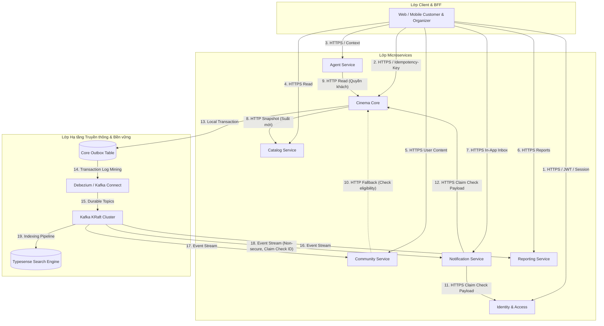

# Đặc tả thiết kế dữ liệu tổng thể — Movie Booking Platform

## 1. Phạm vi và nguồn

Tài liệu này là đặc tả tổng thể quyền sở hữu, mô hình trao đổi và quy ước thiết kế dữ liệu cho nền tảng Movie Booking Platform. Toàn bộ thiết kế được xây dựng theo kiến trúc bảy microservices logic trong monorepo và tuân thủ các bất biến nghiệp vụ, giao dịch và phi chức năng đã được phê duyệt.

Tài liệu thuần túy là tài liệu thiết kế (Markdown và Mermaid), không chứa code thực thi, cấu hình hạ tầng, script migration hay dữ liệu seed. Toàn bộ trạng thái thiết kế là `draft`, chờ chủ sản phẩm và reviewer độc lập (Codex) thẩm định trước khi chuyển giao sang giai đoạn lập kế hoạch migration.

### Nguồn đầu vào có thẩm quyền

1. **Kiến trúc và ranh giới:**
   - [Kiến trúc microservices](../../05-specs/004-service-decomposition/spec.md) và [Quyết định kiến trúc](../../05-specs/004-service-decomposition/decisions.md) (bảy database PostgreSQL logic độc lập, không JOIN/FK xuyên database, Cinema Core giữ hạt nhân giao dịch).
   - [ADR-0001](../../06-decisions/0001-monorepo-platform-and-microservices-boundaries.md), [ADR-0002](../../06-decisions/0002-customer-organizer-app-boundaries.md), [ADR-0003](../../06-decisions/0003-postgresql-and-redis-for-platform-data.md).
   - [ADR-0035](../../06-decisions/0035-search-module-in-cinema-core.md) (Search module đặt trong Cinema Core, Typesense là kho chỉ mục dẫn xuất).
2. **Nghiệp vụ và sản phẩm:**
   - [Mô hình sản phẩm](../../03-product/use-cases.md) và [Mô tả use case](../../03-product/use-case-descriptions.md) (đồng bộ theo xác nhận Q173-A; 9 actor, 50 use case chính + 5 use case chi tiết = 55 use case, quy tắc BR-01–BR-43).
   - [Thuật ngữ hệ thống (GLOSSARY)](../../../GLOSSARY.md).
3. **Yêu cầu phi chức năng (NFR):**
   - Sử dụng **Mục 9 (Yêu cầu phi chức năng)** trong tài liệu `docs/05-specs/domain-context.md` từ worktree nguồn `docs-nfr-requirements` (commit `2cd10657861db1b64e0b9f33e56769d59e9916f0`, snapshot R8 ngày 2026-11-21, SHA256 `1908648E60954DACC0A89D56C8E646AEE3BC070ED1B10D63B221072F908D50A3`).
   - Các NFR đã được chủ sản phẩm phê duyệt ngày 2026-11-17, 2026-11-18 và bổ sung/hòa giải ngày 2026-11-20, 2026-11-21:
     - `NFR-REL-01` (Mục 9.5): Cô lập sự cố AI khỏi luồng trực tiếp, fallback Cloudflare Workers AI sang Groq Free có kiểm soát, không bật trả phí, không phát lại giao dịch.
     - `NFR-PRIV-01` (Mục 9.6): Nhật ký chẩn đoán chỉ thông tin kỹ thuật, lưu tối đa 7 ngày, không lưu nội dung chat/credential/PII, chỉ chủ dự án có quyền xem (phân quyền riêng biệt, không cấp cho Quản trị viên nghiệp vụ).
     - `NFR-DR-01` (Mục 9.7): Mất cơ sở dữ liệu nghiệp vụ phục hồi sang cơ sở dữ liệu sạch; RTO ≤ 60 phút, RPO ≤ 24 giờ.
       - Mục 9.7.2 (Duyệt ngày 2026-11-20): Tệp sao lưu bắt buộc mã hóa, khóa phục hồi do người có quyền nắm giữ riêng; kiểm tra khóa đúng/sai và tệp hỏng/bị sửa, bản không hợp lệ phải báo lỗi và không được coi phục hồi đạt.
       - Mục 9.7.3 (Duyệt ngày 2026-11-20): Bài diễn tập bắt buộc đầu tiên chỉ gây mất **Database logic Cinema Core**, phục hồi sang Core DB sạch, không ghi đè 6 DB logic còn lại; DB các service khác và cấu hình vẫn dùng được.
       - Mục 9.7.4 (Duyệt ngày 2026-11-20): Phương pháp chuẩn hóa là `pg_dump -Fc` và `pg_restore`.
       - Mục 9.7.5 (Duyệt ngày 2026-11-21): Duy trì tối thiểu hai thế hệ bản sao lưu hợp lệ.
       - Mục 9.7.6 (Duyệt ngày 2026-11-21): Sử dụng các kịch bản sao lưu và phục hồi theo nhu cầu (`scripts on-demand`).
     - `NFR-AI-01` (Mục 9.8): Đánh giá 60 ca × 3 đợt, mỗi đợt ≥ 57/60 đạt (95%), 0 lỗi an toàn; phản hồi đầu ≤ 10s (p95), hoàn tất ≤ 30s (p95).
     - `NFR-RES-01` (Mục 9.11): Tối đa một lượt AI đang xử lý/tài khoản, deadline 60s không reset qua reconnect/resume/replica/fallback, tối đa 1 lần chuyển Cloudflare → Groq/lượt.
     - `NFR-SEC-01` (Mục 9.14): Kiểm soát danh tính/quyền/rạp; MFA bắt buộc cho Quản trị viên toàn chuỗi và Quản lý rạp bằng TOTP kèm mã dự phòng dùng 1 lần; đăng xuất phiên hiện tại không ngắt phiên độc lập khác; mất cả TOTP và mã dự phòng không hỗ trợ khôi phục tự động ở mốc demo.
     - `NFR-COR-01` (Mục 9.15): Tính đúng đắn khi tranh chấp ghế và lặp callback thanh toán; p95 đọc ≤ 1s, hold/tạo đơn ≤ 2s, lỗi hệ thống < 1%.
     - `NFR-DUR-01` (Mục 9.16): Tiến trình restart không mất trạng thái đã lưu, không reset TTL hold, không phát sinh tác dụng phụ lặp; khôi phục ≤ 5 phút.

---

## 2. Quyền sở hữu dữ liệu và Mô hình Khái niệm Toàn hệ thống

Hệ thống tuân thủ nghiêm ngặt nguyên tắc **Single Source of Truth** và **Zero Cross-Database Coupling**. Mỗi service sở hữu trọn vẹn một database PostgreSQL logic riêng biệt. Không có bất kỳ liên kết SQL xuyên database nào (Foreign Key, JOIN, View, dblink, postgres_fdw).

```
┌────────────────────────────────────────────────────────────────────────────────────────┐
│                                   CINEMA CORE DATABASE                                 │
│  - Phim phiên bản (Snapshot), Rạp, Phòng, Sơ đồ ghế, Suất chiếu, Bảng giá              │
│  - Cấp phát ghế độc quyền (showtime_seat_allocations), Ghế giữ (Hold), Đơn hàng (Order)│
│  - Snapshot dòng mua (order_ticket_items), Quyền vé (Ticket), Bộ đếm đổi vé (Counters) │
│  - Lượt soát (Scan Log), Ý định thanh toán (Payment Attempt), Nghĩa vụ hoàn tiền       │
│  - Lần hoàn tiền đối soát (client_request_id), Combo đơn hàng, Ca làm việc quầy combo  │
│  - Tài khoản hội viên, Lô điểm (NUMERIC 10,2), Chi tiêu 12 tháng, Voucher hội viên     │
│  - Căn cứ đánh giá phim (Eligibility Outbox), Thao tác chống lặp 2 pha (Idempotency)   │
└────────────────────────────────────────────────────────────────────────────────────────┘
       ▲                      ▲                     ▲                     ▲
       │ HTTP Snapshot        │ Claim Check Ref     │ Eligibility Event   │ Core Outbox Events
       ▼                      ▼                     ▼                     ▼
┌──────────────┐      ┌──────────────┐      ┌──────────────┐      ┌──────────────┐
│ CATALOG DB   │      │ IDENTITY DB  │      │ COMMUNITY DB │      │ REPORTING DB │
│ - Phim gốc   │      │ - Tài khoản  │      │ - Đánh giá   │      │ - Fact/Agg   │
│ - Phiên bản  │      │ - Phiên đăng │      │ - Lịch sử    │      │ - Doanh thu  │
│   đóng băng  │      │   nhập       │      │   kiểm duyệt │      │ - Bán ròng   │
│ - Thể loại,  │      │ - TOTP & Mã  │      │ - Xét lại    │      │ - Tỷ lệ soát │
│   Media meta │      │   dự phòng   │      │ - Yêu thích  │      │ - Watermark  │
│ - Trạng thái │      │ - Quyền & Rạp│      │ - Projection │      │ - Rebuild    │
│   công bố    │      │ - Claim Check│      │   eligibility│      │   checkpoint │
└──────────────┘      └──────────────┘      └──────────────┘      └──────────────┘
                              │                     ▲
                              │ Claim Check Ref     │
                              ▼                     │
                      ┌──────────────┐      ┌──────────────┐
                      │ NOTIFY DB    │      │ AGENT DB     │
                      │ - Hộp thư TB │      │ - Cuộc chat  │
                      │ - Email logs │      │ - Tin nhắn   │
                      │ - Attempt    │      │ - Checkpoint │
                      │ - Claim Check│      │   (LangGraph)│
                      │   dispatch   │      │ - Run/State  │
                      └──────────────┘      └──────────────┘
```

### 2.1. Bảng phân định thẩm quyền bảy Database logic

| Database | Service sở hữu | Dữ liệu gốc có thẩm quyền (Authoritative Data) | Dữ liệu dẫn xuất / Projection | Interface trao đổi dữ liệu |
|---|---|---|---|---|
| `cinema_core` | Cinema Core | Rạp, phòng, sơ đồ ghế, suất chiếu, snapshot phiên bản phim; cấp phát ghế độc quyền (`showtime_seat_allocations`), hold ghế, đơn hàng, snapshot chi tiết dòng mua (`order_ticket_items`), quyền vé theo ghế, bộ đếm đổi vé (`ticket_change_counters`), QR vé, lịch sử soát; ý định thanh toán, bằng chứng thanh toán, yêu cầu hủy, nghĩa vụ hoàn tiền, lần hoàn tiền đối soát qua `client_request_id`; combo theo đơn (nhận 1 lần duy nhất), ca làm việc quầy combo, sự cố giao combo; hội viên, lô điểm scale `NUMERIC(10,2)`, chi tiêu xét hạng 12 tháng (`loyalty_spendings`), voucher đã cấp/thu hồi. | Metadata tìm kiếm phim (đồng bộ từ Catalog sang Typesense); căn cứ đánh giá xuất sang Community; sự kiện tài chính/vận hành xuất sang Reporting. | HTTP tiếp nhận lệnh từ App/BFF; HTTP lấy snapshot từ Catalog; Outbox CDC Kafka phát sự kiện; HTTPS cung cấp payload Claim Check cho Notification. |
| `catalog` | Catalog Service | Thông tin phim biên tập: tựa đề, alias, tóm tắt, đạo diễn, diễn viên, thể loại, thời lượng, phân loại độ tuổi; các phiên bản phát hành đóng băng bất biến (`is_content_frozen`); metadata hình ảnh R2/Cloudflare Images; trailer embed URLs; trạng thái phát hành (draft, published, deprecated). | Không lưu dữ liệu dẫn xuất từ Core. | HTTP API nội bộ cung cấp snapshot phiên bản phim cho Core khi lập suất; HTTP API cho App/BFF tra cứu catalog công khai. |
| `identity` | Identity & Access | Tài khoản (User), phương thức xác thực (Account/Password), phiên đăng nhập (Session dựa trên Better Auth v1.2.9+), trạng thái xác minh email; cấu hình bảo mật MFA: TOTP secret (`secret_encrypted`, `pending_secret_encrypted`), bộ mã dự phòng (Backup Codes dùng 1 lần qua atomic update), nhật ký thử sai; phân công vai trò và phạm vi rạp hợp nhất (`user_role_assignments`). | Không lưu dữ liệu nghiệp vụ vé hoặc điểm hội viên. | HTTP API cho App/BFF đăng nhập, đăng xuất, challenge MFA; HTTPS Claim Check endpoint cung cấp payload gửi email xác minh/khôi phục cho Notification; JWT/Signed Claims cho các service xác minh cục bộ. |
| `agent` | Agent Service | Cuộc hội thoại (Thread), tin nhắn (Message), phiên xử lý (Run), lịch sử attempts (`agent_run_attempts` kèm heartbeat và `execution_epoch`), đề xuất giao dịch có cấu trúc có version và hash (`booking_proposals`); bảng checkpointer LangGraph PostgreSQL v0.2.x+: `checkpoints`, `checkpoint_blobs`, `checkpoint_writes`, `checkpoint_migrations`. | Bản sao tham chiếu tạm kết quả giao dịch Core (không có giá trị xác nhận vé); không lưu dữ liệu cá nhân dài hạn ngoài phiên/tài khoản. | HTTP API tiếp nhận tin nhắn từ App/BFF; HTTP client gọi model ngoài (Workers AI / Groq); HTTP client gọi Core tra cứu suất/vé dưới quyền khách hàng. |
| `community` | Community Service | Bài đánh giá phim (Review), phiên bản nội dung đánh giá (Review Version), nhãn cảnh báo cốt truyện (Spoiler Flag); quyết định kiểm duyệt (Moderation Action), yêu cầu xét lại (`review_appeals` kèm `appeal_version_number` và ràng buộc 1 pending); danh sách phim yêu thích (Watchlist/Favorite); bảng tổng hợp điểm đánh giá (`movie_rating_summaries` trừ/cộng có điều kiện). | Projection căn cứ đủ điều kiện đánh giá (`review_eligibility_projections`) nhận từ Core qua Kafka; HTTP fallback tra cứu Core khi projection quá cũ hoặc chưa rõ. | HTTP API cho Customer/Admin; Kafka Consumer nhận sự kiện eligibility từ Core; HTTP client gọi Core tra cứu eligibility bù. |
| `notification` | Notification Service | Hộp thông báo trong ứng dụng (Inbox Notification), trạng thái đã đọc; ý định chuyển phát email (`email_dispatch_intents`), số lần thử (`email_delivery_attempts`), mã tham chiếu nhà cung cấp (Resend Message ID), nhật ký trạng thái (Sent, Failed, Bounced). | Payload Claim Check tạm thời nhận qua HTTPS từ Identity/Core để chuyển phát; xóa ngay sau khi gửi hoặc hết hạn, không lưu plaintext vào database/queue/log/DLQ. | Kafka Consumer nhận sự kiện thông báo thường; HTTPS Client lấy payload Claim Check từ Identity/Core; HTTPS Client gọi API Resend. |
| `reporting` | Reporting Service | Dữ liệu tổng hợp đọc (Read Models / Aggregates): Doanh thu thực thu, tiền đã hoàn, tiền còn phải hoàn, doanh thu bán ròng theo rạp/ngày/suất; tỷ lệ lấp đầy ghế và tỷ lệ vào rạp tính trên sức chứa ghế vật lý theo BR-35 & Q159; tiến độ tái dựng mô hình (Rebuild Watermark / Checkpoint). | Toàn bộ dữ liệu trong Reporting là bản sao/projection dẫn xuất từ sự kiện nghiệp vụ của Core. Reporting tuyệt đối không phải nguồn thẩm quyền tài chính. | Kafka Consumer nhận toàn bộ sự kiện nghiệp vụ từ Core Outbox; HTTP API cung cấp số liệu báo cáo cho Admin và Manager. |

### 2.2. Sơ đồ Thực thể - Quan hệ Khái niệm Toàn hệ thống (System Conceptual ERD)

> [!TIP]
> **Hướng dẫn xem sơ đồ (Finding F27):** Sơ đồ khái niệm được thiết kế rút gọn thuộc tính và phân nhóm theo 7 database logic để tối ưu hóa khả năng hiển thị. Trên các khung nhìn hẹp (màn hình điện thoại hoặc split view dưới 700px), khuyến nghị mở toàn màn hình hoặc phóng to (zoom) để quan sát chi tiết các mối quan hệ và cardinality. Đối với các sơ đồ ERD chi tiết tại từng tài liệu database con (vốn có kích thước lớn do hiển thị đầy đủ kiểu dữ liệu và ràng buộc vật lý), khuyến nghị xem ở chế độ xem rộng hoặc 100% zoom, cuộn ngang, hoặc xem theo từng nhóm quan hệ logic để bảo đảm khả năng đọc tốt nhất.

Sơ đồ khái niệm dưới đây trực quan hóa các thực thể trung tâm của toàn bộ nền tảng và cách thức chúng kết nối với nhau:
- **Tập trung vào cấu trúc khái niệm:** Mỗi thực thể chỉ hiển thị định danh khóa (PK), thuộc tính nghiệp vụ cốt lõi và định danh service chủ sở hữu; không đưa toàn bộ các cột vật lý hoặc chỉ mục vào hình.
- **Phân định ranh giới liên kết (R3-N02):**
  - **Nét liền (`--`, `||--o{`, `||--o|`):** Liên kết quan hệ nội bộ trong cùng một database logic (Local DB Foreign Key).
  - **Nét đứt (`..`, `}o..o{`, `||..o{`, `||..||`):** Tham chiếu nghiệp vụ xuyên service (`Cross-Service Logical Reference`). Tuyệt đối không tạo FK hay JOIN giữa các database. Dữ liệu được liên kết lỏng qua UUID định danh, sự kiện bất đồng bộ Kafka (Transactional Outbox CDC), HTTP Snapshot khi khởi tạo suất, hoặc cơ chế Claim Check HTTPS.

```mermaid
erDiagram
    %% Quan hệ nội bộ trong cùng một Database (Local DB FK - Nét liền)
    CATALOG_MOVIE ||--o{ CATALOG_MOVIE_VERSION : "freezes"
    IDENTITY_USER ||--o{ IDENTITY_SESSION : "authenticates"
    IDENTITY_USER ||--o{ IDENTITY_ROLE_ASSIGNMENT : "authorizes"
    CORE_CINEMA ||--o{ CORE_SHOWTIME : "hosts_via_room"
    CORE_CINEMA ||--o{ CORE_SEAT : "contains_via_layout"
    CORE_SHOWTIME ||--o{ CORE_SEAT_HOLD : "holds"
    CORE_SHOWTIME ||--o{ CORE_ORDER : "books"
    CORE_ORDER ||--o{ CORE_TICKET : "issues"
    CORE_ORDER ||--o{ CORE_REFUND_OBLIGATION : "refunds"
    AGENT_THREAD ||--o{ AGENT_BOOKING_PROPOSAL : "proposes"
    COMMUNITY_ELIGIBILITY_PROJECTION ||--o| COMMUNITY_REVIEW : "cho phep dang toi da 1 bai"

    %% Tham chiếu nghiệp vụ xuyên Database / Service (Cross-Service Logical Reference - Nét đứt)
    CATALOG_MOVIE_VERSION ||..o{ CORE_SHOWTIME : "version_snapshot"
    IDENTITY_USER ||..o{ CORE_ORDER : "customer_ref"
    IDENTITY_USER ||..o| CORE_LOYALTY_MEMBER : "member_ref"
    IDENTITY_USER ||..o{ AGENT_THREAD : "user_ref"
    IDENTITY_USER ||..o{ COMMUNITY_REVIEW : "author_ref"
    IDENTITY_USER ||..o{ NOTIFY_INBOX_NOTIFICATION : "recipient_ref"
    IDENTITY_USER ||..o{ COMMUNITY_ELIGIBILITY_PROJECTION : "so huu ket luan"
    CORE_SHOWTIME ||..o{ AGENT_BOOKING_PROPOSAL : "target_showtime_ref"
    CORE_ORDER }o..|| COMMUNITY_ELIGIBILITY_PROJECTION : "dong gop su kien theo (user, movie)"
    CORE_ORDER ||..o{ NOTIFY_EMAIL_DISPATCH : "claim_ref_dispatch"
    CORE_ORDER }o..o{ REPORTING_DAILY_REVENUE : "aggregates_cdc_facts"
    CORE_SHOWTIME ||..|| REPORTING_SHOWTIME_PERF : "do luong 1:1"

    CATALOG_MOVIE {
        string id PK "Service: catalog-service"
        string title "Tua phim chinh thuc"
        string status "draft-published-deprecated"
    }
    CATALOG_MOVIE_VERSION {
        string id PK "Service: catalog-service"
        string movie_id FK "Local DB FK"
        int version_number "Phien ban dong bang"
    }
    IDENTITY_USER {
        string id PK "Service: identity-service"
        string email "Email dang nhap duy nhat"
        string status "active-pending_closure-deleted"
    }
    IDENTITY_SESSION {
        string id PK "Service: identity-service"
        string user_id FK "Local DB FK"
        timestamp expires_at "Het han phien"
    }
    IDENTITY_ROLE_ASSIGNMENT {
        string id PK "Service: identity-service"
        string user_id FK "Local DB FK"
        string role "customer-staff-manager-admin"
    }
    CORE_CINEMA {
        string id PK "Service: cinema-core"
        string name "Ten cum rap"
        string status "active-maintenance"
    }
    CORE_SHOWTIME {
        string id PK "Service: cinema-core"
        string cinema_id FK "Local DB FK"
        string movie_version_id "Ref Catalog Movie Version"
        timestamp start_time "Gio chieu phim"
    }
    CORE_SEAT {
        string id PK "Service: cinema-core"
        string seat_layout_id FK "Local DB FK tham chieu layout"
        string seat_code "Ma ghe (vi du: F10)"
    }
    CORE_SEAT_HOLD {
        string id PK "Service: cinema-core"
        string showtime_id FK "Local DB FK"
        timestamp expires_at "Het han giu cho 300s"
    }
    CORE_ORDER {
        string id PK "Service: cinema-core"
        string showtime_id FK "Local DB FK"
        string user_id "Ref Identity User"
        bigint total_amount "Tong tien sau giam"
        string status "pending-paid-cancelled"
    }
    CORE_TICKET {
        string id PK "Service: cinema-core"
        string order_id FK "Local DB FK"
        string status "issued-used-cancelled"
    }
    CORE_REFUND_OBLIGATION {
        string id PK "Service: cinema-core"
        string order_id FK "Local DB FK"
        bigint amount "So tien hoan"
        string status "pending-processing-completed"
    }
    CORE_LOYALTY_MEMBER {
        string id PK "Service: cinema-core"
        string user_id "Ref Identity User"
        decimal points_balance "NUMERIC(10,2) diem tich luy"
    }
    AGENT_THREAD {
        string id PK "Service: agent-service"
        string user_id "Ref Identity User"
        string status "active-archived"
    }
    AGENT_BOOKING_PROPOSAL {
        string id PK "Service: agent-service"
        string thread_id FK "Local DB FK"
        string showtime_id "Ref Core Showtime"
        string status "proposed-accepted-rejected"
    }
    COMMUNITY_ELIGIBILITY_PROJECTION {
        string id PK "Service: community-service"
        string user_id "Ref Identity User"
        string movie_id "Ref Catalog Movie"
        string eligibility_status "ELIGIBLE-INELIGIBLE-REVOKED"
    }
    COMMUNITY_REVIEW {
        string id PK "Service: community-service"
        string user_id "Ref Identity User"
        string movie_id "Ref Catalog Movie"
        int rating "1 den 5 sao"
        string status "published-flagged-hidden"
    }
    NOTIFY_INBOX_NOTIFICATION {
        string id PK "Service: notification-service"
        string user_id "Ref Identity User"
        string title "Tieu de thong bao"
    }
    NOTIFY_EMAIL_DISPATCH {
        string id PK "Service: notification-service"
        string claim_id "Ref Claim Check Payload"
        string status "pending-sending-sent-exhausted"
    }
    REPORTING_DAILY_REVENUE {
        string id PK "Service: reporting-service"
        string cinema_id "Ref Core Cinema"
        date business_date "Ngay kinh doanh"
        bigint net_revenue "Doanh thu ban rong"
    }
    REPORTING_SHOWTIME_PERF {
        string id PK "Service: reporting-service"
        string showtime_id "Ref Core Showtime"
        numeric occupancy_rate "Ty le lap day ghe"
    }
```



### 2.3. Quy ước Ký hiệu & Phân định Ranh giới Liên kết (Local FK vs Cross-Service Reference)

Hệ thống phân định rạch ròi hai cơ chế quan hệ giữa các thực thể để bảo toàn kiến trúc Microservices và ngăn ngừa coupling database:

| Loại quan hệ | Ký hiệu trong ERD | Bản chất kỹ thuật | Cơ chế bảo đảm tính nhất quán | Điểm kiểm soát lỗi & Phục hồi |
|---|---|---|---|---|
| **Local Database FK** (Quan hệ nội bộ DB) | Đường nét liền (`--`, `||--o{`, `||--o|`) | Quan hệ nội bộ trong cùng một database logic (gồm khóa ngoại vật lý trực tiếp hoặc liên kết ngữ nghĩa gián tiếp qua bảng layout phòng chiếu). | ACID Transaction cục bộ (`SERIALIZABLE` hoặc `READ COMMITTED` kèm khóa bi quan/lạc quan). Tính toàn vẹn được bảo đảm 100% tại thời điểm ghi. | Rollback toàn bộ transaction nội bộ nếu vi phạm ràng buộc FK hoặc check constraints. |
| **Cross-Service Reference** (Tham chiếu xuyên service) | Đường nét đứt (`..`) | Tham chiếu logic thông qua trường định danh kiểu chuỗi/UUID; tuyệt đối không khai báo constraint FK xuyên cơ sở dữ liệu. | Tính nhất quán cuối cùng (Eventual Consistency) qua Kafka CDC Outbox, hoặc HTTP Snapshot bất biến tại thời điểm tạo bản ghi. | - Snapshot Catalog: Đóng băng nội dung phim, lỗi mạng thì từ chối tạo suất chiếu.<br>- Kafka Event: Lưu vết Outbox Table, retry có backoff, dead-letter queue (DLQ), idempotency key.<br>- Claim Check: Hết hạn TTL token thì ghi nhận lỗi gửi thư, không làm rò rỉ payload PII. |

### 2.4. Bản đồ Điều hướng tới các Góc nhìn Chi tiết (Detailed View Navigation)

Sơ đồ ERD khái niệm tổng quan ở trên cung cấp góc nhìn toàn cảnh về ranh giới thẩm quyền và dòng chảy quan hệ dữ liệu giữa các Bounded Context. Để nghiên cứu thiết kế vật lý chi tiết của từng service (gồm đầy đủ trường, kiểu dữ liệu, index, trigger, ràng buộc toàn vẹn và quy tắc nghiệp vụ), người đọc tra cứu theo bản đồ điều hướng dưới đây:

| Bounded Context / Chủ đề | Database logic | Tài liệu thiết kế chi tiết | Trọng tâm thiết kế & Invariants |
|---|---|---|---|
| **Cinema Core** | `cinema_core` | [Thiết kế dữ liệu Cinema Core](databases/cinema-core.md) | Suất chiếu, giữ ghế độc quyền TTL (`showtime_seat_allocations`), đơn hàng, quyền vé theo ghế, QR soát vé, nghĩa vụ hoàn tiền, hội viên tích điểm (`NUMERIC(10,2)`). |
| **Identity & Access** | `identity` | [Thiết kế dữ liệu Identity & Access](databases/identity.md) | Tài khoản, phiên đăng nhập (Better Auth v1.2.9+), xác thực hai lớp (TOTP secret mã hóa + mã dự phòng dùng 1 lần), phân quyền rạp (`user_role_assignments`). |
| **Catalog Service** | `catalog` | [Thiết kế dữ liệu Catalog](databases/catalog.md) | Phim biên tập, bí danh tìm kiếm, thể loại, phiên bản nội dung phát hành đóng băng bất biến (`is_content_frozen`), metadata tài sản hình ảnh Cloudflare R2. |
| **Agent Service** | `agent` | [Thiết kế dữ liệu Agent](databases/agent.md) | Cuộc hội thoại, phiên xử lý (`agent_run_attempts` kèm heartbeat), đề xuất đặt vé cấu trúc (Proposal hash SHA256), bảng lưu trạng thái LangGraph v0.2.x+. |
| **Community Service** | `community` | [Thiết kế dữ liệu Community](databases/community.md) | Đánh giá phim, kiểm duyệt và xét lại (`review_appeals`), phim yêu thích, projection điều kiện đánh giá (`review_eligibility_projections`) từ Core. |
| **Notification Service** | `notification` | [Thiết kế dữ liệu Notification](databases/notification.md) | Hộp thư thông báo in-app, nhật ký chuyển phát email, giao thức Claim Check HTTPS bảo mật dữ liệu nhạy cảm (không lưu plaintext vào database/log/DLQ). |
| **Reporting Service** | `reporting` | [Thiết kế dữ liệu Reporting](databases/reporting.md) | Fact/Aggregates doanh thu thực thu, tiền đã hoàn, bán ròng theo rạp/ngày; tỷ lệ lấp đầy ghế theo sức chứa vật lý (BR-35/Q159); checkpoint tiến độ tái dựng. |
| **Transaction Flows** | Đa database | [Luồng giao dịch và Nhất quán dữ liệu](transactions.md) | 12 kịch bản giao dịch cốt lõi: Giữ ghế, Thanh toán, Soát vé, Đổi vé, Hoàn tiền, Đăng nhập MFA, Đề xuất Agent, Đánh giá phim, Báo cáo CDC. |
| **Supporting Stores** | Redis, Typesense, R2 | [Kho lưu trữ phụ trợ và Caching](supporting-stores.md) | Cấu hình Redis (Idempotency 2 pha, Rate limit, Lock phân tán), Typesense (Chỉ mục tìm kiếm phim/rạp), Cloudflare R2 (Media assets). |

---

## 3. Trao đổi dữ liệu và cơ chế tích hợp

Hệ thống sử dụng ba phương thức giao tiếp chính theo [Kiến trúc microservices](../../05-specs/004-service-decomposition/spec.md):



### 3.1. Đồng bộ HTTP / RESTful

- **Catalog → Core (Snapshot suất chiếu):** Khi quản lý rạp lập lịch chiếu hoặc công bố suất, Core gọi HTTP sang Catalog lấy snapshot thông tin phiên bản phim đã công bố và đóng băng (`version_title`, `version_runtime_minutes`, `version_rating_code`, `version_code`). Core lưu bản snapshot này trực tiếp vào bảng `showtimes` trong database Core. Quá trình bán vé và soát vé sau đó chỉ đọc snapshot trong Core, không gọi lại Catalog. Nếu Catalog không khả dụng, Core từ chối tạo/công bố suất chiếu mới.
- **Agent → Core (Tra cứu theo quyền khách):** Agent gọi API Core để lấy dữ liệu suất chiếu, sơ đồ ghế trống và thông tin đặt vé. Lệnh thực thi luôn do App/BFF phát đi với định danh và chữ ký xác nhận của khách hàng, kèm `Idempotency-Key` và `operation_id`.
- **Community → Core (Truy vấn bù căn cứ đánh giá):** Khi khách gửi đánh giá mà projection căn cứ tại Community chưa có bản ghi (do Kafka trễ) hoặc dữ liệu đã vượt ngưỡng độ mới cho phép (*Đề xuất kỹ thuật: 15 phút*), Community gọi HTTP sang Core để tra cứu tức thời. Nếu Core gặp sự cố hoặc timeout, Community tạm hoãn tiếp nhận đánh giá, tuyệt đối không tự ý cho phép đăng bài khi chưa xác minh được quyền.

### 3.2. Bất đồng bộ Transactional Outbox → Debezium CDC → Kafka KRaft

- Để bảo đảm tính nhất quán tuyệt đối giữa thay đổi dữ liệu nghiệp vụ và phát sinh sự kiện, mọi thay đổi trạng thái tại Core (đặt vé thành công, hủy vé, duyệt hoàn tiền, soát vé, đổi điểm) đều ghi kèm một bản ghi sự kiện vào bảng `outbox_events` trong **cùng một transaction cục bộ của PostgreSQL**, kèm số thứ tự tuần tự `aggregate_sequence_number`.
- Debezium / Kafka Connect theo dõi PostgreSQL WAL (Write-Ahead Logging) và trích xuất sự kiện từ bảng outbox đưa vào Kafka KRaft.
- Consumer tại Reporting, Community và Notification tiêu thụ sự kiện từ Kafka và ghi nhận vào bảng `consumer_inbox` trong database riêng của mình để bảo đảm xử lý chính xác một lần về mặt logic (idempotent consumption).

### 3.3. Bảo mật mã xác minh qua Claim Check Pattern (Finding 13)

- Tuyệt đối không đưa email recipient, OTP, URL reset mật khẩu, mã xác minh email hoặc bất kỳ credential/secret nào vào Kafka event, queue công khai, log, trace hay DLQ.
- Khi Identity hoặc Core cần gửi email chứa mã bảo mật:
  1. Service nguồn lưu dữ liệu xác minh (hash), đồng thời lưu payload mã hóa có thời hạn (TTL ngắn) chứa cả địa chỉ email recipient vào bảng `claim_check_payloads` trong database của mình.
  2. Service nguồn phát một thông điệp Claim Check sang Kafka, **chỉ chứa**: `{ claim_id, purpose, expires_at, source_service, idempotency_key }`.
  3. Notification xác thực bằng danh tính dịch vụ (Service Identity Mutual TLS / Internal Token) gọi HTTPS ngược lại service nguồn để lấy payload giải mã tạm thời trong bộ nhớ RAM và chuyển phát qua Resend.
  4. Sau khi gửi (hoặc khi payload hết hạn), payload tự động bị vô hiệu hóa. Notification không lưu email hay secret vào cơ sở dữ liệu của mình.

---

## 4. Quy ước thiết kế dữ liệu

### 4.1. Định dạng khóa chính và tham chiếu xuyên Service (Finding 23)

- **Lưu trữ vật lý Khóa chính và Khóa ngoại trong Cơ sở dữ liệu:**
  - Toàn bộ các cột khóa chính (`id`) và khóa ngoại tham chiếu liên kết mang kiểu `VARCHAR(36)` đều lưu trữ dạng **chuỗi canonical UUIDv7 36 ký tự chuẩn** (RFC 9562, định dạng `8-4-4-4-12`, ví dụ: `018f6f7b-9c2e-7b3a-8f1a-2e4b5c6d7e8f`), sinh tuần tự theo thời gian để tối ưu hóa chỉ mục B-tree, không bao gồm tiền tố logic trong cột cơ sở dữ liệu nhằm bảo đảm vừa vặn tuyệt đối độ dài `VARCHAR(36)`.
- **Quy ước Tiền tố Ngữ cảnh Tầng Ứng dụng & API (Application & API Identifier Convention):**
  - Tại tầng giao tiếp API bên ngoài, REST/GraphQL endpoints, URL slug hoặc nhật ký log của hệ thống, mã định danh có thể được gắn tiền tố logic dạng phân loại để hỗ trợ khả năng đọc và gỡ lỗi trực quan cho lập trình viên và vận hành:
    - `usr_`: Khách hàng / Người dùng (`usr_018f6f7b9c2e7b3a8f1a2e4b5c6d7e8f`)
    - `mov_`: Phim trong Catalog (`mov_018f6f7b9c2e7b3a8f1a2e4b5c6d7e8f`)
    - `ver_`: Phiên bản phát hành phim (`ver_018f6f7b9c2e7b3a8f1a2e4b5c6d7e8f`)
    - `cin_`: Rạp chiếu phim (`cin_018f6f7b9c2e7b3a8f1a2e4b5c6d7e8f`)
    - `aud_`: Phòng chiếu / Auditorium (`aud_018f6f7b9c2e7b3a8f1a2e4b5c6d7e8f`)
    - `shw_`: Suất chiếu / Showtime (`shw_018f6f7b9c2e7b3a8f1a2e4b5c6d7e8f`)
    - `ord_`: Đơn hàng / Order (`ord_018f6f7b9c2e7b3a8f1a2e4b5c6d7e8f`)
    - `tkt_`: Vé theo ghế / Ticket (`tkt_018f6f7b9c2e7b3a8f1a2e4b5c6d7e8f`)
    - `hld_`: Lượt giữ ghế / Seat Hold (`hld_018f6f7b9c2e7b3a8f1a2e4b5c6d7e8f`)
    - `pay_`: Lần thanh toán / Payment Attempt (`pay_018f6f7b9c2e7b3a8f1a2e4b5c6d7e8f`)
    - `ref_`: Nghĩa vụ hoàn tiền (`ref_018f6f7b9c2e7b3a8f1a2e4b5c6d7e8f`)
    - `rfa_`: Lần hoàn tiền qua cổng (`rfa_018f6f7b9c2e7b3a8f1a2e4b5c6d7e8f`)
    - `com_`: Combo bắp nước (`com_018f6f7b9c2e7b3a8f1a2e4b5c6d7e8f`)
    - `rev_`: Bài đánh giá / Review (`rev_018f6f7b9c2e7b3a8f1a2e4b5c6d7e8f`)
    - `ntf_`: Thông báo / Notification Message (`ntf_018f6f7b9c2e7b3a8f1a2e4b5c6d7e8f`)
    - `run_`: Phiên thực thi Agent (`run_018f6f7b9c2e7b3a8f1a2e4b5c6d7e8f`)
    - `prp_`: Đề xuất giao dịch Agent (`prp_018f6f7b9c2e7b3a8f1a2e4b5c6d7e8f`)
  - Khi lưu trữ xuống các bảng cơ sở dữ liệu, tầng lưu trữ (Repository/Data Access Layer) tự động chuẩn hóa tách bỏ tiền tố để lưu trữ chuỗi canonical UUID 36 ký tự thuần túy vào các cột `VARCHAR(36)`.

### 4.2. Tiền tệ và tính toán phân bổ ưu đãi

- **Đơn vị tiền tệ:** Toàn bộ giá trị tiền tệ trong toàn bộ hệ thống được lưu trữ bằng số nguyên chính xác đại diện cho Việt Nam Đồng (**VND**), sử dụng kiểu dữ liệu `BIGINT`. Không sử dụng số thực (`FLOAT`, `DOUBLE`) hoặc số thập phân có phần lẻ.
- **Thang điểm hội viên (Finding 15):** Điểm thưởng tích lũy và số dư điểm hội viên được lưu trữ bằng kiểu `NUMERIC(10,2)` (chính xác 2 chữ số thập phân) để hỗ trợ các tỷ lệ tích điểm và quy đổi linh hoạt theo quy tắc BR-28.
- **Bảo toàn tổng khi phân bổ giảm giá (BR-20):**
  - Giảm giá từ voucher hoặc chương trình khuyến mãi tự động được phân bổ trực tiếp cho từng dòng vé (`order_ticket_items`) và dòng combo ngay tại thời điểm khách hàng xác nhận mua và ghi bền vững vào cơ sở dữ liệu (`discount_amount`, `paid_amount`).
  - Phép tính phân bổ làm tròn xuống (`FLOOR`) đến từng đồng (VND). Phần dư còn lại do làm tròn được phân bổ tuần tự cho các mục có số lẻ lớn nhất.
  - Khi phát sinh hủy vé một phần (BR-10, BR-11), số tiền hoàn trả được lấy trực tiếp từ giá trị thực trả (`paid_amount`) đã lưu của chính dòng vé đó. Tuyệt đối không tính toán lại đơn hàng hoặc chia lại phân bổ cho các vé còn lại.

### 4.3. Quản lý thời gian, múi giờ và ngày nghiệp vụ

- **Lưu trữ chuẩn:** Mọi cột thời gian trong PostgreSQL đều dùng kiểu `TIMESTAMPTZ` (Timestamp with time zone) và luôn được chuyển đổi về chuẩn **UTC** khi ghi xuống cơ sở dữ liệu.
- **Ngày nghiệp vụ Việt Nam (BR-30, BR-35):**
  - Các nghiệp vụ xác định kỳ báo cáo doanh thu, ca phục vụ của quầy bắp nước và ngày chiếu phim được quy chiếu theo múi giờ Việt Nam (`Asia/Ho_Chi_Minh` — UTC+7).
  - Ca phục vụ quầy combo gắn với ngày chiếu của suất, cho phép kéo dài qua 00:00 (nửa đêm) mà không làm mất hiệu lực nhận combo của khách hàng (BR-23, Finding 17).
  - Thời hạn tự nguyện hủy vé (12 tiếng trước giờ chiếu theo BR-10) và thời hạn đổi ghế (30 phút trước giờ chiếu theo BR-19) được tính toán chính xác theo mốc thời gian thực tế (`TIMESTAMPTZ`).

---

## 5. Truy vết yêu cầu (Traceability Matrix)

Ma trận dưới đây liên kết toàn bộ 50 use case chính trong danh mục `use-cases.md` cùng 5 use case chi tiết mở rộng từ `use-case-descriptions.md` (tổng cộng 55 use case), các Quy tắc nghiệp vụ (BR-01 đến BR-43) và Yêu cầu phi chức năng (NFR) tới các thực thể dữ liệu, ràng buộc và tài liệu chi tiết tương ứng:

| Mã UC / BR / NFR | Service Owner | Khái niệm / Bảng dữ liệu chính | Ràng buộc hoặc Cơ chế Transaction | Tài liệu đích | Trạng thái nguồn |
|---|---|---|---|---|---|
| **D-01** | Catalog / Core | `movies`, `movie_versions`, `showtimes`, `cinemas` | Khám phá phim, rạp và suất chiếu công khai không cần đăng nhập; Lọc và phân trang theo rạp, định dạng và khung giờ | `databases/catalog.md`, `databases/cinema-core.md` | Đã duyệt (Q1–Q4) |
| **BR-40 (Học cá nhân hóa)** | Chưa chốt (`[TECH-PROP-07]`: Đề xuất Identity hoặc Client Storage) | Tùy chọn hồ sơ cá nhân hóa (`[TECH-PROP-07]`) | Người dùng có toàn quyền bật, tắt hoặc thiết lập lại (reset) lịch sử học cá nhân hóa theo BR-40 | `databases/identity.md`, `supporting-stores.md` | Quy tắc nghiệp vụ BR-40 đã duyệt (use-cases:689, Tech Stack 2026-11-17, phương án A); Cơ chế lưu trữ profile và service owner là đề xuất kỹ thuật chưa chốt (`[TECH-PROP-07]`, OPEN-11) |
| **BR-41 (Cô lập phiên khách)**| Chưa chốt (`[TECH-PROP-07]`: Đề xuất Redis hoặc Client Session) | `guest_sessions` (`[TECH-PROP-07]`) | Tuyệt đối không nhập (merge) hành vi hoặc tương tác phiên khách vãng lai vào tài khoản khi đăng nhập theo BR-41 | `databases/identity.md`, `supporting-stores.md` | Quy tắc nghiệp vụ BR-41 đã duyệt (use-cases:690, Tech Stack 2026-11-17, phương án A về phiên khách); Cơ chế lưu trữ và service owner là đề xuất kỹ thuật chưa chốt (`[TECH-PROP-07]`, OPEN-11) |
| **BR-42 (Ưu tiên Query)** | Core (Search Module) / Typesense (Derived Store) | `typesense_movies` | Ưu tiên tuyệt đối mức độ khớp từ khóa của truy vấn tìm kiếm tường minh hơn các tín hiệu gợi ý | `databases/catalog.md`, `supporting-stores.md` | Đã duyệt (BR-42, ADR-0035, use-cases:691, Tech Stack 2026-11-17, phương án A về thứ hạng) |
| **A-01, A-02, BR-02** | Identity | `users`, `verifications`, `claim_check_payloads` | `email` UNIQUE; `email_verified` boolean; Claim check outbox phát email | `databases/identity.md` | Đã duyệt (Q4, Q19, BR-02) |
| **A-03, A-04** | Identity | `users`, `sessions`, `accounts` | Cascade session khi xóa; Token UNIQUE; Hash mật khẩu Argon2id | `databases/identity.md` | Đã duyệt (ADR-0008) |
| **A-05, BR-36** | Identity | `verifications`, `claim_check_payloads` | Mã khôi phục có TTL, kiểm tra số lần thử sai, Claim check HTTPS | `databases/identity.md` | Đã duyệt (Q162–Q163, BR-36) |
| **A-06, BR-37** | Agent | `agent_threads`, `agent_messages`, `checkpoints` | Xóa logic hoặc vật lý thread chat; bảo vệ run đang chạy; không cascade sang Core | `databases/agent.md` | Đã duyệt (Q164–Q165, BR-37, Finding 12) |
| **A-07, A-08, BR-38** | Identity / Core | `users`, `deletion_requests` | Chờ đóng khi còn đơn/hoàn tiền; Ẩn danh PII; Giữ dữ liệu tài chính Core | `databases/identity.md` | Đã duyệt (Q166–Q169, BR-38) |
| **B-01, B-02, BR-04** | Core | `showtime_seat_allocations`, `seat_holds`, `showtimes`, `seats` | Độc quyền ghế tại DB; Giữ đúng ghế khách chọn; Tối đa 6 ghế; Sweetbox cả cặp; 1 hold/user; TTL 300s | `databases/cinema-core.md` | Đã duyệt (BR-04, Finding 1, TX-01) |
| **BR-21 (Đơn hàng 0đ)** | Core | `orders`, `tickets`, `showtime_seat_allocations` | Đơn hàng 0đ hoàn tất ngay không qua cổng thanh toán; Bắt buộc hold_id còn hiệu lực tại thời điểm ghi; Không áp dụng quy trình đối soát khoản thu muộn | `databases/cinema-core.md`, `transactions.md` | Đã duyệt (Q77, BR-21, Finding 1, Finding 24) |
| **BR-22 (Khôi phục Voucher)** | Core | `vouchers`, `order_voucher_usages`, `voucher_restoration_records` | Khôi phục voucher hoặc cấp bù voucher mới hạn 14 ngày bảo toàn điều kiện gốc khi vé bị hủy hoặc suất chiếu bị hủy | `databases/cinema-core.md` | Đã duyệt (Q78, BR-22, Finding 16, Finding 24) |
| **B-03, BR-23** | Core | `order_combos`, `combos` | Gắn với đơn hàng; Nhận toàn bộ 1 lần trong ca chiếu; Snapshot giá lúc mua | `databases/cinema-core.md` | Đã duyệt (Q53–Q56, BR-23) |
| **B-04, BR-20** | Core | `orders`, `vouchers`, `order_voucher_usages`, `order_discounts`, `order_ticket_items` | Tối đa 1 voucher cho mỗi đơn hàng (BR-20); Phân bổ số tiền giảm trừ theo tỷ lệ giá trị xuống từng dòng vé và combo | `databases/cinema-core.md` | Đã duyệt (Q74–Q78, BR-20, Finding 3, Finding 24) |
| **B-05, B-06, BR-06** | Core | `orders`, `payment_attempts`, `tickets`, `order_ticket_items` | Chỉ phát hành vé khi Core xác minh thanh toán; Đơn 0đ phát hành ngay không qua cổng | `databases/cinema-core.md` | Đã duyệt (BR-06, TX-02) |
| **B-07, BR-07** | Core | `orders`, `tickets`, `ticket_scan_logs` | 1 QR đại diện cho cả đơn hàng; Quản lý quyền và trạng thái soát theo từng ghế | `databases/cinema-core.md` | Đã duyệt (BR-07) |
| **B-08, BR-05** | Core | `seat_holds`, `showtime_seat_allocations` | Khách chủ động hủy giữ ghế; Giải phóng allocation ghế ngay lập tức | `databases/cinema-core.md` | Đã duyệt (Q9, BR-05, TX-01) |
| **B-09, BR-18, 19** | Core | `tickets`, `ticket_change_counters`, `seat_change_logs`, `seats` | Đổi ghế trong cùng suất (BR-18); Tối đa 1 lần đổi/vé gốc qua counter lock; Hạn trước giờ chiếu ít nhất 30 phút (BR-19); Nguyên tử | `databases/cinema-core.md` | Đã duyệt (Q34–Q44, BR-18, BR-19, Finding 2, TX-05) |
| **R-01, R-02, BR-10, 11, 25** | Core | `ticket_refund_requests`, `tickets` | Hạn gửi yêu cầu ≥ 12h trước giờ chiếu (BR-10); Duyệt trễ sau mốc T-12h vẫn bảo lưu quyền hoàn tiền hợp lệ (BR-25); Hoàn tiền thực trả (BR-11) | `databases/cinema-core.md` | Đã duyệt (Q61–Q67, BR-10, 11, 25, TX-03) |
| **R-03, R-04, BR-27** | Core | `refund_obligations`, `refund_attempts` | Bắt đầu hoàn trong 15 phút; Bắt buộc >0đ; Sinh client_request_id đối soát | `databases/cinema-core.md` | Đã duyệt (Q114–Q119, BR-27, Finding 5, 8, TX-03) |
| **R-05, R-06, BR-12** | Core | `showtime_cancellation_requests`, `showtimes` | Đề nghị và duyệt hủy suất đã bán vé (Pha 1: khóa suất chớp nhoáng) | `databases/cinema-core.md` | Đã duyệt (Q45–Q52, BR-12, Finding 7, TX-04) |
| **R-07, BR-12** | Core | `showtimes`, `tickets`, `refund_obligations`, `vouchers` | Thực thi hủy suất (Pha 2): Quét toàn bộ quyền vé hiện hành bao gồm cả vé đã soát `USED` khi suất bị hủy giữa chừng (Q65); bồi hoàn 100% tiền hoặc khôi phục voucher | `databases/cinema-core.md` | Đã duyệt (BR-12, Finding 7, Finding 24, TX-04) |
| **R-08, BR-26** | Core | `refund_obligations`, `tickets` | Lỗi rạp không cung cấp được dịch vụ; Quản lý lập, Admin duyệt hoàn vé không phí | `databases/cinema-core.md` | Đã duyệt (Q132–Q135, Q172, BR-26) |
| **O-01, O-05, BR-07, 08** | Core | `tickets`, `ticket_scan_logs` | Soát vé theo từng ghế; Kiểm tra quyền vào rạp (`status='ISSUED'`, chưa dùng `status!='USED'`); Chống soát lặp | `databases/cinema-core.md` | Đã duyệt (Q16–Q19, BR-07, 08, Finding 24, TX-06) |
| **O-02, BR-08, 09** | Core | `tickets`, `claim_check_payloads` | Xác minh khách khi không có QR; gửi mã OTP xác minh qua email | `databases/cinema-core.md` | Đã duyệt (Q17, Q19, BR-08, 09, Finding 13) |
| **O-03, BR-08** | Core | `orders`, `tickets` | Tra cứu hỗ trợ tại cửa; kiểm tra vé lỗi hoặc khách gặp sự cố tại cửa rạp | `databases/cinema-core.md` | Đã duyệt (BR-08, Finding 24) |
| **O-04, O-07, BR-13, 24** | Core | `order_combos`, `order_combo_fulfillments`, `combo_exception_records` | Xác nhận giao combo bắp nước tại quầy (nhận 1 lần duy nhất); xử lý sự cố đổi combo thu thêm/hoàn tiền chênh lệch | `databases/cinema-core.md` | Đã duyệt (Q53–Q60, Q73, BR-13, 24, Finding 17) |
| **O-06, BR-30, 31** | Core | `showtimes` | Trạng thái phòng sẵn sàng (`is_ready`) và kết thúc thực tế (`actual_ended_at`); Kiểm tra tuổi khán giả tại cửa (BR-31) | `databases/cinema-core.md` | Đã duyệt (Q122–Q127, BR-30, 31) |
| **L-01, L-02, BR-14, 15** | Core | `loyalty_members`, `loyalty_point_lots`, `vouchers` | Tích điểm từ vé thực trả đã soát (scale 2 chữ số); 100 điểm đổi voucher 10k hạn 90 ngày (Q99); FEFO lô điểm (Q112) | `databases/cinema-core.md` | Đã duyệt (Q24–Q25, Q99, Q112, BR-14, 15, Finding 15, TX-06) |
| **L-03, BR-43** | Community | `movie_favorites` | Khách lưu phim yêu thích; UNIQUE (`user_id`, `movie_id`) | `databases/community.md` | Đã duyệt (BR-43) |
| **L-04, L-05, BR-16, 32** | Community | `reviews`, `review_versions`, `moderation_actions` | 1 bài/user/phim; Điểm 1-5 sao; Ẩn vi phạm (không sửa bài); Che cốt truyện | `databases/community.md` | Đã duyệt (Q138–Q146, BR-16, 32) |
| **L-07, L-08, BR-32** | Community | `review_appeals` | Tác giả sửa bài và khiếu nại; Admin khác người ẩn xét trong 48h; Ràng buộc 1 pending | `databases/community.md` | Đã duyệt (Q140–Q144, BR-32, Finding 20) |
| **L-09, L-10, BR-29** | Core | `loyalty_adjustments` | Đề nghị và duyệt sửa sai điểm/hạng; Thu hồi voucher cấp nhầm; Điểm có thể âm | `databases/cinema-core.md` | Đã duyệt (Q102–Q108, BR-29) |
| **M-01** | Catalog | `movies`, `movie_versions`, `movie_media` | Nội dung phim biên tập, metadata ảnh R2, trailer URL; Đóng băng phiên bản | `databases/catalog.md` | Đã duyệt (M-01, Finding 22, ADR-0019) |
| **M-02, BR-20** | Core | `ticket_pricing_rules`, `discounts` | Bảng giá theo loại ghế/suất; Quy tắc kết hợp ưu đãi tự động | `databases/cinema-core.md` | Đã duyệt (M-02, BR-20) |
| **M-03, M-04, BR-03** | Core | `cinemas`, `auditoriums`, `seat_layouts`, `showtimes` | Sơ đồ ghế vật lý; Đệm giữa 2 suất ≥ 20 phút; Chặn sửa suất khi có hold/vé | `databases/cinema-core.md` | Đã duyệt (Q29, Q32, Q50, BR-03) |
| **M-05, M-06, BR-01** | Identity | `user_role_assignments` | Bảng phân quyền hợp nhất; Gán vai trò và phạm vi rạp được giao | `databases/identity.md` | Đã duyệt (BR-01, Finding 9) |
| **M-07, BR-35** | Reporting | `fact_financial_transactions`, `fact_showtime_performances`, `agg_daily_cinema_revenues` | Thực thu, đã hoàn, bán ròng theo ngày/rạp; Tỷ lệ lấp đầy & vào rạp theo sức chứa; Không PII | `databases/reporting.md` | Đã duyệt (Q155–Q161, BR-35, Finding 21) |
| **M-08, M-09, BR-23** | Core | `combos`, `cinema_combos` | Danh mục combo chuỗi; Bật/tắt bán combo theo từng rạp | `databases/cinema-core.md` | Đã duyệt (Q53, BR-23) |
| **M-10, BR-28** | Core | `loyalty_tiers`, `loyalty_spendings` | Cơ bản / Thân thiết; Mốc 3.000.000đ xét cửa sổ trượt 12 tháng | `databases/cinema-core.md` | Đã duyệt (Q90–Q101, BR-28, Finding 15) |
| **C-01, BR-17, 34** | Agent | `agent_threads`, `agent_runs`, `booking_proposals` | Đề xuất mua vé có version/hash/operation_id; Khách xác nhận mới gửi Core; Deadline 60s | `databases/agent.md` | Đã duyệt (BR-17, BR-34, Finding 11) |
| **N-01, L-06, BR-33** | Notification | `inbox_notifications`, `email_dispatch_intents`, `email_delivery_attempts` | Hộp thư app; Gửi email Resend; Chống spam; Không plaintext secret/recipient trên Kafka | `databases/notification.md` | Đã duyệt (BR-33, Finding 13, ADR-0018) |
| **NFR-REL-01** | Agent | `agent_runs`, `provider_call_logs` | Fallback Cloudflare → Groq Free; Tối đa 1 lần chuyển/lượt; Không bật trả phí | `databases/agent.md` | Đã duyệt (Mục 9.5) |
| **NFR-PRIV-01** | Toàn hệ thống | `diagnostic_logs`, `audit_logs` | Log chẩn đoán kỹ thuật tối đa 7 ngày; Không log chat/credential; Quyền truy cập thuộc riêng Chủ dự án (không cấp cho Quản trị viên nghiệp vụ) | `supporting-stores.md` | Đã duyệt (Mục 9.6) |
| **NFR-DR-01** | Toàn hệ thống | Bản sao lưu Core và Scripts phục hồi | RTO ≤ 60 phút, RPO ≤ 24 giờ (Mục 9.7.1); `pg_dump -Fc` + `pg_restore` Core DB sạch mới (Mục 9.7.4); duy trì 2 thế hệ sao lưu (Mục 9.7.5); scripts on-demand (Mục 9.7.6); diễn tập đầu chỉ mất Core DB (Mục 9.7.3); mã hóa tệp sao lưu (Mục 9.7.2) | `supporting-stores.md`, `transactions.md` | Đã duyệt (NFR Mục 9.7, R8) |
| **NFR-RES-01** | Agent | `agent_runs`, `agent_run_attempts` | 1 lượt AI đang xử lý/user; Deadline 60s không reset; Fencing token `execution_epoch` | `databases/agent.md` | Đã duyệt (Mục 9.11, Finding 12) |
| **NFR-SEC-01** | Identity | `two_factors`, `two_factor_backup_codes`, `sessions` | TOTP + Mã dự phòng 1 lần qua atomic update; Logout phiên hiện tại; Mất cả 2 không khôi phục tự động | `databases/identity.md` | Đã duyệt (Mục 9.14, Finding 10, 14) |
| **NFR-COR-01** | Core | `showtime_seat_allocations`, `payment_attempts`, `tickets`, `idempotency_records` | Chống tranh chấp ghế tuyệt đối; Idempotency 2 pha; p95 đọc ≤ 1s, ghi ≤ 2s | `databases/cinema-core.md` | Đã duyệt (Mục 9.15, Finding 1, 4, TX-01, 02) |
| **NFR-DUR-01** | Toàn hệ thống | Các bảng PostgreSQL State | Restart không mất dữ liệu, không reset TTL, không duplicate side effects | `transactions.md` | Đã duyệt (Mục 9.16) |

---

## 6. Danh mục câu hỏi chờ chủ sản phẩm chốt (Product Open Questions)

Các câu hỏi dưới đây được bảo toàn nguyên vẹn 10 nhóm câu hỏi `OPEN-01` đến `OPEN-10` từ tài liệu sản phẩm gốc (`docs/03-product/use-cases.md#63-bản-tổng-hợp-trước-khi-đồng-bộ-uml`). Thiết kế dữ liệu ghi nhận bối cảnh và ranh giới kỹ thuật tương ứng, tuyệt đối không tự ý giả định chính sách kinh doanh:

| Mã nhóm câu hỏi | Nội dung sản phẩm đã chọn & Bối cảnh | Ranh giới & Ảnh hưởng Thiết kế Dữ liệu | Trạng thái nguồn |
|---|---|---|---|
| **OPEN-01 — Hủy và ngoại lệ** | Khách gửi hủy trước giờ chiếu ít nhất 12 tiếng (BR-10); đủ chính sách thì người xét duyệt, hoàn thực trả không phí (BR-11). Có thời hạn chuyển/xét ngoại lệ. Lỗi phía rạp khiến không thể cung cấp phần chưa sử dụng được xét hủy/hoàn theo Q172; sự cố đang chiếu giữ chính sách riêng (BR-12, Q65). | Bảng `ticket_refund_requests` lưu mốc gửi yêu cầu (`requested_at`); nếu gửi trước T-12h thì rạp duyệt trễ vẫn bảo lưu quyền hoàn tiền hợp lệ (BR-25). Bảng `refund_obligations` ghi nhận nghĩa vụ hoàn tiền. | Đã duyệt nguyên tắc nghiệp vụ tại Q61–Q73, Q172; Chưa chặn schema Core. |
| **OPEN-02 — Phân bổ và hoàn quyền lợi** | Hoàn theo thực trả sau ưu đãi; giữ phân bổ khi hủy một phần, làm tròn đến đồng bảo toàn tổng. Đơn 0đ không tạo giao dịch tiền giả. Khôi phục/cấp bù voucher và combo theo đúng trường hợp đã chọn. | Bảng `order_ticket_items` và `order_discounts` snapshot giá trị thực trả và phân bổ chiết khấu chi tiết; `refund_obligations` không tạo bản ghi cho đơn 0đ (BR-27). | Đã thống nhất tại Q74–Q87; Cần kiểm thử thuật toán làm tròn bảo toàn tổng. |
| **OPEN-03 — Tiền và đối tác** | Bắt đầu xử lý hoàn trong 15 phút khi đủ căn cứ; sự cố có người xử lý/phản hồi và cập nhật định kỳ. Giữ đủ nghĩa vụ hoàn khoản nhỏ, không tự đổi thành voucher/tiền ngoài cổng hoặc thu tăng cho đủ mức API. | Bảng `refund_obligations` giữ nguyên nghĩa vụ hoàn dù giá trị cực nhỏ; cơ chế `status = 'MANUAL_HOLD'` cho phép Admin can thiệp nếu cổng từ chối giao dịch dưới sàn API. | Đã chốt chính sách duyệt Core; Chờ tài liệu kỹ thuật chi tiết của cổng MoMo/VNPAY. |
| **OPEN-04 — Hội viên** | Hai hạng Cơ bản/Thân thiết (`BASIC`/`LOYAL`); ngưỡng 3 triệu đồng chi tiêu vé đã soát trong 12 tháng gần nhất, giữ hạng 12 tháng. Tích theo hạng/tỷ lệ đã chốt lúc xác nhận đơn; 100 điểm đổi voucher 10.000đ, hạn 90 ngày. Giữ các quy tắc sự cố/sửa sai/điểm âm đã chọn. | Cột `points_balance` trong bảng `loyalty_members` cho phép số âm (`NUMERIC(10,2)`) khi thu hồi voucher sai (BR-29, Q108); Bảng `loyalty_spendings` theo dõi chi tiêu 12 tháng. | Đã duyệt chính sách tại Q90–Q113; Schema Core đã bao phủ đầy đủ. |
| **OPEN-05 — Suất và đổi ghế** | Đổi ghế cùng suất, cùng số lượng/loại, miễn phí, trước giờ chiếu ít nhất 30 phút (BR-19), tối đa một lần thành công/vé gốc; Sweetbox cả cặp. Hạn bán, tạm dừng và hủy suất giữ Q32–Q52. | Bảng `ticket_change_counters` khóa chặn tối đa 1 lần đổi/vé; kiểm tra điều kiện `start_time - NOW() >= INTERVAL '30 minutes'`; `seat_change_logs` lưu vết lịch sử. | Đã duyệt tại Q34–Q52; Không mở nghiệp vụ đổi sang suất chiếu khác (BR-18). |
| **OPEN-06 — Nhận khách** | Mở từ giờ niêm yết khi phòng sẵn sàng; khách muộn vẫn được vào khi phim chưa kết thúc và đủ điều kiện. Soát vẫn online, theo từng ghế. Nhận diện khi quay lại bằng thẻ/dấu tạm và đối chiếu; xác minh tuổi/giấy tờ và lỗi tại cửa giữ các điều kiện đã chốt. | Bảng `ticket_scan_logs` lưu vết từng lần soát vé online; không hỗ trợ soát vé offline; không lưu trữ số giấy tờ tùy thân/CCCD vào database (BR-31). | Đã duyệt tại Q122–Q136; Schema Core và Store đã bao phủ. |
| **OPEN-07 — Combo** | Quản trị quản lý danh mục/giá, quản lý rạp bật/tắt cung cấp, nhân viên quầy giao. Nhận toàn bộ một lần trong ca phục vụ; sửa ghi nhầm/giao bù/thay combo có phê duyệt, khách đồng ý, thu/hoàn chênh lệch theo Q88–Q89. | Bảng `order_combo_fulfillments` và `combo_exception_records` lưu vết sự cố, cờ xác nhận khách đồng ý, liên kết thanh toán bổ sung hoặc nghĩa vụ hoàn tiền. | Đã duyệt tại Q53–Q60, Q73; Schema Core đã bao phủ. |
| **OPEN-08 — Đánh giá** | Tài khoản đặt có vé đã soát được đánh giá 1–5 sao; một bài/phim, đăng ngay/hậu kiểm. Không ẩn chỉ vì chê/điểm thấp; che cốt truyện khác ẩn vi phạm. Xét lại do quản trị viên khác người ẩn, hạn 48 tiếng; điểm chỉ tính bài công khai/chưa xóa. | Bảng `reviews`, `review_versions`, `review_appeals` trong Community DB; Core làm chủ phát sự kiện điều kiện đánh giá; điểm tổng hợp tính theo thang 1–5 sao (BR-16, 32). | Đã duyệt tại Q138–Q146; Schema Community đã bao phủ. |
| **OPEN-09 — Thông báo và Buaa** | Hộp thông báo/email cho Customer và Organizer theo quyền, chưa SMS/push. Buaa gọi mô hình AI ngoài, tối thiểu hóa dữ liệu, giữ thẩm quyền Core; mô hình lỗi thì hướng sang màn hình trực tiếp, việc tự đổi mô hình/nhà cung cấp cần hòa giải OPEN-12. | Bảng `inbox_notifications`, `email_dispatch_intents` (Notification DB); `agent_runs`, `booking_proposals` (Agent DB). Payload nhạy cảm truyền qua Claim Check HTTPS. | Đã duyệt tại Q147–Q154; Hòa giải theo NFR-REL-01 (Groq Free fallback). |
| **OPEN-10 — Báo cáo và tài khoản** | Báo cáo tổng hợp, tách bốn chỉ số tiền và hai tỷ lệ ghế. Đổi email cần xác minh cũ/mới; chưa khôi phục dự phòng khi mất hộp thư. Chat không tự xóa theo kỳ; khách được chủ động xóa. Xóa tài khoản có chờ đóng để giữ quyền đơn cũ, vẫn xử lý phần dữ liệu đủ điều kiện; từ bỏ điểm/voucher chưa dùng phải xác nhận, ngoại lệ do quản trị viên được giao xử lý, phản hồi trong 24 tiếng. | Bảng `fact_financial_transactions` và `agg_daily_cinema_revenues` tách bốn chỉ số; Schema Identity sử dụng `users.status = 'PENDING_CLOSURE'` và `status IN ('ACTIVE', 'PENDING_CLOSURE', 'DELETED')` cho phép chờ đóng và ẩn danh PII bảo toàn kế toán. | Đã duyệt tại Q155–Q170; Schema Reporting và Identity đã bao phủ (Finding 24). |

---

## 7. Các đề xuất kỹ thuật phụ thuộc (Technical Proposals & In-Flight Dependencies)

Nhằm phân định rõ ràng giữa các quyết định nghiệp vụ đã được Chủ sản phẩm phê duyệt với các lựa chọn tham số kỹ thuật do đội ngũ kỹ sư đề xuất trong quá trình thiết kế chi tiết, toàn bộ các tham số này được định danh với tiền tố `TECH-PROP-`:

| Mã đề xuất | Nội dung đề xuất kỹ thuật | Đánh đổi & Giải pháp áp dụng | Tài liệu liên quan |
|---|---|---|---|
| **TECH-PROP-01** | Bảng cấp phát ghế độc quyền `showtime_seat_allocations` | Bảo đảm chống xung đột tuyệt đối giữa HOLD và TICKET tại tầng DB vật lý; claim ghế có điều kiện `expires_at > NOW()`. | `databases/cinema-core.md`, `transactions.md` (Finding 1) |
| **TECH-PROP-02** | Khóa bộ đếm đổi vé `ticket_change_counters` | Chống chạy đua đổi vé đồng thời từ 2 tab trình duyệt cho cùng 1 vé gốc; bảo đảm tối đa 1 lần đổi duy nhất. | `databases/cinema-core.md`, `transactions.md` (Finding 2) |
| **TECH-PROP-03** | Khử PII email khỏi Kafka Claim Check Topic | Loại bỏ hoàn toàn email recipient khỏi thông điệp Kafka; chỉ gửi qua HTTPS giải mã trong RAM. | `databases/identity.md`, `databases/notification.md` (Finding 13) |
| **TECH-PROP-04** | Tách biệt luồng cập nhật Metadata và Vector Typesense | Cập nhật metadata so sánh `catalog_version`; cập nhật vector cho phép bổ sung khi cùng version và content_hash. | `databases/catalog.md`, `supporting-stores.md` (Finding R2-N04) |
| **TECH-PROP-05** | Phục hồi thảm họa Core DB và Chế độ Fencing Recovery Mode | Sao lưu `pg_dump -Fc` + phục hồi `pg_restore` sang Core DB sạch mới; kiểm soát mở cổng bằng settlement file và log quét vé rạp. | `supporting-stores.md`, `transactions.md` (Finding 25) |
| **TECH-PROP-06** | Cô lập khách hàng vãng lai mua vé tại quầy | Phạm vi hiện tại phục vụ khách hàng có tài khoản (BR-02); các giao dịch mua vé vãng lai tại quầy thuộc phạm vi hệ thống POS tương lai. | `databases/cinema-core.md` (Finding 24, 26) |
| **TECH-PROP-07** | Vị trí sở hữu dữ liệu tương tác cá nhân hóa | Lưu tín hiệu tương tác thô tại Redis/Typesense; không tạo database thứ tám; không gắn PII vào vector. | `databases/catalog.md`, `supporting-stores.md` (Finding 26) |
| **TECH-PROP-08** | Giới hạn số bước hội thoại Agent trong một lượt | Tạm tính tối đa 10 bước tool-calling/lượt cho mốc demo để kiểm soát chi phí (ngân sách 60s thời gian đơn điệu là QUYẾT ĐỊNH ĐÃ DUYỆT theo NFR §9.11). | `databases/agent.md` (Finding 12, 26) |
| **TECH-PROP-09** | Tham số an toàn MFA, Mã dự phòng, Thời hạn ân hạn và Benchmark Argon2id | Challenge MFA 5 phút, cửa sổ TOTP ±1 bước (30s), 10 mã dự phòng, khóa 15 phút sau 5 lần sai; ân hạn xóa tài khoản 30 ngày; bộ tham số Argon2id (`m=65536, t=3, p=4`) chờ đo benchmark sản xuất theo ADR-0008. | `databases/identity.md`, `databases/notification.md` (Finding 10, 14, 26) |
| **TECH-PROP-STORE-01** | Thời hạn lưu vết tạm thời của collection Typesense cũ | Lưu collection cũ trong 24 giờ sau khi swap alias để đối soát kiểm tra trước khi xóa vật lý giải phóng bộ nhớ. | `supporting-stores.md` (Finding 26) |
| **TECH-PROP-STORE-02** | Lưu trữ sao lưu off-host, hạ tầng KMS độc lập, thuật toán AES-256 và MFA vận hành | Đề xuất kỹ thuật lưu trữ tệp sao lưu tách biệt hoàn toàn off-host, mã hóa bằng AES-256 trên hạ tầng KMS độc lập và áp dụng MFA cho tài khoản vận hành (phân biệt với yêu cầu bắt buộc tại NFR §9.7.2 chỉ yêu cầu mã hóa bản sao lưu và quản lý khóa bởi nhân sự có quyền). | `supporting-stores.md` (Finding 26) |
