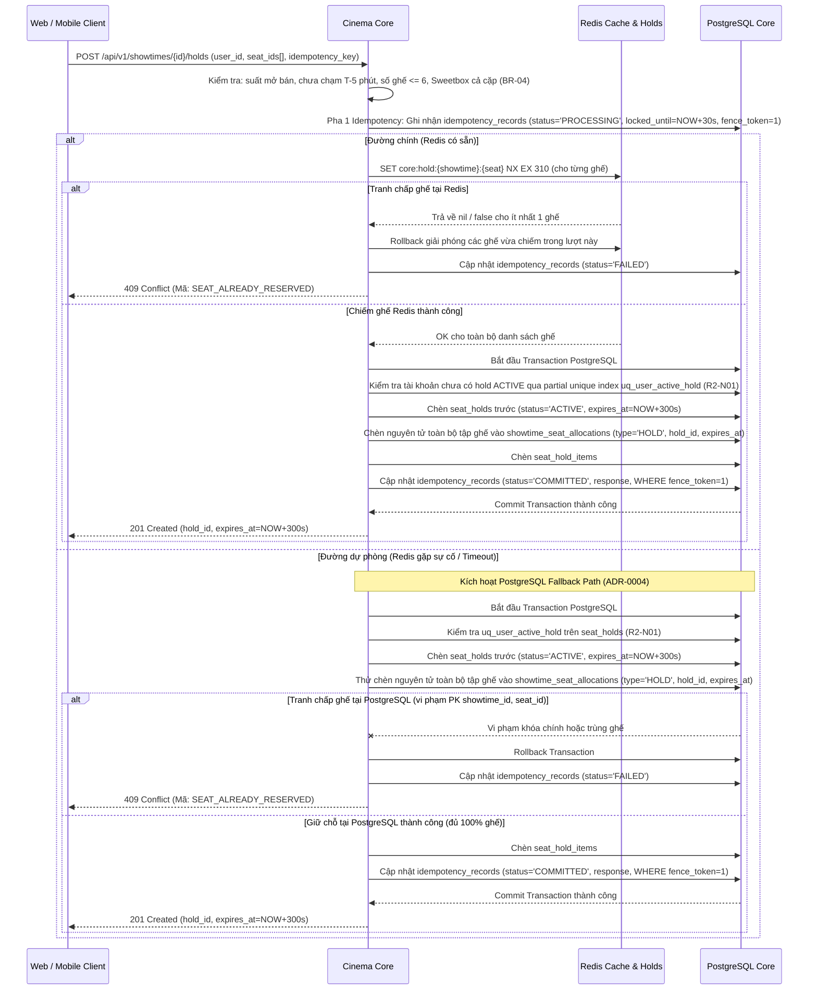
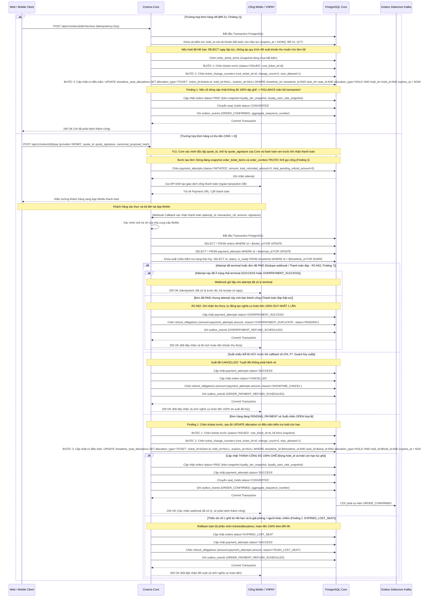
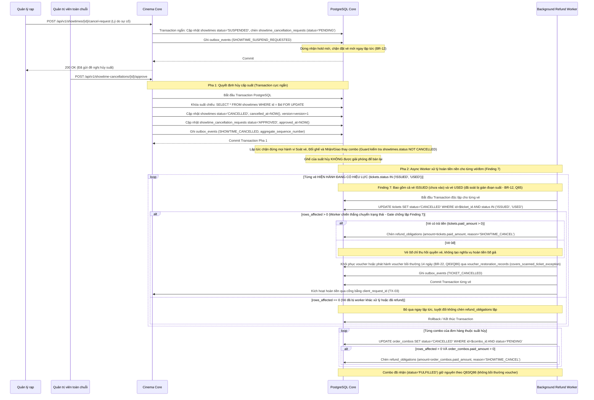
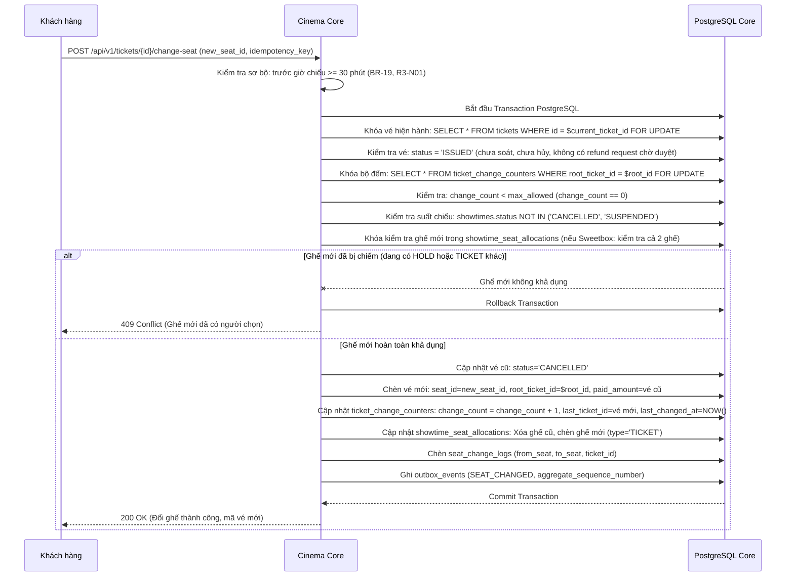
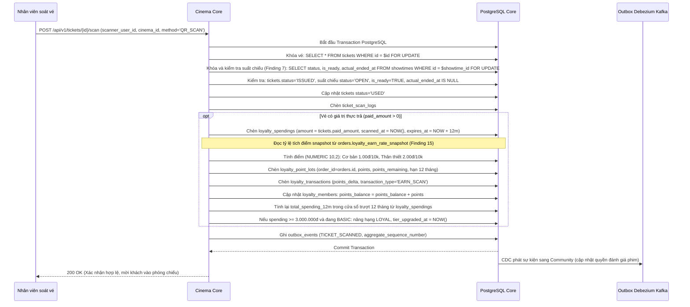
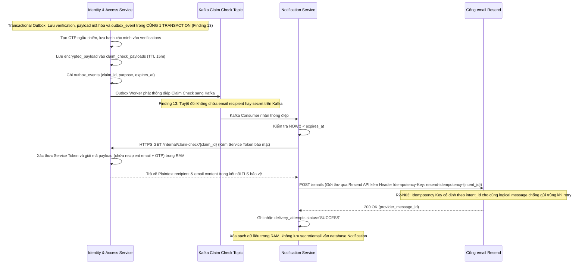

# Sequence giao dịch và ma trận phục hồi — Movie Booking Platform

Tài liệu này đặc tả chi tiết bảy luồng giao dịch trọng yếu (TX-01 đến TX-07) của nền tảng Movie Booking Platform và ma trận xử lý sự cố, điểm phục hồi bền vững và hàng rào an toàn cho từng điểm thất bại (Failure Points).

Mọi tên bảng, trạng thái và trường dữ liệu trong các sơ đồ Mermaid dưới đây hoàn toàn đồng nhất với Từ điển dữ liệu của bảy database logic đã được định nghĩa tại `docs/05-specs/005-data-design/databases/`.

---

## 1. Bảy luồng giao dịch trọng yếu

### TX-01: Giữ ghế nhanh và Chống tranh chấp (Seat Hold & Concurrency Control)

Luồng giao dịch giữ ghế cho tối đa 6 ghế trong vòng 300 giây theo quy tắc BR-04. Luồng phối hợp giữa Redis và PostgreSQL, có cơ chế tự động chuyển sang đường dự phòng PostgreSQL khi Redis gặp sự cố (ADR-0004).

- **Điểm bắt đầu transaction:** Sau khi kiểm tra nghiệp vụ và xác nhận toàn bộ danh sách ghế khả dụng.
- **Điểm commit:** Sau khi chèn thành công cả `seat_holds`, `showtime_seat_allocations` và `seat_hold_items`. Khóa chính kết hợp `(showtime_id, seat_id)` trên `showtime_seat_allocations` đảm bảo độc quyền ghế tuyệt đối tại tầng vật lý.
- **Xử lý timeout / Mất kết nối mạng:** Client gửi lại yêu cầu kèm cùng mã `Idempotency-Key`. Core tra cứu bảng `idempotency_records` và trả về ngay kết quả hold đã tạo trước đó mà không trừ thêm lượt hay tạo hold mới.

---

### TX-02: Thanh toán, Phát hành vé và Xử lý Callback lặp (Payment & Ticket Issuance)

Luồng xác nhận thanh toán qua cổng ngoài (MoMo/VNPAY) và phát hành vé theo quy tắc BR-06 và ADR-0027. Đơn hàng 0đ (do voucher giảm 100%) được xử lý nội bộ, không gọi cổng thanh toán (BR-21). Chi tiết dòng mua vé (`order_ticket_items`) được lưu bất biến ngay tại bước tạo đơn hàng trước khi chuyển hướng sang cổng thanh toán (Finding 3).

- **Xử lý Webhook gửi lặp (Idempotent Webhook):** Cổng gửi lại webhook nhiều lần cho cùng một giao dịch. Core kiểm tra `payment_attempts.status IN ('SUCCESS', 'OVERPAYMENT_SUCCESS')`, lập tức trả về HTTP 200 OK cho cổng mà không tạo thêm vé hay chạy lại transaction phát hành vé hay tạo nghĩa vụ hoàn tiền lặp (R2-N02).

---

### TX-03: Hủy vé tự nguyện, Duyệt hủy và Hoàn tiền (Voluntary Refund & Settlement)

Khách hàng gửi yêu cầu hủy vé ít nhất 12 tiếng trước giờ chiếu theo BR-10. Quản lý rạp xét duyệt trong vòng 4 tiếng liên tục theo BR-11, BR-25. Nếu gửi đúng hạn trước mốc T-12h, việc rạp duyệt sau mốc T-12h vẫn bảo lưu quyền hoàn tiền hợp lệ theo BR-25/Q74 (R3-N01).

```mermaid
sequenceDiagram
    participant Customer as Khách hàng
    participant Manager as Quản lý rạp
    participant Core as Cinema Core
    participant DB as PostgreSQL Core
    participant Pay as Cổng thanh toán
    participant Kafka as Outbox Debezium Kafka

    Customer->>Core: POST /api/v1/tickets/{id}/refund-request (Lý do hủy)
    Core->>Core: Kiểm tra điều kiện: vé ISSUED, thời điểm gửi requested_at <= start_time - 12 hours (BR-10, R3-N01)
    Core->>DB: Chèn ticket_refund_requests (status='PENDING', requested_at=NOW())
    Core-->>Customer: 202 Accepted (Hồ sơ hủy đã được tiếp nhận)

    Note over Manager,Core: Quản lý rạp thẩm định hồ sơ trong tối đa 4 tiếng

    Manager->>Core: POST /api/v1/refund-requests/{id}/approve
    Core->>DB: Bắt đầu Transaction PostgreSQL
    Core->>DB: SELECT * FROM tickets WHERE id = $id FOR UPDATE
    Core->>DB: Kiểm tra: tickets.status = 'ISSUED' (chưa từng soát vé), hồ sơ gửi đúng hạn T-12h bảo lưu quyền (BR-25)
    Core->>DB: Cập nhật tickets status='REFUNDED'
    Core->>DB: Xóa bản ghi showtime_seat_allocations (Giải phóng ghế bán lại ngay - Q51)
    Core->>DB: Cập nhật ticket_refund_requests status='APPROVED', processed_at=NOW()

    alt Vé có thu tiền thực tế (tickets.paid_amount > 0)
        Core->>DB: Chèn refund_obligations (amount = tickets.paid_amount, reason='VOLUNTARY_CANCEL', refund_request_id, payment_attempt_id)
    else Vé 0đ (Áp dụng voucher 100%)
        Note over Core,DB: Finding 8: Tuyệt đối không tạo refund_obligations cho vé 0đ (BR-27)
    end

    Note over Core,DB: Finding 16: Khôi phục voucher khi TẤT CẢ mục ưu đãi trong đơn đều hủy và chưa soát
    Core->>DB: Kiểm tra order_voucher_usages, nếu đủ điều kiện -> cập nhật vouchers.is_used = FALSE
    Core->>DB: Ghi hồ sơ vào voucher_restoration_records (UNIQUE order_voucher_usage_id chống cấp bù lặp)
    Core->>DB: Ghi outbox_events (TICKET_REFUNDED, aggregate_sequence_number)
    DB-->>Core: Commit Transaction
    DB->>Kafka: CDC phát sự kiện sang Reporting (giảm bán ròng tại ngày duyệt) và Notification

    Note over Core,Pay: Worker gửi lệnh hoàn tiền trong tối đa 15 phút (BR-27, Finding 5)

    alt Nhánh 1: Claim nghĩa vụ mới (status = 'PENDING')
        Core->>DB: Bắt đầu Transaction Claim & Reserve (Finding 5)
        Core->>DB: Claim nghĩa vụ PENDING: SELECT * FROM refund_obligations WHERE status='PENDING' ORDER BY created_at FOR UPDATE SKIP LOCKED LIMIT 1
        Core->>DB: Khóa khoản thu gốc: SELECT * FROM payment_attempts WHERE id = $payment_attempt_id FOR UPDATE
        Core->>DB: Kiểm tra trần hoàn tiền: total_refunded + total_pending + amount <= payment_attempts.amount
        Core->>DB: Cập nhật payment_attempts: total_pending_refund_amount += amount
        Core->>DB: Sinh client_request_id duy nhất
        Core->>DB: Chèn refund_attempts (id, refund_obligation_id, client_request_id, provider, status='PENDING', amount)
        Core->>DB: Cập nhật refund_obligations status='PROCESSING', current_attempt_id=attempt.id, locked_until=NOW() + INTERVAL '2 minutes'
        Core->>DB: Commit Transaction Claim & Reserve TRƯỚC KHI gọi HTTP sang cổng
        Core->>Pay: POST /v1/refunds (kèm client_request_id)
        alt Cổng thanh toán phản hồi thành công ngay
            Pay-->>Core: 200 OK (provider_refund_id = "ref_momo_123")
            Core->>DB: CAS Transaction: UPDATE refund_attempts SET status='SUCCESS', settled_at=NOW(), provider_refund_id WHERE id=:attempt_id AND status IN ('PENDING', 'PENDING_RECONCILE')
            alt rows_affected == 1 (Worker này thắng duy nhất)
                Core->>DB: Cập nhật payment_attempts: total_pending -= amount, total_refunded += amount
                Core->>DB: Cập nhật refund_obligations status='SETTLED', settled_at=NOW(), locked_until=NULL
                Core->>DB: Ghi outbox_events: REFUND_SETTLED (Commit transaction)
            else rows_affected == 0
                Core->>DB: Đọc trạng thái thực tế: SELECT status, provider_refund_id FROM refund_attempts WHERE id=:id
                Note over Core,DB: Trả receipt tương ứng trạng thái thực, DỪNG LẠI NGAY, không trừ tiền hay ghi outbox!
            end
        else Cổng thanh toán timeout / Lỗi mạng không xác định
            Pay--xCore: HTTP Timeout / Network Error
            Core->>DB: CAS cách ly: UPDATE refund_attempts SET status='PENDING_RECONCILE' WHERE id=:id AND status='PENDING'
            Note over Core,DB: Giữ nguyên total_pending_refund_amount, worker tiếp quản sẽ đối soát bằng client_request_id cũ
        end
    else Nhánh 2: Tiếp quản nghĩa vụ PROCESSING quá hạn lease (Worker Recovery - Finding 5)
        Core->>DB: Bắt đầu Transaction Tiếp Quản
        Core->>DB: SELECT * FROM refund_obligations WHERE status='PROCESSING' AND locked_until < NOW() ORDER BY created_at FOR UPDATE SKIP LOCKED LIMIT 1
        Note over Core,DB: F5: TUYỆT ĐỐI KHÔNG reserve tiền lại (đã reserve) và KHÔNG sinh client_request_id mới!
        Core->>DB: Cập nhật gia hạn lease: locked_until = NOW() + INTERVAL '2 minutes'
        Core->>DB: Đọc bản ghi refund_attempts cũ theo current_attempt_id để lấy client_request_id đã gửi cổng
        Core->>DB: Commit gia hạn lease
        Core->>Pay: GET /v1/refunds/{client_request_id} (Truy vấn đối soát trạng thái giao dịch cổng)
        alt Cổng thanh toán xác nhận đã hoàn tiền THÀNH CÔNG
            Pay-->>Core: 200 OK (status='SUCCESS', provider_refund_id)
            Core->>DB: CAS Transaction: UPDATE refund_attempts SET status='SUCCESS', settled_at=NOW(), provider_refund_id WHERE id=:attempt_id AND status IN ('PENDING', 'PENDING_RECONCILE')
            alt rows_affected == 1 (Worker này thắng duy nhất)
                Core->>DB: Cập nhật payment_attempts: total_pending -= amount, total_refunded += amount
                Core->>DB: Cập nhật refund_obligations status='SETTLED', settled_at=NOW(), locked_until=NULL
                Core->>DB: Ghi outbox_events: REFUND_SETTLED (Commit transaction)
            else rows_affected == 0
                Core->>DB: Đọc lại trạng thái thực tế: SELECT status, provider_refund_id FROM refund_attempts WHERE id=:id
                Note over Core,DB: Trả receipt tương ứng trạng thái thực tế, dừng lại ngay, không ghi đúp số dư!
            end
        else Cổng thanh toán báo giao dịch THẤT BẠI DỨT KHOÁT (Confirmed Failure)
            Pay-->>Core: 400 Bad Request / 422 Unprocessable (Lỗi từ chối hoàn tiền vĩnh viễn)
            alt Hết lượt thử lại hoặc lỗi vĩnh viễn (non-retryable)
                Core->>DB: CAS Transaction: UPDATE refund_attempts SET status='FAILED', settled_at=NOW() WHERE id=:attempt_id AND status IN ('PENDING', 'PENDING_RECONCILE')
                alt rows_affected == 1 (Thắng CAS duy nhất)
                    Core->>DB: Giải phóng reserve: Cập nhật payment_attempts total_pending -= amount
                    Core->>DB: Cập nhật refund_obligations status='MANUAL_HOLD', locked_until=NULL (Chuyển nhân viên đối soát thủ công)
                    Core->>DB: Ghi outbox_events: REFUND_FAILED_MANUAL_HOLD (Commit transaction)
                else rows_affected == 0 (Thua CAS)
                    Core->>DB: Đọc lại trạng thái thực tế từ DB
                    Note over Core,DB: Dừng lại ngay, KHÔNG trừ pending và KHÔNG đổi status nghĩa vụ đã SETTLED!
                end
            else Còn lượt thử lại (cổng xác nhận thất bại dứt khoát)
                Core->>DB: CAS: Chốt attempt cũ FAILED: UPDATE refund_attempts SET status='FAILED', settled_at=NOW() WHERE id=:attempt_id AND status IN ('PENDING', 'PENDING_RECONCILE')
                alt rows_affected == 1 (Thắng CAS duy nhất)
                    Note over Core,DB: F5 Invariant: Tiền reserve trong total_pending GIỮ NGUYÊN (single reserve), không cộng dồn!
                    Core->>DB: Sinh attempt tiếp theo tuần tự: INSERT INTO refund_attempts (id, refund_obligation_id, client_request_id, provider, amount, status='PENDING')
                    Core->>DB: Cập nhật refund_obligations: current_attempt_id=new_id, status='PROCESSING', locked_until=NOW()+5m (Commit)
                    Core->>Pay: POST /v1/refunds (Gửi lệnh hoàn với new_client_request_id mới tuần tự)
                else rows_affected == 0 (Thua CAS)
                    Core->>DB: Đọc lại trạng thái thực tế từ DB
                    Note over Core,DB: Dừng lại ngay, tuyệt đối KHÔNG sinh attempt mới và KHÔNG gọi cổng!
                end
            end
        else Cổng thanh toán báo KHÔNG TỒN TẠI (NOT_FOUND) hoặc CHƯA RÕ CĂN CỨ
            Pay-->>Core: 404 Not Found / Lỗi mạng không xác định
            Note over Core,DB: F5 Invariant: Tuyệt đối KHÔNG coi NOT_FOUND là thất bại dứt khoát!
            Core->>DB: Transaction FOR UPDATE kiểm tra trạng thái: SELECT status, current_attempt_id FROM refund_obligations WHERE id=:obligation_id FOR UPDATE
            alt Nghĩa vụ hoặc attempt đã terminal (SUCCESS/SETTLED do webhook chốt trước)
                Core->>DB: Đọc và trả receipt thực tế, DỪNG LẠI NGAY, tuyệt đối KHÔNG ghi đè MANUAL_HOLD!
            else Nghĩa vụ vẫn PROCESSING và attempt hiện hành chưa quyết toán
                Core->>DB: Bảo lưu reserve: Giữ nguyên total_pending_refund_amount
                Core->>DB: Giữ refund_attempts status='PENDING_RECONCILE'
                Core->>DB: Cập nhật refund_obligations status='MANUAL_HOLD', locked_until=NULL (Chờ đối soát có biên bản)
            end
        else Cổng thanh toán tiếp tục TIMEOUT hoặc MẠNG GIÁN ĐOẠN
            Pay-->>Core: Timeout / 504 Gateway Timeout
            Core->>DB: CAS Transaction: UPDATE refund_attempts SET status='PENDING_RECONCILE' WHERE id=:attempt_id AND status='PENDING'
            alt rows_affected == 1 (Thắng CAS duy nhất)
                Core->>DB: UPDATE refund_obligations SET status='FAILED_RETRYABLE', locked_until=NULL WHERE id=:obligation_id
                Note over Core,DB: F5 Invariant: Tiền reserve GIỮ NGUYÊN trong total_pending, KHÔNG đưa nghĩa vụ về PENDING!
            else rows_affected == 0 (Thua CAS)
                Core->>DB: Đọc lại trạng thái thực tế từ DB
                Note over Core,DB: Dừng lại ngay, webhook hoặc tiến trình khác đã xử lý, KHÔNG ghi đè obligation!
            end
        end
    else Nhánh 3: Thử lại nghĩa vụ FAILED_RETRYABLE (Single Reserve Sequential Retry - Finding 5)
        Core->>DB: Bắt đầu Transaction Claim Thử Lại
        Core->>DB: SELECT * FROM refund_obligations WHERE status='FAILED_RETRYABLE' AND locked_until IS NULL ORDER BY created_at FOR UPDATE SKIP LOCKED LIMIT 1
        Core->>DB: Khóa attempt hiện hành: SELECT status, client_request_id FROM refund_attempts WHERE id = ro.current_attempt_id FOR UPDATE
        alt Trường hợp A: attempt hiện hành ĐÃ ở trạng thái FAILED (đã chốt dứt khoát trước đó)
            alt Còn lượt thử lại (số attempt < 5)
                Core->>DB: Sinh new_attempt_id và new_client_request_id mới tuần tự
                Core->>DB: Chèn refund_attempts (id=new_attempt_id, status='PENDING', amount=ro.obligation_amount)
                Core->>DB: CAS chuyển attempt: UPDATE refund_obligations SET current_attempt_id=new_attempt_id, status='PROCESSING', locked_until=NOW()+INTERVAL '2 minutes' WHERE id=:obligation_id AND current_attempt_id=:old_attempt_id
                alt rows_affected == 1 (Thắng CAS duy nhất)
                    Core->>DB: Commit transaction chuyển attempt (Reserve tiền bảo lưu nguyên vẹn)
                    Core->>Pay: POST /v1/refunds (Gửi lệnh hoàn với new_client_request_id mới)
                else rows_affected == 0 (Thua CAS)
                    Core->>DB: Rollback / Đọc lại trạng thái, DỪNG LẠI NGAY!
                end
            else Hết lượt thử lại (>= 5 lần)
                Core->>DB: Giải phóng reserve: Cập nhật payment_attempts total_pending -= amount
                Core->>DB: Cập nhật refund_obligations status='MANUAL_HOLD', locked_until=NULL
                Core->>DB: Ghi outbox_events: REFUND_FAILED_MANUAL_HOLD (Commit transaction)
            end
        else Trường hợp B: attempt hiện hành vẫn PENDING / PENDING_RECONCILE (kết quả chưa rõ - Finding 5)
            Core->>DB: Cập nhật status='PROCESSING', locked_until = NOW() + INTERVAL '2 minutes' (Gia hạn lease đối soát)
            Core->>DB: Commit transaction gia hạn lease trước khi gọi HTTP (giải phóng khóa hàng & connection pool)
            Core->>Pay: GET /v1/refunds/{client_request_id} (Truy vấn cổng đối soát attempt hiện hành)
            Core->>DB: Mở Transaction mới: SELECT status, current_attempt_id FROM refund_obligations WHERE id = :id FOR UPDATE
            alt Cổng xác nhận SUCCESS
                Core->>DB: CAS chốt SUCCESS attempt cũ, SETTLED nghĩa vụ, trừ pending cộng refunded
                Core->>DB: Ghi outbox_events: REFUND_SETTLED (Commit transaction)
            else Cổng xác nhận FAILED dứt khoát
                Core->>DB: CAS chốt attempt cũ FAILED, nếu thắng -> chuyển tuần tự sang attempt mới như Trường hợp A
            else Cổng báo NOT_FOUND hoặc chưa rõ căn cứ
                Core->>DB: Kiểm tra gate terminal: Nếu đã SETTLED thì dừng, nếu chưa -> chuyển MANUAL_HOLD (Commit)
            else Cổng timeout hoặc mạng gián đoạn
                Core->>DB: CAS attempt PENDING_RECONCILE, obligation FAILED_RETRYABLE (Commit)
            end
        end
    end
```

- **Hàng rào an toàn:** Không hoàn tiền vượt quá số tiền thực trả ban đầu (`paid_amount`). Ghế được giải phóng bán lại ngay khi quản lý duyệt, không phụ thuộc vào tiến độ chuyển tiền của ngân hàng (Q51).
- **Quy tắc khôi phục voucher (Finding 16):** Chỉ khôi phục khi tất cả các ghế/combo được áp dụng voucher trong đơn đều bị hủy chưa sử dụng. Chống cấp bù lặp qua `voucher_restoration_records`.

---

### TX-04: Đề nghị và Duyệt Hủy toàn bộ Suất chiếu (Showtime Cancellation)

Áp dụng khi rạp gặp sự cố bất khả kháng không thể tổ chức chiếu hoặc phim bị gián đoạn giữa chừng theo BR-12, R-05, R-06. Luồng tách biệt thành 2 pha để không tạo lock diện rộng kéo dài:

- **Hàng rào hủy cấp suất tức thời đối với Combo (Finding 17):** Ngay khi suất chiếu chuyển `CANCELLED`, mọi hành vi giao nhận combo tại quầy — bao gồm cả nhận combo thông thường và giao thay/bù do thiếu hàng (`REPLACED_EQUAL`, `REPLACED_DOWNGRADE`, `REPLACED_UPGRADE`, `COMBO_ADJUST`) — đều bị chặn đứng ngay lập tức qua guard kiểm tra `showtimes.status != 'CANCELLED'` và dòng combo gốc `order_combos.status != 'CANCELLED'` trong cùng transaction trước khi ghi nhận xuất kho. Nếu suất đã hủy, giao dịch giao thay/bù bị ROLLBACK ngay lập tức và từ chối xuất hàng; các dòng combo chưa nhận chuyển sang trạng thái `CANCELLED` và tự động sinh nghĩa vụ hoàn tiền theo TX-04 (BR-24, decisions004:551–561).
- **Bền bỉ:** Tiến độ hoàn tiền từng vé được ghi nhận bền vững trong PostgreSQL. Nếu worker bị restart giữa chừng, worker mới tiếp tục quét các vé chưa sinh nghĩa vụ hoàn tiền để xử lý tiếp mà không bị trùng lặp. Vé lịch sử đã bị đổi sang vé khác hoặc đã hoàn trước đó bị loại trừ 100%, bảo đảm không bao giờ hoàn tiền hai lần. Bao phủ đầy đủ cả khách đã vào rạp khi suất bị hủy giữa chừng theo BR-12 và Q65.

---

### TX-05: Đổi vị trí ghế trong cùng Suất chiếu (Seat Change)

Khách hàng đổi ghế cùng loại, cùng suất chiếu trước giờ chiếu tối thiểu 30 phút theo BR-19 và Q34–Q44 (R3-N01). Luồng áp dụng cơ chế khóa vé hiện hành và bộ đếm đổi vé để chống chạy đua đổi vé đồng thời (Finding 2).

- **Bảo toàn số lượt:** Thất bại do tranh chấp ghế giữ nguyên vé cũ và không làm mất lượt đổi của khách hàng. Khóa vé hiện hành kết hợp khóa `ticket_change_counters` loại bỏ hoàn toàn khả năng hồi sinh quyền vé đã hủy hoặc 2 yêu cầu đồng thời cùng đổi thành công cho cùng một vé gốc (BR-19, Finding 2).

---

### TX-06: Soát vé tại cửa và Đổi điểm lấy Voucher (Ticket Scan & Loyalty)

Soát vé tích lũy điểm và xét hạng nguyên tử trong cùng một transaction theo BR-08, BR-14, BR-28. Điểm số được lưu trữ và tính toán chính xác với scale 2 chữ số thập phân `NUMERIC(10,2)` (Finding 15). Khóa suất chiếu dưới cùng transaction để loại trừ hoàn toàn race condition với thao tác hủy suất chiếu (Finding 7). Khi đổi điểm, hệ thống trừ theo nguyên tắc **FEFO (First Expiring, First Out)** ưu tiên các lô điểm có `expires_at` sớm nhất (Q112), kiểm tra đủ 100 điểm dưới khóa bi quan và sinh voucher có thời hạn **90 ngày** chuẩn xác theo Q99.

---

### TX-07: Chuyển phát Email Bảo mật qua Claim Check Pattern (Transactional Outbox)

Bảo vệ mã OTP và token không bao giờ xuất hiện dưới dạng văn bản thô (Plaintext) hoặc lộ địa chỉ email trong các hệ thống truyền thông trung gian (ADR-0018, Kiến trúc mục 4, Finding 13).

---

## 2. Ma trận phục hồi sự cố (Failure Points & Recovery Matrix)

Bảng dưới đây định nghĩa chi tiết trạng thái dữ liệu bền vững, ranh giới giao dịch và quy trình phục hồi tại từng điểm thất bại trong hệ thống:

| Mã lỗi | Điểm thất bại (Failure Point) | Trạng thái bền vững tại PostgreSQL | Rủi ro tiềm ẩn | Cơ chế phục hồi và Hàng rào an toàn |
|---|---|---|---|---|
| **FP-01** | Client gửi yêu cầu tạo hold nhưng kết nối mạng bị ngắt trước khi nhận phản hồi | `seat_holds`, `showtime_seat_allocations` và `seat_hold_items` đã commit `ACTIVE` | Khách tưởng thất bại nhưng ghế đã bị giữ, không chọn lại được | Client gửi lại yêu cầu kèm cùng mã `Idempotency-Key`. Core tra cứu `idempotency_records` trả về đúng thông tin `hold_id` cũ. Hết hạn 300s tự giải phóng nếu khách không thanh toán. |
| **FP-02** | Khách thanh toán MoMo thành công nhưng webhook bị timeout mạng không đến được Core | `payment_attempts` vẫn ở trạng thái `INITIATED`, `orders` vẫn `PENDING_PAYMENT` | Đơn hàng chưa phát hành vé mặc dù tiền của khách đã bị trừ tại MoMo | Client mở màn hình đơn hàng kích hoạt lệnh đối soát chủ động: Core gọi API truy vấn giao dịch MoMo (`GET /query-transaction`), nhận kết quả thành công và phát hành vé bình thường. |
| **FP-03** | Webhook MoMo xác nhận thành công nhưng gửi đến muộn sau khi hold ghế đã hết hạn và ghế bị bán mất | `seat_holds` đã `EXPIRED`, ghế đã có vé `ISSUED` của người khác | Không thể phát hành vé đúng vị trí cho khách | Core kích hoạt **BR-06**: cập nhật `orders.status = 'EXPIRED_LOST_SEAT'`, `payment_attempts.status = 'SUCCESS'`, sinh ngay `refund_obligations` với lý do `RUSH_LOST_SEAT` hoàn tiền 100% cho khách, gửi email giải thích. Tuyệt đối không tự ý đổi ghế. |
| **FP-04** | Quản trị viên duyệt hủy vé nhưng tiến trình máy chủ Core bị crash ngay sau lệnh commit | `tickets.status = 'REFUNDED'`, `refund_obligations.status = 'PENDING'` | Ghế đã giải phóng bán lại nhưng lệnh gọi cổng hoàn tiền chưa được gửi đi | Khi Core khởi động lại, worker định kỳ quét các bản ghi `refund_obligations` có `status = 'PENDING'` bằng `SELECT ... FOR UPDATE SKIP LOCKED` và tiếp tục gửi lệnh hoàn tiền sang cổng trong hạn 15 phút (BR-27). |
| **FP-05** | API cổng hoàn tiền MoMo/VNPAY bị timeout mạng khi Core gửi lệnh hoàn | `refund_obligations.status = 'PROCESSING'`, `refund_attempts.status = 'PENDING_RECONCILE'` | Chưa rõ tiền đã về ví khách hay chưa, nếu gửi lại có thể bị hoàn 2 lần | Core chuyển sang trạng thái chờ đối soát `PENDING_RECONCILE`, giữ nguyên `total_pending_refund_amount`. Worker đối soát gọi API kiểm tra trạng thái hoàn tiền của đối tác bằng `client_request_id` (Finding 5). Nếu cổng không hỗ trợ query theo `client_request_id`, chuyển sang `MANUAL_HOLD`. Tuyệt đối không sinh mã hoàn mới để thử lại mù quáng. |
| **FP-06** | Quản lý gửi đề nghị hủy suất chiếu nhưng dịch vụ thông báo (Notification) gặp sự cố | `showtimes.status = 'SUSPENDED'`, các giao dịch đặt mới bị chặn đứng tại Core | Khách hàng chưa nhận được email thông báo suất chiếu bị hủy | Giao dịch Core hoàn tất độc lập, phát sự kiện `SHOWTIME_SUSPEND_REQUESTED`. Khi Admin chính thức duyệt hủy suất chiếu, Core phát sự kiện `SHOWTIME_CANCELLED` vào `outbox_events`. Khi Notification phục hồi, Kafka CDC đẩy lại sự kiện để gửi email cho khách. Lỗi thông báo không làm nghẽn Core. |
| **FP-07** | Khách hàng đổi ghế thành công nhưng mạng bị ngắt, app không tải được vé mới | Vé cũ `CANCELLED`, vé mới `ISSUED`, `ticket_change_counters` ghi nhận `change_count = 1` | Khách không thấy mã vé mới, cố gắng bấm đổi ghế lại lần nữa | Client gửi lại yêu cầu cùng `Idempotency-Key`. Core tra cứu `idempotency_records` trả về mã vé mới đã sinh. Nếu khách bấm đổi lần 2 với ghế khác, Core khóa vé hiện hành và counter đọc thấy `change_count >= 1` và từ chối ngay (BR-19, Finding 2). |
| **FP-08** | Hai nhân viên soát vé quét vé cùng lúc tại hai cửa khác nhau | Vé đầu tiên thực thi commit `tickets.status = 'USED'`, ghi `ticket_scan_logs` | Người thứ hai vào rạp trái phép bằng ảnh chụp màn hình | Lệnh quét thứ hai bị chặn do `status = 'USED'`. Core từ chối cửa thứ hai, ghi log cảnh báo và thông báo vị trí cửa đã quét trước đó cho nhân viên (BR-08). |
| **FP-09** | Kafka Connect hoặc Debezium bị gián đoạn hoạt động trong 2 giờ | Toàn bộ sự kiện nghiệp vụ tích lũy an toàn trong bảng `outbox_events` của PostgreSQL Core | Reporting và Community bị chậm cập nhật số liệu trong 2 giờ | Core tiếp tục bán vé bình thường. Khi Debezium hoạt động trở lại, worker đọc tuần tự theo `aggregate_sequence_number` đẩy sang Kafka. Consumer kiểm tra sequence gap; nếu phát hiện gap sẽ tạm dừng partition để bù đắp, đảm bảo thứ tự tuyệt đối. |
| **FP-10** | Khôi phục thảm họa (Disaster Recovery): cơ sở dữ liệu Cinema Core được phục hồi từ bản sao lưu logic sạch (`pg_dump -Fc` / `pg_restore`) | Dữ liệu Cinema Core phục hồi về mốc sao lưu; 6 database logic của các service khác (Identity, Community, Catalog, Agent, Notification, Reporting) VẪN NGUYÊN VẸN | Giao dịch phát sinh sau mốc sao lưu cần đối soát; nguy cơ gọi cổng thanh toán phát lại hoặc gửi thông báo trùng | Áp dụng **Quy trình Phục hồi và Hàng rào An toàn Core (Core Recovery Fencing Protocol - Finding 25)** với mục tiêu RTO ≤ 60 phút và RPO ≤ 24 giờ cần đo khi diễn tập (NFR §9.7.1): (1) Khởi động Cinema Core sạch ở chế độ `FENCING_RECOVERY`; (2) Chặn phát lệnh gọi cổng thanh toán MoMo/VNPAY; (3) Tải settlement file từ cổng MoMo/VNPAY và nạp lại các biên lai soát vé trực tuyến có chữ ký (`core_scan_receipt`) từ máy soát vé để đối soát, bù đắp các giao dịch `PAID`, `REFUNDED` và cập nhật vé `USED` (tuân thủ BR-08 cấm soát offline); (4) KHÔNG reset mù cơ sở dữ liệu hay Kafka offset của 6 service còn lại: Core gửi thông điệp `CORE_RESTORED_RECONCILIATION_STARTED`, các service vệ tinh kích hoạt Reconciliation Inbox để hòa giải, sửa chữa và Rebuild Partition báo cáo trong cửa sổ sự cố ($T_{\text{backup}} \to T_{\text{disaster}}$); (5) Quản trị viên duyệt dỡ bỏ hàng rào (`LIFT_RECOVERY_FENCE`) chuyển Core sang hoạt động bình thường. |
