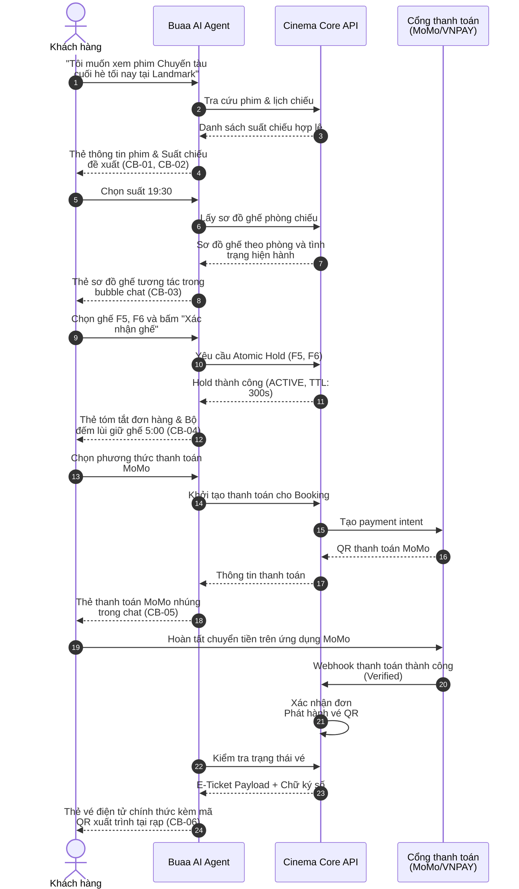

# Conversational Booking Specification (End-to-End Chat Booking)

**Phạm vi:** đặc tả kênh chat theo sản phẩm mục tiêu, đồng bộ theo Q173-A ngày 2026-11-17; không xác nhận code đã vận hành.
[Mô hình use case](../03-product/use-cases.md) sở hữu mục tiêu/BR/OPEN;
[mô tả use case](../03-product/use-case-descriptions.md) sở hữu điều kiện, kết quả và ngoại lệ.
CB-01–CB-06 là các bước hành trình, không phải mã use case thay thế B-01–B-09/C-01.

## 1. Mục đích và Phạm vi

Quy định luồng đặt vé toàn trình bằng ngôn ngữ tự nhiên (Conversational Booking) trong không gian làm việc của **AI Agent Workspace** (`apps/customer-web/chat`, `apps/customer-mobile/chat`).

Khách hàng có thể tìm phim, chọn suất chiếu, chọn ghế trên sơ đồ nhúng, thêm combo, áp dụng voucher,
thanh toán và nhận vé điện tử ngay trong hành trình chat. Thanh toán có thể cần mở ứng dụng cổng rồi quay lại;
không bắt khách khởi tạo lại đơn hoặc thời hạn giữ ghế khi chuyển kênh.

Phạm vi còn gồm tra cứu đơn/vé, bỏ hold chưa thanh toán, gửi yêu cầu hủy vé đã mua, theo dõi hoàn tiền và đổi ghế trong cùng suất (B-09).
Hội viên/đổi điểm, đánh giá/xét lại, quản trị/xóa tài khoản, xóa chat và gửi lại email dùng màn hình chuyên biệt; AI không được xét duyệt hủy,
soát vé, giao combo hoặc quản trị vận hành. Xem bảng phạm vi kênh AI trong mô hình, không suy chat có mọi quyền.

---

## 2. Ranh giới trách nhiệm

| Thành phần | Trách nhiệm |
| :--- | :--- |
| **Người dùng** | Nhập yêu cầu tự nhiên, lựa chọn phương án và xác nhận các hành động giao dịch tài chính (ghế, tiền, thanh toán). |
| **AI Agent (`services/agent-service`)** | Lưu giữ ngữ cảnh hội thoại, bóc tách thực thể (phim, rạp, ngày giờ), gọi công cụ của Cinema Core và trả về thẻ giao diện tương tác (Interactive UI Cards) trong chat. |
| **Cinema Core (`services/cinema-core`)** | Xác thực tồn kho ghế, tạo lệnh Hold có thời hạn (TTL), tạo booking, kiểm tra thanh toán và phát hành vé điện tử có chữ ký số. |
| **Dịch vụ mô hình AI ngoài (ACT-LLM)** | Agent Service gọi API để hiểu/trả lời; chỉ ngữ cảnh tối thiểu đã lọc theo BR-34, không gửi định danh/bí mật/QR hoặc toàn bộ hồ sơ/đơn. Mô hình không có thẩm quyền giao dịch. |
| **Cổng thanh toán** | Xử lý giao dịch MoMo/VNPAY và cung cấp kết quả để Cinema Core xác minh/đối soát. |

---

## 3. Hành trình tương tác từng bước (CB-01 → CB-06)

Sơ đồ minh họa luồng thành công; trên khung hẹp nên mở toàn màn hình hoặc cuộn ngang để giữ chữ đọc được.

### Chi tiết các bước tương tác:

- **CB-01 — Nhận diện nhu cầu**: Tiếp nhận câu lệnh tự nhiên của khách hàng (thể loại, thời gian, tên rạp, diễn viên). Trích xuất bộ lọc constraints và phản hồi xác nhận.
- **CB-02 — Lựa chọn phim & suất chiếu**: Hiển thị thẻ phim kèm các nút chọn giờ chiếu nhanh (chip buttons).
- **CB-03 — Chọn ghế tương tác (Embedded SeatMap)**: Hiển thị sơ đồ theo phòng (Standard, VIP, Sweetbox) từ Core ngay trong bong bóng chat; 64 ghế là mẫu cũ:
  - Ghế đang chọn: Highlight màu đỏ Rosso Corsa (`#DA291C`).
  - Ghế đã bán: Bị khóa (`disabled`), không thể click.
  - Hỗ trợ nút mở rộng "Xem toàn màn hình" khi người dùng cần không gian thao tác lớn hơn.
- **CB-04 — Tóm tắt đơn hàng & Kích hoạt Hold**: Hiển thị chi tiết vé, rạp, phòng chiếu, tổng tiền và bộ đếm ngược thời gian giữ chỗ (Hold Countdown TTL 5 phút).
- **CB-05 — Thanh toán bảo mật**: Hiển thị tùy chọn thanh toán và mã QR chuyển khoản MoMo/VNPAY.
- **CB-06 — Vé điện tử E-Ticket QR**: Chỉ hiển thị sau khi xác minh Core đã xác nhận đơn/phát hành, gồm nhánh 0đ hợp lệ không gọi cổng. QR/chữ ký theo hợp đồng Core; đợt này chưa chọn cách mã hóa/đổi QR cho đổi ghế.

Sơ đồ trên chỉ minh họa luồng thành công. Callback lặp, kết quả chưa rõ hoặc thu tiền sau khi ghế
được giải phóng phải theo B-06/R-03; AI không xác nhận từ redirect hay tự đổi ghế.
Email vé qua N-01 sau phát hành, lỗi không hủy vé; tự thử lại giới hạn/gửi lại theo quyền và trạng thái hiện hành. Nhà cung cấp/cấu hình vẫn OPEN-09.
Nhánh 0đ dùng khách xác nhận riêng → Core kiểm ưu đãi/hold/quyền ghế → xác nhận/phát hành, không gọi cổng thu 0đ.
Giữ hạn nhận hold T−5 phút, bắt đầu thanh toán trước T khi hold còn hạn; trước mua hiển thị rõ điều kiện tuổi/giờ/giấy tờ.
Mô hình lỗi/hết hạn mức: báo gián đoạn, hướng màn hình trực tiếp khi Core còn hoạt động, chưa tự đổi vendor; tra cứu giao dịch trước thử lại, không gia hạn hold.

## 4. Ánh xạ hành trình và hỗ trợ sau mua

| Tương tác trong chat | Use case mục tiêu | Ràng buộc |
|---|---|---|
| Khám phá và chọn phim/suất (CB-01–CB-02) | D-01 | Đọc thông tin công khai. |
| Chọn ghế, combo/voucher, lập đơn (CB-03–CB-04) | B-01–B-04 | Đăng nhập/email đã xác minh; chỉ bắt đầu hold sau xác nhận danh sách; Core quyết định giá/TTL. |
| Thanh toán và kết quả (CB-05–CB-06) | B-05–B-06 | Khách xác nhận; cổng/Core xác minh, xử lý lặp; client/AI kiểm tra phản hồi/chữ ký trước hiển thị vé. |
| Tra cứu lịch sử/chi tiết đơn và vé | B-07 | Chỉ đúng chủ/quyền truy cập; không dùng vé mẫu thay dữ liệu chưa rõ. |
| Bỏ hold chưa mua | B-08 | Xác nhận trạng thái Core, không hủy mù một khoản đã thu. |
| Đổi ghế cùng suất | B-09 | Giữ số lượng/loại/Sweetbox cả cặp; miễn phí, T−30 phút, một lần thành công/vé gốc; xác nhận cũ → mới, nguyên tử/giữ quyền cũ khi lỗi. |
| Gửi yêu cầu hủy một phần/toàn bộ | R-01 | Khách xác nhận ghế/cặp Sweetbox; tiếp nhận chưa phải duyệt hoặc hoàn tiền. |
| Theo dõi yêu cầu/quyết định và hoàn tiền | R-04 | Phân biệt đã duyệt, đang xử lý và đã hoàn; AI không hứa ngày tiền về. |

B-06 xử lý callback/đối soát do cổng cung cấp, không phải lệnh AI tự xác nhận thanh toán.
R-02/R-03/R-06 là thẩm quyền/quá trình vận hành theo quyền, không được suy từ khả năng theo dõi trong chat.
Các chính sách hủy/hoàn/ưu đãi/sự cố theo BR và Q32–Q172 hiện hành; OPEN giữ phần tích hợp chưa kiểm chứng.
Chat không tự xóa theo kỳ; khách chủ động xóa A-06 trên màn hình Customer, độc lập với đơn/vé tại Core.
