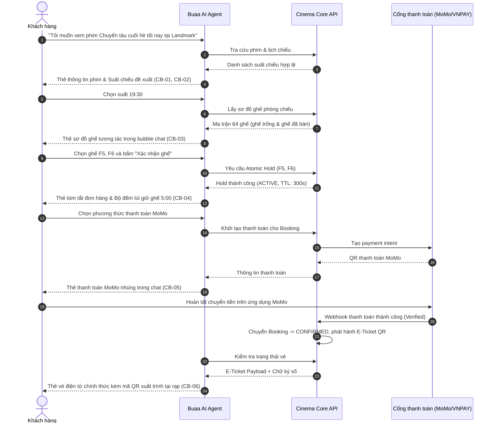

# Conversational Booking Specification (End-to-End Chat Booking)

## 1. Mục đích và Phạm vi

Quy định luồng đặt vé toàn trình bằng ngôn ngữ tự nhiên (Conversational Booking) trong không gian làm việc của **AI Agent Workspace** (`apps/web/chat`, `apps/mobile/chat`).

Khách hàng có thể tìm phim, chọn suất chiếu, chọn ghế trên sơ đồ nhúng, áp dụng ưu đãi, thanh toán và nhận vé điện tử (E-ticket QR) ngay trong cuộc trò chuyện mà không bị ép buộc rời khỏi khung chat.

---

## 2. Ranh giới trách nhiệm

| Thành phần | Trách nhiệm |
| :--- | :--- |
| **Người dùng** | Nhập yêu cầu tự nhiên, lựa chọn phương án và xác nhận các hành động giao dịch tài chính (ghế, tiền, thanh toán). |
| **AI Agent (`services/agent-service`)** | Lưu giữ ngữ cảnh hội thoại, bóc tách thực thể (phim, rạp, ngày giờ), gọi công cụ của Cinema Core và trả về thẻ giao diện tương tác (Interactive UI Cards) trong chat. |
| **Cinema Core (`services/cinema-core`)** | Xác thực tồn kho ghế, tạo lệnh Hold có thời hạn (TTL), tạo booking, kiểm tra thanh toán và phát hành vé điện tử có chữ ký số. |
| **Cổng thanh toán** | Xử lý giao dịch thanh toán (MoMo, VNPAY, Thẻ) và trả webhook xác nhận về Cinema Core. |

---

## 3. Hành trình tương tác từng bước (CB-01 → CB-06)

### Chi tiết các bước tương tác:

- **CB-01 — Nhận diện nhu cầu**: Tiếp nhận câu lệnh tự nhiên của khách hàng (thể loại, thời gian, tên rạp, diễn viên). Trích xuất bộ lọc constraints và phản hồi xác nhận.
- **CB-02 — Lựa chọn phim & suất chiếu**: Hiển thị thẻ phim kèm các nút chọn giờ chiếu nhanh (chip buttons).
- **CB-03 — Chọn ghế tương tác (Embedded SeatMap)**: Hiển thị trực quan ma trận ghế 64 vị trí (Standard, VIP, Sweetbox) ngay trong bong bóng chat:
  - Ghế đang chọn: Highlight màu đỏ Rosso Corsa (`#DA291C`).
  - Ghế đã bán: Bị khóa (`disabled`), không thể click.
  - Hỗ trợ nút mở rộng "Xem toàn màn hình" khi người dùng cần không gian thao tác lớn hơn.
- **CB-04 — Tóm tắt đơn hàng & Kích hoạt Hold**: Hiển thị chi tiết vé, rạp, phòng chiếu, tổng tiền và bộ đếm ngược thời gian giữ chỗ (Hold Countdown TTL 5 phút).
- **CB-05 — Thanh toán bảo mật**: Hiển thị tùy chọn thanh toán và mã QR chuyển khoản MoMo/VNPAY.
- **CB-06 — Vé điện tử E-Ticket QR**: Chỉ hiển thị sau khi Cinema Core xác thực thanh toán thành công. Mã QR chứa payload JSON có chữ ký bảo mật xác thực tại cổng vào rạp.
