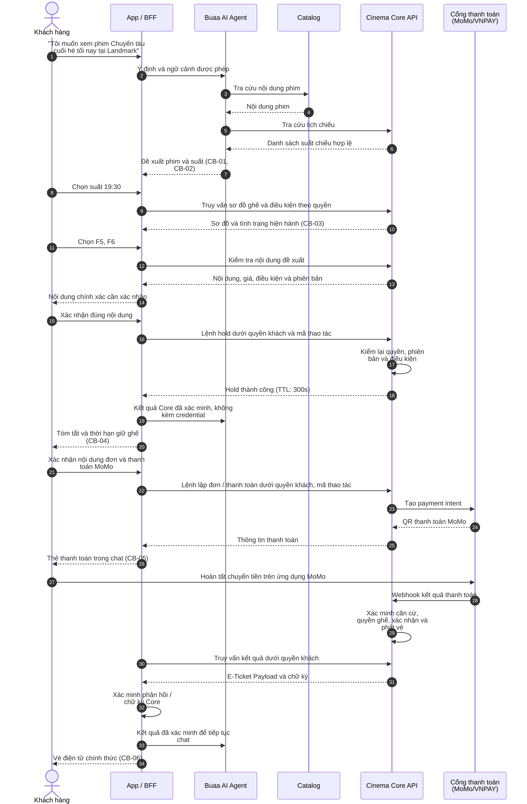

# Conversational Booking Specification (End-to-End Chat Booking)

**Phạm vi:** đặc tả kênh chat theo sản phẩm mục tiêu, đồng bộ ranh giới service và nghiệp vụ Q173 ngày 2026-11-17;
không xác nhận code đã vận hành. [Thiết kế microservices](004-service-decomposition/spec.md) sở hữu
ranh giới thực thi lệnh và [quyết định](004-service-decomposition/decisions.md) giữ nguồn chấp thuận.
[Mô hình use case](../03-product/use-cases.md) sở hữu mục tiêu/BR/OPEN;
[mô tả use case](../03-product/use-case-descriptions.md) sở hữu điều kiện, kết quả và ngoại lệ.
CB-01–CB-06 là các bước hành trình, không phải mã use case thay thế B-01–B-09/C-01.

**Lựa chọn kỹ thuật tiếp nối:** [Agent](../../services/agent-service/README.md) dùng Python/FastAPI/LangGraph,
SSE/sse-starlette và Cloudflare Free → Groq Free; [Core](../../services/cinema-core/README.md) sở hữu giao dịch
và module Search. Agent gọi API Search của Core theo [ADR-0035](../06-decisions/0035-search-module-in-cinema-core.md).
Thông tin/link thanh toán theo từng adapter tại [ADR-0027](../06-decisions/0027-direct-http-and-node-crypto-for-payment-gateways.md);
QR trong ví dụ không là cam kết mọi cổng/operation đều trả QR. Các lựa chọn này chưa xác nhận tích hợp runtime.

## 1. Mục đích và Phạm vi

Quy định luồng đặt vé toàn trình bằng ngôn ngữ tự nhiên (Conversational Booking) trong không gian làm việc của **AI Agent Workspace** (`apps/customer-web/chat`, `apps/customer-mobile/chat`).

Khách hàng có thể tìm phim, chọn suất chiếu, chọn ghế trên sơ đồ nhúng, thêm combo, áp dụng voucher,
thanh toán và nhận vé điện tử ngay trong hành trình chat. Thanh toán có thể cần mở ứng dụng cổng rồi quay lại;
không bắt khách khởi tạo lại đơn hoặc thời hạn giữ ghế khi chuyển kênh.

Phạm vi còn gồm tra cứu đơn/vé, bỏ hold chưa thanh toán, gửi yêu cầu hủy vé đã mua theo dõi hoàn tiền và đổi ghế trong cùng suất B-09.
Hội viên/đổi điểm, đánh giá/xét lại, tài khoản/xóa chat/xóa tài khoản và gửi lại email dùng màn hình chuyên biệt; AI không được xét duyệt hủy,
soát vé, giao combo hoặc quản trị vận hành. Xem bảng phạm vi kênh AI trong mô hình, không suy chat có mọi quyền.

---

## 2. Ranh giới trách nhiệm

| Thành phần | Trách nhiệm |
| :--- | :--- |
| **Người dùng** | Nhập yêu cầu tự nhiên, lựa chọn phương án và xác nhận các hành động giao dịch tài chính (ghế, tiền, thanh toán). |
| **App/BFF** | Hiển thị đề xuất, thu xác nhận đúng nội dung Core đã kiểm tra; gửi lệnh dưới danh tính khách với mã thao tác ổn định, xác minh phản hồi Core trước khi trình bày kết quả. |
| **AI Agent (`services/agent-service`)** | Lưu ngữ cảnh, bóc tách thực thể, truy vấn theo quyền và trả đề xuất có cấu trúc. Không giữ credential giao dịch rộng trong mô hình/checkpoint; app/BFF thực thi lệnh. |
| **Cinema Core (`services/cinema-core`)** | Xác thực tồn kho ghế, tạo lệnh Hold có thời hạn (TTL), tạo booking, kiểm tra thanh toán và phát hành vé điện tử có chữ ký số. |
| **Catalog** | Cung cấp nội dung phim; lịch/giá/ghế của suất và snapshot phục vụ giao dịch thuộc Core. |
| **Notification** | Nhận sự kiện sau commit để chuyển phát email vé; không quyết định vé đã phát hành hay thay Core xác minh giao dịch. |
| **Dịch vụ mô hình AI ngoài (ACT-LLM)** | Agent Service gọi API với ngữ cảnh tối thiểu đã lọc theo C-01/BR-34; không bí mật/QR/PII/toàn hồ sơ. Quan hệ Q153/ADR-0028 cần hòa giải OPEN-12 trước routing. |
| **Cổng thanh toán** | Xử lý giao dịch MoMo/VNPAY và cung cấp kết quả để Cinema Core xác minh/đối soát. |

---

## 3. Hành trình tương tác từng bước (CB-01 → CB-06)

Sơ đồ minh họa luồng thành công; trên khung hẹp nên mở toàn màn hình hoặc cuộn ngang để giữ chữ đọc được.

### Chi tiết các bước tương tác:

- **CB-01 — Nhận diện nhu cầu**: Tiếp nhận câu lệnh tự nhiên của khách hàng (thể loại, thời gian, tên rạp, diễn viên). Trích xuất bộ lọc constraints và phản hồi xác nhận.
- **CB-02 — Lựa chọn phim & suất chiếu**: Hiển thị thẻ phim kèm các nút chọn giờ chiếu nhanh (chip buttons).
- **CB-03 — Chọn ghế tương tác (Embedded SeatMap)**: Hiển thị sơ đồ theo phòng (Standard, VIP, Sweetbox) từ Core ngay trong bong bóng chat; 64 ghế là mẫu cũ:
  - Ghế đang chọn: Highlight màu đỏ Rosso Corsa (`#DA291C`).
  - Ghế đã bán: Bị khóa (`disabled`), không thể click.
  - Hỗ trợ nút mở rộng "Xem toàn màn hình" khi người dùng cần không gian thao tác lớn hơn.
- **CB-04 — Tóm tắt đơn hàng & Kích hoạt Hold**: Hiển thị chi tiết vé, rạp, phòng chiếu, tổng tiền và bộ đếm ngược thời gian giữ chỗ (Hold Countdown TTL 5 phút).
- **CB-05 — Thanh toán bảo mật**: Hiển thị tùy chọn và thông tin/link thanh toán do adapter MoMo/VNPAY cung cấp; chỉ hiện QR khi operation thực tế hỗ trợ.
- **CB-06 — Vé điện tử E-Ticket QR**: Chỉ hiển thị sau xác minh Core đã xác nhận/phát hành, gồm nhánh 0đ hợp lệ không gọi cổng. QR/chữ ký theo hợp đồng Core; đổi ghế chưa chọn cách mã hóa/đổi QR.

Sơ đồ trên chỉ minh họa luồng thành công. Callback lặp, kết quả chưa rõ hoặc thu tiền sau khi ghế
được giải phóng phải theo B-06/R-03; AI không xác nhận từ redirect hay tự đổi ghế.
Email vé được phối hợp gửi sau phát hành, lỗi email không hủy vé. Resend đã được chọn tại
[ADR-0018](../06-decisions/0018-resend-for-transactional-email.md); tham số/quy trình ngoại lệ gửi lại
còn theo OPEN-09. Notification sở hữu chuyển phát, bảo vệ mã theo thiết kế microservices; chưa xác nhận tích hợp runtime.

Các bước kiểm tra/xác nhận trên biểu diễn trách nhiệm, không quy định endpoint hoặc số HTTP request.
Xác nhận gắn đúng nội dung/phiên bản Core kiểm tra; thay đổi nội dung phải xác nhận lại.
Timeout lệnh phải tra cứu bằng mã thao tác cũ; chỉ một lời chat hoặc trạng thái checkpoint không là
bằng chứng đã giữ ghế/thu tiền/phát vé. Truy cập riêng tư của Agent vẫn cần hợp đồng quyền được đặc tả,
không suy lời gọi trong sơ đồ thành quyền đại diện khách không giới hạn.

## 4. Ánh xạ hành trình và hỗ trợ sau mua

| Tương tác trong chat | Use case mục tiêu | Ràng buộc |
|---|---|---|
| Khám phá và chọn phim/suất (CB-01–CB-02) | D-01 | Đọc thông tin công khai. |
| Chọn ghế, combo/voucher, lập đơn (CB-03–CB-04) | B-01–B-04 | Đăng nhập/email đã xác minh; chỉ bắt đầu hold sau xác nhận danh sách; Core quyết định giá/TTL. |
| Thanh toán và kết quả (CB-05–CB-06) | B-05–B-06 | Khách xác nhận; cổng/Core xác minh, xử lý lặp; client/AI kiểm tra phản hồi/chữ ký trước hiển thị vé. |
| Tra cứu lịch sử/chi tiết đơn và vé | B-07 | Chỉ đúng chủ/quyền truy cập; không dùng vé mẫu thay dữ liệu chưa rõ. |
| Bỏ hold chưa mua | B-08 | Xác nhận trạng thái Core, không hủy mù một khoản đã thu. |
| Đổi ghế cùng suất | B-09 | Miễn phí, T−30 phút, cùng số lượng/loại, Sweetbox cả cặp, một lần/vé gốc; xác nhận cũ → mới, nguyên tử và giữ vé cũ khi lỗi. |
| Gửi yêu cầu hủy một phần/toàn bộ | R-01 | Khách xác nhận ghế/cặp Sweetbox; tiếp nhận chưa phải duyệt hoặc hoàn tiền. |
| Theo dõi yêu cầu/quyết định và hoàn tiền | R-04 | Phân biệt đã duyệt, đang xử lý và đã hoàn; AI không hứa ngày tiền về. |

B-06 xử lý callback/đối soát do cổng cung cấp, không phải lệnh AI tự xác nhận thanh toán.
R-02/R-03/R-06 là thẩm quyền/quá trình vận hành theo quyền, không được suy từ khả năng theo dõi trong chat.
Các chính sách hủy, hoàn, phân bổ ưu đãi và sự cố vẫn tham chiếu OPEN hiện có.

## Quy tắc bổ sung theo Q173 và phụ thuộc

B-01/BR-18 dừng hold mới T−5 phút; B-05 chỉ khởi tạo trước T với hold còn hạn. Trước mua hiển thị
rõ tuổi/giờ/giấy tờ và người đặt xác nhận cả nhóm. BR-20 giữ phân bổ ưu đãi đến đồng lúc mua;
BR-21: đơn 0đ cần khách xác nhận và Core kiểm ưu đãi/hold/quyền ghế, không tạo giao dịch thu tiền giả.
N-01/BR-33: hộp thông báo và email, tự thử lại giới hạn/gửi lại kiểm quyền/chống spam/trạng thái hiện hành;
email lỗi không hủy vé. Q149 đã chọn chính sách, còn tham số và tích hợp Resend chưa kiểm chứng.
Chat không tự xóa theo kỳ; khách chủ động xóa A-06, độc lập đơn/vé/hoàn. Các hành vi nghiệp vụ
khác theo Q32–Q172, không lấy phần OPEN làm lý do hỏi lại lựa chọn đã chốt.

Q153 chọn gián đoạn thì hướng màn hình trực tiếp và chưa tự đổi provider; ADR-0028 chọn Groq Free
dự phòng inference cho Workers AI. OPEN-12 giữ quan hệ cần xác nhận trước khi triển khai tự fallback;
chưa chọn thay người dùng hoặc phát lại toàn graph/giao dịch. Cấu hình và kiểm chứng runtime vẫn còn mở.
