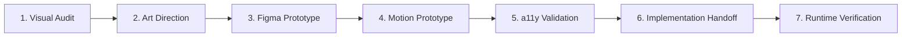

# Quy Trình Thiết Kế & Chuyển Giao Giao Diện (UI Design & Motion Handoff Workflow)

Tài liệu hướng dẫn quy trình tiêu chuẩn gồm 7 bước (7-Stage Workflow) dành cho Designer và AI Coding Agent khi thực hiện thiết kế, tạo mẫu chuyển động và triển khai giao diện người dùng trong hệ sinh thái **Movie Booking Platform**.

Quy trình này tuân thủ nguyên tắc quản trị tại [`.agents/rules/ui-skill-routing.md`](../../.agents/rules/ui-skill-routing.md), quy chuẩn chất lượng tại [`docs/04-standards/ui-quality.md`](../04-standards/ui-quality.md) và ngôn ngữ chuyển động tại [`docs/04-standards/motion-design.md`](../04-standards/motion-design.md).

---

## 1. Nguyên Tắc Quản Trị & Rào Cản (Governance Guardrails)

1. **Mặc định Figma-First (Figma-First Default):** Mọi thiết kế màn hình mới hoặc thiết kế lại (redesign) cho bốn ứng dụng Customer/Organizer × Web/Mobile đều phải được dựng và phê duyệt trên Figma trước khi chuyển giao thành mã nguồn.
2. **Không cộng dồn phong cách (No Style Stacking):** Tuyệt đối không kích hoạt đồng thời các skill mang tính định hình phong cách xung đột (ví dụ: `design-taste-frontend` và `emil-design-eng`). Phải phân định theo giai đoạn: giai đoạn bố cục dùng taste skill, giai đoạn công thái học chi tiết mới dùng interaction skill.
3. **Thẩm quyền Token tối thượng (Token Authority):** Không để gu cá nhân hoặc gợi ý của skill ghi đè bảng màu Ferrari Dark Cinema (`#000000`, `#181818`, `#303030`, `#DA291C`), hình học góc nhọn `0px radius` hoặc các chuẩn mực đã quy định tại [`DESIGN.md`](../../DESIGN.md).
4. **Không tự ý cài thêm thư viện (Zero Unapproved Dependencies):** Không tự cài đặt các gói animation (Framer Motion, Motion, GSAP, Lenis), icon pack mới hay CSS framework bên ngoài nếu chưa có phê duyệt chính thức trong Issue.
5. **Bằng chứng trước tuyên bố (Evidence Before Assertions):** Không bao giờ tuyên bố giao diện "hoàn hảo", "mượt mà" hoặc "đạt chuẩn responsive" chỉ bằng cách đọc code; bắt buộc phải có bằng chứng từ trình duyệt hoặc simulator thực tế.

---

## 2. Quy Trình 7 Bước Chi Tiết

---

### Bước 1 — Kiểm Toán Thị Giác (Visual Audit)
- **Mục tiêu:** Rà soát hiện trạng màn hình hoặc component cần thiết kế/nâng cấp.
- **Hành động:**
  - Đối chiếu màn hình với [PRODUCT.md](../../apps/customer-web/PRODUCT.md) của ứng dụng để nắm bắt đúng đối tượng người dùng và mục tiêu tác vụ.
  - Kiểm tra xem component đã có trong `@platform/ui` hoặc đã có mã nguồn tại `src/features/` hay chưa.
  - Lập danh sách các token màu, khoảng cách và kiểu chữ hiện hành đang được sử dụng.
- **Đầu ra:** Báo cáo kiểm toán ngắn gọn xác định các điểm thiếu hụt về mặt bố cục, phân cấp chữ hoặc công thái học.

---

### Bước 2 — Định Hướng Nghệ Thuật & Bố Cục (Art Direction & Composition)
- **Mục tiêu:** Xác định cấu trúc biên tập điện ảnh (Cinematic Editorial) và tỷ lệ không gian.
- **Hành động:**
  - Xác lập phân cấp chữ theo 8 tầng typography của hệ thống (từ Hero Headline lớn đến Body copy dễ đọc).
  - Phân định các khu vực tràn viền (full-bleed photography) và các khu vực nội dung được bọc trong khung biên tập (`--page-max-width: 1760px` hoặc `1440px`).
  - Thiết lập tỷ lệ âm tính (negative space), vị trí điểm nhấn thị giác (focal points) và tương phản sáng tối trên nền Carbone Nero `#000000`.
- **Đầu ra:** Khung wireframe hoặc layout draft xác định rõ tỷ lệ hình học góc nhọn 0px và mật độ thông tin phù hợp với loại màn hình (Expressive / Restrained / Minimal).

---

### Bước 3 — Tạo Mẫu Thiết Kế Figma (Figma Prototype — Figma-First)
- **Mục tiêu:** Hoàn thiện thiết kế chi tiết trên canvas Figma để người dùng và chủ sản phẩm xem xét, điều chỉnh trước khi viết code.
- **Hành động:**
  - Ánh xạ chính xác các node thiết kế với Design Tokens của hệ thống.
  - Thiết kế đầy đủ các trạng thái của màn hình:
    1. `Default` (Trạng thái chuẩn).
    2. `Hover` (Trỏ chuột trên Desktop).
    3. `Active / Pressed` (Nhấn nút, chạm màn hình).
    4. `Focus Visible` (Đường viền đỏ `#da291c` cho bàn phím).
    5. `Loading / Skeleton` (Đúng hình dạng khối layout).
    6. `Empty State` (Chỉ dẫn hành động kế tiếp khi không có dữ liệu).
    7. `Error State` (Thông báo lỗi và nút khắc phục).
- **Đầu ra:** Figma Node URL và frame hoàn chỉnh với đầy đủ các biến thể trạng thái.

---

### Bước 4 — Tạo Mẫu & Định Cấu Hình Chuyển Động (Motion Prototype)
- **Mục tiêu:** Lựa chọn và tinh chỉnh các chuyển động phù hợp với cấp độ cường độ của màn hình.
- **Hành động:**
  - Tra cứu bảng ma trận phân bổ màn hình tại mục 5 của [`docs/04-standards/motion-design.md`](../04-standards/motion-design.md).
  - Chọn lựa pattern phù hợp trong 10 Motion Patterns chuẩn:
    - Nếu là Hero trang chủ/phim: Áp dụng `Pattern 01 (Scroll-linked)`, `02 (Mask Reveal)` hoặc `06 (Kinetic Typography)`.
    - Nếu là Tương tác nút bấm/ghế: Áp dụng `Pattern 08 (Contextual Micro-interaction)`.
    - Nếu là Danh sách lọc: Áp dụng `Pattern 04 (Object Choreography)`.
  - Gán các token chuyển động dự kiến: `--motion-duration-*` và `--motion-ease-*`.
  - Kiểm tra xem chuyển động có xâm phạm bất biến an toàn giao dịch hay không (không làm trễ Hold timer, không che mã QR vé).
- **Đầu ra:** Kịch bản chuyển động (Motion spec) nêu rõ trigger, thời lượng, đường cong gia tốc và các thuộc tính biến đổi (`transform`, `opacity`).

---

### Bước 5 — Kiểm Chứng Khả Năng Tiếp Cận (Accessibility Validation)
- **Mục tiêu:** Bảo đảm thiết kế và chuyển động thân thiện với mọi đối tượng người dùng trước khi triển khai kỹ thuật.
- **Hành động:**
  - Kiểm tra độ tương phản màu sắc chữ trên nền đen/xám: Tối thiểu 4.5:1 cho nội dung thông thường, 3:1 cho tiêu đề lớn.
  - Xác lập hành vi thay thế khi bật `prefers-reduced-motion: reduce`: Tắt toàn bộ chuyển động dịch chuyển hoặc trượt; thay bằng hiển thị tĩnh tức thời hoặc crossfade nhẹ.
  - Kiểm tra tiêu chuẩn an toàn co giật quang học (WCAG 2.3.1): Không có hiệu ứng chớp tắt quá 3 lần/giây.
  - Xác định thứ tự nhận tiêu điểm bàn phím (Tab order) tuần tự, logic.
- **Đầu ra:** Danh mục kiểm tra a11y được tích chọn đầy đủ, sẵn sàng cho khâu code.

---

### Bước 6 — Chuyển Giao Triển Khai Kỹ Thuật (Implementation Handoff)
- **Mục tiêu:** Chuyển hóa thiết kế và kịch bản chuyển động thành mã nguồn sạch sẽ, hiệu năng cao.
- **Hành động:**
  - **Trên Web (Customer Web / Organizer Web):**
    - Sử dụng CSS Modules và biến CSS tokens từ `@platform/design-tokens`.
    - Áp dụng các primitive tương tác từ React Aria Components theo [ADR-0026](../06-decisions/0026-react-aria-components-for-web-ui-primitives.md).
    - Viết animation bằng thuần CSS `@keyframes` hoặc transitions; chỉ biến đổi trên `transform` và `opacity`.
    - Thêm media query `@media (prefers-reduced-motion: reduce)` trong CSS module.
  - **Trên Mobile (Customer Mobile / Organizer Mobile):**
    - Ánh xạ token sang theme bản địa React Native / Expo theo [ADR-0016](../06-decisions/0016-expo-router-and-mobile-native-foundation.md).
    - Sử dụng `Animated` API với `useNativeDriver: true`.
- **Đầu ra:** Pull Request chứa mã nguồn component hoàn chỉnh, chạy qua toàn bộ unit tests hiện có (`npm test`).

---

### Bước 7 — Kiểm Chứng & Thu Thập Bằng Chứng Runtime (Runtime Verification)
- **Mục tiêu:** Xác nhận giao diện hiển thị đúng chuẩn và đạt hiệu năng thực tế trên môi trường chạy thật.
- **Hành động:**
  - Khởi chạy ứng dụng và truy cập màn hình thực tế.
  - **Kiểm chứng Web:** Mở Chrome DevTools Performance panel, ghi vết (record trace) quá trình cuộn và tương tác:
    - Xác nhận đạt mục tiêu 60fps (thời gian frame <16.6ms).
    - Xác nhận không có hiện tượng giật cục bố cục (Cumulative Layout Shift CLS < 0.1).
    - Chụp ảnh màn hình thực tế (Rendered screenshot) ở các kích thước Mobile (375px) và Desktop (1440px/1760px).
  - **Kiểm chứng Mobile:** Thao tác trên iOS Simulator hoặc Android Emulator, xác nhận cảm ứng mượt mà và hiển thị vé offline chuẩn xác.
- **Đầu ra:** Bằng chứng đo kiểm đính kèm trong Pull Request (ảnh chụp, thông số FPS, log trace).

---

## 3. Bảng Kiểm Tra Handoff (Handoff Checklist)

Trước khi đóng tác vụ UI/Motion, kỹ sư và agent bắt buộc đối chiếu checklist:

| Hạng mục kiểm tra | Tiêu chuẩn bắt buộc | Đạt / Chưa đạt |
|---|---|---|
| **Bản sắc thị giác** | Đúng mã màu Ferrari Dark Cinema (`#000000`, `#181818`, `#303030`, `#DA291C`), góc phẳng 0px radius | [ ] |
| **Phân cấp chữ** | Sử dụng đúng thang bậc typography; độ tương phản WCAG AA >= 4.5:1 | [ ] |
| **Chuyển động** | Chỉ biến đổi `transform` và `opacity`; không gián đoạn giao dịch; hỗ trợ `prefers-reduced-motion` | [ ] |
| **Công thái học** | Có đủ trạng thái Default, Hover, Pressed, Focus Visible, Loading, Empty, Error | [ ] |
| **Phụ thuộc** | Không cài đặt thêm bất kỳ thư viện ngoài nào (Zero unapproved dependencies) | [ ] |
| **Hiệu năng & Bằng chứng** | Đã đo kiểm 60fps trên trình duyệt/thiết bị thực và đính kèm bằng chứng cụ thể | [ ] |
